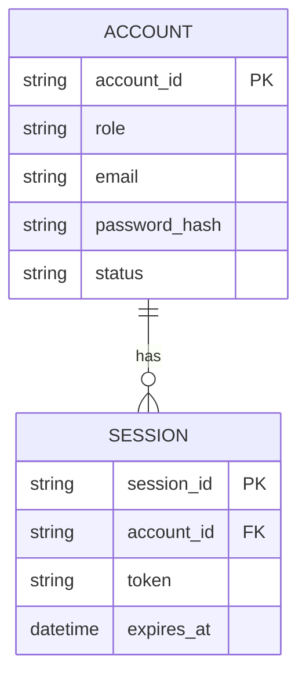
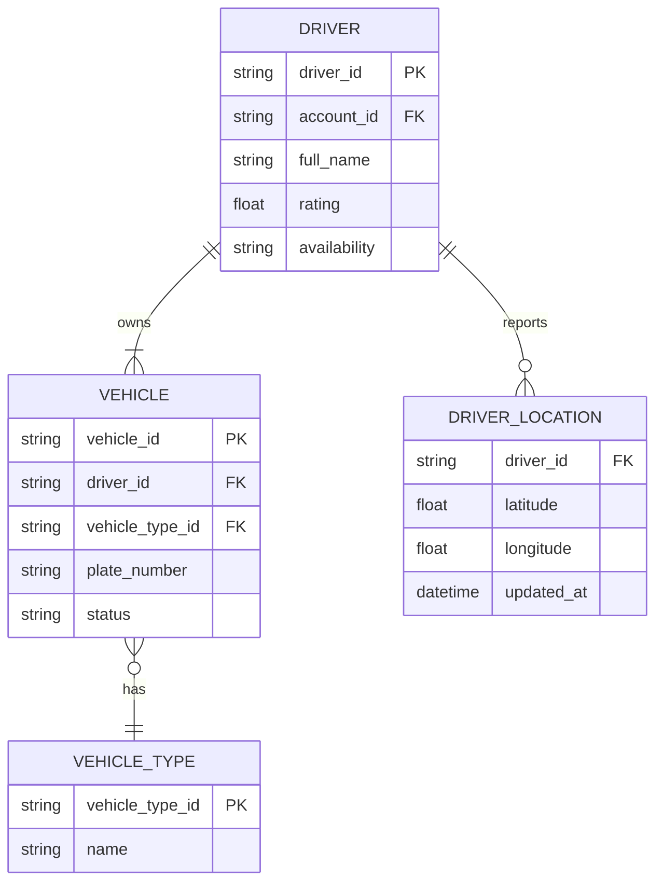
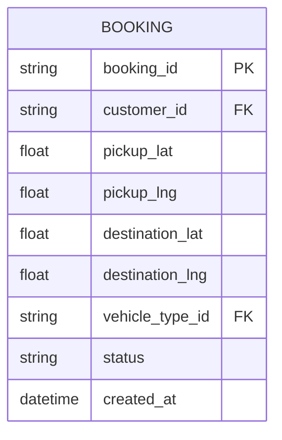
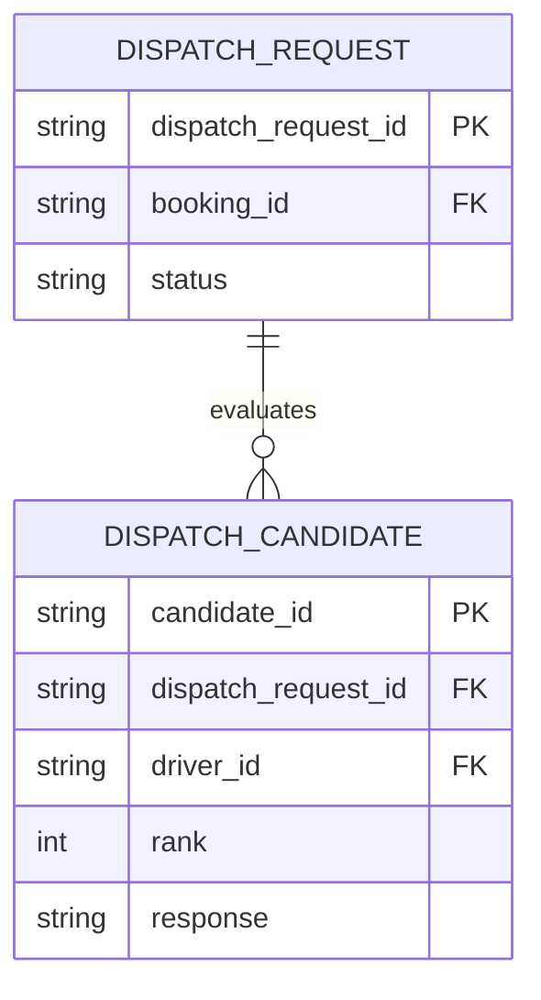
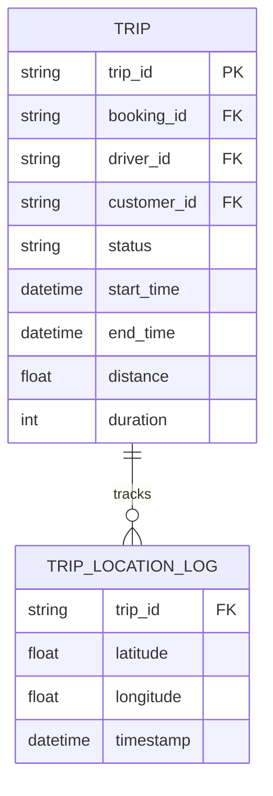
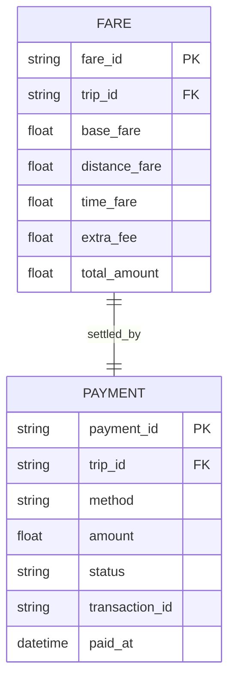
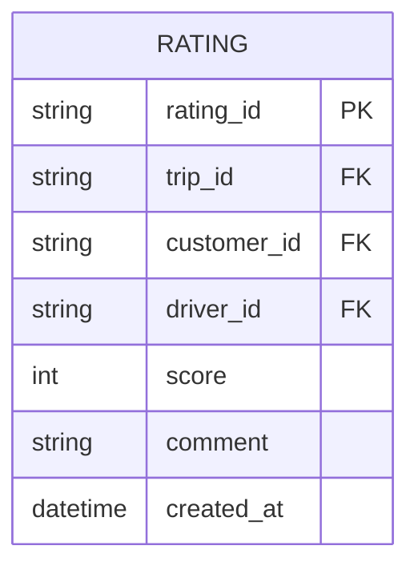
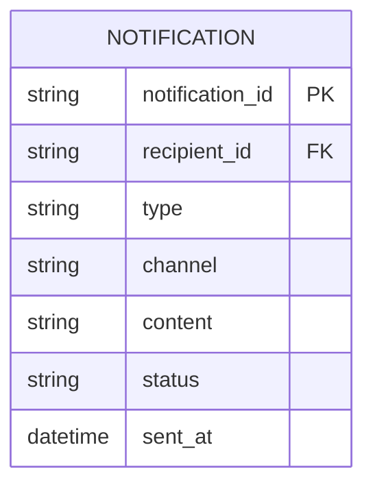
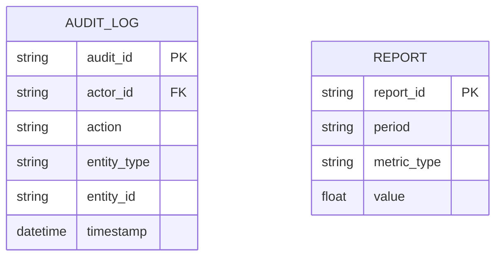
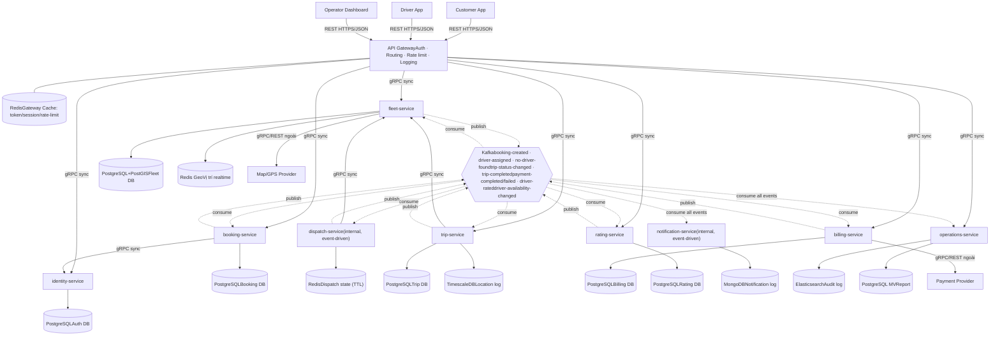

# Thiết kế DDD — Bounded Context cho hệ thống Cab Booking

9 Bounded Context, mỗi Context xác định Aggregate gốc, Ubiquitous Language và Bộ quy tắc ứng xử (invariants), dựa trên FR/BR/UC trong srs.md.

### Phân loại Subdomain

- Core Domain: Dispatch (Matching), Trip — nơi tạo lợi thế cạnh tranh (thuật toán ghép tài xế, vòng đời chuyến thời gian thực).
- Supporting Domain: Booking, Fleet Management, Billing & Payment, Rating, Operations & Reporting.
- Generic Domain: Identity & Access, Notification.

### Context Map (quan hệ giữa các Bounded Context)

| Upstream | Downstream | Kiểu quan hệ | Sự kiện tích hợp |
| --- | --- | --- | --- |
| Booking | Dispatch | Customer/Supplier | `BookingCreated` |
| Fleet Management | Dispatch | Customer/Supplier (query) | `DriverAvailabilityChanged` |
| Dispatch | Trip | Customer/Supplier | `DriverAssigned` |
| Trip | Billing & Payment | Customer/Supplier | `TripCompleted` |
| Trip | Rating | Customer/Supplier | `TripCompleted` |
| Identity & Access | Tất cả context khác | Shared Kernel hạn chế (chỉ chia sẻ account_id/role, không chia sẻ dữ liệu nội bộ) | — |
| Tất cả context | Notification | Published Language (event-driven) | mọi domain event |
| Tất cả context | Operations & Reporting | Conformist (chỉ đọc) | mọi domain event + audit |

### Bounded Context ↔ FR ↔ Workflow ↔ Business Process ↔ Microservice

| Bounded Context | FR phục vụ | Workflow / UC | Business Process | Microservice |
| --- | --- | --- | --- | --- |
| Identity & Access | FR26, FR27 | UC01–UC03 Đăng ký / Đăng nhập / Thông tin cá nhân | BP5 · Quản lý vận hành | `identity-service` |
| Fleet Management | FR28, FR29 | UC20–UC21 Quản lý tài xế & phương tiện | BP5 · Quản lý vận hành | `fleet-service` |
| Booking | FR01 | UC04–UC05 Đặt xe, xác định điểm đón | BP1 · Đặt xe & Ghép tài xế | `booking-service` |
| Dispatch | FR02–FR10 | UC06–UC09 Tìm & phân công tài xế | BP1 · Đặt xe & Ghép tài xế | `dispatch-service` |
| Trip | FR11–FR15 | UC10–UC12 Theo dõi & thực hiện chuyến | BP2 · Thực hiện & theo dõi chuyến đi | `trip-service` |
| Billing & Payment | FR16–FR20 | UC13–UC15 Tính cước & thanh toán | BP3 · Tính cước & thanh toán | `billing-service` |
| Rating | FR25 | UC17 Đánh giá tài xế | BP4 · Thông báo & chăm sóc khách hàng | `rating-service` |
| Notification | FR21–FR24 | UC16 Nhận thông báo (cắt ngang mọi UC) | BP4 · Thông báo & chăm sóc khách hàng | `notification-service` |
| Operations & Reporting | FR30, FR31, FR33, FR34 | UC22–UC24 Giám sát, xử lý sự cố, tra cứu / UC26 Báo cáo | BP5 · Quản lý vận hành | `operations-service` |

**Business Process Model** (5 quy trình nghiệp vụ tổng hợp từ FR01–FR34): BP1 Đặt xe & Ghép tài xế (FR01–10) · BP2 Thực hiện & theo dõi chuyến đi (FR11–15) · BP3 Tính cước & thanh toán (FR16–20) · BP4 Thông báo & chăm sóc khách hàng (FR21–25) · BP5 Quản lý vận hành (FR26–34).

### CSDL đề xuất theo Database-per-Service

| Microservice | Loại CSDL | Công nghệ đề xuất | Lý do chính |
| --- | --- | --- | --- |
| `identity-service` | SQL (quan hệ) | PostgreSQL / MySQL | Cần ACID, ràng buộc unique (email/phone), khối lượng ghi thấp nhưng độ nhất quán cao |
| `fleet-service` | SQL + In-memory/Geo | PostgreSQL+PostGIS (hồ sơ) · Redis Geo (vị trí realtime) | Dispatch cần truy vấn không gian nhanh; vị trí tài xế đổi liên tục, không cần ACID nghiêm ngặt |
| `booking-service` | SQL (quan hệ) | PostgreSQL / MySQL | Cấu trúc cố định, cần transaction khi chuyển trạng thái Booking |
| `dispatch-service` | NoSQL Key-Value/In-memory | Redis (TTL theo timeout phản hồi) | Dữ liệu tồn tại ngắn hạn, throughput cao, không cần lưu trữ lâu dài |
| `trip-service` | SQL + Time-series | PostgreSQL (Trip) · TimescaleDB/InfluxDB (log vị trí) | Trip cần ACID cho vòng đời trạng thái; log vị trí ghi liên tục, khối lượng lớn theo thời gian |
| `billing-service` | SQL (quan hệ) | PostgreSQL / MySQL | Giao dịch tiền bắt buộc ACID chặt chẽ, phục vụ đối soát/báo cáo tài chính |
| `rating-service` | SQL (quan hệ) | PostgreSQL | Cần tính điểm trung bình chính xác và ràng buộc duy nhất 1 rating/trip |
| `notification-service` | NoSQL Document | MongoDB | Ghi log lớn, ít quan hệ, cần mở rộng ngang dễ dàng |
| `operations-service` | NoSQL Search + OLAP | Elasticsearch (audit log) · PostgreSQL materialized view (report) | Audit cần tìm kiếm/lọc nhanh trên log lớn; report cần truy vấn tổng hợp định kỳ |

## 1. Identity & Access Generic

**Trách nhiệm:** Đăng ký, đăng nhập, xác thực và quản lý trạng thái tài khoản cho cả ba vai trò Customer/Driver/Operator. Aggregate gốc: `Account`.

### Ubiquitous Language

| Thuật ngữ | Định nghĩa |
| --- | --- |
| Account | Tài khoản đăng nhập, gắn đúng 1 Role |
| Role | Vai trò: Customer, Driver, Operator |
| Session | Phiên đăng nhập hợp lệ, có thời hạn |
| Trạng thái tài khoản | Active / Locked / Inactive |

### Bộ quy tắc ứng xử

- Mỗi Account chỉ thuộc đúng một Role, không đổi Role sau khi tạo.
- Account Locked/Inactive bị từ chối ở mọi chức năng yêu cầu xác thực (Exception UC02, NFR06).
- Mật khẩu chỉ lưu dạng băm, không bao giờ lưu plaintext (NFR08).
- Session hết hạn phải xác thực lại trước khi thực hiện hành động tiếp theo (NFR06).

Sự kiện phát ra: `AccountRegistered`, `AccountLoggedIn`, `AccountLocked`

### Microservice: `identity-service`

- **Kho dữ liệu riêng:** accounts_db (account_id, role, password_hash, status)
- **API chính:** `POST /auth/register`, `POST /auth/login`, `GET /accounts/:id`, `PATCH /accounts/:id/status`
- **Giao tiếp:** đồng bộ (REST/JWT) — mọi service khác xác thực qua token, không truy vấn trực tiếp accounts_db

### Entity & ERD

**CSDL:** PostgreSQL/MySQL — quan hệ, cần ACID cho đăng ký/khóa tài khoản và ràng buộc unique trên email/phone.

## 2. Fleet Management Supporting

**Trách nhiệm:** Quản lý hồ sơ tài xế, phương tiện và trạng thái sẵn sàng theo thời gian thực. Aggregate gốc: `DriverProfile` (liên kết `Vehicle`).

### Ubiquitous Language

| Thuật ngữ | Định nghĩa |
| --- | --- |
| Driver | Tài xế đã đăng ký, gắn với ít nhất một Vehicle |
| Vehicle / VehicleType | Phương tiện và loại xe (Sedan, SUV, 4 chỗ, 7 chỗ) |
| Trạng thái sẵn sàng | Available / Busy / Offline — tách biệt với trạng thái tài khoản |

### Bộ quy tắc ứng xử

- Driver chỉ đủ điều kiện nhận chuyến khi Account Active, Availability = Available và Vehicle đang hoạt động (BRULE01, BRULE02).
- Vị trí (current_latitude/longitude) được cập nhật liên tục khi Driver đang hoạt động (FR13).

Sự kiện phát ra: `DriverAvailabilityChanged`, `DriverLocationUpdated`

### Microservice: `fleet-service`

- **Kho dữ liệu riêng:** fleet_db (drivers, vehicles, vehicle_types, trạng thái sẵn sàng)
- **API chính:** `GET /drivers?available=true&area=..`, `PATCH /drivers/:id/availability`, `POST /drivers/:id/location`, `GET /vehicles/:id`
- **Giao tiếp:** Dispatch gọi đồng bộ để truy vấn ứng viên; tự phát sự kiện bất đồng bộ khi vị trí/trạng thái đổi

### Entity & ERD

**CSDL:** PostgreSQL+PostGIS cho Driver/Vehicle (hồ sơ ổn định, cần join, index không gian); Redis Geo cho vị trí hiện tại (ghi liên tục, đọc rất nhanh cho Dispatch, không cần lưu lịch sử lâu dài).

## 3. Booking Supporting

**Trách nhiệm:** Tiếp nhận yêu cầu đặt xe từ Customer. Aggregate gốc: `Booking`.

### Ubiquitous Language

| Thuật ngữ | Định nghĩa |
| --- | --- |
| Booking | Yêu cầu đặt xe: điểm đón, điểm đến, loại xe |
| Điểm đón / Điểm đến | Tọa độ + địa chỉ xác định bằng GPS hoặc nhập tay (FR01) |

### Bộ quy tắc ứng xử

- Chỉ Customer đã xác thực mới tạo được Booking (Precondition UC04).
- Booking bắt buộc đủ điểm đón, điểm đến, loại xe hợp lệ trước khi chuyển trạng thái (AC01, AC02).
- Booking không tự tìm tài xế — chỉ phát sự kiện để Dispatch xử lý (tách trách nhiệm giữa hai context).

Sự kiện phát ra: `BookingCreated`

### Microservice: `booking-service`

- **Kho dữ liệu riêng:** booking_db (booking_id, customer_id, pickup, destination, vehicle_type_id, status)
- **API chính:** `POST /bookings`, `GET /bookings/:id`, `PATCH /bookings/:id` (cập nhật điểm đón/đến trước xác nhận)
- **Giao tiếp:** gọi `identity-service` để xác thực Customer; phát `BookingCreated` bất đồng bộ cho `dispatch-service`

### Entity & ERD

**CSDL:** PostgreSQL/MySQL — một entity duy nhất, cấu trúc cố định, cần transaction khi chuyển trạng thái (PENDING → SEARCHING_DRIVER → NO_DRIVER_FOUND).

## 4. Dispatch (Matching) Core

**Trách nhiệm:** Tìm và gán tài xế phù hợp cho một Booking. Aggregate gốc: `DispatchRequest`.

### Ubiquitous Language

| Thuật ngữ | Định nghĩa |
| --- | --- |
| Ứng viên tài xế | Driver Available, đúng loại xe, trong khu vực phù hợp điểm đón |
| Xếp hạng ứng viên | Thứ tự ưu tiên gửi yêu cầu, theo khoảng cách |
| Yêu cầu nhận chuyến | Lời mời gửi tới một tài xế tại một thời điểm |
| Timeout phản hồi | Thời gian tối đa tài xế phải chấp nhận/từ chối |

### Bộ quy tắc ứng xử

- Chỉ xét ứng viên Available, đúng loại xe, đúng khu vực (BRULE01, BRULE02, FR02–FR04).
- Gửi yêu cầu tuần tự theo xếp hạng, không gửi đồng thời nhiều tài xế (BRULE03).
- Từ chối hoặc hết Timeout → chuyển ứng viên kế tiếp (BRULE04–BRULE06).
- Hết danh sách ứng viên mà chưa có ai chấp nhận → kết thúc với `NoDriverFound` (BRULE07).
- Mỗi Booking chỉ được gán đúng một Driver duy nhất, kể cả khi nhiều Driver accept gần như đồng thời.

Nhận: `BookingCreated` · Phát ra: `DriverAssigned`, `NoDriverFound`

### Microservice: `dispatch-service`

- **Kho dữ liệu riêng:** dispatch_db (dispatch_request_id, booking_id, danh sách ứng viên, trạng thái yêu cầu)
- **API chính:** nội bộ — không expose cho client; consumer của `BookingCreated`, publisher của `DriverAssigned`/`NoDriverFound`
- **Giao tiếp:** gọi đồng bộ `fleet-service` để lấy ứng viên/khoảng cách; bất đồng bộ (event) với Booking, Trip, Notification

### Entity & ERD

**CSDL:** Redis (key-value, TTL theo thời gian timeout phản hồi) — dữ liệu chỉ tồn tại trong lúc ghép tài xế, throughput cao, không cần lưu trữ lâu dài; có thể archive bất đồng bộ sang kho log để phục vụ Operations.

## 5. Trip Core

**Trách nhiệm:** Quản lý vòng đời và theo dõi thời gian thực của một chuyến đi đã có tài xế. Aggregate gốc: `Trip`.

### Ubiquitous Language

| Thuật ngữ | Định nghĩa |
| --- | --- |
| Trạng thái chuyến | ACCEPTED → ARRIVED → PICKED_UP → IN_PROGRESS → COMPLETED |
| ETA | Thời gian dự kiến tài xế đến điểm đón (FR15) |

### Bộ quy tắc ứng xử

- Trip được tạo ngay khi nhận sự kiện `DriverAssigned`.
- Trạng thái chỉ chuyển theo đúng thứ tự vòng đời, không cho phép nhảy cóc (Main Flow UC11).
- Chỉ Driver được gán cho Trip mới có quyền cập nhật trạng thái của Trip đó.
- Khi chuyển COMPLETED, phải có đủ end_time/distance/duration hợp lệ trước khi phát sự kiện cho Billing (NFR14).

Nhận: `DriverAssigned` · Phát ra: `TripStatusChanged`, `TripCompleted`

### Microservice: `trip-service`

- **Kho dữ liệu riêng:** trip_db (trip_id, driver_id, trạng thái, vị trí theo thời gian thực, distance, duration)
- **API chính:** `GET /trips/:id`, `PATCH /trips/:id/status`, `POST /trips/:id/location` (stream WebSocket/MQTT cho vị trí)
- **Giao tiếp:** consumer của `DriverAssigned`; phát `TripCompleted` bất đồng bộ cho Billing & Rating

### Entity & ERD

**CSDL:** PostgreSQL cho Trip (cần ACID cho vòng đời trạng thái tuần tự); TimescaleDB/InfluxDB cho TRIP_LOCATION_LOG (ghi liên tục mỗi vài giây, truy vấn theo thời gian, khối lượng lớn).

## 6. Billing & Payment Supporting

**Trách nhiệm:** Tính cước và xử lý thanh toán. Aggregate gốc: `Fare`, `Payment`.

### Ubiquitous Language

| Thuật ngữ | Định nghĩa |
| --- | --- |
| Fare | base_fare + distance_fare + time_fare + extra_fee |
| Payment | Giao dịch CASH hoặc ELECTRONIC |
| Payment Provider | Bên thứ ba xử lý thanh toán điện tử |

### Bộ quy tắc ứng xử

- Fare chỉ được tính sau khi Trip COMPLETED (BRULE08).
- Payment không lưu thông tin thẻ/tài khoản nhạy cảm, chỉ lưu transaction_id tham chiếu (BRULE09, NFR09).
- Thanh toán thất bại cho phép thực hiện lại theo chính sách, không tự hủy Trip (BRULE10).

Nhận: `TripCompleted` · Phát ra: `FareCalculated`, `PaymentCompleted`, `PaymentFailed`

### Microservice: `billing-service`

- **Kho dữ liệu riêng:** billing_db (fares, payments, transaction_id — không lưu dữ liệu thẻ)
- **API chính:** `POST /payments`, `GET /payments/:trip_id`, `POST /payments/:id/retry`
- **Giao tiếp:** consumer của `TripCompleted`; gọi đồng bộ Payment Provider (bên ngoài); phát kết quả bất đồng bộ cho Notification & Operations

### Entity & ERD

Ghi chú: `trip_id` chỉ là reference sang `trip-service`, không JOIN vật lý xuyên service. **CSDL:** PostgreSQL/MySQL — giao dịch tiền bắt buộc ACID, cần join/tổng hợp cho đối soát và báo cáo tài chính.

## 7. Rating Supporting

**Trách nhiệm:** Ghi nhận đánh giá của Customer dành cho Driver. Aggregate gốc: `Rating`.

### Ubiquitous Language

| Thuật ngữ | Định nghĩa |
| --- | --- |
| Rating | Đánh giá gồm score và comment, gắn với đúng một Trip |
| Điểm trung bình | Giá trị tổng hợp từ mọi Rating của một Driver |

### Bộ quy tắc ứng xử

- Chỉ tạo Rating khi Trip đã COMPLETED (Precondition UC17).
- Mỗi Trip chỉ được đánh giá đúng một lần, bởi đúng Customer đã thực hiện chuyến (BRULE11).
- Rating mới phải cập nhật lại điểm trung bình của đúng Driver liên quan.

Nhận: `TripCompleted` · Phát ra: `DriverRated`

### Microservice: `rating-service`

- **Kho dữ liệu riêng:** rating_db (rating_id, trip_id, customer_id, driver_id, score, comment)
- **API chính:** `POST /ratings`, `GET /drivers/:id/ratings`
- **Giao tiếp:** consumer của `TripCompleted`; phát `DriverRated` để `fleet-service` cập nhật rating trung bình của Driver

### Entity & ERD

**CSDL:** PostgreSQL — cần ràng buộc duy nhất 1 rating/trip_id và tính trung bình rating chính xác, nhất quán (phục vụ `fleet-service`).

## 8. Notification Generic

**Trách nhiệm:** Chuyển sự kiện từ các Bounded Context khác thành thông điệp gửi tới đúng người nhận. Aggregate gốc: `Notification`.

### Ubiquitous Language

| Thuật ngữ | Định nghĩa |
| --- | --- |
| Notification | Thông điệp về trạng thái Booking/Trip/Payment |
| Channel | Kênh gửi (in-app, SMS...) |

### Bộ quy tắc ứng xử

- Context này không sở hữu nghiệp vụ nào, chỉ lắng nghe sự kiện và chuyển thành thông điệp (FR21–FR24).
- Lỗi khi gửi Notification không được làm gián đoạn hoạt động của context nguồn phát sự kiện (NFR05).

Nhận: `BookingCreated`, `DriverAssigned`, `TripStatusChanged`, `PaymentCompleted/Failed`

### Microservice: `notification-service`

- **Kho dữ liệu riêng:** notification_db (chỉ log gửi, không sở hữu dữ liệu nghiệp vụ)
- **API chính:** không expose nghiệp vụ — chỉ là consumer bất đồng bộ của mọi domain event, đẩy tin qua kênh app/SMS
- **Giao tiếp:** hoàn toàn bất đồng bộ (message queue), lỗi ở đây không được chặn các service nguồn

### Entity & ERD

**CSDL:** MongoDB — dữ liệu dạng log, ghi rất nhiều, gần như không JOIN, cần mở rộng ngang dễ dàng theo lưu lượng thông báo.

## 9. Operations & Reporting Supporting

**Trách nhiệm:** Giám sát vận hành, ghi nhật ký và tổng hợp báo cáo cho Operator. Aggregate gốc: `AuditLog`, `Report`.

### Ubiquitous Language

| Thuật ngữ | Định nghĩa |
| --- | --- |
| Giám sát chuyến | Operator theo dõi/can thiệp Trip đang diễn ra (FR30, FR31) |
| Audit Log | Nhật ký ghi lại hành động thay đổi trạng thái quan trọng |
| Báo cáo hoạt động | Tổng hợp số liệu Booking/Trip/Payment/Driver theo kỳ (FR33) |

### Bộ quy tắc ứng xử

- Operator chỉ xem/can thiệp dữ liệu theo đúng quyền hạn được phân (NFR07).
- Mọi thay đổi trạng thái quan trọng (Trip, Payment, Account) phải được ghi vào Audit Log (FR34, NFR10).
- Context này chỉ đọc dữ liệu tổng hợp từ sự kiện của các context khác, không chỉnh sửa dữ liệu nghiệp vụ gốc.

### Microservice: `operations-service`

- **Kho dữ liệu riêng:** ops_db (audit_log, báo cáo tổng hợp — read model dựng từ event của các service khác)
- **API chính:** `GET /trips?status=..` (giám sát), `GET /audit-logs`, `GET /reports?from=..&to=..`
- **Giao tiếp:** consumer bất đồng bộ của mọi domain event (CQRS read-model); không gọi ngược vào service nghiệp vụ gốc

### Entity & ERD

**CSDL:** Elasticsearch cho AUDIT_LOG (tìm kiếm/lọc nhanh trên log lớn); PostgreSQL materialized view cho REPORT (truy vấn tổng hợp định kỳ theo Booking/Trip/Payment/Driver).

## 10. Kiến trúc Microservice tổng thể

Áp dụng đúng mô hình đã học: Client gọi **REST API** qua **API Gateway** (xác thực, định tuyến, rate limit, log — cache tại Redis); Gateway gọi các service bằng **gRPC (đồng bộ)**; các service gọi nhau bằng **gRPC (đồng bộ)** khi cần dữ liệu ngay; giao tiếp giữa các Bounded Context chủ yếu qua **Kafka (bất đồng bộ)** theo domain event đã thiết kế ở mục 3; mỗi service có **CSDL riêng**.

| Microservice | Expose qua Gateway | Gọi đồng bộ (gRPC) tới | Kafka publish | Kafka consume |
| --- | --- | --- | --- | --- |
| `identity-service` | Có (REST→gRPC) | — | — | — |
| `fleet-service` | Có | Map/GPS Provider (ngoài) | `driver-availability-changed` | `driver-rated` |
| `booking-service` | Có | identity-service | `booking-created` | `no-driver-found` |
| `dispatch-service` | Không (nội bộ) | fleet-service | `driver-assigned`, `no-driver-found` | `booking-created`, `driver-availability-changed` |
| `trip-service` | Có | fleet-service | `trip-status-changed`, `trip-completed` | `driver-assigned` |
| `billing-service` | Có | Payment Provider (ngoài) | `payment-completed`, `payment-failed` | `trip-completed` |
| `rating-service` | Có | — | `driver-rated` | `trip-completed` |
| `notification-service` | Không (nội bộ) | — | — | tất cả event trên |
| `operations-service` | Có (chỉ Operator) | — | — | tất cả event trên |

**Chú thích:** REST API (Client ↔ Gateway) · gRPC đồng bộ (Gateway ↔ service, service ↔ service khi cần trả lời ngay) · Kafka bất đồng bộ (giao tiếp giữa các Bounded Context theo domain event) · mỗi service kết nối đúng một CSDL riêng (Database-per-Service).