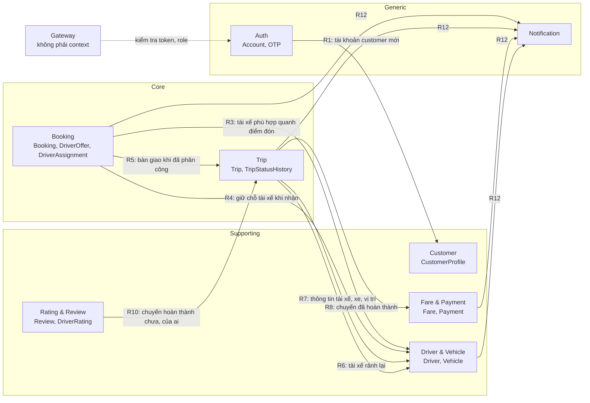
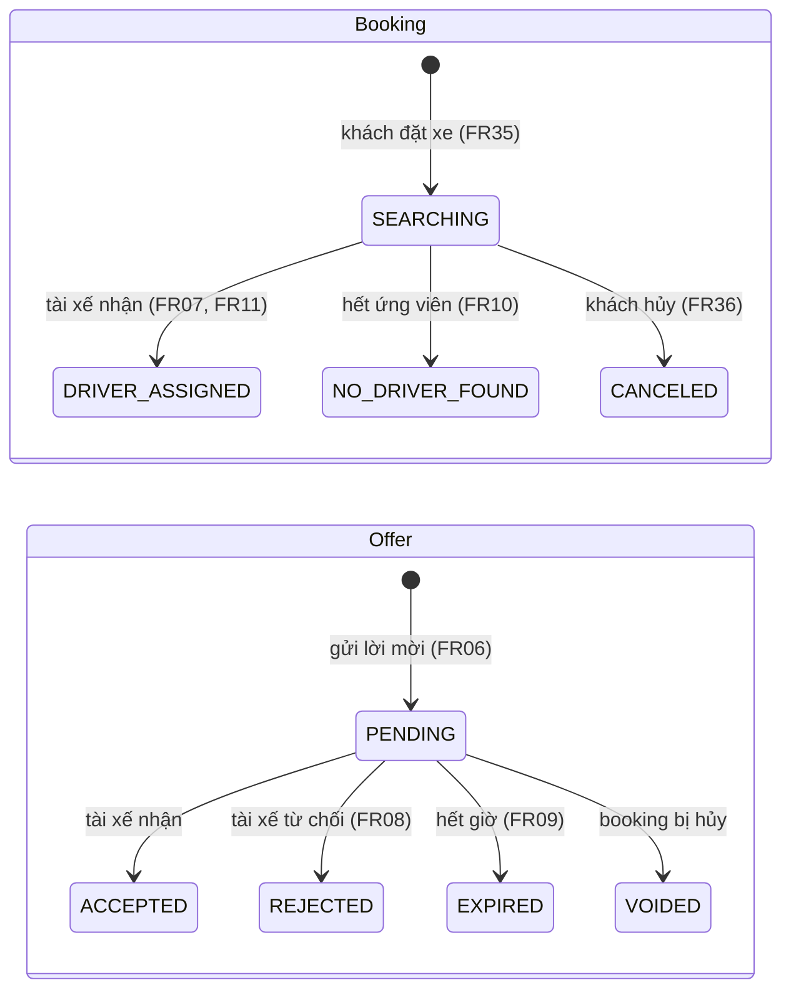
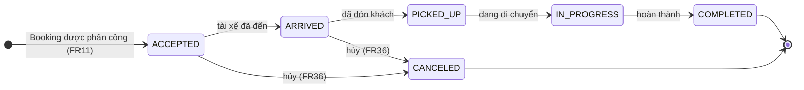

# 01 — Bounded context của Cab Booking System

> Vòng 1 (chỉ BA), bản sửa 2026-10-02 theo **danh sách 8 service giảng viên chốt** (`CLAUDE.md`).
> Nguồn: `srs.md`, `CLAUDE.md`, `docs/study/00-ban-do-phieu-cham.md`, `docs/study/01-nghiep-vu-va-truy-vet.md`; mốc so sánh: `docs/reference/thiet-ke-da-duyet.md`.
> File này trả lời: **chia hệ thống thành những phần nào, mỗi phần sở hữu gì, vì sao**. gRPC hay Kafka cho từng quan hệ: file 02. Loại database, schema: file 03.
> Tên trạng thái viết HOA là **đề xuất**, trừ các tên đã có trong SRS (`NO_DRIVER_FOUND`, `CANCELED`, `FAILED`, Online/Offline, "chờ duyệt"). Tên chính thức chốt ở spec.

## 1. Tóm tắt

| # | Bounded context | Loại subdomain | Microservice | Aggregate gốc |
|---|---|---|---|---|
| 1 | Identity & Access (Auth) | Generic | `auth-service` | Account, OtpVerification |
| 2 | Customer | Supporting | `customer-service` | CustomerProfile |
| 3 | Driver & Vehicle | Supporting | `driver-service` | Driver (gồm Vehicle, hồ sơ đăng ký, vị trí), VehicleType |
| 4 | Booking (gồm ghép tài xế) | **Core** | `booking-service` | Booking (gồm DriverOffer, DriverAssignment) |
| 5 | Trip | **Core** | `trip-service` | Trip (gồm TripStatusHistory) |
| 6 | Fare & Payment | Supporting | `payment-service` | Fare, Payment |
| 7 | Notification | Generic | `notification-service` | Notification |
| 8 | Rating & Review | Supporting | `review-service` | Review, DriverRating (điểm tổng hợp) |

Tổng: **8 service nghiệp vụ + Gateway**. Gateway không phải bounded context: không có mô hình nghiệp vụ, chỉ xác thực token, kiểm tra role, rate limit, routing, log (`CLAUDE.md`).

Thay đổi so với bản nháp trước (7 service: auth, customer, driver, ride, dispatch, payment, notification):

| Thay đổi | Lý do ngắn | ADR |
|---|---|---|
| `ride-service` → tách `booking-service` + `trip-service` | Giảng viên chốt. Ranh giới: thời điểm tài xế nhận chuyến | ADR-006 (thay ADR-002) |
| `dispatch-service` → bỏ; ghép tài xế nằm trong `booking-service` | Giảng viên chốt. Hủy và nhận cùng lúc thành một giao dịch cục bộ | ADR-006 (thay ADR-003) |
| Rating → `review-service` riêng | Giảng viên chốt; mục chấm 20 | ADR-006 (thay ADR-002) |
| Auth, Customer, Driver, Payment, Notification | Giữ nguyên | ADR-001 |

So sánh với thiết kế tham chiếu đã được duyệt: bảng "Khác với thiết kế tham chiếu" ở file 02, mục 10.

## 2. Phân loại subdomain

| Subdomain | Loại | Lý do | Truy vết |
|---|---|---|---|
| Đặt xe và ghép tài xế (Booking) | Core | Lợi thế cạnh tranh: nhận yêu cầu và tìm đúng tài xế, nhanh. 7/12 BRULE (01–07) nằm ở đây; quy tắc ghép là của riêng doanh nghiệp, không mua sẵn được | BG01, BR01, BR02, NFR02 |
| Chuyến đi (Trip) | Core | Là dịch vụ doanh nghiệp bán. Sai trình tự trạng thái là sai cước, sai đánh giá | BG03, BR03, BR07, BR09 |
| Tài xế & phương tiện | Supporting | Cần có để ghép được (BRULE01, 02) nhưng tự nó không tạo khác biệt; nghiệp vụ là quản lý hồ sơ và duyệt | BG02, BR06, BR08 |
| Khách hàng | Supporting | Hồ sơ cá nhân, CRUD đơn giản, phục vụ core | BG03, BR05 |
| Cước & thanh toán | Supporting | **Bảng giá** là quy tắc riêng của doanh nghiệp nên không phải generic; **xử lý giao dịch thẻ** giao cho Payment Provider (BRULE09) | BG04, BR04, BR12 |
| Đánh giá | Supporting | Một quy tắc (BRULE11), phục vụ chất lượng dịch vụ | BG03, BR11 |
| Xác thực & tài khoản | Generic | Bài toán giống mọi hệ thống (đăng nhập, băm mật khẩu, JWT, OTP) | BG05, NFR06, NFR07 |
| Thông báo | Generic | Gửi tin theo sự kiện; thực tế mua dịch vụ ngoài (Notification Provider trong SRS) | BR10, NFR05, NFR13 |

Ý nghĩa khi vấn đáp: **core** là nơi đầu tư thiết kế kỹ nhất (máy trạng thái, bất biến, test); **generic** làm đơn giản nhất có thể.

## 3. Ranh giới Booking — Trip

Đây là ranh giới dễ bị hỏi nhất. Một câu: **Booking là "khách muốn đi và hệ thống đang tìm người chở"; Trip là "đã có người chở và chuyến đang diễn ra"**. Mốc chuyển là lúc tài xế nhận chuyến (FR07).

| | Booking | Trip |
|---|---|---|
| Câu hỏi nó trả lời | Khách yêu cầu gì? Đã hỏi những tài xế nào? Ai nhận? | Chuyến đang ở bước nào? Ai đổi trạng thái, lúc nào, vì sao? |
| Sở hữu | Yêu cầu đặt xe (điểm đón, điểm đến, loại xe, phương thức thanh toán); **DriverOffer** (lời mời, hạn trả lời, kết quả); **DriverAssignment** (tài xế nào được phân công, lúc nào) | **Trip** (bản chụp điều khoản lúc bàn giao + trạng thái + mốc thời gian + quãng đường, thời lượng); **TripStatusHistory**; lý do hủy chuyến |
| Tác nhân chính | Khách (đặt, hủy khi chưa có tài xế); tài xế (nhận / từ chối lời mời); hệ thống (đếm giờ) | Tài xế (cập nhật trạng thái); khách (theo dõi, hủy); admin (giám sát, can thiệp) |
| Kết thúc khi | `DRIVER_ASSIGNED`, `NO_DRIVER_FOUND` hoặc `CANCELED` | `COMPLETED` hoặc `CANCELED` |
| Hủy (FR36) | Hủy **yêu cầu** khi còn đang tìm tài xế | Hủy **chuyến** sau khi đã có tài xế |
| BRULE | BRULE01–07 | BRULE08 (chỉ báo "hoàn thành" khi thật sự hoàn thành); trình tự trạng thái (mục chấm 17) |
| Mục chấm | 14, 15, 16, 18 (hủy khi đang tìm) | 16 (Trip được tạo), 17, 18 |

**Dữ liệu chuyển từ Booking sang Trip lúc nào, bằng cách nào:**

| Điểm | Nội dung |
|---|---|
| Lúc nào | Đúng một lần: khi tài xế nhận lời mời và Booking chuyển `DRIVER_ASSIGNED` |
| Cái gì | Bản chụp: `booking_id`, `customer_id`, `driver_id`, `vehicle_type`, tọa độ điểm đón và điểm đến, `payment_method`, thời điểm phân công |
| Bằng cách nào | Booking phát một sự kiện "đã phân công tài xế"; Trip nghe và tạo Trip ở trạng thái đầu. Chi tiết và lý do: file 02 (K3), ADR-007 |
| Sau bàn giao | Booking **không đổi nữa**. Trip không sửa Booking, Booking không sửa Trip. Hai bên chỉ tham chiếu nhau bằng `booking_id` |
| Một Booking — mấy Trip | Nhiều nhất một (Trip có `booking_id` duy nhất) |
| Vì sao Trip giữ bản chụp | Trip phải tự tính quãng đường, tự báo cho Payment loại xe và phương thức thanh toán khi hoàn thành mà không hỏi lại Booking (NFR05: Booking dừng thì chuyến đang chạy vẫn hoàn thành được) |

## 4. Sơ đồ quan hệ giữa các context (mức khái niệm)

Mũi tên `A --> B` nghĩa là **A cần biết một điều gì đó từ B hoặc báo cho B**. Đây chưa phải gRPC hay Kafka; file 02 quyết định từng đường. Bốn quan hệ đã xét và **quyết định không nối** (R2, R9, R11, R13) chỉ có trong bảng, không vẽ.

| Mã | Bên cần | Cần biết gì từ bên nào | Vì yêu cầu nào | Bên cần có phải chờ kết quả mới làm tiếp không? |
|---|---|---|---|---|
| R1 | Customer | Auth vừa tạo tài khoản `customer` (account_id) để có hồ sơ tương ứng | FR26, FR27; mục 9, 11 | Có (tạm) — Q3 |
| R2 | Driver | Tài xế đã qua OTP và account_id | FR39; mục 21 | **Không nối**: token đã mang `account_id` và role `driver` — Q4 |
| R3 | Booking | Danh sách tài xế sẵn sàng, đúng loại xe, trong 1 km, kèm khoảng cách | FR02–FR05, BRULE01–03 | Có: không có danh sách thì không gửi lời mời được |
| R4 | Booking | Tài xế vừa bấm nhận **còn rảnh không**; nếu còn thì giữ chỗ (chuyển sang bận) | BRULE01, FR07, NFR14 | Có: chưa chắc tài xế còn rảnh thì không được xác nhận phân công |
| R5 | Trip | Booking nào vừa có tài xế, kèm bản chụp (mục 3) | FR07, FR11, FR12 | Không: Booking đã xong phần việc của mình khi ghi nhận phân công |
| R6 | Driver | Chuyến của tài xế đã kết thúc hoặc bị hủy → rảnh lại | BRULE01 | Không: Trip không cần chờ Driver ghi xong |
| R7 | Trip | Tên tài xế, biển số, loại xe, vị trí hiện tại | FR13–FR15; UC10, UC22 | Có: cần dữ liệu để trả lời khách ngay |
| R8 | Payment | Chuyến hoàn thành: quãng đường, thời lượng, loại xe, phương thức thanh toán, khách, tài xế | FR16, BRULE08 | Không: NFR05 — Payment lỗi không được chặn việc kết thúc chuyến |
| R9 | Trip | Chuyến đã được thanh toán hay chưa | NFR14; mục 19 | **Không nối** (tạm) — Q6 |
| R10 | Review | Chuyến có ở trạng thái hoàn thành không, của khách nào, tài xế nào | BRULE11, FR25; mục 20 | Có: chưa biết thì không được nhận đánh giá |
| R11 | Driver | Điểm đánh giá trung bình của tài xế | UC17 bước 5 | **Không nối**: điểm tổng hợp do Review sở hữu — Q28 |
| R12 | Notification | Sự kiện cần báo: đặt xe được nhận, có lời mời, tài xế nhận chuyến, không tìm được tài xế, hủy, đổi trạng thái chuyến, kết quả thanh toán, kết quả duyệt hồ sơ | FR06, FR10, FR21–FR24, FR36, AC16, AC20 | Không: NFR05 — Notification lỗi không được chặn đặt xe |
| R13 | Booking | Kết cục của chuyến (hoàn thành / hủy) để hiện trong danh sách booking | FR37 | **Không nối**: Booking kết thúc ở `DRIVER_ASSIGNED` — Q27 |

Cặp **không có quan hệ**: Customer với mọi context trừ Auth; Auth với mọi context trừ Customer; Payment ↔ Booking, Driver, Review; Review ↔ Booking, Driver, Notification; Notification không gọi ai (chỉ nhận). Danh sách đầy đủ kèm lý do: file 02, mục 9.

## 5. Thuật ngữ mang nghĩa khác nhau giữa các context

Đây là lý do chính để vẽ ranh giới: cùng một từ, mỗi context hiểu một kiểu.

| Thuật ngữ | Auth | Customer | Driver | Booking | Trip | Payment | Review |
|---|---|---|---|---|---|---|---|
| **Khách hàng** | Account có role `customer` | Hồ sơ cá nhân | — | Người đặt (`customer_id`) | Hành khách của chuyến | Người trả tiền | Người chấm điểm |
| **Tài xế** | Account có role `driver` | — | Hồ sơ, giấy phép, xe, trạng thái duyệt, trạng thái nhận chuyến, vị trí | **Ứng viên** (`driver_id` + khoảng cách), rồi người được phân công | Người thực hiện chuyến, được đổi trạng thái | — | Người được chấm |
| **Trạng thái** | Tài khoản: hoạt động / bị khóa | — | Hai trạng thái riêng: **duyệt hồ sơ** và **nhận chuyến** (Offline / Online / bận) | Trạng thái Booking; trạng thái Offer | Trạng thái Trip | Trạng thái Payment: chờ / thành công / `FAILED` | — |
| **Yêu cầu** | — | — | — | **Booking**: yêu cầu đặt xe (FR35). **Offer**: lời mời nhận chuyến gửi cho một tài xế (FR06) | — | Yêu cầu thanh toán gửi Provider | — |
| **Hoàn thành** | — | — | — | Không có: Booking kết thúc khi đã phân công | Tài xế xác nhận đã đến nơi | Giao dịch thành công | Điều kiện để được đánh giá |
| **Hủy** | — | — | — | Hủy yêu cầu khi đang tìm; hủy luôn Offer đang chờ | Hủy chuyến đã có tài xế, kèm lý do | — | — |
| **Loại xe** | — | — | **Danh mục gốc** VehicleType | Loại khách chọn; điều kiện lọc (mã) | Bản chụp (mã) | Khóa tra bảng giá (mã) | — |

`vehicle_type` là mã dùng chung giữa các context (published language). Driver sở hữu danh mục; các context khác chỉ giữ mã, không giữ khóa ngoại.

## 6. Chi tiết từng bounded context

### 6.1 Auth — Identity & Access

| Mục | Nội dung |
|---|---|
| Trách nhiệm | Tạo tài khoản; kiểm tra thông tin đăng nhập; cấp token chứa `account_id` và `role`; xác thực số điện thoại bằng OTP; giữ role của tài khoản |
| **Không** làm | Không giữ hồ sơ cá nhân (họ tên, ngày sinh, giấy phép lái xe). Không biết gì về booking, chuyến, tiền |
| Ngôn ngữ chung | **Account**: danh tính đăng nhập (định danh + mật khẩu đã băm + role + trạng thái). **Role**: `customer` / `driver` / `admin`. **Token**: JWT cấp sau khi đăng nhập. **OTP**: mã dùng một lần chứng minh sở hữu số điện thoại. **Khóa**: tài khoản bị chặn đăng nhập |
| Aggregate gốc | **Account**; **OtpVerification** |
| FR / UC | FR26, FR32, FR39 (phần OTP) / UC01, UC02, UC25 (phần gán role), UC29 (bước OTP) |
| Mục chấm | 9, 10, 21 (OTP), 24, 25; cung cấp token và role cho mục 27, 28 |

| # | Quy tắc | Nguồn |
|---|---|---|
| A1 | Đăng ký công khai chỉ tạo role `customer` | `CLAUDE.md` — đã chốt |
| A2 | Định danh đăng nhập (số điện thoại / email) là duy nhất | UC02; mục 9 (đường lỗi "trùng") |
| A3 | Tài khoản bị khóa thì từ chối đăng nhập | Exception của UC02, NFR06 |
| A4 | Không lưu mật khẩu dạng rõ; không trả mật khẩu / băm ra ngoài | NFR08, mục 24 |
| A5 | Token mang role; mọi thao tác quản trị dựa vào role này | BRULE12, NFR07, FR32 |
| A6 | OTP có hạn dùng và chỉ dùng một lần; tài khoản `driver` chỉ được tạo sau khi OTP đúng | FR39, mục 21 |
| A7 | Tài khoản `admin` không tạo qua API công khai (tạo sẵn bằng seed) | BRULE12 — **suy đoán**, Q8 |

### 6.2 Customer

| Mục | Nội dung |
|---|---|
| Trách nhiệm | Giữ và cho xem / sửa hồ sơ cá nhân của khách hàng; cho tra cứu khách hàng theo mã |
| **Không** làm | Không giữ mật khẩu, không đăng nhập. Không giữ booking của khách (thuộc Booking) |
| Ngôn ngữ chung | **CustomerProfile**: thông tin cá nhân của một khách. **Mã khách hàng**: định danh hồ sơ, tham chiếu tới Account bằng ID |
| Aggregate gốc | **CustomerProfile** |
| FR / UC | FR27; FR26 (phần tạo hồ sơ khi đăng ký) / UC03; UC01 (phần hồ sơ); UC19 |
| Mục chấm | 11; 9 (đăng ký xong phải có hồ sơ); 24; 26 (họ tên là text do người dùng nhập) |

| # | Quy tắc | Nguồn |
|---|---|---|
| C1 | Mỗi tài khoản `customer` có đúng một hồ sơ | FR26, FR27 |
| C2 | Khách chỉ xem / sửa hồ sơ của chính mình; `admin` xem được mọi hồ sơ | NFR08, NFR16, BRULE12 — Q9 |
| C3 | Dữ liệu cá nhân được bảo vệ khi lưu | NFR08, NFR16, mục 24 |

### 6.3 Driver & Vehicle

| Mục | Nội dung |
|---|---|
| Trách nhiệm | Hồ sơ tài xế và phương tiện; quy trình đăng ký — duyệt hồ sơ; trạng thái nhận chuyến Online / Offline / bận; vị trí hiện tại; trả lời "tài xế nào sẵn sàng, đúng loại xe, quanh tọa độ này"; trả lời "tài xế này còn rảnh không" và giữ chỗ |
| **Không** làm | Không quyết định hỏi tài xế nào trước, không gửi lời mời, không đếm giờ (thuộc Booking). Không giữ mật khẩu |
| Ngôn ngữ chung | **Hồ sơ tài xế**. **Trạng thái duyệt**: chờ duyệt / đã duyệt / bị từ chối. **Trạng thái nhận chuyến**: Offline, Online (= Available/Ready của BRULE01), bận (đang giữ cho một booking / chuyến). **Vehicle**, **VehicleType**. **Vị trí hiện tại**. **Giữ chỗ**: chuyển Online → bận cho đúng một `booking_id` |
| Aggregate gốc | **Driver** (gồm Vehicle, trạng thái duyệt, trạng thái nhận chuyến, vị trí hiện tại); **VehicleType** (danh mục) |
| FR / UC | FR28, FR29, FR38, FR39; FR02, FR03, FR04 (thực hiện truy vấn); FR13 / UC12, UC20, UC21, UC28, UC29, UC30 |
| Mục chấm | 12, 13, 21, 22, 23; 24 (số giấy phép, số điện thoại) |

| # | Quy tắc | Nguồn |
|---|---|---|
| D1 | Chỉ tài xế đang Online **và không bận** mới xuất hiện trong kết quả tìm | BRULE01, FR38, AC03 |
| D2 | Kết quả tìm chỉ gồm tài xế có xe đúng loại yêu cầu | BRULE02, FR03, AC04 |
| D3 | Kết quả tìm nằm trong bán kính (mặc định 1 km), kèm khoảng cách, sắp từ gần đến xa, có limit và paging | FR02, FR04, mục 13 |
| D4 | Hồ sơ mới tạo luôn ở trạng thái chờ duyệt | FR39, AC19 |
| D5 | Chỉ `admin` được duyệt / từ chối; chỉ hồ sơ đang chờ duyệt mới duyệt / từ chối được | BRULE12, FR39, AC20 |
| D6 | Chỉ tài xế đã được duyệt mới bật Online được | **Suy ra** từ FR39 + BRULE01 — Q10 |
| D7 | Biển số xe không trùng | FR29 — **suy đoán**, chốt ở file 03 |
| D8 | **Một tài xế tại một thời điểm chỉ bị giữ cho nhiều nhất một booking.** Giữ chỗ chỉ thành công khi tài xế đang Online và không bận; giữ lặp cho cùng `booking_id` trả kết quả như lần đầu | BRULE01, NFR14 |
| D9 | Tài xế chỉ rảnh lại khi chuyến của **đúng** booking đang giữ kết thúc hoặc bị hủy | BRULE01 |

Vì sao Driver và Vehicle chung một context (giảng viên cho gộp): BRULE01 và BRULE02 cần **cùng lúc** trạng thái, loại xe và vị trí trong một truy vấn (mục chấm 13). Khách chỉ chọn **loại xe**, không chọn xe cụ thể, nên Vehicle không có vòng đời riêng ngoài tài xế. Chỉ tách khi khách được tự chọn xe.

SRS có entity `DriverLocation` (lịch sử vị trí). Mục chấm chỉ cần **vị trí hiện tại** (mục 13). Có lưu lịch sử hay không: file 03 (Q11).

### 6.4 Booking — Đặt xe và ghép tài xế (core)

| Mục | Nội dung |
|---|---|
| Trách nhiệm | Nhận yêu cầu đặt xe; danh sách booking của khách; **ghép tài xế**: lấy ứng viên, hỏi **lần lượt** từ gần đến xa, đếm giờ phản hồi, xử lý nhận / từ chối / hết giờ, kết luận "đã phân công" hoặc "không tìm được"; hủy yêu cầu khi đang tìm; bàn giao cho Trip |
| **Không** làm | Không giữ hồ sơ, vị trí, trạng thái nhận chuyến của tài xế (hỏi Driver). Không giữ trạng thái chuyến sau khi phân công (Trip). Không tính tiền |
| Ngôn ngữ chung | **Booking**: yêu cầu đặt xe — điểm đón, điểm đến, loại xe, phương thức thanh toán. **Đang tìm tài xế**. **Ứng viên**: tài xế thỏa điều kiện, kèm khoảng cách. **Offer (lời mời)**: gửi cho một tài xế, có hạn trả lời. **Hết giờ**. **Đã loại**: tài xế từ chối hoặc hết giờ, không hỏi lại cho booking này. **Phân công (DriverAssignment)**: tài xế đã nhận. **`NO_DRIVER_FOUND`**. **`CANCELED`** |
| Aggregate gốc | **Booking** (gồm danh sách DriverOffer và nhiều nhất một DriverAssignment) |
| FR | FR01, FR05–FR10, FR11 (lưu phân công), FR35, FR36 (khi đang tìm), FR37; khởi phát FR02–FR04 |
| UC | UC04, UC05, UC06, UC07, UC08, UC09, UC18, UC27 (khi đang tìm) |
| Mục chấm | 14, 15, 16, 18 (hủy khi đang tìm); 26 (địa chỉ, lý do hủy) |

| # | Quy tắc | Nguồn |
|---|---|---|
| B1 | Thiếu điểm đón, điểm đến, loại xe hoặc phương thức thanh toán thì không tạo Booking | FR35, AC01, AC02 |
| B2 | Booking mới luôn ở trạng thái đang tìm tài xế; khách **không chờ** ghép xong | FR35, NFR01 |
| B3 | Chỉ gửi Offer cho tài xế sẵn sàng, đúng loại xe | BRULE01, BRULE02, AC03, AC04 |
| B4 | Trong các ứng viên, tài xế gần điểm đón nhất được hỏi trước | BRULE03, FR05, AC05 |
| B5 | Mỗi Offer có hạn trả lời; quá hạn thì coi là không phản hồi | BRULE04, BRULE06, FR09, AC08 |
| B6 | Tài xế từ chối hoặc hết giờ thì bị loại, việc tìm **tiếp tục** với người kế tiếp, Booking không bị hủy | BRULE05, BRULE06, FR08, AC07 |
| B7 | Hết ứng viên thì Booking chuyển `NO_DRIVER_FOUND` và khách phải được báo | BRULE07, FR10, AC09, UC06 |
| B8 | Mỗi Booking có nhiều nhất một Offer được nhận; nhận rồi thì chuyển `DRIVER_ASSIGNED` và ngừng tìm | FR07, AC06, NFR14 |
| B9 | Chỉ tài xế được mời mới trả lời được Offer đó; Offer đã hết giờ hoặc đã trả lời thì không trả lời lại được | BRULE04, NFR07 |
| B10 | Tại một thời điểm mỗi Booking chỉ có một Offer đang chờ; một tài xế chỉ có một Offer đang chờ | BRULE03 ("gửi … trước") — **diễn giải**, Q12 |
| B11 | Chỉ xác nhận phân công khi Driver đã giữ chỗ được tài xế (D8) | BRULE01, NFR14 |
| B12 | Hủy và nhận xảy ra cùng lúc: bên nào ghi vào Booking trước thì thắng; bên sau nhận lỗi "đã đổi trạng thái" | FR36, FR07, NFR14 |
| B13 | Hủy phải kèm lý do; chỉ hủy được Booking đang tìm. Đã phân công thì phải hủy **chuyến** (Trip) | FR36, AC16 — Q29 |
| B14 | Khách chỉ thấy booking của chính mình; danh sách có limit và paging | FR37, AC17, NFR08 |

B12 là lợi ích trực tiếp của việc đưa ghép tài xế vào Booking: Booking, Offer và Assignment nằm trong một database nên tranh chấp hủy — nhận được giải quyết bằng một giao dịch cục bộ, không cần hai service thống nhất với nhau.

Thời hạn trả lời (BRULE04 ghi "do doanh nghiệp quy định") chưa có con số: Q12.

### 6.5 Trip — Chuyến đi (core)

| Mục | Nội dung |
|---|---|
| Trách nhiệm | Tạo Trip khi Booking được phân công; giữ vòng đời chuyến đến khi hoàn thành hoặc hủy; ghi lịch sử từng lần đổi trạng thái; xác định quãng đường và thời lượng; cho khách theo dõi chuyến; hủy chuyến; cho `admin` giám sát và can thiệp chuyến lỗi; trả lời "chuyến này đã hoàn thành chưa, của ai" |
| **Không** làm | Không tìm tài xế, không gửi lời mời (Booking). Không tính tiền (Payment). Không giữ đánh giá (Review) |
| Ngôn ngữ chung | **Trip**: chuyến đi thực tế, chỉ tồn tại sau khi có tài xế nhận. **Đã nhận / đã đến / đã đón khách / đang di chuyển / hoàn thành**: năm trạng thái của FR12. **Lịch sử trạng thái**: ai đổi, từ gì sang gì, lúc nào, lý do. **Hủy chuyến**: `CANCELED` kèm lý do |
| Aggregate gốc | **Trip** (gồm TripStatusHistory) |
| FR | FR11 (tạo chuyến), FR12, FR14, FR15, FR30, FR31, FR36 (sau khi có tài xế); FR34 (lịch sử chuyến) |
| UC | UC10, UC11, UC22, UC23, UC27 (sau khi có tài xế) |
| Mục chấm | 16 (Trip được tạo), 17, 18; 26 (lý do hủy) |

| # | Quy tắc | Nguồn |
|---|---|---|
| T1 | Trip chỉ được tạo từ một Booking đã phân công; mỗi `booking_id` nhiều nhất một Trip | FR07, FR11, AC06, NFR14 |
| T2 | Trạng thái chỉ đi theo đúng trình tự, không nhảy cóc, không lùi | FR12, mục 17 — SRS chưa có BRULE riêng (Q10) |
| T3 | Chỉ tài xế của chuyến mới cập nhật được trạng thái | BRULE12 (tinh thần), NFR07 |
| T4 | Mọi lần đổi trạng thái đều ghi một dòng lịch sử (ai, từ đâu sang đâu, lúc nào, lý do) | FR34, NFR10 |
| T5 | Hủy phải kèm lý do; chuyến đã hoàn thành hoặc đã hủy thì không hủy được. Hủy được đến trạng thái nào, ai được hủy: Q7 | FR36, AC16 |
| T6 | Chỉ báo "hoàn thành" ra ngoài khi Trip thật sự ở trạng thái hoàn thành; kèm quãng đường và thời lượng do Trip xác định | BRULE08, FR16 |
| T7 | Khách chỉ xem được chuyến của mình, tài xế chỉ xem chuyến mình chạy; `admin` xem mọi chuyến và can thiệp chuyến lỗi | NFR08, BRULE12, FR30, FR31, AC15 |

### 6.6 Fare & Payment

| Mục | Nội dung |
|---|---|
| Trách nhiệm | Tính cước sau khi chuyến hoàn thành; ghi nhận thanh toán tiền mặt; gửi yêu cầu thanh toán điện tử và nhận kết quả (callback) từ Payment Provider; cho thanh toán lại khi thất bại; lưu giao dịch để tra cứu, đối soát; chống xử lý lặp |
| **Không** làm | Không lưu số thẻ / tài khoản ngân hàng. Không giữ trạng thái chuyến |
| Ngôn ngữ chung | **Fare**: cước của một chuyến. **Bảng giá**: quy tắc tính theo loại xe. **Payment**: thanh toán cho một chuyến. **Phương thức**: tiền mặt / điện tử, khách chọn lúc đặt xe. **Callback (webhook)**. **Khóa chống lặp (idempotency key)**. **Retry** |
| Aggregate gốc | **Fare** (một cho mỗi Trip); **Payment** |
| FR / UC | FR16–FR20; FR34 (lịch sử giao dịch) / UC13, UC14, UC15, UC24 |
| Mục chấm | 19, 30; 24 (dữ liệu giao dịch) |

| # | Quy tắc | Nguồn |
|---|---|---|
| M1 | Chỉ tính cước khi chuyến đã hoàn thành; mỗi chuyến một Fare. Chưa có Fare thì không thanh toán được | BRULE08, FR16 |
| M2 | Không lưu thông tin thẻ / tài khoản; chỉ lưu mã giao dịch của Provider | BRULE09, NFR09, FR20 |
| M3 | Giao dịch thất bại vẫn phải được lưu với trạng thái `FAILED` và khách được báo | BRULE10, FR19, AC13 |
| M4 | Thất bại thì được thanh toán lại theo chính sách | FR19, UC15, AC13 — Q13 |
| M5 | Cùng một yêu cầu / callback gửi lại thì trả đúng kết quả cũ, không trừ tiền lần hai | Mục 30, NFR14 — SRS chưa có FR/BRULE riêng (Q10) |
| M6 | Một chuyến chỉ có nhiều nhất một Payment thành công | NFR14 |
| M7 | Phương thức thanh toán lấy theo lựa chọn lúc đặt xe | FR35, `CLAUDE.md` — đã chốt |

Fare và Payment chung một context: UC14 có tiền điều kiện "đã tính cước"; hai thứ luôn đi liền và cùng thuộc trách nhiệm đối soát. Payment Provider là hệ thống ngoài; giả lập hay sandbox thật: Q14.

### 6.7 Notification

| Mục | Nội dung |
|---|---|
| Trách nhiệm | Nghe các sự kiện nghiệp vụ, tạo thông báo cho đúng người nhận, cho người dùng xem thông báo của mình |
| **Không** làm | Không quyết định nghiệp vụ. Không context nào chờ Notification |
| Ngôn ngữ chung | **Notification**: một tin gửi cho một người (người nhận, loại, tiêu đề, nội dung, trạng thái). **Người nhận**: `account_id`. **Kênh**: trong ứng dụng / SMS / email |
| Aggregate gốc | **Notification** |
| FR / UC | FR21–FR24; phần "thông báo" của FR06, FR10, FR11, FR19, FR36 / UC16 |
| Mục chấm | 16, 18 (vế "các bên được báo"); 22 (AC20); nơi nhìn thấy event rõ nhất cho mục 7 |

| # | Quy tắc | Nguồn |
|---|---|---|
| N1 | Notification lỗi không được làm hỏng đặt xe, chuyến, thanh toán | NFR05, NFR15 |
| N2 | Người dùng chỉ xem được thông báo của mình | NFR08 |
| N3 | Không tìm được tài xế thì khách **phải** có thông báo | BRULE07, AC09 |
| N4 | Cùng một sự kiện nhận hai lần thì không tạo hai thông báo | NFR14 |

Kênh gửi thật (SMS / email / push) cần Notification Provider. Đề xuất: chỉ lưu thông báo trong ứng dụng và cho xem qua API — Q14.

### 6.8 Rating & Review

| Mục | Nội dung |
|---|---|
| Trách nhiệm | Nhận điểm và nhận xét của khách cho một chuyến đã hoàn thành; lưu Review **gắn với `trip_id`**; giữ điểm trung bình của từng tài xế; cho xem đánh giá của một chuyến và điểm của một tài xế |
| **Không** làm | Không giữ trạng thái chuyến: muốn biết chuyến đã hoàn thành chưa thì hỏi Trip |
| Ngôn ngữ chung | **Review**: một lần đánh giá cho một chuyến (điểm + nhận xét). **Điểm trung bình (DriverRating)**: số tổng hợp của một tài xế, tính từ các Review |
| Aggregate gốc | **Review**; **DriverRating** |
| FR / UC | FR25 / UC17 |
| Mục chấm | 20 ("Review được lưu và liên kết với chuyến đi"); 26 (nhận xét là text tự do) |

| # | Quy tắc | Nguồn |
|---|---|---|
| V1 | Chỉ đánh giá chuyến đã hoàn thành | BRULE11, AC14 |
| V2 | Chỉ khách của chính chuyến đó được đánh giá | BRULE11 ("khách hàng đã hoàn thành chuyến") |
| V3 | Mỗi chuyến chỉ một đánh giá | Exception của UC17 |
| V4 | Điểm nằm trong thang cho phép | UC17 bước 3 — thang 1–5 là **suy đoán**, chốt ở spec mục 20 |
| V5 | Lưu Review và cập nhật điểm trung bình của tài xế trong cùng một giao dịch | UC17 bước 4–5, NFR14 |

## 7. Context → microservice

### 7.1 Vì sao mỗi context là một service riêng

Danh sách do giảng viên chốt; bảng này ghi **lý do nghiệp vụ** để sinh viên tự giải thích được, và đánh đổi phải chấp nhận.

| Context → service | Lý do nghiệp vụ là context riêng | Đánh đổi |
|---|---|---|
| Auth → `auth-service` | Phục vụ cả ba role; "khách hàng" ở đây là một Account có role, không phải hồ sơ. Mật khẩu tách khỏi dữ liệu cá nhân (NFR08, mục 24). ADR-001 | Đăng ký khách chạm hai service (ADR-004) |
| Customer → `customer-service` | Hồ sơ chỉ của khách; đối xứng với hồ sơ tài xế ở Driver; hay thêm trường, còn xác thực thì ổn định | Service nhỏ (1 FR, 1–2 mục chấm) |
| Driver & Vehicle → `driver-service` | BRULE01, BRULE02 cần trạng thái, loại xe, vị trí trong **một** truy vấn (mục 13). Xe không có vòng đời riêng ngoài tài xế | Vị trí cập nhật rất thường xuyên, hồ sơ thì hiếm; hai kiểu tải nằm chung |
| Booking → `booking-service` | Giai đoạn "chưa có tài xế": ngôn ngữ riêng (ứng viên, Offer, hết giờ), 7/12 BRULE, có việc chạy nền đếm giờ. Ghép tài xế nằm chung vì Offer chỉ có nghĩa với một Booking và hủy — nhận phải nhất quán (B12). ADR-006 | Thuật toán ghép đổi thì triển khai lại cả service nhận booking; việc chạy nền và việc phục vụ request nằm chung |
| Trip → `trip-service` | Giai đoạn "đã có tài xế": tác nhân khác (tài xế điều khiển), quy tắc khác (trình tự trạng thái, lịch sử), nhịp khác (kéo dài cả chuyến). Booking dừng thì chuyến đang chạy vẫn hoàn thành được (NFR05). ADR-006 | Một chuyến xe nằm ở hai service: phải bàn giao (ADR-007); có hai thao tác hủy; danh sách booking không tự hiện kết cục chuyến (Q27) |
| Fare & Payment → `payment-service` | NFR05 nêu đích danh Payment. Dữ liệu tiền cần kiểm soát riêng (NFR09, BRULE09) | Cước có sau khi hoàn thành một chút, không tức thì |
| Notification → `notification-service` | NFR05 nêu đích danh Notification. Chỉ nghe sự kiện, không ai chờ | Thêm một service và một database cho chức năng đơn giản |
| Rating & Review → `review-service` | Đánh giá xảy ra **sau** khi chuyến đã đóng, do khách làm, không ảnh hưởng vòng đời chuyến. Mục chấm 20 chấm riêng việc lưu và liên kết Review với chuyến. Lỗi ở đây không được ảnh hưởng chuyến đang chạy. ADR-006 | Một service cho 1 FR, 1 mục chấm; phải hỏi Trip để kiểm tra BRULE11 |

### 7.2 Tên cũ → tên mới

| Tên trong `docs/study/` | Tên trong bản nháp trước | Tên trong thiết kế này |
|---|---|---|
| Identity | `auth-service` + `customer-service` | `auth-service` + `customer-service` |
| Fleet | `driver-service` | `driver-service` |
| Booking | `ride-service` | `booking-service` |
| Dispatch | `dispatch-service` | trong `booking-service` (DriverOffer, DriverAssignment) |
| Trip | `ride-service` | `trip-service` |
| Rating | module trong `ride-service` | `review-service` |
| Payment, Notification | giữ nguyên | giữ nguyên |
| Operations | không có | không có; xem 7.3 |

Thuật ngữ đổi theo: DispatchRequest (phiên ghép) → không còn aggregate riêng, là phần "đang tìm" của Booking; Rating → Review; quy tắc P1–P9 → B3–B12; R-1…R-10 → B1, B2, B13, B14 và T1–T7; G1–G4 → V1–V4.

### 7.3 Phần vận hành của Admin (FR30, FR31, FR33, FR34)

Giảng viên đã bỏ `report-service` và `audit-service`. **Phiếu chấm không có mục nào chấm trực tiếp FR30, FR31, FR33, FR34** (`01-nghiep-vu-va-truy-vet.md` mục 3.5: "Không có trong phiếu"). Thao tác của `admin` mà phiếu chấm cần chỉ là duyệt hồ sơ (mục 22, FR39) và một route chỉ dành cho admin để minh họa 403 (mục 28) — cả hai đã nằm ở `driver-service`.

| FR | Phiếu chấm cần? | Đặt ở | Nội dung |
|---|---|---|---|
| FR30 Giám sát chuyến | Không (AC15 có trong SRS) | `trip-service`, role `admin` | Danh sách chuyến lọc theo trạng thái. Booking đang tìm tài xế: `booking-service`, role `admin` |
| FR31 Xử lý chuyến lỗi | Không | `trip-service`, role `admin` | `admin` hủy chuyến bị treo; dùng chung thao tác hủy và ghi lịch sử (T4) |
| FR33 Báo cáo | Không | **Không làm** trong phạm vi 30 mục | Cần tổng hợp dữ liệu của Trip và Payment; không có service nào được phép đọc database của service khác — Q1 |
| FR34 Lịch sử, Audit Log | Không | Phân tán, mỗi service ghi phần của mình | Lịch sử chuyến: TripStatusHistory (T4). Lịch sử ghép: các Offer của Booking. Giao dịch: `payment-service`. Ai duyệt hồ sơ, lúc nào: `driver-service`. Request: log của Gateway. Không có audit tập trung — Q2 |

Thứ tự làm: FR30, FR31 sau khi xong 30 mục chấm (Q32).

## 8. Kiểm tra độ phủ

### 8.1 FR01–FR39

| FR | Context chính | Tham gia | Ghi chú |
|---|---|---|---|
| FR01 Xác định vị trí khách | Booking | — | Client gửi tọa độ điểm đón; không tích hợp Map/GPS Provider (Q14) |
| FR02 Tìm tài xế sẵn có | Driver | Booking (bên hỏi) | Mục 13 |
| FR03 Lọc theo loại xe | Driver | Booking | |
| FR04 Tính khoảng cách | Driver | Booking | |
| FR05 Xếp hạng theo khoảng cách | Booking | Driver (trả danh sách đã sắp) | Booking chịu trách nhiệm quy tắc "ai được hỏi trước" |
| FR06 Gửi yêu cầu nhận chuyến | Booking | Notification | |
| FR07 Tài xế chấp nhận | Booking | Driver (giữ chỗ), Trip (tạo chuyến) | |
| FR08 Tài xế từ chối | Booking | — | |
| FR09 Tài xế không phản hồi | Booking | — | |
| FR10 Báo không tìm được tài xế | Booking | Notification | |
| FR11 Xác nhận tài xế cho chuyến | Booking (lưu phân công) | Trip (tạo Trip), Notification | |
| FR12 Cập nhật trạng thái chuyến | Trip | — | |
| FR13 Theo dõi vị trí tài xế | Driver | Trip (hiển thị) | |
| FR14 Hiển thị thông tin chuyến | Trip | Driver | |
| FR15 Thời gian dự kiến đến | Trip | Driver | Ngoài phiếu chấm; ước lượng đơn giản — Q11 |
| FR16 Tính cước | Payment | Trip (dữ liệu chuyến) | |
| FR17 Thanh toán tiền mặt | Payment | — | Q13 |
| FR18 Thanh toán điện tử | Payment | — | |
| FR19 Thanh toán thất bại | Payment | Notification | |
| FR20 Lưu giao dịch | Payment | — | |
| FR21 Thông báo đặt xe | Notification | Booking | |
| FR22 Thông báo tài xế nhận chuyến | Notification | Booking | |
| FR23 Thông báo trạng thái chuyến | Notification | Trip | |
| FR24 Thông báo thanh toán | Notification | Payment | |
| FR25 Đánh giá tài xế | Review | Trip (kiểm tra BRULE11) | |
| FR26 Đăng ký và đăng nhập | Auth | Customer (hồ sơ) | |
| FR27 Hồ sơ khách hàng | Customer | — | |
| FR28 Hồ sơ tài xế | Driver | — | |
| FR29 Phương tiện | Driver | — | |
| FR30 Giám sát chuyến | Trip | Booking | Role `admin`; ngoài phiếu chấm |
| FR31 Xử lý chuyến lỗi | Trip | — | Role `admin`; ngoài phiếu chấm |
| FR32 Phân quyền | Auth (giữ role) | Gateway (kiểm tra) | Mục 28 |
| FR33 Báo cáo | **Không gán** | — | Q1 |
| FR34 Lịch sử, Audit Log | Phân tán | Trip, Booking, Payment, Driver | Gán một phần — Q2 |
| FR35 Tạo yêu cầu đặt xe | Booking | — | |
| FR36 Hủy yêu cầu / hủy chuyến | Booking (đang tìm); Trip (đã có tài xế) | Driver, Notification | Mục 18 |
| FR37 Danh sách booking | Booking | — | Mục 14 |
| FR38 Bật / tắt nhận chuyến | Driver | — | Mục 23 |
| FR39 Đăng ký và duyệt hồ sơ tài xế | Driver | Auth (OTP, tài khoản), Notification | Mục 21, 22 |

Kết quả: 37/39 FR có context chính. **FR33 không gán; FR34 gán một phần.** Cả hai ngoài 30 mục chấm.

### 8.2 30 mục chấm

| # | Nội dung | Thuộc về | Ghi chú |
|---|---|---|---|
| 1 | Kiến trúc tổ chức source code | Hạ tầng / tài liệu | File này + cấu trúc thư mục trong `CLAUDE.md` |
| 2 | `.gitignore`, `.env` | Hạ tầng | |
| 3 | Nhiệm vụ Gateway | Gateway | File 02 |
| 4 | IPC giữa các microservice | Toàn hệ thống | File 02 |
| 5 | Compose, liệt kê container | Hạ tầng | |
| 6 | `/health`, `/ready`, `/health/services` | Gateway | Cả 8 service phải trả lời được health |
| 7 | Kafka | Hạ tầng + Booking, Trip, Payment, Driver (phát); Trip, Driver, Payment, Notification (nghe) | File 02 |
| 8 | Mọi request qua Gateway | Gateway / Compose | |
| 9 | Đăng ký khách hàng → đăng nhập được | Auth, Customer | |
| 10 | Đăng nhập → token | Auth | |
| 11 | Xem khách hàng theo mã | Customer | |
| 12 | Xem tài xế theo mã | Driver | |
| 13 | Tài xế quanh tọa độ 1 km | Driver | |
| 14 | Booking của khách, limit + paging | Booking | |
| 15 | Đặt xe → tìm tài xế → gửi offer | Booking, Driver; Notification | |
| 16 | Tài xế nhận chuyến | Booking, Driver (giữ chỗ), Trip (tạo chuyến), Notification | |
| 17 | Trạng thái chuyến đúng trình tự | Trip | |
| 18 | Hủy chuyến → `CANCELED`, các bên được báo | Trip (đã có tài xế), Booking (đang tìm); Driver, Notification | |
| 19 | Thanh toán online + callback → COMPLETED | Payment | Q6 |
| 20 | Đánh giá chuyến | Review; Trip | |
| 21 | Đăng ký tài xế (OTP) → chờ duyệt | Auth, Driver | |
| 22 | Admin duyệt / từ chối | Driver; Notification | |
| 23 | Tài xế bật / tắt nhận chuyến | Driver | |
| 24 | Mã hóa dữ liệu nhạy cảm + quản lý khóa | Cắt ngang: Auth, Customer, Driver, Payment | NFR08, NFR16; trường nào: file 03 |
| 25 | SQL injection | Cắt ngang; demo tại Auth (đăng nhập) | Quy ước code trong `CLAUDE.md` |
| 26 | XSS | Cắt ngang: Customer, Driver, Booking, Trip, Review | Xử lý ở đâu: file 02 / 04 |
| 27 | JWT bị sửa → 401 | Gateway (Auth cấp token) | |
| 28 | Sai quyền → 403 | Gateway (Auth giữ role) | |
| 29 | Spam → 429 | Gateway | |
| 30 | Replay thanh toán → response cũ | Payment | |

Kết quả: **30/30 mục có nơi nhận.** Mỗi service trong 8 service gánh ít nhất một mục.

### 8.3 Mục chấm chưa có mã yêu cầu trong `srs.md`

| Mục chấm / quy tắc | Hiện bám vào | Thiếu |
|---|---|---|
| 17 (đúng trình tự) — T2 | FR12 | BRULE về thứ tự trạng thái |
| 29 (rate limit) | Không NFR nào nói về giới hạn tần suất (gần nhất: NFR04) | NFR mới |
| 30 (replay thanh toán) — M5 | NFR14 | BRULE / FR về chống xử lý lặp |
| 24, 26 | NFR08, NFR16 | Đủ ở mức NFR; chưa có AC |
| 6, 7, 8 | Quy tắc kiến trúc trong `CLAUDE.md` | Không cần FR (hạ tầng) |
| "Chỉ tài xế đã duyệt mới Online" — D6 | Suy ra từ FR39 | BRULE mới |
| "Một tài xế chỉ bị giữ cho một booking" — D8 | BRULE01, NFR14 | Có thể ghi rõ thành BRULE mới |

Chưa thêm mã mới vào `srs.md` trong vòng này; xem Q10.

## 9. Câu hỏi còn mở

Loại: **SV** = sinh viên tự quyết được; **GV** = nên hỏi giảng viên. Q17–Q26 và Q33–Q36 nằm ở file 02.

| # | Câu hỏi | Lựa chọn | Đề xuất | Hỏi ai |
|---|---|---|---|---|
| Q1 | FR33 (báo cáo) có làm không? | (a) Không làm, ghi rõ ngoài phạm vi; (b) một API thống kê đơn giản trong `trip-service` (chỉ số chuyến, không có doanh thu) | (a) — không mục chấm nào cần, giảng viên đã bỏ report-service | SV |
| Q2 | FR34 Audit Log làm đến mức nào? | (a) Mỗi service tự ghi phần của mình (7.3); (b) thêm bảng nhật ký thao tác admin ở từng service | (a) | SV |
| Q3 | Đăng ký khách chạm hai service. Nếu bước hai lỗi thì sao? | (a) Auth báo sự kiện, Customer tạo hồ sơ sau; (b) tạo đồng bộ, lỗi thì hoàn tác; (c) hồ sơ tạo khi khách cập nhật lần đầu | (b) — ADR-004; mục 11 cần hồ sơ có ngay sau mục 9 | GV |
| Q4 | Tài xế chờ duyệt có đăng nhập được không? | (a) Được, nhưng không bật Online được (D6); (b) không được — Auth phải biết kết quả duyệt | (a) — ít phụ thuộc hơn | SV |
| Q5 | Tài xế nhận Offer bằng cách nào khi không có push thật? | (a) Tài xế gọi API xem Offer đang chờ, kèm thông báo; (b) chỉ qua thông báo | (a). Vế "hủy và nhận cùng lúc" **đã đóng**: quy tắc B12 | SV |
| Q6 | Mục 19 "callback → COMPLETED": COMPLETED là trạng thái của **giao dịch** hay của **chuyến / booking**? | (a) Của Payment; (b) của chuyến — khi đó cần thêm một mốc sau "hoàn thành" | (a); cần xem nguyên văn phiếu chấm | GV |
| Q7 | Khách hủy chuyến được đến trạng thái nào? Tài xế có được hủy không? | (a) Khách hủy được trước khi đón khách; (b) bất cứ lúc nào trước khi hoàn thành | (a); tài xế không hủy, gặp sự cố thì `admin` xử lý (FR31) | SV |
| Q8 | Tài khoản `admin` tạo bằng cách nào? UC25 có cần API quản lý role không? | (a) Seed sẵn, role cố định 3 giá trị; (b) API đổi role | (a) | SV |
| Q9 | Mục 11, 12: role nào được xem hồ sơ của người khác? | (a) Chỉ chính chủ và `admin`; (b) tài xế xem được khách của chuyến mình và ngược lại | (a) | SV |
| Q10 | Có thêm mã mới vào `srs.md` cho các quy tắc ở 8.3 không? | (a) Thêm BRULE13–16 và NFR17, cập nhật RTM; (b) giữ nguyên | (a); BA thêm khi được đồng ý | SV |
| Q11 | FR15 (ETA) và lịch sử vị trí làm đến đâu? | (a) ETA = khoảng cách đường thẳng / tốc độ trung bình; chỉ lưu vị trí hiện tại; (b) lưu cả lịch sử | (a) | SV |
| Q12 | Thời hạn tài xế trả lời Offer là bao lâu? Hỏi lần lượt hay phát cho nhiều người cùng lúc? | 15–30 giây; lần lượt theo BRULE03 | Lần lượt; thời hạn là biến cấu hình, đặt ngắn khi demo | SV |
| Q13 | Tiền mặt: ai xác nhận đã thu? Thanh toán lại tối đa mấy lần? | Tài xế xác nhận / tự ghi nhận khi hoàn thành; 3 lần / không giới hạn | Tài xế xác nhận; tối đa 3 lần | SV |
| Q14 | Ba hệ thống ngoài (Payment, Map/GPS, Notification Provider) có tích hợp thật không? | (a) Giả lập cả ba; (b) sandbox thật cho Payment | (a) | GV |
| Q15 | ~~Tách Dispatch khỏi Ride?~~ | — | **Đã đóng**: giảng viên chốt ghép tài xế nằm trong `booking-service` | — |
| Q16 | Bảng Entity trong `srs.md` để `password_hash` ở cả Customer, Driver, Operator; thiết kế đưa về Account. Có sửa SRS không? | (a) Sửa SRS; (b) giữ, ghi chú dẫn sang file 03 | (a), làm cùng file 03 | SV |
| Q27 | Booking có cần biết kết cục của Trip (hoàn thành / hủy) để danh sách booking (mục 14) hiện trạng thái cuối không? | (a) Không: Booking dừng ở `DRIVER_ASSIGNED`, client xem chuyến qua API của Trip; (b) Booking nghe sự kiện của Trip và ghi trạng thái cuối | (a) — bớt một đường nối. Chọn (b) thì file 02 thêm `booking-service` vào subscriber của K6 | SV |
| Q28 | Điểm trung bình của tài xế nằm ở đâu? | (a) Ở Review, xem qua API của Review; (b) Review phát sự kiện, Driver ghi vào hồ sơ để mục 12 hiện luôn điểm | (a) — không yêu cầu nào buộc Driver phải biết điểm (BRULE03 chỉ xét khoảng cách). Chọn (b) thì thêm topic `review.created` | SV |
| Q29 | Hủy: hai thao tác (hủy booking khi đang tìm, hủy chuyến khi đã có tài xế) hay một? | (a) Hai thao tác; hủy sai giai đoạn trả 409 kèm mã lỗi chỉ rõ; (b) một thao tác, Booking chuyển tiếp sang Trip | (a) — (b) cần Booking gọi đồng bộ sang Trip | SV |
| Q30 | Thiết kế tham chiếu có bảng PERMISSION và ROLE_PERMISSION. Project có cần không? | (a) Không: ba role cố định, kiểm tra theo role tại Gateway; (b) có bảng quyền chi tiết | (a) — mục 28 chỉ cần role. Chốt ở file 03 | SV |
| Q31 | Khóa chính dùng INT (như tham chiếu) hay UUID? | INT tự tăng / UUID | UUID: mỗi service tự sinh mã không cần hỏi nhau, không đoán được mã kế tiếp (NFR08). Chốt ở file 03 | SV |
| Q32 | FR30, FR31 (admin giám sát, can thiệp chuyến) có làm không khi phiếu chấm không yêu cầu? | (a) Làm tối thiểu ở `trip-service` sau khi xong 30 mục; (b) không làm | (a) | SV |
