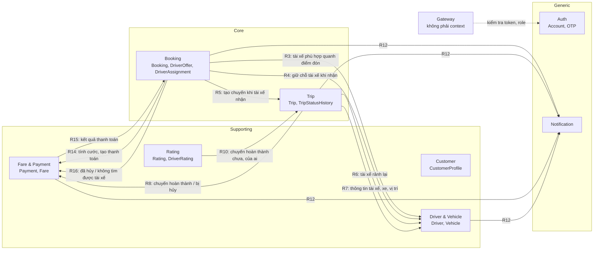
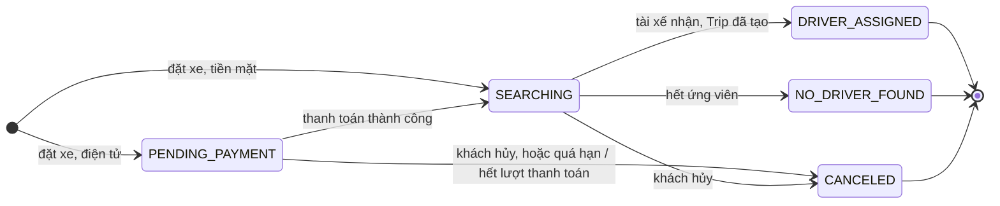
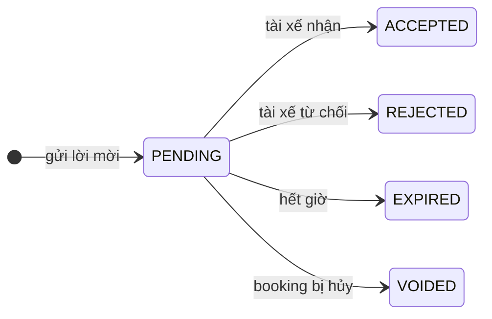
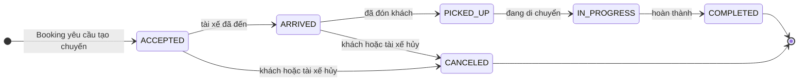
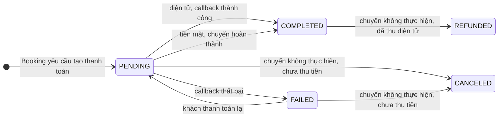

# 01 — Bounded context của Cab Booking System

> Vòng 1 (chỉ BA), bản sửa 2026-10-02 lần 3: theo **8 service giảng viên chốt** và các quyết định mới trong `CLAUDE.md` (đổi tên `rating-service`; đồng bộ là mặc định; thanh toán trả trước với cước cố định; hoàn tiền; hủy; Redis ở Gateway).
> Đồng bộ 2026-10-02 lần 4 (cùng lúc viết file 03, 04): công thức cước và ai tính quãng đường; hạn thanh toán 10 phút / 3 lần (BRULE17); đăng xuất (FR42, UC33); đóng Q10 (một phần), Q11, Q16, Q21, Q37. Chỉ sửa các dòng bị ảnh hưởng.
> Sửa 2026-10-03 theo góp ý giảng viên: **tách đăng ký khỏi hồ sơ khách hàng** — Auth và Customer không còn quan hệ (R1 không nối, bỏ đường S1; quy tắc A8, C1, C4–C6; BRULE18) — ADR-013; hệ thống ngoài giả lập đơn giản — ADR-014.
> Nguồn sự thật: `srs.md` (FR01–FR42, BRULE01–18, UC01–UC33, AC01–AC29) và `CLAUDE.md`. Mốc so sánh: `docs/reference/thiet-ke-da-duyet.md`.
> File này trả lời: **chia hệ thống thành những phần nào, mỗi phần sở hữu gì, vì sao**. gRPC hay Kafka cho từng quan hệ: file 02. Loại database, schema: file 03.
> Tên trạng thái viết HOA là **đề xuất**, trừ các tên đã có trong SRS và `CLAUDE.md` (`NO_DRIVER_FOUND`, `CANCELED`, `FAILED`, `COMPLETED`, Online/Offline, "chờ duyệt"). Tên chính thức chốt ở spec.

## 1. Tóm tắt

| # | Bounded context | Loại subdomain | Microservice | Aggregate gốc |
|---|---|---|---|---|
| 1 | Identity & Access (Auth) | Generic | `auth-service` | Account, OtpVerification |
| 2 | Customer | Supporting | `customer-service` | CustomerProfile |
| 3 | Driver & Vehicle | Supporting | `driver-service` | Driver (gồm Vehicle, hồ sơ đăng ký, vị trí), VehicleType |
| 4 | Booking (gồm ghép tài xế) | **Core** | `booking-service` | Booking (gồm DriverOffer, DriverAssignment) |
| 5 | Trip | **Core** | `trip-service` | Trip (gồm TripStatusHistory) |
| 6 | Fare & Payment | Supporting | `payment-service` | Payment (gồm Fare và các lần giao dịch) |
| 7 | Notification | Generic | `notification-service` | Notification |
| 8 | Rating | Supporting | `rating-service` | Rating, DriverRating (điểm tổng hợp) |

Tổng: **8 service nghiệp vụ + Gateway**. Gateway không phải bounded context: không có mô hình nghiệp vụ, chỉ xác thực token, kiểm tra role, rate limit, routing, log (`CLAUDE.md`).

Thay đổi của bản sửa này so với bản trước:

| Thay đổi | Lý do ngắn | ADR |
|---|---|---|
| `review-service` → `rating-service`; context "Rating & Review" → "Rating" | Giảng viên chốt tên trong `CLAUDE.md`; khớp entity `Rating` của SRS | ADR-006 |
| Cước cố định tính **khi đặt xe**; điện tử **trả trước**; có hoàn tiền | FR16, FR18, FR40, BRULE08, BRULE13–15 | ADR-009 |
| Booking có thêm trạng thái chờ thanh toán; Payment tham gia luồng đặt xe | FR35, BRULE13 | ADR-009 |
| Tài xế nhận chuyến: Booking gọi Trip tạo chuyến và chờ kết quả | `CLAUDE.md` — đã chốt | ADR-008 |
| Hủy: chỉ trước khi chuyến bắt đầu; tài xế cũng hủy được chuyến đã nhận | BRULE16, FR36, FR41 | ADR-009 |
| Trip không còn tính quãng đường, thời lượng để tính cước | Cước đã cố định từ lúc đặt (BRULE08) | ADR-009 |
| (2026-10-03) Đăng ký chỉ tạo tài khoản; khách tạo hồ sơ sau khi đăng nhập; Auth và Customer không gọi nhau | Góp ý giảng viên; FR26, FR27, BRULE18 | ADR-013 (thay ADR-004) |

## 2. Phân loại subdomain

| Subdomain | Loại | Lý do | Truy vết |
|---|---|---|---|
| Đặt xe và ghép tài xế (Booking) | Core | Lợi thế cạnh tranh: nhận yêu cầu và tìm đúng tài xế, nhanh. BRULE01–07 nằm ở đây; quy tắc ghép là của riêng doanh nghiệp, không mua sẵn được | BG01, BR01, BR02, NFR02 |
| Chuyến đi (Trip) | Core | Là dịch vụ doanh nghiệp bán. Sai trình tự trạng thái là sai việc thu tiền, hoàn tiền, đánh giá | BG03, BR03, BR07, BR09 |
| Tài xế & phương tiện | Supporting | Cần có để ghép được (BRULE01, 02) nhưng tự nó không tạo khác biệt | BG02, BR06, BR08 |
| Khách hàng | Supporting | Hồ sơ cá nhân, CRUD đơn giản | BG03, BR05 |
| Cước & thanh toán | Supporting | **Bảng giá và chính sách hoàn tiền** là quy tắc riêng của doanh nghiệp nên không phải generic; **xử lý giao dịch thẻ** giao cho Payment Provider (BRULE09) | BG04, BR04, BR12 |
| Đánh giá | Supporting | Một quy tắc (BRULE11), phục vụ chất lượng dịch vụ | BG03, BR11 |
| Xác thực & tài khoản | Generic | Bài toán giống mọi hệ thống (đăng nhập, băm mật khẩu, JWT, OTP) | BG05, NFR06, NFR07 |
| Thông báo | Generic | Gửi tin theo sự kiện; thực tế mua dịch vụ ngoài | BR10, NFR05, NFR13 |

Ý nghĩa khi vấn đáp: **core** là nơi đầu tư thiết kế kỹ nhất (máy trạng thái, bất biến, test); **generic** làm đơn giản nhất có thể.

## 3. Ba ranh giới dễ bị hỏi

### 3.1 Booking — Trip

Một câu: **Booking là "khách muốn đi, đã biết giá, hệ thống đang tìm người chở"; Trip là "đã có người chở và chuyến đang diễn ra"**. Mốc chuyển là lúc tài xế nhận chuyến (FR07).

| | Booking | Trip |
|---|---|---|
| Câu hỏi nó trả lời | Khách yêu cầu gì, giá bao nhiêu, đã trả chưa? Đã hỏi những tài xế nào? Ai nhận? | Chuyến đang ở bước nào? Ai đổi trạng thái, lúc nào, vì sao? |
| Sở hữu | Yêu cầu đặt xe (điểm đón, điểm đến, loại xe, phương thức thanh toán, **số tiền cước** nhận từ Payment); **DriverOffer**; **DriverAssignment** | **Trip** (bản chụp điều khoản lúc bàn giao + trạng thái + mốc thời gian); **TripStatusHistory**; lý do và người hủy chuyến |
| Tác nhân chính | Khách (đặt, hủy khi chưa có tài xế); tài xế (nhận / từ chối lời mời); hệ thống (chờ thanh toán, đếm giờ) | Tài xế (cập nhật trạng thái, hủy chuyến đã nhận); khách (theo dõi, hủy); admin (giám sát) |
| Kết thúc khi | `DRIVER_ASSIGNED`, `NO_DRIVER_FOUND` hoặc `CANCELED` | `COMPLETED` hoặc `CANCELED` |
| Hủy | Khách hủy **yêu cầu** khi chưa có tài xế (FR36) | Khách hoặc tài xế hủy **chuyến** đã có tài xế, trước khi đón khách (FR36, FR41, BRULE16) |
| BRULE | BRULE01–07, BRULE13 | BRULE16; trình tự trạng thái (mục chấm 17) |
| Mục chấm | 14, 15, 16, 18 (hủy khi chưa có tài xế) | 16 (Trip được tạo), 17, 18 |

**Bàn giao Booking → Trip:**

| Điểm | Nội dung |
|---|---|
| Lúc nào | Đúng một lần: khi tài xế nhận lời mời |
| Cái gì | Bản chụp: `booking_id`, `customer_id`, `driver_id`, `vehicle_type`, tọa độ điểm đón và điểm đến, `payment_method`, `fare_amount` |
| Bằng cách nào | Booking **gọi Trip tạo chuyến và chờ kết quả** (`CreateTrip`), nhận `trip_id` rồi mới xác nhận phân công và trả lời tài xế. Lý do: ADR-008 |
| Sau bàn giao | Booking **không đổi nữa**. Hai bên chỉ tham chiếu nhau bằng `booking_id` / `trip_id` |
| Một Booking — mấy Trip | Nhiều nhất một. Tài xế hủy chuyến đã nhận thì hệ thống **không** tạo Trip thứ hai; khách đặt lại bằng Booking mới (FR41, `CLAUDE.md`) |
| Vì sao Trip giữ bản chụp | Trip tự chạy đến hết chuyến mà không hỏi lại Booking (NFR05). Tài xế nhìn thấy phương thức và số tiền phải thu khi chuyến tiền mặt hoàn thành (FR17) |

### 3.2 Booking — Payment (mới)

| Điểm | Nội dung |
|---|---|
| Ai tính cước | **Payment**: giữ bảng giá, áp công thức FR16 và lưu từng thành phần của cước (BR12). **Booking** tính quãng đường ước tính từ tọa độ (đường thẳng × 1,3) rồi gửi quãng đường và loại xe cho Payment; Booking chỉ **giữ số tiền** đã tính để hiện cho khách (`CLAUDE.md` — đã chốt) |
| Hạn thanh toán | **Payment** giữ hạn 10 phút và đếm tối đa 3 lần thử (BRULE17). Quá hạn hoặc hết lượt: Payment hủy bỏ thanh toán và báo ra; **Booking** tự chuyển sang `CANCELED` khi nghe tin đó (file 03 mục 8.5) |
| Lúc nào | Một lần, khi tạo Booking; không đổi sau đó (FR16, BRULE08) |
| Thanh toán gắn với gì | Gắn với **`booking_id`**, không phải `trip_id`: lúc khách trả trước, Trip chưa tồn tại |
| Ai quyết định "được tìm tài xế" | Booking. Tiền mặt: tìm ngay. Điện tử: chỉ khi biết thanh toán đã thành công (BRULE13) |
| Ai quyết định hoàn tiền | Payment, dựa trên sự kiện "chuyến không được thực hiện" do Booking hoặc Trip báo (BRULE14, BRULE15). Booking và Trip **không biết** có hoàn hay không |

### 3.3 "COMPLETED" có hai nghĩa

| Ở đâu | Nghĩa |
|---|---|
| Trip `COMPLETED` | Tài xế xác nhận đã chở khách tới nơi (FR12, mục chấm 17) |
| Payment `COMPLETED` | Giao dịch đã thu tiền thành công. **Đây là "COMPLETED" của mục chấm 19** (`CLAUDE.md` — đã chốt) |

Với thanh toán điện tử, Payment `COMPLETED` xảy ra **trước** khi có tài xế; với tiền mặt, xảy ra **sau** Trip `COMPLETED`.

## 4. Sơ đồ quan hệ giữa các context (mức khái niệm)

Mũi tên `A --> B` nghĩa là **A cần một điều gì đó từ B hoặc báo cho B**. Đây chưa phải gRPC hay Kafka; file 02 quyết định từng đường. Quan hệ đã xét và **quyết định không nối** (R1, R2, R9, R11, R13) chỉ có trong bảng.

| Mã | Bên cần | Cần gì từ bên nào | Vì yêu cầu nào | Bên khởi phát có phải chờ kết quả mới làm tiếp không? |
|---|---|---|---|---|
| R1 | Customer | Biết tài khoản `customer` nào vừa đăng ký để tạo hồ sơ | FR26, FR27; mục 9, 11 | **Không nối** — đã chốt 2026-10-03 (`CLAUDE.md`, ADR-013): khách tự tạo hồ sơ sau khi đăng nhập; `customer_id` lấy từ `account_id` trong token mà Gateway đã xác thực. (Bản trước: Auth gọi đồng bộ — ADR-004, đã bị thay thế) |
| R2 | Driver | Tài xế đã qua OTP và `account_id` | FR39; mục 21 | **Không nối**: token đã mang `account_id` và role `driver` — Q4 |
| R3 | Booking | Danh sách tài xế sẵn sàng, đúng loại xe, trong 1 km, kèm khoảng cách | FR02–FR05, BRULE01–03 | Có: không có danh sách thì không gửi lời mời được |
| R4 | Booking | Tài xế vừa bấm nhận **còn rảnh không**; nếu còn thì giữ chỗ | BRULE01, FR07, NFR14 | Có: chưa chắc tài xế còn rảnh thì không được xác nhận |
| R5 | Booking | Trip tạo chuyến và trả mã chuyến | FR07, FR11, FR12; mục 16 → 17 | **Có** — đã chốt: nhận chuyến mà không có Trip là vô nghĩa (ADR-008) |
| R6 | Driver | Chuyến của tài xế đã kết thúc hoặc bị hủy → rảnh lại | BRULE01, FR41 | Không: Trip không được kẹt vì Driver |
| R7 | Trip | Tên tài xế, biển số, loại xe, vị trí hiện tại | FR13–FR15; UC10, UC22 | Có: cần dữ liệu để trả lời khách ngay |
| R8 | Payment | Chuyến hoàn thành (ghi nhận tiền mặt) hoặc bị hủy (hoàn tiền) | FR17, FR40, BRULE14, BRULE15 | Không: NFR05 — Payment lỗi không được chặn việc kết thúc hay hủy chuyến |
| R9 | Trip | Chuyến đã được thanh toán hay chưa | — | **Không nối**: không quy tắc nào của Trip phụ thuộc trạng thái tiền; "COMPLETED" ở mục 19 là của Payment |
| R10 | Rating | Chuyến có hoàn thành không, của khách nào, tài xế nào | BRULE11, FR25; mục 20 | Có: chưa biết thì không được nhận đánh giá |
| R11 | Driver | Điểm đánh giá trung bình của tài xế | UC17 bước 5 | **Không nối**: điểm tổng hợp do Rating sở hữu — Q28 |
| R12 | Notification | Sự kiện cần báo: đặt xe được nhận, có lời mời, tài xế nhận chuyến, không tìm được tài xế, hủy, đổi trạng thái chuyến, kết quả thanh toán, hoàn tiền, kết quả duyệt hồ sơ | FR06, FR10, FR21–FR24, FR36, FR41, AC16, AC20, AC24 | Không: NFR05 nêu đích danh Notification |
| R13 | Booking | Kết cục của chuyến (hoàn thành / hủy) để hiện trong danh sách booking | FR37 | **Không nối**: Booking kết thúc ở `DRIVER_ASSIGNED` — Q27 |
| R14 | Booking | Payment tính cước cố định và tạo thanh toán, trả số tiền và mã thanh toán | FR16, FR35, BRULE08 | **Có** — đã chốt: Booking phải trả ngay cho khách số tiền (ADR-009) |
| R15 | Booking | Thanh toán điện tử của booking này đã thành công chưa | FR18, BRULE13, AC21 | Không: Payment đã thu tiền thì phải ghi nhận xong dù Booking đang lỗi; kết quả đến từ Provider vào lúc không biết trước |
| R16 | Payment | Booking đã bị hủy, hoặc không tìm được tài xế → hoàn tiền | FR40, BRULE14, AC22 | Không: việc hủy phải thành công dù Payment đang lỗi (NFR05) |

Cặp **không có quan hệ**: Customer với **mọi** context; Auth với **mọi** context (cả hai chỉ được Gateway gọi); Rating với mọi context trừ Trip; Payment ↔ Driver; Notification không gọi ai (chỉ nhận). Danh sách đầy đủ kèm lý do: file 02, mục 9.

## 5. Thuật ngữ mang nghĩa khác nhau giữa các context

| Thuật ngữ | Auth | Customer | Driver | Booking | Trip | Payment | Rating |
|---|---|---|---|---|---|---|---|
| **Khách hàng** | Account có role `customer` | Hồ sơ cá nhân (có thể **chưa tạo**) | — | Người đặt (`customer_id`) | Hành khách của chuyến | Người trả tiền, người được hoàn | Người chấm điểm |
| **Tài xế** | Account có role `driver` | — | Hồ sơ, giấy phép, xe, trạng thái duyệt, trạng thái nhận chuyến, vị trí | **Ứng viên**, rồi người được phân công | Người thực hiện chuyến | — | Người được chấm |
| **Trạng thái** | Tài khoản: hoạt động / bị khóa | — | **Duyệt hồ sơ** và **nhận chuyến** (Offline / Online / bận) | Trạng thái Booking; trạng thái Offer | Trạng thái Trip | Trạng thái giao dịch | — |
| **Hoàn thành / COMPLETED** | — | — | — | Không có: Booking kết thúc khi đã phân công | Tài xế xác nhận đã đến nơi | **Đã thu tiền thành công** (mục 19) | Điều kiện để được đánh giá |
| **Hủy** | — | — | — | Khách hủy yêu cầu khi chưa có tài xế | Khách hoặc tài xế hủy chuyến trước khi đón khách | Thanh toán chưa thu bị hủy bỏ (`CANCELED`); đã thu thì **hoàn** (`REFUNDED`) | — |
| **Từ chối** | — | — | Admin từ chối hồ sơ | Tài xế từ chối **lời mời**: không phải hủy, không hoàn tiền (BRULE15) | — | — | — |
| **Cước** | — | — | — | Số tiền đã chốt, chỉ để hiển thị | Bản chụp số tiền (tài xế biết phải thu bao nhiêu) | **Fare**: kết quả áp bảng giá; nơi duy nhất tính | — |
| **Loại xe** | — | — | **Danh mục gốc** VehicleType | Loại khách chọn; điều kiện lọc (mã) | Bản chụp (mã) | Khóa tra bảng giá (mã) | — |

`vehicle_type` là mã dùng chung giữa các context (published language). Driver sở hữu danh mục; các context khác chỉ giữ mã, không giữ khóa ngoại.

## 6. Chi tiết từng bounded context

### 6.1 Auth — Identity & Access

| Mục | Nội dung |
|---|---|
| Trách nhiệm | Tạo tài khoản; kiểm tra thông tin đăng nhập; cấp token chứa `account_id` và `role`; xác thực số điện thoại bằng OTP; giữ role của tài khoản |
| **Không** làm | Không giữ hồ sơ cá nhân và **không gọi Customer** khi đăng ký (ADR-013). Không biết gì về booking, chuyến, tiền. Không giữ danh sách token đã thu hồi (Gateway giữ trong Redis — file 02) |
| Ngôn ngữ chung | **Account**: danh tính đăng nhập (định danh + mật khẩu đã băm + role + trạng thái). **Role**: `customer` / `driver` / `admin`, là một cột của Account, **không có bảng PERMISSION** (`CLAUDE.md`). **Token**: JWT. **OTP**. **Khóa** |
| Aggregate gốc | **Account**; **OtpVerification** |
| FR / UC | FR26, FR32, FR39 (phần OTP) / UC01, UC02, UC25 (phần role), UC29 (bước OTP) |
| Mục chấm | 9, 10, 21 (OTP), 24, 25; cung cấp token và role cho mục 27, 28 |

| # | Quy tắc | Nguồn |
|---|---|---|
| A1 | Đăng ký công khai chỉ tạo role `customer` | `CLAUDE.md` — đã chốt |
| A2 | Định danh đăng nhập (số điện thoại / email) là duy nhất | UC02; mục 9 (đường lỗi "trùng") |
| A3 | Tài khoản bị khóa thì từ chối đăng nhập | Exception của UC02, NFR06 |
| A4 | Không lưu mật khẩu dạng rõ; không trả mật khẩu / băm ra ngoài | NFR08, mục 24 |
| A5 | Token mang role; mọi thao tác quản trị dựa vào role này | BRULE12, NFR07, FR32 |
| A6 | OTP có hạn dùng và chỉ dùng một lần; tài khoản `driver` chỉ được tạo sau khi OTP đúng | FR39, mục 21 |
| A7 | Tài khoản `admin` không tạo qua API công khai (tạo sẵn bằng seed) | BRULE12 — **suy đoán**, Q8 |
| A8 | Đăng ký khách **chỉ tạo Account** (số điện thoại, email tùy chọn, mật khẩu); không tạo hồ sơ, không gọi service nào. Thành công khi Account đã lưu | FR26, UC01, AC27; mục 9; ADR-013 (thay bản cũ theo ADR-004) |

### 6.2 Customer

| Mục | Nội dung |
|---|---|
| Trách nhiệm | Cho khách **đã đăng nhập** tạo hồ sơ một lần, rồi xem / sửa hồ sơ của mình; cho tra cứu khách hàng theo mã (chính chủ, `admin`) |
| **Không** làm | Không giữ mật khẩu, không đăng nhập, không giữ số điện thoại đăng nhập (thuộc Auth). Không biết tài khoản nào vừa đăng ký: chỉ tin `account_id` trong metadata do Gateway chuyển. Không giữ booking của khách. **Không gọi và không bị service nào gọi** |
| Ngôn ngữ chung | **CustomerProfile**: thông tin cá nhân của một khách (họ tên, ngày sinh). **Mã khách hàng** = `account_id` của tài khoản đang đăng nhập. **Chưa có hồ sơ**: tài khoản đã đăng ký nhưng chưa tạo hồ sơ |
| Aggregate gốc | **CustomerProfile** |
| FR / UC | FR27, BRULE18 / UC03, UC19 |
| Mục chấm | 11; 24; 26 (họ tên là text do người dùng nhập) |

| # | Quy tắc | Nguồn |
|---|---|---|
| C1 | Mỗi tài khoản `customer` có **nhiều nhất** một hồ sơ; tạo lần hai → 409 | BRULE18, FR27, AC28, NFR14 |
| C2 | Khách chỉ xem / sửa hồ sơ của chính mình; `admin` xem được mọi hồ sơ, không sửa | BRULE18, NFR08, NFR16, BRULE12 — Q9 |
| C3 | Dữ liệu cá nhân được bảo vệ khi lưu | NFR08, NFR16, mục 24 |
| C4 | `customer_id` của hồ sơ **là** `account_id` trong token; khi tạo / sửa không nhận mã khách từ client | BRULE18, NFR07; ADR-013 |
| C5 | Chưa tạo hồ sơ thì xem và sửa đều trả 404 | FR27, UC03, AC28 |
| C6 | Họ tên bắt buộc khi tạo; ngày sinh tùy chọn, định dạng `YYYY-MM-DD`, không ở tương lai | FR27, UC03 |

### 6.3 Driver & Vehicle

| Mục | Nội dung |
|---|---|
| Trách nhiệm | Hồ sơ tài xế và phương tiện; quy trình đăng ký — duyệt hồ sơ; trạng thái nhận chuyến Online / Offline / bận; vị trí hiện tại; trả lời "tài xế nào sẵn sàng, đúng loại xe, quanh tọa độ này"; trả lời "tài xế này còn rảnh không" và giữ chỗ / nhả chỗ |
| **Không** làm | Không quyết định hỏi tài xế nào trước, không gửi lời mời, không đếm giờ (thuộc Booking). Không giữ mật khẩu |
| Ngôn ngữ chung | **Hồ sơ tài xế**. **Trạng thái duyệt**: chờ duyệt / đã duyệt / bị từ chối. **Trạng thái nhận chuyến**: Offline, Online (= Available/Ready của BRULE01), bận. **Vehicle**, **VehicleType**. **Vị trí hiện tại**. **Giữ chỗ**: chuyển Online → bận cho đúng một `booking_id` |
| Aggregate gốc | **Driver** (gồm Vehicle, trạng thái duyệt, trạng thái nhận chuyến, vị trí hiện tại); **VehicleType** (danh mục) |
| FR / UC | FR28, FR29, FR38, FR39; FR02, FR03, FR04 (thực hiện truy vấn); FR13 / UC12, UC20, UC21, UC28, UC29, UC30 |
| Mục chấm | 12, 13, 21, 22, 23; 24 (số giấy phép; số điện thoại của tài xế chỉ nằm ở Auth — file 03) |

| # | Quy tắc | Nguồn |
|---|---|---|
| D1 | Chỉ tài xế đang Online **và không bận** mới xuất hiện trong kết quả tìm | BRULE01, FR38, AC03 |
| D2 | Kết quả tìm chỉ gồm tài xế có xe đúng loại yêu cầu | BRULE02, FR03, AC04 |
| D3 | Kết quả tìm nằm trong bán kính (mặc định 1 km), kèm khoảng cách, sắp từ gần đến xa, có limit và paging | FR02, FR04, mục 13 |
| D4 | Hồ sơ mới tạo luôn ở trạng thái chờ duyệt | FR39, AC19 |
| D5 | Chỉ `admin` được duyệt / từ chối; chỉ hồ sơ đang chờ duyệt mới duyệt / từ chối được | BRULE12, FR39, AC20 |
| D6 | Chỉ tài xế đã được duyệt mới bật Online được | **Suy ra** từ FR39 + BRULE01 — Q10 |
| D7 | Biển số xe không trùng | FR29 — **suy đoán**; file 03 đặt UNIQUE trên `vehicles.license_plate` |
| D8 | **Một tài xế tại một thời điểm chỉ bị giữ cho nhiều nhất một booking.** Giữ chỗ chỉ thành công khi tài xế đang Online và không bận; giữ lặp cho cùng `booking_id` trả kết quả như lần đầu | BRULE01, NFR14 |
| D9 | Tài xế chỉ rảnh lại khi chuyến của **đúng** booking đang giữ hoàn thành hoặc bị hủy (kể cả do chính tài xế hủy), hoặc khi Booking nhả chỗ vì không tạo được chuyến | BRULE01, FR41 |

Vì sao Driver và Vehicle chung một context (giảng viên cho gộp): BRULE01 và BRULE02 cần **cùng lúc** trạng thái, loại xe và vị trí trong một truy vấn (mục chấm 13). Khách chỉ chọn **loại xe**, không chọn xe cụ thể. Chỉ tách khi khách được tự chọn xe.

### 6.4 Booking — Đặt xe và ghép tài xế (core)

| Mục | Nội dung |
|---|---|
| Trách nhiệm | Nhận yêu cầu đặt xe; **lấy cước cố định và mã thanh toán từ Payment** ngay khi tạo; giữ Booking điện tử ở trạng thái chờ thanh toán đến khi biết đã trả; danh sách booking của khách; **ghép tài xế**: lấy ứng viên, hỏi **lần lượt** từ gần đến xa, đếm giờ phản hồi, xử lý nhận / từ chối / hết giờ; khi tài xế nhận thì giữ chỗ tài xế và **yêu cầu Trip tạo chuyến**; kết luận "đã phân công" hoặc "không tìm được"; hủy yêu cầu khi chưa có tài xế |
| **Không** làm | Không tự tính cước, không thu tiền, không hoàn tiền (Payment). Không giữ hồ sơ, vị trí, trạng thái nhận chuyến của tài xế (Driver). Không giữ trạng thái chuyến sau khi phân công (Trip) |
| Ngôn ngữ chung | **Booking**: yêu cầu đặt xe — điểm đón, điểm đến, loại xe, phương thức thanh toán, cước. **Chờ thanh toán**. **Đang tìm tài xế**. **Ứng viên**. **Offer (lời mời)**: gửi cho một tài xế, có hạn trả lời. **Từ chối**, **hết giờ**, **đã loại**. **Phân công (DriverAssignment)**. **`NO_DRIVER_FOUND`**. **`CANCELED`** |
| Aggregate gốc | **Booking** (gồm danh sách DriverOffer và nhiều nhất một DriverAssignment) |
| FR | FR01, FR05–FR10, FR11 (lưu phân công), FR35, FR36 (khi chưa có tài xế), FR37; khởi phát FR02–FR04, FR16; chờ kết quả của FR18 |
| UC | UC04, UC05, UC06, UC07, UC08, UC09, UC18, UC27 (khi chưa có tài xế) |
| Mục chấm | 14, 15, 16, 18 (hủy khi chưa có tài xế), 19 (vế "trả xong mới tìm tài xế"); 26 (địa chỉ, lý do hủy) |

| Bước chuyển Booking | Nguồn |
|---|---|
| → `PENDING_PAYMENT` / → `SEARCHING` lúc tạo | FR35, BRULE13 |
| `PENDING_PAYMENT` → `SEARCHING` | FR18, BRULE13, AC21 |
| `SEARCHING` → `DRIVER_ASSIGNED` | FR07, FR11, AC06 |
| `SEARCHING` → `NO_DRIVER_FOUND` | FR10, BRULE07, AC09 |
| → `CANCELED` (khách hủy) | FR36, BRULE16, AC16 |
| `PENDING_PAYMENT` → `CANCELED` (hệ thống hủy) | BRULE17, AC25 |

| # | Quy tắc | Nguồn |
|---|---|---|
| B1 | Thiếu điểm đón, điểm đến, loại xe hoặc phương thức thanh toán thì không tạo Booking | FR35, AC01, AC02 |
| B2 | Booking mới: tiền mặt → đang tìm tài xế ngay; điện tử → chờ thanh toán. Khách **không chờ** ghép xong | FR35, BRULE13, NFR01 |
| B3 | Chỉ gửi Offer cho tài xế sẵn sàng, đúng loại xe | BRULE01, BRULE02, AC03, AC04 |
| B4 | Trong các ứng viên, tài xế gần điểm đón nhất được hỏi trước | BRULE03, FR05, AC05 |
| B5 | Mỗi Offer có hạn trả lời; quá hạn thì coi là không phản hồi | BRULE04, BRULE06, FR09, AC08 |
| B6 | Tài xế từ chối hoặc hết giờ thì bị loại, việc tìm **tiếp tục** với người kế tiếp. Booking **không bị hủy**, không báo gì cho Payment nên **không hoàn tiền** | BRULE05, BRULE06, BRULE15, FR08, AC07, AC23 |
| B7 | Hết ứng viên thì Booking chuyển `NO_DRIVER_FOUND`; khách phải được báo và (nếu đã trả) được hoàn tiền | BRULE07, BRULE14, FR10, AC09, AC22 |
| B8 | Mỗi Booking có nhiều nhất một Offer được nhận; nhận rồi thì chuyển `DRIVER_ASSIGNED` và ngừng tìm | FR07, AC06, NFR14 |
| B9 | Chỉ tài xế được mời mới trả lời được Offer đó; Offer đã hết giờ hoặc đã trả lời thì không trả lời lại được | BRULE04, NFR07 |
| B10 | Tại một thời điểm mỗi Booking chỉ có một Offer đang chờ; một tài xế chỉ có một Offer đang chờ | BRULE03 ("gửi … trước") — **diễn giải**, Q12 |
| B11 | Chỉ xác nhận phân công khi Driver đã giữ chỗ được tài xế (D8) | BRULE01, NFR14 |
| B12 | Hủy và nhận xảy ra cùng lúc: bên nào ghi vào Booking trước thì thắng; bên sau nhận lỗi sai trạng thái (409) | FR36, FR07, NFR14 |
| B13 | Hủy phải kèm lý do; chỉ khách của booking hủy được; chỉ hủy được Booking đang chờ thanh toán hoặc đang tìm. Đã phân công thì phải hủy **chuyến** (Trip) | FR36, BRULE16, AC16 |
| B14 | Khách chỉ thấy booking của chính mình; danh sách có limit và paging | FR37, AC17, NFR08 |
| B15 | Chỉ tạo Booking khi Payment đã trả về cước và mã thanh toán. Booking giữ số tiền đó, **không sửa** | FR16, BRULE08; ADR-009 |
| B16 | Booking điện tử chỉ được đưa vào tìm tài xế khi biết thanh toán đã thành công. Thanh toán thất bại thì Booking vẫn chờ, khách thanh toán lại trong hạn và số lượt còn lại | BRULE13, BRULE17, FR18, FR19, AC21 |
| B18 | Booking đang chờ thanh toán chuyển `CANCELED` (người hủy: hệ thống) khi Payment báo đã quá hạn 10 phút hoặc hết 3 lần thử; khách được báo | BRULE17, AC25 |
| B17 | Chỉ xác nhận phân công khi Trip đã được tạo và trả về mã chuyến; câu trả lời cho tài xế kèm mã chuyến | FR07, FR11, mục 16 → 17; ADR-008 |

B12 là lợi ích trực tiếp của việc đưa ghép tài xế vào Booking: Booking, Offer và Assignment nằm trong một database nên tranh chấp hủy — nhận được giải quyết bằng khóa một dòng.

Chưa có con số: thời hạn trả lời Offer (Q12) — là giới hạn trên, đọc từ biến môi trường (`CLAUDE.md`). Thời hạn chờ thanh toán đã chốt: 10 phút, 3 lần thử (BRULE17).

### 6.5 Trip — Chuyến đi (core)

| Mục | Nội dung |
|---|---|
| Trách nhiệm | Tạo Trip khi Booking yêu cầu (tài xế đã nhận); giữ vòng đời chuyến đến khi hoàn thành hoặc hủy; ghi lịch sử từng lần đổi trạng thái; cho khách theo dõi chuyến; **khách hoặc tài xế hủy chuyến trước khi đón khách**; cho `admin` giám sát; trả lời "chuyến này đã hoàn thành chưa, của ai"; báo ra ngoài mỗi lần đổi trạng thái |
| **Không** làm | Không tìm tài xế, không tìm tài xế thay thế khi chuyến bị hủy (FR41). Không tính cước, không thu, không hoàn tiền (Payment). Không giữ đánh giá (Rating) |
| Ngôn ngữ chung | **Trip**: chuyến đi thực tế, chỉ tồn tại sau khi có tài xế nhận. **Đã nhận / đã đến / đã đón khách / đang di chuyển / hoàn thành**: năm trạng thái của FR12. **Chuyến bắt đầu** = đã đón khách (BRULE16). **Lịch sử trạng thái**. **Hủy chuyến**: `CANCELED` kèm lý do và người hủy |
| Aggregate gốc | **Trip** (gồm TripStatusHistory) |
| FR | FR11 (tạo chuyến), FR12, FR14, FR15, FR30, FR31, FR36 (sau khi có tài xế), FR41; FR34 (lịch sử chuyến) |
| UC | UC10, UC11, UC22, UC23, UC27 (sau khi có tài xế), UC32 |
| Mục chấm | 16 (Trip được tạo), 17, 18; 26 (lý do hủy) |

Từ `PICKED_UP` trở đi **không hủy được** (BRULE16).

| # | Quy tắc | Nguồn |
|---|---|---|
| T1 | Trip chỉ được tạo theo yêu cầu của Booking khi tài xế nhận; mỗi `booking_id` nhiều nhất một Trip; yêu cầu tạo lặp cho cùng `booking_id` trả lại Trip cũ | FR07, FR11, AC06, NFR14 |
| T2 | Trạng thái chỉ đi theo đúng trình tự, không nhảy cóc, không lùi; sai trình tự trả lỗi sai trạng thái (409) | FR12, mục 17 — SRS chưa có BRULE riêng (Q10) |
| T3 | Chỉ tài xế của chuyến mới cập nhật được trạng thái | BRULE12 (tinh thần), NFR07 |
| T4 | Mọi lần đổi trạng thái đều ghi một dòng lịch sử (ai, từ đâu sang đâu, lúc nào, lý do) | FR34, NFR10 |
| T5 | Hủy phải kèm lý do. Chỉ **khách của chuyến** hoặc **tài xế của chuyến** hủy được, và chỉ khi chuyến chưa bắt đầu (đang `ACCEPTED` hoặc `ARRIVED`) | FR36, FR41, BRULE16, AC16, AC24 |
| T6 | Chuyến bị hủy thì kết thúc ở `CANCELED`; hệ thống **không** tự tìm tài xế khác | FR41, `CLAUDE.md` |
| T7 | Khách chỉ xem được chuyến của mình, tài xế chỉ xem chuyến mình chạy; `admin` xem mọi chuyến | NFR08, BRULE12, FR30, AC15 |
| T8 | Mỗi lần đổi trạng thái (kể cả trạng thái đầu) đều được báo ra ngoài kèm `booking_id`, người hủy nếu có — để Driver, Payment, Notification làm phần của mình | FR22, FR23, FR17, FR40, BRULE01 |

### 6.6 Fare & Payment

| Mục | Nội dung |
|---|---|
| Trách nhiệm | **Tính cước cố định** theo bảng giá khi Booking yêu cầu và tạo thanh toán cho booking đó; gửi yêu cầu thanh toán điện tử và nhận kết quả (callback) từ Payment Provider; báo kết quả thanh toán; cho thanh toán lại khi thất bại; **ghi nhận tiền mặt** khi chuyến hoàn thành; **hoàn tiền** khi chuyến không được thực hiện; lưu giao dịch để tra cứu, đối soát; chống xử lý lặp |
| **Không** làm | Không lưu số thẻ / tài khoản ngân hàng. Không giữ trạng thái booking hay chuyến. Không quyết định có tìm tài xế hay không (Booking) |
| Ngôn ngữ chung | **Fare**: cước của một booking, tính một lần. **Bảng giá**: quy tắc tính theo loại xe và quãng đường. **Payment**: thanh toán của một booking. **Phương thức**: tiền mặt / điện tử. **Trả trước**. **Callback (webhook)**. **Khóa chống lặp (idempotency key)**. **Thanh toán lại**. **Hoàn tiền (refund)**: trả lại đủ số đã thu. **Hủy bỏ**: thanh toán chưa thu, không còn hiệu lực |
| Aggregate gốc | **Payment** (một cho mỗi `booking_id`; gồm Fare và các lần giao dịch với Provider) |
| FR / UC | FR16–FR20, FR40; FR34 (lịch sử giao dịch) / UC13, UC14, UC15, UC24, UC31 |
| Mục chấm | 19, 30; 18 (vế hoàn tiền sau khi hủy); 24 (dữ liệu giao dịch) |

| Trường hợp "chuyến không được thực hiện" | Payment điện tử đã `COMPLETED` | Payment chưa thu (tiền mặt, hoặc điện tử chưa trả) | Nguồn |
|---|---|---|---|
| Khách hủy trước khi có tài xế | → `REFUNDED` | → `CANCELED` | BRULE14 |
| Khách hủy sau khi có tài xế | → `REFUNDED` | → `CANCELED` | BRULE14 |
| Không tìm được tài xế | → `REFUNDED` | → `CANCELED` | BRULE14 |
| Tài xế hủy chuyến đã nhận | → `REFUNDED` | → `CANCELED` | BRULE14, FR41, AC24 |
| Chuyến đã hoàn thành | Không đổi | Tiền mặt → `COMPLETED` | BRULE15, FR17 |
| Tài xế từ chối lời mời | Không đổi (Payment không được báo) | Không đổi | BRULE15 |

| # | Quy tắc | Nguồn |
|---|---|---|
| M1 | Cước tính **một lần** khi tạo thanh toán cho booking, từ loại xe và quãng đường ước tính do Booking gửi sang: `giá mở cửa + đơn giá mỗi km × quãng đường`, làm tròn lên 1.000 đ, không thấp hơn cước tối thiểu; từng thành phần được lưu lại; không đổi sau đó; áp dụng cho cả hai phương thức. Mỗi `booking_id` một Payment; yêu cầu tạo lặp trả lại Payment cũ | FR16, BRULE08, NFR14 |
| M2 | Không lưu thông tin thẻ / tài khoản; chỉ lưu mã giao dịch của Provider | BRULE09, NFR09, FR20 |
| M3 | Giao dịch thất bại vẫn phải được lưu với trạng thái `FAILED` và khách được báo | BRULE10, FR19, AC13 |
| M4 | Thất bại thì được thanh toán lại, trong hạn 10 phút kể từ lúc tạo và tối đa 3 lần thử | FR19, BRULE17, UC15, AC13, AC25 |
| M5 | Cùng một yêu cầu / callback gửi lại thì trả đúng kết quả cũ, không thu tiền lần hai | Mục 30, NFR14 — SRS chưa có FR/BRULE riêng (Q10) |
| M6 | Một booking chỉ có nhiều nhất một lần thu thành công | NFR14 |
| M7 | Phương thức thanh toán lấy theo lựa chọn lúc đặt xe | FR35, `CLAUDE.md` |
| M8 | Hoàn **đủ** tiền trong bốn trường hợp của BRULE14; chỉ hoàn Payment điện tử đang `COMPLETED`; mỗi Payment hoàn nhiều nhất một lần | FR40, BRULE14, AC22, AC24 |
| M9 | Không hoàn khi chuyến đã hoàn thành, và khi tài xế chỉ từ chối lời mời | BRULE15, AC23 |
| M10 | Tiền mặt: chuyển `COMPLETED` khi chuyến hoàn thành; chuyến không thực hiện thì `CANCELED` | FR17, AC11 |
| M11 | Kết quả "thành công" đến **sau khi** thanh toán đã bị hủy bỏ (khách hủy trong lúc đang trả): vẫn ghi nhận rồi hoàn ngay | BRULE14, NFR14 — **suy ra**, chi tiết ở spec mục 19 |
| M12 | Mỗi lần Payment sang `COMPLETED`, `FAILED` hoặc `REFUNDED` đều được báo ra ngoài; `CANCELED` được báo ra khi lý do là quá hạn hoặc hết lượt (M13) | FR24, BRULE10, BRULE13, BRULE17 |
| M13 | Thanh toán điện tử quá hạn, hoặc lần thử cuối thất bại, thì chuyển `CANCELED` kèm lý do; lần thử thất bại vẫn được lưu. Từ đó không nhận lần thử mới | BRULE17, BRULE10, AC25 |

Fare và Payment chung một context và một aggregate: cước tính xong là thanh toán được tạo ngay trong cùng một thao tác. Payment Provider là hệ thống ngoài, **giả lập đơn giản sau một lớp adapter**: module trong `payment-service` gọi ngay phần xử lý callback, mặc định thành công (`CLAUDE.md`, ADR-014).

### 6.7 Notification

| Mục | Nội dung |
|---|---|
| Trách nhiệm | Nghe các sự kiện nghiệp vụ, tạo thông báo cho đúng người nhận, cho người dùng xem thông báo của mình |
| **Không** làm | Không quyết định nghiệp vụ. Không context nào chờ Notification |
| Ngôn ngữ chung | **Notification**: một tin gửi cho một người (người nhận, loại, tiêu đề, nội dung, trạng thái). **Người nhận**: `account_id`. **Kênh**: giả lập sau adapter (`CLAUDE.md`) |
| Aggregate gốc | **Notification** |
| FR / UC | FR21–FR24; phần "thông báo" của FR06, FR10, FR11, FR19, FR36, FR40, FR41 / UC16 |
| Mục chấm | 16, 18 (vế "các bên được báo"); 22 (AC20); nơi nhìn thấy event rõ nhất cho mục 7 |

| # | Quy tắc | Nguồn |
|---|---|---|
| N1 | Notification lỗi không được làm hỏng đặt xe, chuyến, thanh toán | NFR05, NFR15 |
| N2 | Người dùng chỉ xem được thông báo của mình | NFR08 |
| N3 | Không tìm được tài xế thì khách **phải** có thông báo | BRULE07, AC09 |
| N4 | Cùng một sự kiện nhận hai lần thì không tạo hai thông báo | NFR14 |
| N5 | Chuyến bị hủy (do khách hoặc tài xế) thì bên còn lại phải được báo | AC16, AC24 |

### 6.8 Rating

| Mục | Nội dung |
|---|---|
| Trách nhiệm | Nhận điểm và nhận xét của khách cho một chuyến đã hoàn thành; lưu Rating **gắn với `trip_id`**; giữ điểm trung bình của từng tài xế; cho xem đánh giá của một chuyến và điểm của một tài xế |
| **Không** làm | Không giữ trạng thái chuyến: muốn biết chuyến đã hoàn thành chưa thì hỏi Trip |
| Ngôn ngữ chung | **Rating**: một lần đánh giá cho một chuyến (điểm + nhận xét); phiếu chấm mục 20 gọi là "Review". **DriverRating**: điểm trung bình của một tài xế |
| Aggregate gốc | **Rating**; **DriverRating** |
| FR / UC | FR25 / UC17 |
| Mục chấm | 20 ("Review được lưu và liên kết với chuyến đi"); 26 (nhận xét là text tự do) |

| # | Quy tắc | Nguồn |
|---|---|---|
| V1 | Chỉ đánh giá chuyến đã hoàn thành | BRULE11, AC14 |
| V2 | Chỉ khách của chính chuyến đó được đánh giá | BRULE11 |
| V3 | Mỗi chuyến chỉ một đánh giá | Exception của UC17 |
| V4 | Điểm nằm trong thang cho phép | UC17 bước 3 — thang 1–5 là **suy đoán**; file 03 đặt CHECK 1–5, xác nhận ở spec mục 20 |
| V5 | Lưu Rating và cập nhật điểm trung bình của tài xế trong cùng một giao dịch | UC17 bước 4–5, NFR14 |

## 7. Context → microservice

### 7.1 Vì sao mỗi context là một service riêng

Danh sách do giảng viên chốt; bảng này ghi **lý do nghiệp vụ** và đánh đổi phải chấp nhận.

| Context → service | Lý do nghiệp vụ là context riêng | Đánh đổi |
|---|---|---|
| Auth → `auth-service` | Phục vụ cả ba role; "khách hàng" ở đây là Account có role, không phải hồ sơ. Mật khẩu tách khỏi dữ liệu cá nhân (NFR08, mục 24). ADR-001 | Khách phải thêm một bước tạo hồ sơ sau khi đăng nhập (ADR-013) |
| Customer → `customer-service` | Hồ sơ chỉ của khách; đối xứng với hồ sơ tài xế ở Driver. Không gọi và không bị service nào gọi: dừng thì chỉ mất chức năng hồ sơ | Service nhỏ (1 FR, 1–2 mục chấm); có thể tồn tại tài khoản `customer` chưa có hồ sơ |
| Driver & Vehicle → `driver-service` | BRULE01, BRULE02 cần trạng thái, loại xe, vị trí trong **một** truy vấn (mục 13) | Vị trí cập nhật rất thường xuyên, hồ sơ thì hiếm; hai kiểu tải nằm chung |
| Booking → `booking-service` | Giai đoạn "chưa có tài xế": ngôn ngữ riêng (chờ thanh toán, ứng viên, Offer, hết giờ), BRULE01–07 và BRULE13, có việc chạy nền đếm giờ. ADR-006 | Là nơi điều phối: phải gọi Driver, Payment, Trip; ba service đó lỗi thì từng bước của đặt xe lỗi theo (ADR-008, ADR-009) |
| Trip → `trip-service` | Giai đoạn "đã có tài xế": tác nhân khác (tài xế điều khiển), quy tắc khác (trình tự trạng thái, BRULE16). Booking dừng thì chuyến đang chạy vẫn hoàn thành được. ADR-006 | Một chuyến xe nằm ở hai service: phải bàn giao (ADR-008); có hai thao tác hủy; danh sách booking không tự hiện kết cục chuyến (Q27) |
| Fare & Payment → `payment-service` | Tiền cần kiểm soát riêng (NFR09, BRULE09); bảng giá và chính sách hoàn tiền đổi độc lập với cách ghép tài xế (NFR12) | **Nằm trong luồng đặt xe**: Payment lỗi thì không tạo được booking mới — đánh đổi so với NFR05 (ADR-009) |
| Notification → `notification-service` | NFR05 nêu đích danh Notification. Chỉ nghe sự kiện, không ai chờ | Thêm một service và một database cho chức năng đơn giản |
| Rating → `rating-service` | Đánh giá xảy ra **sau** khi chuyến đã đóng, không ảnh hưởng vòng đời chuyến. Mục chấm 20 chấm riêng. ADR-006 | Một service cho 1 FR, 1 mục chấm; phải hỏi Trip để kiểm tra BRULE11 |

### 7.2 Tên cũ → tên mới

| Tên trong `docs/study/` | Tên trong thiết kế tham chiếu | Tên trong thiết kế này |
|---|---|---|
| Identity | `auth-service` + `customer-service` | `auth-service` + `customer-service` |
| Fleet | `driver-service` | `driver-service` |
| Booking, Dispatch | `booking-service` | `booking-service` (DriverOffer, DriverAssignment nằm trong) |
| Trip | `trip-service` | `trip-service` |
| Rating | `review-service` | `rating-service`; aggregate Review → Rating |
| Payment, Notification | giữ nguyên | giữ nguyên |
| Operations | `report-service`, `audit-service` | không có; xem 7.3 |

### 7.3 Phần vận hành của Admin (FR30, FR31, FR33, FR34)

Giảng viên đã bỏ `report-service` và `audit-service`. **Phiếu chấm không có mục nào chấm trực tiếp FR30, FR31, FR33, FR34.** Thao tác của `admin` mà phiếu chấm cần chỉ là duyệt hồ sơ (mục 22) và một route chỉ dành cho admin để minh họa 403 (mục 28) — cả hai ở `driver-service`.

| FR | Phiếu chấm cần? | Đặt ở | Nội dung |
|---|---|---|---|
| FR30 Giám sát chuyến | Không (AC15 có trong SRS) | `trip-service`, role `admin` | Danh sách chuyến lọc theo trạng thái |
| FR31 Xử lý chuyến lỗi | Không | `trip-service`, role `admin` | Chưa thiết kế: BRULE16 chỉ nói về khách và tài xế — Q45 |
| FR33 Báo cáo | Không | **Không làm** trong phạm vi 30 mục | Cần tổng hợp dữ liệu của Trip và Payment; không service nào được đọc database của service khác — Q1 |
| FR34 Lịch sử, Audit Log | Không | Phân tán, mỗi service ghi phần của mình | Lịch sử chuyến: TripStatusHistory. Lịch sử ghép: các Offer. Giao dịch và hoàn tiền: `payment-service`. Ai duyệt hồ sơ: `driver-service`. Request: log của Gateway — Q2 |

## 8. Kiểm tra độ phủ

### 8.1 FR01–FR42

| FR | Context chính | Tham gia | Ghi chú |
|---|---|---|---|
| FR01 Xác định vị trí khách | Booking | — | Client gửi tọa độ điểm đón; bản đồ giả lập sau adapter |
| FR02 Tìm tài xế sẵn có | Driver | Booking (bên hỏi) | Mục 13 |
| FR03 Lọc theo loại xe | Driver | Booking | |
| FR04 Tính khoảng cách | Driver | Booking | |
| FR05 Xếp hạng theo khoảng cách | Booking | Driver (trả danh sách đã sắp) | Booking chịu trách nhiệm quy tắc "ai được hỏi trước" |
| FR06 Gửi yêu cầu nhận chuyến | Booking | Notification | |
| FR07 Tài xế chấp nhận | Booking | Driver (giữ chỗ), Trip (tạo chuyến) | |
| FR08 Tài xế từ chối | Booking | — | Không hủy, không hoàn tiền (BRULE15) |
| FR09 Tài xế không phản hồi | Booking | — | |
| FR10 Báo không tìm được tài xế | Booking | Notification, Payment (hoàn tiền) | |
| FR11 Xác nhận tài xế cho chuyến | Booking (lưu phân công) | Trip (tạo Trip), Notification | |
| FR12 Cập nhật trạng thái chuyến | Trip | — | |
| FR13 Theo dõi vị trí tài xế | Driver | Trip (hiển thị) | |
| FR14 Hiển thị thông tin chuyến | Trip | Driver | |
| FR15 Thời gian dự kiến đến | Trip | Driver | Ngoài phiếu chấm; ước lượng đơn giản — Q11 |
| FR16 Tính cước cố định khi đặt xe | Payment | Booking (yêu cầu tính, giữ số tiền) | |
| FR17 Thanh toán tiền mặt | Payment | Trip (báo hoàn thành) | Tự ghi nhận khi chuyến hoàn thành |
| FR18 Thanh toán điện tử trả trước | Payment | Booking (chờ kết quả rồi mới tìm tài xế) | Mục 19 |
| FR19 Thanh toán thất bại | Payment | Notification; Booking (vẫn chờ) | |
| FR20 Lưu giao dịch | Payment | — | |
| FR21 Thông báo đặt xe | Notification | Booking | |
| FR22 Thông báo tài xế nhận chuyến | Notification | Trip (báo trạng thái đầu của chuyến) | |
| FR23 Thông báo trạng thái chuyến | Notification | Trip | |
| FR24 Thông báo thanh toán | Notification | Payment | |
| FR25 Đánh giá tài xế | Rating | Trip (kiểm tra BRULE11) | |
| FR26 Đăng ký tài khoản và đăng nhập | Auth | — | Đăng ký chỉ tạo tài khoản (A8) |
| FR27 Hồ sơ khách hàng | Customer | — | Khách tạo hồ sơ sau khi đăng nhập (BRULE18, C1–C6) |
| FR28 Hồ sơ tài xế | Driver | — | |
| FR29 Phương tiện | Driver | — | |
| FR30 Giám sát chuyến | Trip | — | Role `admin`; ngoài phiếu chấm |
| FR31 Xử lý chuyến lỗi | Trip | — | Ngoài phiếu chấm; Q45 |
| FR32 Phân quyền | Auth (giữ role) | Gateway (kiểm tra) | Mục 28 |
| FR33 Báo cáo | **Không gán** | — | Q1 |
| FR34 Lịch sử, Audit Log | Phân tán | Trip, Booking, Payment, Driver | Gán một phần — Q2 |
| FR35 Tạo yêu cầu đặt xe | Booking | Payment (cước, thanh toán) | Mục 15 |
| FR36 Hủy yêu cầu / hủy chuyến | Booking (chưa có tài xế); Trip (đã có tài xế) | Payment, Driver, Notification | Mục 18 |
| FR37 Danh sách booking | Booking | — | Mục 14 |
| FR38 Bật / tắt nhận chuyến | Driver | — | Mục 23 |
| FR39 Đăng ký và duyệt hồ sơ tài xế | Driver | Auth (OTP, tài khoản), Notification | Mục 21, 22 |
| FR40 Hoàn tiền | Payment | Booking, Trip (báo sự việc), Notification | |
| FR41 Tài xế hủy chuyến đã nhận | Trip | Driver (rảnh lại), Payment (hoàn tiền), Notification | |
| FR42 Đăng xuất | **Gateway** (không phải context) | Redis; Auth cấp token có mã định danh để thu hồi | `CLAUDE.md` — đã chốt; file 04 API A06 |

Kết quả: 39/42 FR có context chính; FR42 do Gateway xử lý. **FR33 không gán; FR34 gán một phần.** Cả hai ngoài 30 mục chấm.

### 8.2 30 mục chấm

| # | Nội dung | Thuộc về | Ghi chú |
|---|---|---|---|
| 1 | Kiến trúc tổ chức source code | Hạ tầng / tài liệu | File này + cấu trúc thư mục trong `CLAUDE.md` |
| 2 | `.gitignore`, `.env` | Hạ tầng | |
| 3 | Nhiệm vụ Gateway | Gateway | File 02 |
| 4 | IPC giữa các microservice | Toàn hệ thống | File 02 |
| 5 | Compose, liệt kê container | Hạ tầng | |
| 6 | `/health`, `/ready`, `/health/services` | Gateway | Cả 8 service phải trả lời được health |
| 7 | Kafka | Hạ tầng + Booking, Trip, Payment, Driver (phát); Booking, Driver, Payment, Notification (nghe) | File 02 |
| 8 | Mọi request qua Gateway | Gateway / Compose | |
| 9 | Đăng ký khách hàng → đăng nhập được | Auth | Chỉ tạo tài khoản (ADR-013) |
| 10 | Đăng nhập → token | Auth | |
| 11 | Xem khách hàng theo mã | Customer | Tạo hồ sơ rồi xem; hoặc dùng KH1 seed đã có hồ sơ (file 04 mục 5.2) |
| 12 | Xem tài xế theo mã | Driver | |
| 13 | Tài xế quanh tọa độ 1 km | Driver | |
| 14 | Booking của khách, limit + paging | Booking | |
| 15 | Đặt xe → tìm tài xế → gửi offer | Booking, Payment (cước), Driver; Notification | Demo bằng booking **tiền mặt** để tìm tài xế ngay — Q44 |
| 16 | Tài xế nhận chuyến | Booking, Driver (giữ chỗ), Trip (tạo chuyến), Notification | |
| 17 | Trạng thái chuyến đúng trình tự | Trip | |
| 18 | Hủy chuyến → `CANCELED`, các bên được báo | Trip (đã có tài xế), Booking (chưa có tài xế); Driver, Payment (hoàn tiền), Notification | |
| 19 | Thanh toán online + callback → COMPLETED | Payment; Booking (chuyển sang tìm tài xế) | COMPLETED là trạng thái của Payment |
| 20 | Đánh giá chuyến | Rating; Trip | |
| 21 | Đăng ký tài xế (OTP) → chờ duyệt | Auth, Driver | |
| 22 | Admin duyệt / từ chối | Driver; Notification | |
| 23 | Tài xế bật / tắt nhận chuyến | Driver | |
| 24 | Mã hóa dữ liệu nhạy cảm + quản lý khóa | Cắt ngang: Auth, Customer, Driver, Payment | NFR08, NFR16; trường nào: file 03 |
| 25 | SQL injection | Cắt ngang; demo tại Auth (đăng nhập) | Quy ước code trong `CLAUDE.md` |
| 26 | XSS | Cắt ngang: Customer, Driver, Booking, Trip, Rating | Xử lý ở đâu: file 02 / 04 |
| 27 | JWT bị sửa → 401 | Gateway (Auth cấp token) | |
| 28 | Sai quyền → 403 | Gateway (Auth giữ role) | |
| 29 | Spam → 429 | Gateway + Redis | |
| 30 | Replay thanh toán → response cũ | Payment | |

Kết quả: **30/30 mục có nơi nhận.** Mỗi service trong 8 service gánh ít nhất một mục.

### 8.3 Mục chấm và quyết định chưa có mã yêu cầu trong `srs.md`

| Mục chấm / quy tắc | Hiện bám vào | Thiếu |
|---|---|---|
| 17 (đúng trình tự) — T2 | FR12 | BRULE về thứ tự trạng thái |
| 29 (rate limit) | Không NFR nào nói về giới hạn tần suất | NFR mới |
| 30 (replay thanh toán) — M5 | NFR14 | BRULE / FR về chống xử lý lặp |
| Đăng xuất, thu hồi token (Redis ở Gateway) | **FR42, UC33** (đã thêm vào `srs.md`) | AC cho FR42 (RTM26 đang để trống) |
| Thời hạn chờ thanh toán, số lần thanh toán lại | **BRULE17, AC25** (đã thêm vào `srs.md`) | Đủ |
| 24, 26 | NFR08, NFR16 | Đủ ở mức NFR; chưa có AC |
| 6, 7, 8 | Quy tắc kiến trúc trong `CLAUDE.md` | Không cần FR (hạ tầng) |
| "Chỉ tài xế đã duyệt mới Online" — D6 | Suy ra từ FR39 | BRULE mới |
| "Một tài xế chỉ bị giữ cho một booking" — D8 | BRULE01, NFR14 | Có thể ghi rõ thành BRULE mới |

| Hồ sơ khách tạo sau đăng nhập (2026-10-03) | **BRULE18, AC27–AC29, RTM27, RTM28** (đã thêm vào `srs.md`); FR26, FR27, UC01, UC03 viết lại | Đủ |

Các dòng còn thiếu ở trên vẫn chờ Q10. Mã mới nếu thêm phải bắt đầu từ **BRULE19, NFR17, FR43, UC34, AC30, RTM29** (BRULE18, FR42, UC33, AC29, RTM28 đã được dùng).

## 9. Câu hỏi còn mở

Loại: **SV** = sinh viên tự quyết được; **GV** = nên hỏi giảng viên. Câu của file 02: Q19–Q25, Q35, Q38–Q43.

### 9.1 Đã đóng

| # | Câu hỏi | Kết luận | Nguồn |
|---|---|---|---|
| Q3 | Đăng ký khách chạm hai service thì nối thế nào? | **Đổi 2026-10-03:** không nối. Đăng ký chỉ tạo tài khoản; khách tạo hồ sơ sau khi đăng nhập (trước đó: Auth gọi đồng bộ — ADR-004, đã bị thay thế) | `CLAUDE.md`; ADR-013 |
| Q6 | "COMPLETED" ở mục 19 là của ai? | Của giao dịch thanh toán | `CLAUDE.md` |
| Q7 | Hủy được đến lúc nào? Tài xế có hủy được không? | Trước khi đón khách (BRULE16); tài xế hủy được chuyến đã nhận (FR41) | `srs.md` |
| Q13 (một phần) | Tiền mặt: ai xác nhận đã thu? | Hệ thống tự ghi nhận khi chuyến hoàn thành (FR17). Số lần thanh toán lại: chuyển sang Q37 | `CLAUDE.md` |
| Q14 | Ba hệ thống ngoài có tích hợp thật không? | Giả lập cả ba **ở mức đơn giản nhất**, sau lớp adapter (cách giả lập từng hệ thống: file 02 mục 4.5) | `CLAUDE.md`; ADR-014 |
| Q15 | Tách Dispatch? | Ghép tài xế nằm trong `booking-service` | `CLAUDE.md` |
| Q29 | Hủy là hai thao tác hay một? | Hai: hủy Booking (chưa có tài xế), hủy Trip (đã có tài xế) | `CLAUDE.md` |
| Q30 | Có bảng PERMISSION không? | Không; ba role cố định | `CLAUDE.md` |
| Q31 | Khóa chính INT hay UUID? | UUID | `CLAUDE.md` |
| Q37 | Booking chờ thanh toán được bao lâu, thanh toán lại mấy lần? | 10 phút, tối đa 3 lần thử; quá thì booking bị hủy | `srs.md` BRULE17, AC25; `CLAUDE.md` |
| Q16 | Bảng Entity trong `srs.md` chưa khớp thiết kế | Sinh viên đã sửa Booking, Trip, Fare, Payment theo trả trước và thêm dòng dẫn sang file 03. Phần còn khác (`password_hash` ở ba bảng, bảng Role, lịch sử vị trí): file 03 câu Q46 | `srs.md` |
| Q10 (một phần) | Thêm mã mới vào `srs.md`? | Đã thêm FR42, UC33, BRULE17, AC25, AC26. **Còn thiếu** mã cho: trình tự trạng thái chuyến (mục 17), rate limit (mục 29), chống xử lý lặp (mục 30), D6, D8 — vẫn mở ở 9.2 | `srs.md` |
| Q11 (BA đóng, chưa xác nhận) | ETA và lịch sử vị trí làm đến đâu? | Chỉ lưu vị trí hiện tại của tài xế; không có bảng lịch sử | File 03 mục 5.2 |

### 9.2 Còn mở

| # | Câu hỏi | Lựa chọn | Đề xuất | Hỏi ai |
|---|---|---|---|---|
| Q1 | FR33 (báo cáo) có làm không? | (a) Không làm, ghi rõ ngoài phạm vi; (b) một API thống kê đơn giản trong `trip-service` | (a) | SV |
| Q2 | FR34 Audit Log làm đến mức nào? | (a) Mỗi service tự ghi phần của mình (7.3); (b) thêm bảng nhật ký thao tác admin | (a) | SV |
| Q4 | Tài xế chờ duyệt có đăng nhập được không? | (a) Được, nhưng không bật Online được (D6); (b) không được — Auth phải biết kết quả duyệt | (a) — ít phụ thuộc hơn | SV |
| Q5 | Tài xế nhận Offer bằng cách nào khi không có push thật? | (a) Tài xế gọi API xem Offer đang chờ, kèm thông báo; (b) chỉ qua thông báo | (a) | SV |
| Q8 | Tài khoản `admin` tạo bằng cách nào? | (a) Seed sẵn; (b) API đổi role | (a) | SV |
| Q9 | Mục 11, 12: role nào được xem hồ sơ của người khác? | (a) Chỉ chính chủ và `admin`; (b) tài xế xem được khách của chuyến mình và ngược lại | (a) | SV |
| Q10 | Có thêm mã mới vào `srs.md` cho các dòng **còn thiếu** ở 8.3 không (mục 17, 29, 30, D6, D8; AC cho FR42)? | (a) Thêm BRULE19…, NFR17, AC30 và cập nhật RTM; (b) giữ nguyên | (a); BA thêm khi được đồng ý | SV |
| Q11 | FR15 (ETA) tính thế nào? (Phần lịch sử vị trí đã đóng ở 9.1) | (a) ETA = khoảng cách / tốc độ trung bình; (b) không làm | (a), làm sau 30 mục | SV |
| Q12 | Thời hạn tài xế trả lời Offer là bao lâu? | 15–30 giây | Biến môi trường `OFFER_TIMEOUT_SECONDS`, mặc định đề xuất 20 giây (file 03 mục 13) | SV |
| Q27 | Booking có cần biết kết cục của Trip để danh sách booking (mục 14) hiện trạng thái cuối không? Rõ nhất khi tài xế hủy chuyến: Booking vẫn ghi `DRIVER_ASSIGNED` | (a) Không: client xem chuyến qua API của Trip; (b) Booking nghe sự kiện của Trip | (a) — bớt một đường nối. Chọn (b) thì `booking-service` thêm một subscribe | SV |
| Q28 | Điểm trung bình của tài xế nằm ở đâu? | (a) Ở Rating; (b) Rating gọi Driver ghi điểm vào hồ sơ | (a) — không yêu cầu nào buộc Driver biết điểm (BRULE03 chỉ xét khoảng cách) | SV |
| Q32 | FR30 (admin giám sát chuyến) có làm không khi phiếu chấm không yêu cầu? | (a) Làm tối thiểu ở `trip-service` sau khi xong 30 mục; (b) không làm | (a) | SV |
| Q44 | Mục 15 và mục 19 demo theo thứ tự nào? Với trả trước, booking điện tử phải qua callback rồi mới có offer | (a) Mục 15, 16, 17 dùng booking tiền mặt; mục 19, 30 dùng một booking điện tử riêng; (b) một booking điện tử cho cả chuỗi, chạy mục 19 xen giữa mục 15 | (a) | GV |
| Q45 | FR31: `admin` can thiệp chuyến lỗi **sau khi đã đón khách** thì làm gì, có hoàn tiền không? BRULE14, BRULE16 không nói | (a) Ngoài phạm vi; (b) thêm trạng thái và quy tắc hoàn tiền riêng | (a) | SV |
| Q56 | Tách đăng ký khỏi hồ sơ (ADR-013): khách **chưa tạo hồ sơ** có được đặt xe không? | (a) Được: không FR / BRULE nào buộc có hồ sơ mới đặt xe; Booking chỉ cần `customer_id` trong token; (b) không: Booking phải hỏi Customer → thêm đường gRPC booking → customer | (a) — giữ Customer không nối với ai; nếu giảng viên muốn (b) thì cần thêm một BRULE và một đường gRPC | SV / GV |
