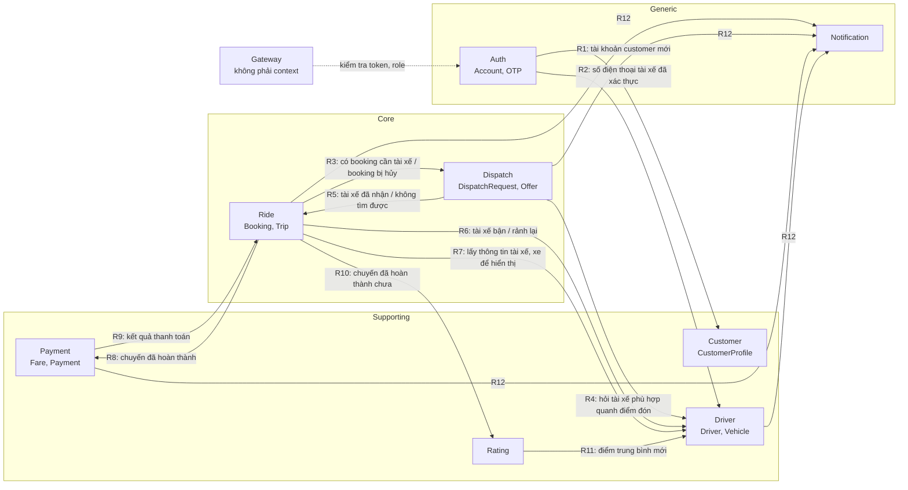
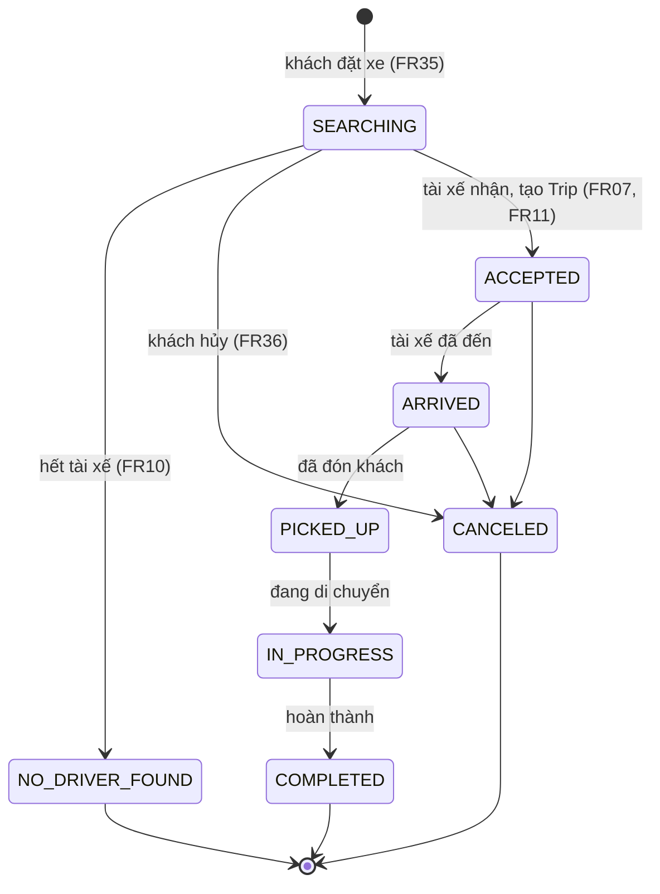

# 01 — Bounded context của Cab Booking System

> Vòng 1 (chỉ BA). Nguồn: `srs.md`, `CLAUDE.md`, `docs/study/00-ban-do-phieu-cham.md`, `docs/study/01-nghiep-vu-va-truy-vet.md`.
> File này trả lời: **chia hệ thống thành những phần nào, vì sao**. Chưa quyết định gRPC/Kafka (file 02) và loại database (file 03).
> Tên trạng thái viết HOA trong file này là **đề xuất**, trừ các tên đã có trong SRS (`NO_DRIVER_FOUND`, `CANCELED`, `FAILED`, Online/Offline, "chờ duyệt"). Tên chính thức chốt ở spec.

## 1. Tóm tắt

| # | Bounded context | Loại subdomain | Microservice | Aggregate gốc |
|---|---|---|---|---|
| 1 | Xác thực & Tài khoản (Auth) | Generic | `auth-service` | Account, OtpVerification |
| 2 | Khách hàng (Customer) | Supporting | `customer-service` | CustomerProfile |
| 3 | Tài xế & Phương tiện (Driver) | Supporting | `driver-service` | Driver (gồm Vehicle), VehicleType |
| 4 | Đặt xe & Chuyến đi (Ride) | **Core** | `ride-service` | Booking, Trip |
| 5 | Ghép tài xế (Dispatch) | **Core** | `dispatch-service` | DispatchRequest (gồm Offer) |
| 6 | Cước & Thanh toán (Payment) | Supporting | `payment-service` | Fare, Payment |
| 7 | Đánh giá (Rating) | Supporting | chạy trong `ride-service` | Rating |
| 8 | Thông báo (Notification) | Generic | `notification-service` | Notification |

Tổng: **7 service nghiệp vụ + Gateway**. Gateway không phải bounded context: nó không có mô hình nghiệp vụ, chỉ làm xác thực token, kiểm tra role, rate limit, routing, log (`CLAUDE.md`).

So với bản cũ (Identity, Fleet, Booking, Dispatch, Trip, Payment, Rating, Notification — 8 service):

| Thay đổi | Lý do ngắn | ADR |
|---|---|---|
| Identity → tách `auth-service` + `customer-service` | Nhận xét của giảng viên; hai mô hình khác nhau | ADR-001 |
| Booking + Trip + Rating → gộp `ride-service` | Cùng một vòng đời, cần nhất quán trong một giao dịch (NFR14) | ADR-002 |
| Dispatch giữ riêng | Quy trình chạy nền có hẹn giờ, ngôn ngữ riêng | ADR-003 |
| Fleet → đổi tên `driver-service` | Tên khớp tác nhân Driver trong SRS; nội dung không đổi | — |
| Không có service Operations | Không mục chấm nào cần; xem mục 6.3 | — |

## 2. Phân loại subdomain

| Subdomain | Loại | Lý do | Truy vết |
|---|---|---|---|
| Đặt xe và vòng đời chuyến đi | Core | Là sản phẩm chính của doanh nghiệp; BG01 và BG03 nằm ở đây. Sai ở đây là mất chuyến | BG01, BG03, BR01, BR03, BR07 |
| Ghép tài xế | Core | Lợi thế cạnh tranh: tìm đúng tài xế, nhanh. 7/12 BRULE (01–07) nằm ở đây; không mua sẵn được vì quy tắc ghép là của riêng doanh nghiệp | BG01, BR02, NFR02 |
| Tài xế & phương tiện | Supporting | Cần có để ghép được (BRULE01, 02) nhưng tự nó không tạo khác biệt; nghiệp vụ là quản lý hồ sơ và duyệt | BG02, BR06, BR08 |
| Khách hàng | Supporting | Hồ sơ cá nhân, CRUD đơn giản, phục vụ core | BG03, BR05 |
| Cước & thanh toán | Supporting | **Bảng giá** là quy tắc riêng của doanh nghiệp nên không phải generic; còn **xử lý giao dịch thẻ** giao cho Payment Provider (BRULE09) | BG04, BR04, BR12 |
| Đánh giá | Supporting | Một quy tắc (BRULE11), phục vụ chất lượng dịch vụ | BG03, BR11 |
| Xác thực & tài khoản | Generic | Bài toán giống mọi hệ thống (đăng nhập, băm mật khẩu, JWT, OTP); không riêng gì ngành đặt xe | BG05, NFR06, NFR07 |
| Thông báo | Generic | Gửi tin theo sự kiện; thực tế mua dịch vụ ngoài (Notification Provider trong SRS) | BR10, NFR05, NFR13 |

Ý nghĩa khi vấn đáp: **core** là nơi đầu tư thiết kế kỹ nhất (máy trạng thái, bất biến, test); **generic** làm đơn giản nhất có thể.

## 3. Sơ đồ quan hệ giữa các context (mức khái niệm)

Mũi tên `A --> B` nghĩa là **A cần biết một điều gì đó từ B hoặc báo cho B**. Đây chưa phải gRPC hay Kafka; file 02 sẽ quyết định từng đường.

| Mã | Bên cần | Cần biết gì từ bên nào | Vì yêu cầu nào | Bên cần có phải chờ kết quả mới làm tiếp không? (gợi ý cho file 02) |
|---|---|---|---|---|
| R1 | Customer | Auth vừa tạo tài khoản `customer` (account_id) để có hồ sơ tương ứng | FR26, FR27; mục 9, 11 | Chưa chốt — xem câu hỏi Q3 |
| R2 | Driver | Số điện thoại của tài xế đã qua OTP và account_id | FR39; mục 21 | Chưa chốt — xem Q4 |
| R3 | Dispatch | Booking mới: điểm đón, loại xe; và booking bị hủy khi đang tìm | FR35, FR36, FR06 | Không: FR35 nói Booking được tạo ở trạng thái "đang tìm tài xế", khách không chờ ghép xong |
| R4 | Dispatch | Danh sách tài xế sẵn sàng, đúng loại xe, trong 1 km, kèm khoảng cách | FR02–FR05, BRULE01–03 | Có: không có danh sách thì không gửi offer được |
| R5 | Ride | Tài xế nào đã nhận, hoặc đã hết tài xế | FR07, FR10, FR11, BRULE07 | Chưa chốt — xem Q5 (tranh chấp hủy và nhận cùng lúc) |
| R6 | Driver | Tài xế vừa được gán chuyến (bận); chuyến kết thúc hoặc hủy (rảnh) | BRULE01 | File 02 quyết định |
| R7 | Ride | Tên tài xế, biển số, loại xe, vị trí hiện tại | FR14, FR15; UC10, UC22 | Có: cần dữ liệu để trả lời khách ngay |
| R8 | Payment | Chuyến hoàn thành: quãng đường, thời gian, loại xe, phương thức thanh toán, khách, tài xế | FR16, BRULE08 | Không: NFR05 — Payment lỗi không được chặn việc kết thúc chuyến |
| R9 | Ride | Chuyến đã được thanh toán hay chưa | NFR14; mục 19 | Chưa chốt — xem Q6 |
| R10 | Rating | Chuyến có ở trạng thái hoàn thành và thuộc về khách này không | BRULE11 | Cùng service nên đọc trực tiếp (ADR-002) |
| R11 | Driver | Điểm đánh giá trung bình mới của tài xế | UC17 bước 5 | Không: khách không cần chờ |
| R12 | Notification | Sự kiện cần báo: đặt xe được nhận, tài xế nhận chuyến, đổi trạng thái, hủy, không tìm được tài xế, kết quả thanh toán, kết quả duyệt hồ sơ | FR10, FR21–FR24, FR36, AC16, AC20 | Không: NFR05 — Notification lỗi không được chặn đặt xe |

Cặp **không có quan hệ** (file 02 không được nối): Customer ↔ Driver, Customer ↔ Dispatch, Customer ↔ Payment, Auth ↔ Ride, Auth ↔ Dispatch, Auth ↔ Payment, Payment ↔ Dispatch, Payment ↔ Driver, Notification → bất kỳ context nào (Notification chỉ nhận).

## 4. Thuật ngữ mang nghĩa khác nhau giữa các context

Đây là lý do chính để vẽ ranh giới: cùng một từ, mỗi context hiểu một kiểu.

| Thuật ngữ | Auth | Customer | Driver | Ride | Dispatch | Payment | Rating |
|---|---|---|---|---|---|---|---|
| **Khách hàng** | Account có role `customer` | Hồ sơ cá nhân | — | `customer_id` của người đặt | — | Người trả tiền (`customer_id`) | Người chấm điểm |
| **Tài xế** | Account có role `driver` | — | Hồ sơ, giấy phép, xe, trạng thái duyệt, trạng thái nhận chuyến, vị trí | `driver_id` được gán cho Trip | **Ứng viên**: `driver_id` + khoảng cách | — | Người được chấm |
| **Trạng thái (status)** | Tài khoản: hoạt động / bị khóa | — | Hai trạng thái riêng: **duyệt hồ sơ** (chờ duyệt / đã duyệt / từ chối) và **nhận chuyến** (Offline / Online / đang bận) | Trạng thái Booking; trạng thái Trip | Trạng thái Offer: đang chờ / nhận / từ chối / hết giờ | Trạng thái Payment: chờ / thành công / `FAILED` | — |
| **Yêu cầu** | — | — | — | **Booking**: yêu cầu đặt xe của khách (FR35) | **Offer**: yêu cầu nhận chuyến gửi cho một tài xế (FR06) | Yêu cầu thanh toán gửi Provider | — |
| **Hoàn thành** | — | — | — | Trip đến nơi, tài xế bấm hoàn thành | Phiên ghép kết thúc | Giao dịch thành công | — |
| **Hủy** | — | — | — | Booking/Trip → `CANCELED` | Dừng phiên ghép, hủy Offer đang chờ | — | — |
| **Loại xe** | — | — | **Danh mục gốc** VehicleType; mỗi Vehicle thuộc một loại | Loại khách chọn khi đặt (mã) | Điều kiện lọc (mã) | Khóa để tra bảng giá (mã) | — |

`vehicle_type` là mã dùng chung giữa các context (published language). Driver sở hữu danh mục; các context khác chỉ giữ mã, không giữ khóa ngoại.

## 5. Chi tiết từng bounded context

### 5.1 Auth — Xác thực & Tài khoản

| Mục | Nội dung |
|---|---|
| Trách nhiệm | Tạo tài khoản; kiểm tra thông tin đăng nhập; cấp token chứa `account_id` và `role`; xác thực số điện thoại bằng OTP; giữ role của tài khoản |
| **Không** làm | Không giữ hồ sơ cá nhân (họ tên, ngày sinh, giấy phép lái xe). Không biết gì về booking, chuyến, tiền |
| Ngôn ngữ chung | **Account**: danh tính đăng nhập (định danh đăng nhập + mật khẩu đã băm + role + trạng thái). **Credential**: mật khẩu, chỉ lưu dạng băm. **Role**: `customer` / `driver` / `admin`. **Token**: JWT cấp sau khi đăng nhập. **OTP**: mã dùng một lần để chứng minh sở hữu số điện thoại. **Khóa**: tài khoản bị chặn đăng nhập |
| Aggregate gốc | **Account**; **OtpVerification** (số điện thoại, mã, hạn dùng, đã dùng chưa) |
| FR | FR26, FR32, FR39 (phần OTP) |
| UC | UC01, UC02, UC25 (phần gán role), UC29 (bước OTP) |
| Mục chấm | 9, 10, 21 (OTP), 24, 25; cung cấp token và role cho mục 27, 28 |

Quy tắc phải bảo vệ:

| # | Quy tắc | Nguồn |
|---|---|---|
| A1 | Đăng ký công khai chỉ tạo role `customer` | `CLAUDE.md` — quyết định đã chốt |
| A2 | Định danh đăng nhập (số điện thoại / email) là duy nhất | UC02; mục 9 (đường lỗi "trùng") |
| A3 | Tài khoản bị khóa thì từ chối đăng nhập | Exception của UC02, NFR06 |
| A4 | Không lưu mật khẩu dạng rõ; không trả mật khẩu/băm ra ngoài | NFR08, mục 24 |
| A5 | Token mang role; mọi thao tác quản trị dựa vào role này | BRULE12, NFR07, FR32 |
| A6 | OTP có hạn dùng và chỉ dùng một lần; tài khoản `driver` chỉ được tạo sau khi OTP đúng | FR39, mục 21 |
| A7 | Tài khoản `admin` không tạo qua API công khai (tạo sẵn bằng seed) | BRULE12 — **suy đoán**, xem Q8 |

### 5.2 Customer — Khách hàng

| Mục | Nội dung |
|---|---|
| Trách nhiệm | Giữ và cho xem / sửa hồ sơ cá nhân của khách hàng; cho tra cứu khách hàng theo mã |
| **Không** làm | Không giữ mật khẩu, không đăng nhập. Không giữ booking của khách (thuộc Ride) |
| Ngôn ngữ chung | **CustomerProfile**: thông tin cá nhân của một khách (họ tên, ngày sinh, thông tin liên lạc). **Mã khách hàng**: định danh hồ sơ, tham chiếu tới Account bằng ID |
| Aggregate gốc | **CustomerProfile** |
| FR | FR27; FR26 (phần tạo hồ sơ khi đăng ký) |
| UC | UC03; UC01 (phần hồ sơ); UC19 (Admin tra cứu) |
| Mục chấm | 11; 9 (đăng ký xong phải có hồ sơ); 24 (dữ liệu cá nhân); 26 (họ tên là text do người dùng nhập) |

| # | Quy tắc | Nguồn |
|---|---|---|
| C1 | Mỗi tài khoản `customer` có đúng một hồ sơ | FR26, FR27 |
| C2 | Khách chỉ xem / sửa hồ sơ của chính mình; `admin` xem được mọi hồ sơ | NFR08, NFR16, BRULE12 — phạm vi xem của role khác: xem Q9 |
| C3 | Dữ liệu cá nhân được bảo vệ khi lưu | NFR08, NFR16, mục 24 |

### 5.3 Driver — Tài xế & Phương tiện

| Mục | Nội dung |
|---|---|
| Trách nhiệm | Hồ sơ tài xế và phương tiện; quy trình đăng ký — duyệt hồ sơ; trạng thái nhận chuyến Online/Offline; vị trí hiện tại của tài xế; trả lời câu hỏi "tài xế nào sẵn sàng, đúng loại xe, quanh tọa độ này" |
| **Không** làm | Không quyết định hỏi tài xế nào trước, không gửi offer (thuộc Dispatch). Không giữ mật khẩu |
| Ngôn ngữ chung | **Hồ sơ tài xế**: thông tin cá nhân + giấy phép lái xe. **Trạng thái duyệt**: chờ duyệt / đã duyệt / bị từ chối. **Trạng thái nhận chuyến** (availability): Offline, Online (= Available/Ready của BRULE01), đang bận (đang có chuyến). **Vehicle**: xe của tài xế. **VehicleType**: loại xe. **Vị trí hiện tại**: tọa độ mới nhất tài xế gửi lên. **Tài xế lân cận**: tài xế thỏa điều kiện quanh một tọa độ |
| Aggregate gốc | **Driver** (gồm Vehicle; trạng thái duyệt, trạng thái nhận chuyến, vị trí hiện tại, điểm trung bình); **VehicleType** (danh mục) |
| FR | FR28, FR29, FR38, FR39; FR02, FR03, FR04 (thực hiện truy vấn); FR13 |
| UC | UC12, UC20, UC21, UC28, UC29, UC30 |
| Mục chấm | 12, 13, 21, 22, 23; 24 (số giấy phép, số điện thoại) |

| # | Quy tắc | Nguồn |
|---|---|---|
| D1 | Chỉ tài xế đang Online **và không bận** mới xuất hiện trong kết quả tìm | BRULE01, FR38, AC03 |
| D2 | Kết quả tìm chỉ gồm tài xế có xe đúng loại yêu cầu | BRULE02, FR03, AC04 |
| D3 | Kết quả tìm nằm trong bán kính (mặc định 1 km), kèm khoảng cách, sắp từ gần đến xa, có limit và paging | FR02, FR04, mục 13 |
| D4 | Hồ sơ mới tạo luôn ở trạng thái chờ duyệt | FR39, AC19 |
| D5 | Chỉ `admin` được duyệt / từ chối; chỉ hồ sơ đang chờ duyệt mới duyệt / từ chối được | BRULE12, FR39, AC20 |
| D6 | Chỉ tài xế đã được duyệt mới bật Online được | **Suy ra** từ FR39 + BRULE01; SRS chưa có BRULE riêng — xem Q10 |
| D7 | Biển số xe không trùng | FR29 — **suy đoán**, chốt ở file 03 |

Ghi chú: SRS có entity `DriverLocation` (lịch sử vị trí). Mục chấm chỉ cần **vị trí hiện tại** (mục 13). Có lưu lịch sử hay không để file 03 quyết định (xem Q11).

### 5.4 Ride — Đặt xe & Chuyến đi (core)

| Mục | Nội dung |
|---|---|
| Trách nhiệm | Nhận yêu cầu đặt xe; giữ vòng đời Booking và Trip từ lúc tạo đến lúc hoàn thành hoặc hủy; danh sách booking của khách; cho khách theo dõi chuyến; cho `admin` giám sát và can thiệp chuyến lỗi; lịch sử chuyến |
| **Không** làm | Không tìm tài xế, không gửi offer, không đếm giờ phản hồi (Dispatch). Không tính tiền (Payment) |
| Ngôn ngữ chung | **Booking**: yêu cầu đặt xe của khách — điểm đón, điểm đến, loại xe, phương thức thanh toán. **Trip**: chuyến đi thực tế, chỉ tồn tại sau khi có tài xế nhận. **Điểm đón / điểm đến**: tọa độ + địa chỉ. **Đang tìm tài xế**: Booking đã tạo, chưa có tài xế. **`NO_DRIVER_FOUND`**: đã hỏi hết mà không ai nhận. **`CANCELED`**: bị hủy kèm lý do. **Hoàn thành**: tài xế xác nhận đã đến nơi |
| Aggregate gốc | **Booking**; **Trip** (tham chiếu Booking, `driver_id`) |
| FR | FR01, FR11, FR12, FR14, FR15, FR30, FR31, FR35, FR36, FR37; FR34 (lịch sử chuyến) |
| UC | UC04, UC05, UC10, UC11, UC18, UC22, UC23, UC27 |
| Mục chấm | 14, 15 (tạo booking), 16 (tạo Trip khi tài xế nhận), 17, 18; 26 (địa chỉ, lý do hủy) |

Vòng đời (đề xuất, chốt ở spec mục 15–18):

| # | Quy tắc | Nguồn |
|---|---|---|
| R-1 | Thiếu điểm đón, điểm đến, loại xe hoặc phương thức thanh toán thì không tạo Booking | FR35, AC01, AC02 |
| R-2 | Booking mới luôn ở trạng thái đang tìm tài xế | FR35 |
| R-3 | Trip chỉ được tạo khi có tài xế nhận; một Booking có nhiều nhất một Trip và một tài xế | FR07, FR11, AC06, NFR14 |
| R-4 | Trạng thái Trip chỉ đi theo đúng trình tự, không nhảy cóc, không lùi | FR12, mục 17 — SRS chưa có BRULE riêng (Q10) |
| R-5 | Chỉ tài xế được gán mới cập nhật được trạng thái Trip của mình | BRULE12 (tinh thần), NFR07 |
| R-6 | Hủy phải kèm lý do; chuyến đã hoàn thành hoặc đã hủy thì không hủy được nữa. Hủy được đến trạng thái nào: Q7 | FR36, AC16 |
| R-7 | Khách chỉ thấy booking của chính mình; danh sách có limit và paging | FR37, AC17, NFR08 |
| R-8 | Chuyến chỉ được báo "hoàn thành" cho Payment khi Trip thật sự ở trạng thái hoàn thành | BRULE08 |
| R-9 | Không tìm được tài xế thì Booking chuyển `NO_DRIVER_FOUND` | UC06 Exception, BRULE07 |
| R-10 | Chỉ `admin` được xem mọi chuyến và can thiệp chuyến lỗi | BRULE12, FR30, FR31, AC15 |

### 5.5 Dispatch — Ghép tài xế (core)

| Mục | Nội dung |
|---|---|
| Trách nhiệm | Với mỗi Booking đang tìm tài xế: lấy danh sách ứng viên, hỏi **lần lượt** từ gần đến xa, đếm giờ phản hồi, xử lý nhận / từ chối / hết giờ, kết luận "đã có tài xế" hoặc "không tìm được" |
| **Không** làm | Không giữ hồ sơ hay vị trí tài xế (hỏi Driver). Không giữ trạng thái chuyến (báo cho Ride) |
| Ngôn ngữ chung | **Phiên ghép (DispatchRequest)**: một lần đi tìm tài xế cho một Booking. **Ứng viên**: tài xế thỏa điều kiện, kèm khoảng cách. **Offer**: lời mời nhận chuyến gửi cho một tài xế, có hạn trả lời. **Hết giờ (timeout)**: tài xế không trả lời trong hạn. **Đã loại**: tài xế từ chối hoặc hết giờ, không hỏi lại trong phiên này |
| Aggregate gốc | **DispatchRequest** (gồm danh sách Offer và danh sách tài xế đã loại) |
| FR | FR05, FR06, FR07, FR08, FR09, FR10 (kết luận); khởi phát FR02–FR04 |
| UC | UC06, UC07, UC08, UC09 |
| Mục chấm | 15 (tìm tài xế, gửi offer), 16 (tài xế nhận) |

| # | Quy tắc | Nguồn |
|---|---|---|
| P1 | Chỉ gửi Offer cho tài xế sẵn sàng | BRULE01, AC03 |
| P2 | Chỉ gửi Offer cho tài xế đúng loại xe | BRULE02, AC04 |
| P3 | Trong các ứng viên, tài xế gần điểm đón nhất được hỏi trước | BRULE03, FR05, AC05 |
| P4 | Mỗi Offer có hạn trả lời; quá hạn thì coi là không phản hồi | BRULE04, BRULE06, FR09, AC08 |
| P5 | Tài xế từ chối hoặc hết giờ thì bị loại khỏi phiên, phiên **tiếp tục** với người kế tiếp, Booking không bị hủy | BRULE05, BRULE06, FR08, AC07 |
| P6 | Hết ứng viên thì kết luận không tìm được và phải báo khách | BRULE07, FR10, AC09 |
| P7 | Mỗi phiên có nhiều nhất một Offer được nhận; nhận rồi thì phiên đóng | FR07, AC06, NFR14 |
| P8 | Chỉ tài xế được mời mới trả lời được Offer đó; Offer đã hết giờ hoặc đã trả lời thì không trả lời lại được | BRULE04, NFR07 |
| P9 | Tại một thời điểm mỗi phiên chỉ có một Offer đang chờ (hỏi lần lượt, không phát đồng loạt) | BRULE03 ("gửi … trước") — **diễn giải**, xem Q12 |

Thời hạn trả lời (BRULE04 ghi "do doanh nghiệp quy định") chưa có con số: Q12.

### 5.6 Payment — Cước & Thanh toán

| Mục | Nội dung |
|---|---|
| Trách nhiệm | Tính cước sau khi chuyến hoàn thành; ghi nhận thanh toán tiền mặt; gửi yêu cầu thanh toán điện tử và nhận kết quả (callback) từ Payment Provider; cho thanh toán lại khi thất bại; lưu giao dịch để tra cứu, đối soát; chống xử lý lặp |
| **Không** làm | Không lưu số thẻ / tài khoản ngân hàng. Không giữ trạng thái chuyến |
| Ngôn ngữ chung | **Fare**: cước của một chuyến (cước mở cửa + theo quãng đường + theo thời gian + phụ phí). **Bảng giá**: quy tắc tính theo loại xe. **Payment**: một giao dịch thanh toán cho một chuyến. **Phương thức**: tiền mặt / điện tử, do khách chọn lúc đặt xe. **Callback (webhook)**: Provider báo kết quả. **Khóa chống lặp (idempotency key)**: mã để nhận ra yêu cầu gửi lại. **Retry**: thanh toán lại sau khi thất bại |
| Aggregate gốc | **Fare** (một cho mỗi Trip); **Payment** |
| FR | FR16, FR17, FR18, FR19, FR20; FR34 (lịch sử giao dịch) |
| UC | UC13, UC14, UC15, UC24 |
| Mục chấm | 19, 30; 24 (dữ liệu giao dịch) |

| # | Quy tắc | Nguồn |
|---|---|---|
| M1 | Chỉ tính cước khi chuyến đã hoàn thành; mỗi chuyến một Fare | BRULE08, FR16 |
| M2 | Không lưu thông tin thẻ / tài khoản; chỉ lưu mã giao dịch của Provider | BRULE09, NFR09, FR20 |
| M3 | Giao dịch thất bại vẫn phải được lưu với trạng thái `FAILED` và khách được báo | BRULE10, FR19, AC13 |
| M4 | Thất bại thì được thanh toán lại theo chính sách | FR19, UC15, AC13 — số lần tối đa: Q13 |
| M5 | Cùng một yêu cầu / callback gửi lại thì trả đúng kết quả cũ, không trừ tiền lần hai | Mục 30, NFR14 — SRS chưa có FR/BRULE riêng (Q10) |
| M6 | Một chuyến chỉ có nhiều nhất một Payment thành công | NFR14 |
| M7 | Phương thức thanh toán lấy theo lựa chọn lúc đặt xe | FR35, `CLAUDE.md` — quyết định đã chốt |

Payment Provider là hệ thống ngoài (SRS: stakeholder). Project dùng nhà cung cấp giả lập hay sandbox thật: Q14.

### 5.7 Rating — Đánh giá

| Mục | Nội dung |
|---|---|
| Trách nhiệm | Nhận điểm và nhận xét của khách cho một chuyến đã hoàn thành; tính điểm trung bình của tài xế |
| Ngôn ngữ chung | **Rating**: một lần chấm cho một chuyến (điểm + nhận xét). **Điểm trung bình**: số tổng hợp của một tài xế |
| Aggregate gốc | **Rating** |
| FR / UC | FR25 / UC17 |
| Mục chấm | 20; 26 (nhận xét là text tự do) |

| # | Quy tắc | Nguồn |
|---|---|---|
| G1 | Chỉ đánh giá chuyến đã hoàn thành | BRULE11, AC14 |
| G2 | Chỉ khách của chính chuyến đó được đánh giá | BRULE11 ("khách hàng đã hoàn thành chuyến") |
| G3 | Mỗi chuyến chỉ một đánh giá | Exception của UC17 |
| G4 | Điểm nằm trong thang cho phép | UC17 bước 3 — thang điểm 1–5 là **suy đoán**, chốt ở spec mục 20 |

### 5.8 Notification — Thông báo

| Mục | Nội dung |
|---|---|
| Trách nhiệm | Nghe các sự kiện nghiệp vụ, tạo thông báo cho đúng người nhận, cho người dùng xem thông báo của mình |
| **Không** làm | Không quyết định nghiệp vụ. Không context nào chờ Notification |
| Ngôn ngữ chung | **Notification**: một tin gửi cho một người (người nhận, loại, tiêu đề, nội dung, trạng thái). **Người nhận**: `account_id`. **Kênh**: cách gửi (trong ứng dụng / SMS / email) |
| Aggregate gốc | **Notification** |
| FR / UC | FR21, FR22, FR23, FR24; phần "thông báo" của FR10, FR11, FR19, FR36 / UC16 |
| Mục chấm | 16, 18 (vế "các bên được báo"); 22 (AC20: tài xế nhận kết quả duyệt); là nơi nhìn thấy event rõ nhất cho mục 7 |

| # | Quy tắc | Nguồn |
|---|---|---|
| N1 | Notification lỗi không được làm hỏng đặt xe, chuyến, thanh toán | NFR05, NFR15 |
| N2 | Người dùng chỉ xem được thông báo của mình | NFR08 |
| N3 | Không tìm được tài xế thì khách **phải** có thông báo | BRULE07, AC09 |
| N4 | Cùng một sự kiện nhận hai lần thì không tạo hai thông báo | NFR14 — **suy đoán** về mức cần thiết, chốt ở file 02 |

Kênh gửi thật (SMS / email / push) cần Notification Provider. Đề xuất: chỉ lưu thông báo trong ứng dụng và cho xem qua API — xem Q14.

## 6. Context → microservice: lý do tách, gộp

### 6.1 Bảng ánh xạ

| Context | Service | Tách hay gộp | Lý do | Đánh đổi |
|---|---|---|---|---|
| Auth | `auth-service` | **Tách** khỏi Customer | Auth phục vụ cả ba role; hồ sơ khách chỉ là của khách. Tài xế đã có hồ sơ ở Driver, nên hồ sơ khách ở Customer là đối xứng. Mật khẩu tách khỏi dữ liệu cá nhân (NFR08, mục 24). Đúng nhận xét của giảng viên | Đăng ký khách chạm hai service: có thể tạo được tài khoản mà chưa có hồ sơ. Phải xử lý ở file 02 |
| Customer | `customer-service` | Tách | Như trên. Tốc độ thay đổi khác: hồ sơ hay thêm trường, xác thực thì ổn định | Service nhỏ (1 FR, 1–2 mục chấm) |
| Driver | `driver-service` | Giữ một service cho hồ sơ + xe + trạng thái + vị trí | BRULE01 và BRULE02 cần **cùng lúc** trạng thái, loại xe và vị trí trong một truy vấn (mục 13). Tách vị trí ra service riêng thì mỗi lần tìm phải ghép dữ liệu hai nơi | Vị trí cập nhật rất thường xuyên, hồ sơ thì hiếm; hai kiểu tải nằm chung. Chấp nhận ở quy mô đồ án |
| Ride (Booking + Trip) | `ride-service` | **Gộp** Booking và Trip | Một vòng đời liên tục; lúc tài xế nhận phải đổi Booking **và** tạo Trip cùng lúc (NFR14); FR36 là **một** yêu cầu hủy cho cả hai; mục 14 cần danh sách booking kèm trạng thái chuyến | Service lớn nhất hệ thống; đội lớn sẽ khó chia việc. Xem ADR-002 |
| Rating | trong `ride-service` | **Gộp** về triển khai, vẫn là context riêng | BRULE11 cần biết chuyến đã hoàn thành và thuộc về ai — dữ liệu này nằm ngay tại Ride. Tách riêng thì một service chỉ gánh 1 mục chấm và phải gọi ngược về Ride | Rating không triển khai, mở rộng độc lập được. Giữ thành module và bảng riêng để tách sau. Xem ADR-002 |
| Dispatch | `dispatch-service` | **Tách** khỏi Ride | Là quy trình chạy nền kéo dài (hỏi nhiều tài xế × thời hạn), có hẹn giờ; khách không chờ nó (FR35). Ngôn ngữ riêng (Offer, ứng viên, hết giờ). Thuật toán ghép là phần hay đổi nhất (NFR12). Ghép chậm hoặc lỗi không chặn việc nhận booking (NFR05) | Thêm một ranh giới giữa hai context core: "tài xế nhận" phải được hai service cùng ghi nhận, và có tranh chấp hủy — nhận. Đây là quyết định dễ bị hỏi nhất. Xem ADR-003 |
| Payment (Fare + Payment) | `payment-service` | Gộp Fare và Payment; tách khỏi Ride | NFR05 nêu đích danh Payment: lỗi Payment không được làm dừng đặt xe. Dữ liệu tiền cần kiểm soát riêng (NFR09, BRULE09). Fare và Payment luôn đi liền (UC14 tiền điều kiện: đã tính cước) | Tính cước cần dữ liệu chuyến từ Ride (R8) |
| Notification | `notification-service` | Tách | NFR05 nêu đích danh Notification. Chỉ nghe sự kiện, không ai chờ nó | Thêm một service và một database cho chức năng đơn giản |

### 6.2 Tên cũ → tên mới (tài liệu `docs/study/` còn dùng tên cũ)

| Tên trong `docs/study/` | Tên trong thiết kế này |
|---|---|
| Identity | `auth-service` + `customer-service` |
| Fleet | `driver-service` |
| Booking, Trip, Rating | `ride-service` |
| Dispatch, Payment, Notification | giữ nguyên |
| Operations | không có service; xem 6.3 |

### 6.3 Phần vận hành của Admin (FR30, FR31, FR33, FR34)

Không lập context / service Operations vì **không mục chấm nào cần** (`01-nghiep-vu-va-truy-vet.md` mục 3.5 đã ghi "Không có trong phiếu"), và các chức năng này chỉ là thao tác của role `admin` trên dữ liệu đã có chủ:

| FR | Nằm ở | Ghi chú |
|---|---|---|
| FR30 Giám sát chuyến | Ride (role `admin`) | Đọc danh sách chuyến theo trạng thái |
| FR31 Xử lý chuyến lỗi | Ride (role `admin`) | Ví dụ: `admin` hủy chuyến bị treo |
| FR33 Báo cáo | **Chưa gán** | Cần tổng hợp dữ liệu nhiều context; ngoài 30 mục chấm. Đề xuất hoãn — Q1 |
| FR34 Lịch sử, Audit Log | Phân tán: lịch sử chuyến ở Ride, giao dịch ở Payment; thao tác của `admin` ghi tại context xảy ra thao tác | Không có audit tập trung. Mức độ cần làm: Q2 |

## 7. Kiểm tra độ phủ

### 7.1 FR01–FR39

| FR | Context chính | Tham gia | Ghi chú |
|---|---|---|---|
| FR01 Xác định vị trí khách | Ride | — | Client gửi tọa độ điểm đón; không tích hợp Map/GPS Provider (Q14) |
| FR02 Tìm tài xế sẵn có | Driver | Dispatch (bên hỏi) | Mục 13 |
| FR03 Lọc theo loại xe | Driver | Dispatch | |
| FR04 Tính khoảng cách | Driver | Dispatch | |
| FR05 Xếp hạng theo khoảng cách | Dispatch | Driver (trả danh sách đã sắp) | Dispatch chịu trách nhiệm quy tắc "ai được hỏi trước" |
| FR06 Gửi yêu cầu nhận chuyến | Dispatch | Notification (Q5) | |
| FR07 Tài xế chấp nhận | Dispatch | Ride, Driver | |
| FR08 Tài xế từ chối | Dispatch | — | |
| FR09 Tài xế không phản hồi | Dispatch | — | |
| FR10 Báo không tìm được tài xế | Dispatch (kết luận) | Ride (`NO_DRIVER_FOUND`), Notification | |
| FR11 Xác nhận tài xế cho chuyến | Ride | Notification | |
| FR12 Cập nhật trạng thái chuyến | Ride | — | |
| FR13 Theo dõi vị trí tài xế | Driver | Ride (hiển thị) | |
| FR14 Hiển thị thông tin chuyến | Ride | Driver | |
| FR15 Thời gian dự kiến đến | Ride | Driver | Ngoài phiếu chấm; ước lượng đơn giản — Q11 |
| FR16 Tính cước | Payment | Ride (dữ liệu chuyến) | |
| FR17 Thanh toán tiền mặt | Payment | — | Ai xác nhận đã thu tiền: Q13 |
| FR18 Thanh toán điện tử | Payment | — | |
| FR19 Thanh toán thất bại | Payment | Notification | |
| FR20 Lưu giao dịch | Payment | — | |
| FR21 Thông báo đặt xe | Notification | Ride | |
| FR22 Thông báo tài xế nhận chuyến | Notification | Ride / Dispatch | |
| FR23 Thông báo trạng thái chuyến | Notification | Ride | |
| FR24 Thông báo thanh toán | Notification | Payment | |
| FR25 Đánh giá tài xế | Rating | Ride, Driver (điểm trung bình) | |
| FR26 Đăng ký và đăng nhập | Auth | Customer, Driver (hồ sơ) | |
| FR27 Hồ sơ khách hàng | Customer | — | |
| FR28 Hồ sơ tài xế | Driver | — | |
| FR29 Phương tiện | Driver | — | |
| FR30 Giám sát chuyến | Ride | — | Role `admin`; ngoài phiếu chấm |
| FR31 Xử lý chuyến lỗi | Ride | — | Role `admin`; ngoài phiếu chấm |
| FR32 Phân quyền | Auth (giữ role) | Gateway (kiểm tra) | Mục 28 |
| FR33 Báo cáo | **Chưa gán** | — | Q1 |
| FR34 Lịch sử, Audit Log | Phân tán | Ride, Payment, Driver | Gán một phần — Q2 |
| FR35 Tạo yêu cầu đặt xe | Ride | Dispatch | |
| FR36 Hủy yêu cầu / hủy chuyến | Ride | Dispatch, Driver, Notification | |
| FR37 Danh sách booking | Ride | — | Mục 14 |
| FR38 Bật / tắt nhận chuyến | Driver | — | Mục 23 |
| FR39 Đăng ký và duyệt hồ sơ tài xế | Driver | Auth (OTP, tài khoản), Notification | Mục 21, 22 |

Kết quả: 37/39 FR có context chính. **FR33 chưa gán; FR34 gán một phần.** Cả hai đều ngoài 30 mục chấm.

### 7.2 30 mục chấm

| # | Nội dung | Thuộc về | Ghi chú |
|---|---|---|---|
| 1 | Kiến trúc tổ chức source code | Hạ tầng / tài liệu | File này + cấu trúc thư mục trong `CLAUDE.md` |
| 2 | `.gitignore`, `.env` | Hạ tầng | |
| 3 | Nhiệm vụ Gateway | Gateway | File 02 |
| 4 | IPC giữa các microservice | Toàn hệ thống | File 02, đầu vào là bảng R1–R12 |
| 5 | Compose, liệt kê container | Hạ tầng | |
| 6 | `/health`, `/ready`, `/health/services` | Gateway | Mỗi service phải trả lời được câu hỏi "còn sống không" |
| 7 | Kafka | Hạ tầng + các context phát sự kiện | File 02 |
| 8 | Mọi request qua Gateway | Gateway / Compose | |
| 9 | Đăng ký khách hàng → đăng nhập được | Auth, Customer | |
| 10 | Đăng nhập → token | Auth | |
| 11 | Xem khách hàng theo mã | Customer | |
| 12 | Xem tài xế theo mã | Driver | |
| 13 | Tài xế quanh tọa độ 1 km | Driver | |
| 14 | Booking của khách, limit + paging | Ride | |
| 15 | Đặt xe → tìm tài xế → gửi offer | Ride, Dispatch, Driver | |
| 16 | Tài xế nhận chuyến | Dispatch, Ride, Driver, Notification | |
| 17 | Trạng thái chuyến đúng trình tự | Ride | |
| 18 | Hủy chuyến → `CANCELED`, các bên được báo | Ride, Notification; Dispatch, Driver tham gia | |
| 19 | Thanh toán online + callback → COMPLETED | Payment; Ride nếu COMPLETED là của chuyến | Q6 |
| 20 | Đánh giá chuyến | Rating | |
| 21 | Đăng ký tài xế (OTP) → chờ duyệt | Auth, Driver | |
| 22 | Admin duyệt / từ chối | Driver; Notification | |
| 23 | Tài xế bật / tắt nhận chuyến | Driver | |
| 24 | Mã hóa dữ liệu nhạy cảm + quản lý khóa | Cắt ngang: Auth, Customer, Driver, Payment | NFR08, NFR16; phạm vi trường nào: file 03 |
| 25 | SQL injection | Cắt ngang; demo tại Auth (đăng nhập) | Quy ước code trong `CLAUDE.md` |
| 26 | XSS | Cắt ngang: mọi context nhận text (Customer, Driver, Ride, Rating) | Xử lý ở đâu: file 02 / 04 |
| 27 | JWT bị sửa → 401 | Gateway (Auth cấp token) | |
| 28 | Sai quyền → 403 | Gateway (Auth giữ role) | |
| 29 | Spam → 429 | Gateway | |
| 30 | Replay thanh toán → response cũ | Payment | |

Kết quả: **30/30 mục có nơi nhận.** Không mục nào bị bỏ.

### 7.3 Mục chấm chưa có mã yêu cầu trong `srs.md`

Các mục này gán được context, nhưng **không truy vết được về FR/BRULE cụ thể** — chỉ bám vào NFR chung hoặc không có gì:

| Mục chấm | Hiện bám vào | Thiếu |
|---|---|---|
| 17 (đúng trình tự) | FR12 | BRULE về thứ tự trạng thái |
| 29 (rate limit) | Không có NFR nào nói về giới hạn tần suất (gần nhất: NFR04) | NFR mới |
| 30 (replay thanh toán) | NFR14 | BRULE / FR về chống xử lý lặp |
| 24, 26 | NFR08, NFR16 | Đủ ở mức NFR; chưa có AC |
| 6, 7, 8 | Quy tắc kiến trúc trong `CLAUDE.md` | Không cần FR (hạ tầng) |
| "Chỉ tài xế đã duyệt mới Online" (D6) | Suy ra từ FR39 | BRULE mới |

Chưa thêm mã mới vào `srs.md` trong vòng này; xem Q10.

## 8. Câu hỏi còn mở

Loại: **SV** = sinh viên tự quyết được; **GV** = nên hỏi giảng viên.

| # | Câu hỏi | Lựa chọn | Đề xuất | Hỏi ai |
|---|---|---|---|---|
| Q1 | FR33 (báo cáo) có làm không? | (a) Hoãn, ghi rõ ngoài phạm vi; (b) làm một API thống kê đơn giản trong Ride | (a) — không mục chấm nào cần | SV |
| Q2 | FR34 Audit Log làm đến mức nào? | (a) Mỗi context tự ghi thao tác quan trọng; (b) service audit tập trung nghe sự kiện | (a) | SV |
| Q3 | Đăng ký khách hàng chạm hai service (Auth tạo tài khoản, Customer tạo hồ sơ). Nếu bước hai lỗi thì sao? | (a) Auth báo sự kiện, Customer tạo hồ sơ sau — hồ sơ có thể trễ; (b) tạo đồng bộ cả hai, lỗi thì hoàn tác; (c) hồ sơ được tạo lần đầu khi khách cập nhật | Quyết ở file 02; lưu ý mục 11 cần hồ sơ có ngay sau mục 9 | GV — vì bài mẫu của thầy có đúng cặp Auth + Customer |
| Q4 | Tài xế chờ duyệt có đăng nhập được không? | (a) Được, nhưng không bật Online được (D6) — Auth không cần biết kết quả duyệt; (b) không được — Auth phải biết kết quả duyệt | (a) — ít phụ thuộc hơn, tài xế xem được trạng thái hồ sơ | SV |
| Q5 | Tài xế nhận Offer bằng cách nào khi không có push thật? Và khi tài xế bấm "nhận" đúng lúc khách bấm "hủy" thì bên nào thắng? | Offer: (a) tài xế gọi API xem offer đang chờ; (b) chỉ qua thông báo. Tranh chấp: Ride là nơi quyết định cuối vì giữ trạng thái Booking | (a) + Ride quyết định; chi tiết ở file 02 và spec 15–16 | SV |
| Q6 | Mục 19 "callback → COMPLETED": COMPLETED là trạng thái của **giao dịch** hay của **chuyến / booking**? | (a) Của Payment; (b) của Booking — khi đó Trip "hoàn thành" và Booking "COMPLETED sau khi trả tiền" là hai mốc khác nhau | Cần xem lại nguyên văn phiếu chấm; file này mới chỉ dựa trên bản tóm tắt trong `docs/study/00` | GV |
| Q7 | Khách hủy được đến trạng thái nào? Tài xế có được hủy không? | (a) Khách hủy được trước khi đón khách; (b) hủy được bất cứ lúc nào trước khi hoàn thành. SRS (UC27) chỉ ghi actor là Customer | (a); tài xế không hủy, gặp sự cố thì `admin` xử lý (FR31) | SV |
| Q8 | Tài khoản `admin` tạo bằng cách nào? UC25 "Quản lý phân quyền" có cần API quản lý role không? | (a) Seed sẵn, role cố định 3 giá trị; (b) API cho admin tạo admin / đổi role | (a) — mục 28 chỉ cần kiểm tra role | SV |
| Q9 | Mục 11, 12 "xem khách hàng / tài xế theo mã": role nào được xem của người khác? | (a) Chỉ chính chủ và `admin`; (b) tài xế xem được khách của chuyến mình và ngược lại | (a) cho API theo mã; thông tin đối phương trong chuyến trả kèm ở API chuyến (FR14) | SV |
| Q10 | Có thêm mã mới vào `srs.md` cho các quy tắc ở mục 7.3 không (thứ tự trạng thái, chống lặp thanh toán, rate limit, tài xế đã duyệt mới Online)? | (a) Thêm BRULE13–15 và NFR17, cập nhật RTM; (b) giữ nguyên, bám NFR chung | (a) — để mỗi mục chấm truy vết được; BA sẽ thêm khi được đồng ý | SV |
| Q11 | FR15 (thời gian dự kiến) và lịch sử vị trí (`DriverLocation` trong SRS) làm đến đâu? | (a) ETA = khoảng cách đường thẳng / tốc độ trung bình; chỉ lưu vị trí hiện tại; (b) lưu cả lịch sử | (a) — ngoài phiếu chấm | SV |
| Q12 | Thời hạn tài xế trả lời Offer là bao lâu (BRULE04 chưa có số)? Hỏi lần lượt từng người hay phát cho nhiều người cùng lúc? | Số gợi ý 15–30 giây; hỏi lần lượt theo BRULE03 | Lần lượt; thời hạn là biến cấu hình, đặt ngắn khi demo | SV |
| Q13 | Tiền mặt: ai xác nhận đã thu (FR17)? Thanh toán lại tối đa mấy lần (FR19 "theo chính sách")? | Tài xế xác nhận / tự động ghi nhận khi hoàn thành; 3 lần / không giới hạn | Tài xế xác nhận; tối đa 3 lần | SV |
| Q14 | Ba hệ thống ngoài trong SRS (Payment, Map/GPS, Notification Provider) có tích hợp thật không? | (a) Giả lập cả ba; (b) dùng sandbox thật cho Payment | (a) — phiếu chấm chỉ cần callback và chống replay | GV |
| Q15 | Tách Dispatch khỏi Ride có được xem là "vừa đủ" không, hay nên gộp để còn 6 service? | Xem ADR-003 | Giữ tách | GV |
| Q16 | Bảng Entity trong `srs.md` cho Customer, Driver, Operator **mỗi bảng tự giữ `password_hash`**; thiết kế này đưa mật khẩu về Account ở Auth. Có sửa bảng Entity trong SRS cho khớp không? | (a) Sửa SRS; (b) giữ SRS là mô hình khái niệm ban đầu, ghi chú dẫn sang file 03 | (a), làm cùng lúc với file 03 | SV |
