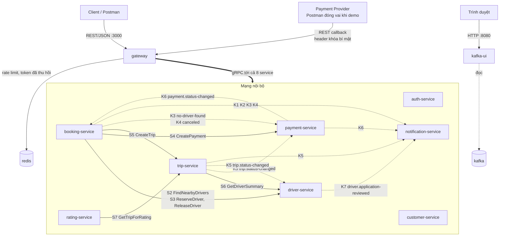
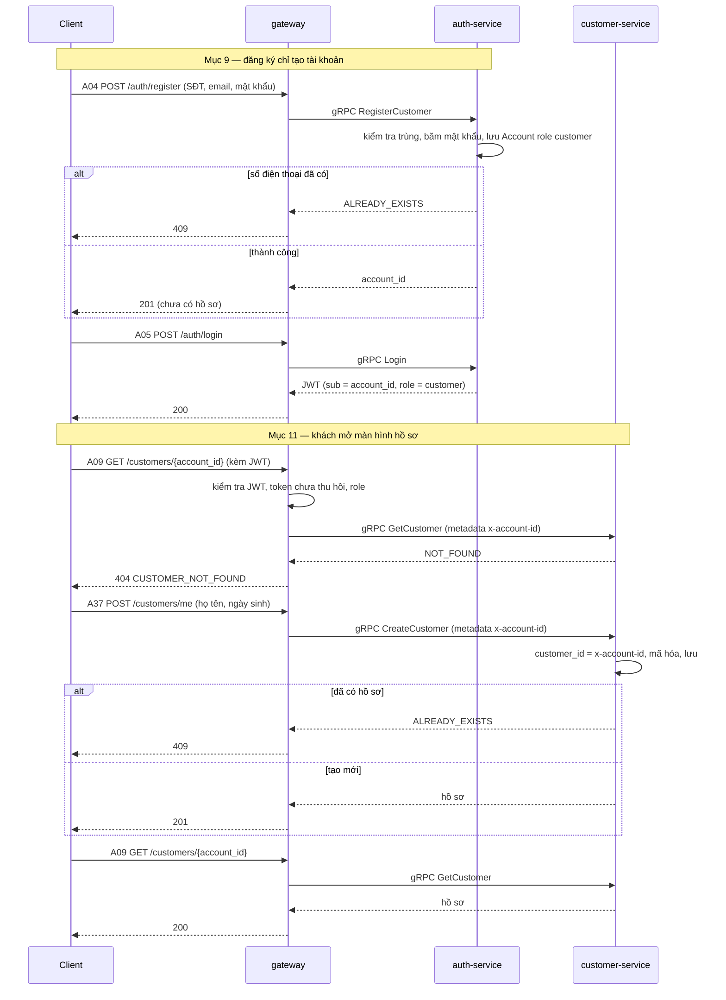
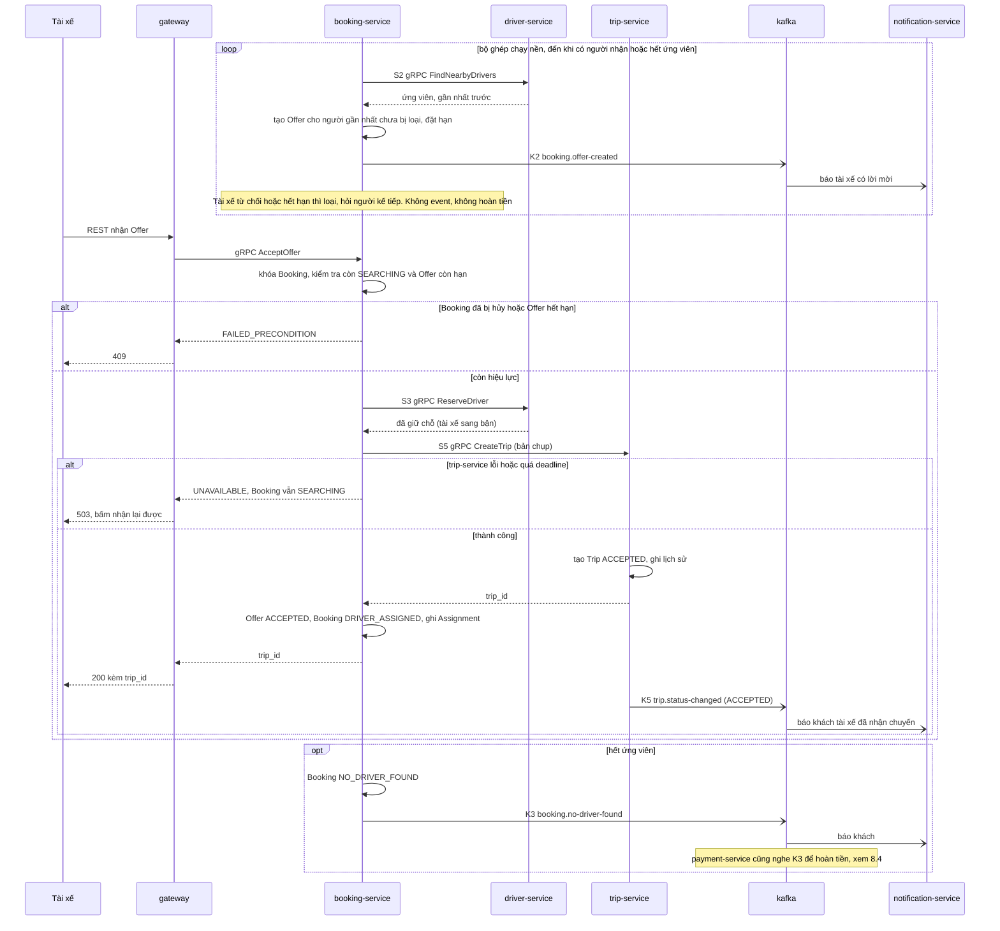
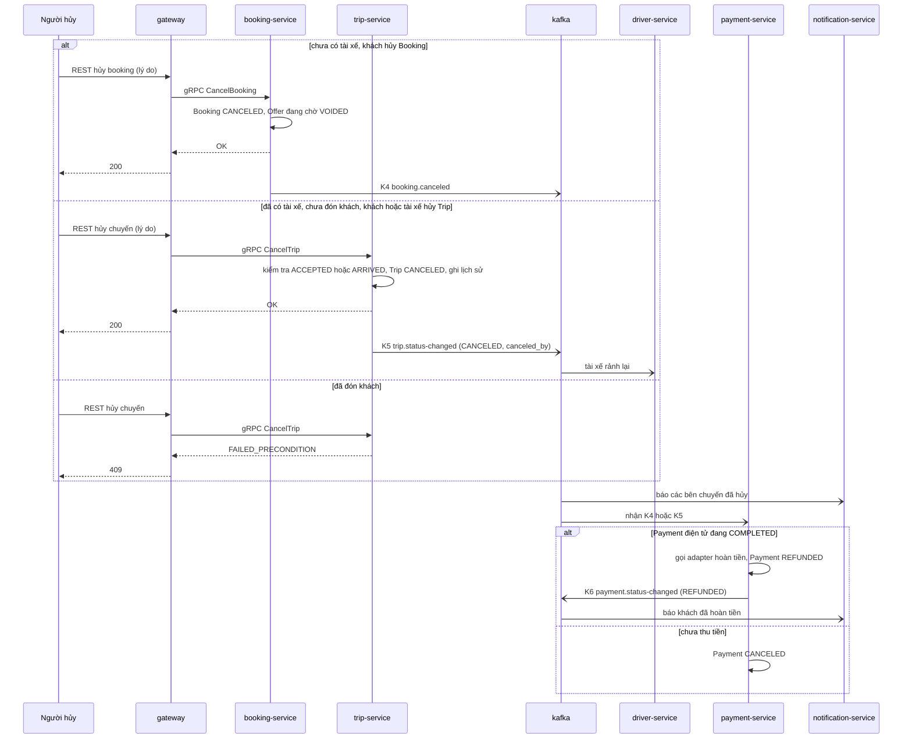
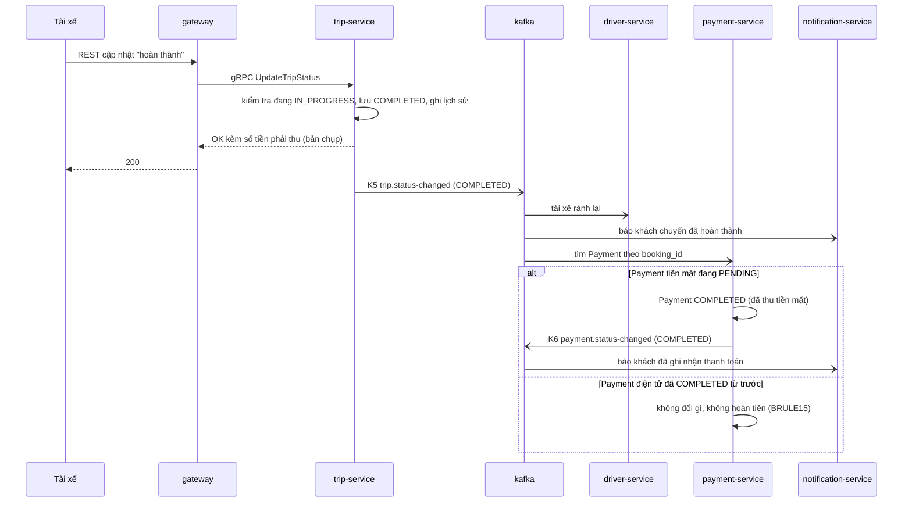
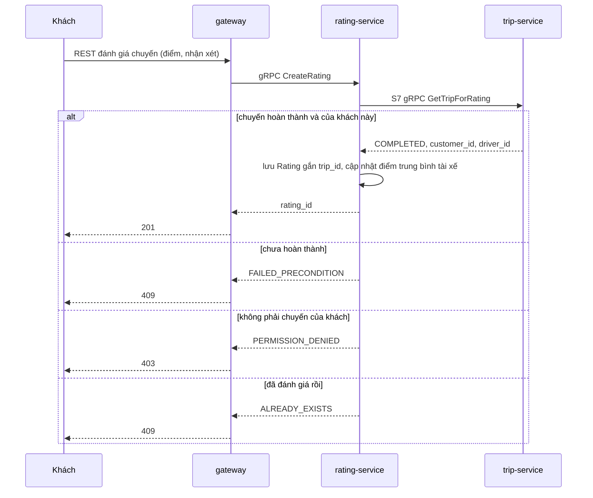

# 02 — Kiến trúc và đường giao tiếp

> Vòng 1 (chỉ BA), bản sửa 2026-10-02 lần 3: theo **8 service giảng viên chốt** và các quyết định mới trong `CLAUDE.md`. Đầu vào: `01-bounded-contexts.md` (bảng R1–R16), `CLAUDE.md`, `srs.md`; mốc so sánh: `docs/reference/thiet-ke-da-duyet.md`.
> File này trả lời: **service nào nói chuyện với service nào, bằng gì, vì yêu cầu nào** — và cặp nào **không** nói chuyện.
> Không thuộc file này: loại database và schema (file 03), đường dẫn REST chi tiết (file 04), field của `.proto` (spec).
>
> **Đã chốt (`CLAUDE.md`):** 8 service; Kafka + Kafka UI; Redis ở Gateway, không Nginx; **Auth và Customer không gọi nhau** (2026-10-03); Booking → Trip `CreateTrip` đồng bộ; Booking → Payment đồng bộ để tính cước và tạo thanh toán; kết quả thanh toán và hoàn tiền đi bằng event; khóa chính số nguyên (ADR-015); JWT HS256 (ADR-016); gửi event ngay sau commit, không outbox (ADR-017); `FAILED_PRECONDITION` → 409; ba hệ thống ngoài giả lập đơn giản nhất sau adapter.
> **Sửa 2026-10-03 lần 2 (luật thi: gõ tay mọi request, không mở tài liệu):** đóng Q19 (HS256 — ADR-016) và Q20 (bỏ outbox — ADR-017, ADR-005 bị thay thế); đóng GĐ-6, GĐ-8. **Không đổi đường giao tiếp nào** (S2–S7, K1–K7 giữ nguyên).
> **Sửa 2026-10-03** theo góp ý giảng viên: **bỏ đường S1** (`auth-service` → `customer-service` `CreateProfile`) — ADR-013 thay ADR-004. **Giữ nguyên mã S2–S7**, không đánh số lại, để không phải đổi mã ở file 03, 04, 05 và ADR; mã S1 bỏ trống, không dùng lại. Hệ thống ngoài giả lập đơn giản: callback xác thực bằng khóa bí mật trong header, bỏ chữ ký HMAC — ADR-014. Đóng Q43, Q50. Cùng ngày đóng Q56 (Booking không gọi Customer — mục 9), Q57 (`simulate_result: "MANUAL"` — mục 4.5, 8.2), Q58.
> **Chưa chốt:** chỗ ghi **[GĐ-n]** là *giả định tạm*, liệt kê ở mục 11.
> **Đồng bộ 2026-10-02 lần 4** (cùng lúc viết file 03, 04): Booking tính quãng đường, Payment tính cước (đóng Q38, GĐ-13); hạn thanh toán BRULE17 → K6 có thêm `CANCELED`; Redis dừng thì cho qua (đóng Q39); đăng xuất ở Gateway theo FR42 (đóng Q40); tìm tài xế bằng Haversine (ADR-011). Chỉ sửa các dòng bị ảnh hưởng.

## 1. Tóm tắt

**Nguyên tắc (giảng viên):** hai service cần làm việc với nhau thì **mặc định gọi đồng bộ bằng gRPC**. Chỉ dùng Kafka khi nghiệp vụ **bắt buộc** bất đồng bộ, tức có ít nhất một trong ba lý do:

| Mã lý do | Nghĩa |
|---|---|
| **L1** | Bên phát **không được chờ**: không có ai đang đợi câu trả lời, hoặc kết quả đến vào lúc không biết trước |
| **L2** | Bên phát **không được thất bại theo** bên nhận (NFR05, NFR15) |
| **L3** | **Nhiều bên** cùng cần biết một sự kiện |

| Loại đường | Số lượng | Ghi chú |
|---|---|---|
| Client → Gateway | REST/JSON | Cổng duy nhất cho nghiệp vụ (mục chấm 8) |
| Gateway → service | gRPC, tới cả 8 service | Mỗi service có ít nhất một API cho người dùng |
| Gateway → Redis | 2 việc | Bộ đếm rate limit; danh sách token đã thu hồi |
| Service → service đồng bộ | **6 lời gọi gRPC** (S2–S7; S1 đã bỏ 2026-10-03) | Mặc định |
| Service → service bất đồng bộ | **7 topic Kafka** (K1–K7) | Mỗi topic ghi lý do L1 / L2 / L3 |
| Cặp service có nối | 10 / 28 | Mục 9 |
| Cặp service **không** nối | 18 / 28 | Mục 9 |

Mỗi service dùng kiểu giao tiếp nào (ngoài việc nhận gRPC từ Gateway):

| Service | Gọi gRPC sang service khác | Bị service khác gọi gRPC | Publish Kafka | Subscribe Kafka |
|---|---|---|---|---|
| `auth-service` | — | — | — | — |
| `customer-service` | — | — | — | — |
| `driver-service` | — | S2, S3, S6 | K7 | K5 |
| `booking-service` | S2, S3 → driver; S4 → payment; S5 → trip | — | K1, K2, K3, K4 | K6 |
| `trip-service` | S6 → driver | S5, S7 | K5 | — |
| `payment-service` | — | S4 | K6 | K3, K4, K5 |
| `notification-service` | — | — | — | K1–K7 |
| `rating-service` | S7 → trip | — | — | — |

Trả lời nhận xét "không phải service nào cũng giao tiếp cả đồng bộ lẫn bất đồng bộ":

| Nhóm | Service | Vì sao |
|---|---|---|
| **Không giao tiếp với service nào**, chỉ được Gateway gọi | `auth-service`, `customer-service` | Không context nào cần dữ liệu của chúng: các service khác chỉ cần `account_id` và role, Gateway đã lấy từ token. Hồ sơ khách do khách tạo sau khi đăng nhập, nên Auth không phải báo Customer (ADR-013) |
| Chỉ gRPC, **không dùng Kafka** | `rating-service` | Không có sự kiện nào của nó mà context khác cần biết, và nó không cần nghe sự kiện nào |
| Chỉ Kafka, **không có gRPC với service khác** | `notification-service` | Không ai được phép chờ hay lỗi theo nó (NFR05 nêu đích danh) |
| Cả hai | `booking-service`, `trip-service`, `driver-service`, `payment-service` | Mỗi đường có lý do riêng ở mục 4.3 và 6.2 |

## 2. Thành phần và nhiệm vụ

### 2.1 Danh sách

| Thành phần | Nhiệm vụ | Truy vết | Mở cổng ra máy chủ? |
|---|---|---|---|
| `gateway` | Xem 2.2 | Mục chấm 3, 6, 8, 27, 28, 29 | **Có — 3000** |
| `redis` | Bộ đếm rate limit; danh sách token đã thu hồi. **Chỉ Gateway dùng**; không chứa dữ liệu nghiệp vụ | Mục chấm 29; NFR06; `CLAUDE.md` | Không |
| `auth-service` | Tài khoản, đăng nhập, cấp JWT, OTP, role. Đăng ký khách chỉ tạo tài khoản | FR26, FR32, FR39 | Không |
| `customer-service` | Hồ sơ khách hàng: khách tạo sau khi đăng nhập, xem, sửa | FR27, BRULE18 | Không |
| `driver-service` | Hồ sơ tài xế, xe, duyệt hồ sơ, Online/Offline, vị trí, tìm tài xế quanh tọa độ, giữ chỗ tài xế | FR02–FR04, FR13, FR28, FR29, FR38, FR39 | Không |
| `booking-service` | Booking kèm cước, chờ thanh toán, danh sách booking, ghép tài xế (Offer, đếm giờ, phân công), hủy khi chưa có tài xế | FR01, FR05–FR11, FR35–FR37 | Không |
| `trip-service` | Trip, trình tự trạng thái, lịch sử, hủy chuyến (khách, tài xế), theo dõi, giám sát | FR11, FR12, FR14, FR15, FR30, FR36, FR41 | Không |
| `payment-service` | Cước cố định, thanh toán trả trước, callback, ghi nhận tiền mặt, hoàn tiền, chống lặp | FR16–FR20, FR40 | Không |
| `notification-service` | Tạo và cho xem thông báo | FR21–FR24 | Không |
| `rating-service` | Đánh giá chuyến, điểm trung bình tài xế | FR25 | Không |
| `kafka` | Kênh sự kiện | Mục chấm 7 | Không |
| `kafka-ui` | Giao diện web xem topic và event | Mục chấm 7 | **Có — 8080** |
| `kafka-init` | Tạo topic khi khởi động rồi thoát | Mục chấm 7 | Không |
| Database của từng service | File 03 | Database-per-service | Không |

**Chỉ hai thành phần mở cổng ra máy chủ:** Gateway tại `http://localhost:3000` và Kafka UI tại `http://localhost:8080` (hai số cổng cố định, ghi thẳng trong `compose.yaml`; không còn biến `GATEWAY_PORT`, `KAFKA_UI_PORT` — file 03 mục 13). Kafka UI là công cụ xem, không phải đường vào nghiệp vụ.

**Không đặt Nginx** trước Gateway: Gateway tự làm reverse proxy (`CLAUDE.md`).

### 2.2 Nhiệm vụ Gateway (mục chấm 3)

| # | Nhiệm vụ | Làm gì | Truy vết |
|---|---|---|---|
| 1 | Authentication | Kiểm tra chữ ký và hạn của JWT **tại chỗ**, không gọi `auth-service` mỗi request; rồi tra Redis xem token đã bị thu hồi chưa. Sai → 401 | NFR06, mục 27 |
| 2 | Thu hồi token | Đăng xuất: Gateway tự ghi mã token (`jti`) vào Redis, tự hết hạn cùng lúc với token; không gọi `auth-service` | **FR42, UC33**, NFR06; `CLAUDE.md` — đã chốt |
| 3 | Authorization | So role trong token với role mà route cho phép. Sai → 403 | BRULE12, NFR07, FR32, mục 28 |
| 4 | Rate limiting | Đếm request trong Redis theo IP (route công khai) hoặc theo tài khoản. Vượt → 429 | Mục 29 |
| 5 | Routing | Đổi REST/JSON → gRPC; đổi gRPC status → HTTP theo bảng trong `CLAUDE.md` (gồm `FAILED_PRECONDITION` → 409) | Mục 3, 4, 8 |
| 6 | Log | Ghi method, đường dẫn, mã trả về, thời gian, mã request. Không ghi mật khẩu, token, dữ liệu cá nhân | NFR10, NFR08 |
| 7 | Health | `/health`, `/ready` (gồm cả Redis), `/health/services` (hỏi health của cả 8 service qua gRPC) | Mục 6 |
| 8 | Kiểm tra hình thức đầu vào | Thiếu trường, sai kiểu → 400 trước khi gọi service | Mục 25, 26 |

Vì sao Redis mà không đếm trong bộ nhớ Gateway: bộ đếm và danh sách thu hồi phải **còn sau khi Gateway khởi động lại** và **dùng chung** nếu chạy nhiều bản Gateway; Redis có sẵn lệnh tăng số kèm hạn tự xóa. Chi tiết: ADR-010. Key và thời gian sống: file 03 mục 12.

**Redis dừng (đã chốt):** Gateway vẫn cho request đi qua và ghi log cảnh báo. Trong lúc đó không có rate limit và token đã đăng xuất tạm dùng lại được.

Gateway **không** làm:

| Không làm | Vì sao |
|---|---|
| Logic nghiệp vụ, kể cả gọi lần lượt hai service rồi ghép kết quả | `CLAUDE.md`. Đăng ký và tạo hồ sơ là **hai request riêng của client**, không ai điều phối (ADR-013); điều phối đặt xe và nhận chuyến do `booking-service` làm (S2–S5) |
| Truy cập database nghiệp vụ; dùng Redis làm cache dữ liệu nghiệp vụ | `CLAUDE.md` |
| Kiểm tra "dữ liệu này có phải của bạn không" | Là quy tắc nghiệp vụ (C2, B13, B14, T3, T5, T7, V2 trong file 01). Gateway chỉ biết role |
| Kiểm tra khóa bí mật của callback thanh toán | Khóa thuộc context Payment; `payment-service` so khóa (ADR-014) |
| Tự chuyển "hủy booking" thành "hủy chuyến" | Hủy sai giai đoạn do service trả 409; client gọi đúng thao tác |

Gateway chuyển danh tính đã kiểm tra (`account_id`, `role`) cho service qua gRPC metadata. Service tin metadata này vì chỉ Gateway vào được mạng nội bộ của Compose (mục chấm 8). Lời gọi service → service chuyển tiếp nguyên metadata đó.

**JWT ký HS256** bằng một khóa bí mật `JWT_SECRET` mà chỉ `auth-service` (ký) và Gateway (kiểm tra) có — đã chốt 2026-10-03, ADR-016 (trước là giả định GĐ-8: khóa bất đối xứng).

## 3. Sơ đồ kiến trúc

Nét liền = gRPC (bên gọi chờ kết quả). Nét đứt = Kafka (bên phát không chờ). Mọi đường nét đứt đi qua `kafka`; sơ đồ vẽ thẳng từ bên phát đến bên nghe để thấy ai cần biết điều gì. Tám đường Gateway → service vẽ gộp.



Sơ đồ cố ý **không có mũi tên nào nối `auth-service` và `customer-service`** với service khác (bỏ S1 ngày 2026-10-03, ADR-013). Cổng thanh toán giả lập là **module bên trong** `payment-service` (không phải container): nhận yêu cầu thu / hoàn rồi gọi ngay phần xử lý callback. Mũi tên `PP → gateway` là callback gửi từ ngoài vào khi Postman đóng vai Provider (mục 19, 30) — ADR-014.

## 4. Bảng mọi đường giao tiếp

### 4.1 Từ ngoài vào

| Mã | Bên gửi | Bên nhận | Kiểu | Nội dung | Vì yêu cầu nào |
|---|---|---|---|---|---|
| C1 | Client (khách, tài xế, admin) | `gateway` :3000 | REST/JSON | Mọi thao tác của người dùng | `CLAUDE.md`; mục 8 |
| C2 | Payment Provider (giả lập: Postman đóng vai) | `gateway` :3000 | REST/JSON, không JWT; header `X-Callback-Secret` chứa khóa bí mật cố định (không HMAC) | Callback kết quả giao dịch. Trong luồng thường adapter đã gọi phần xử lý callback ngay trong `payment-service`; đường này dùng để demo "hệ thống nhận callback" và replay | FR18, UC14, mục 19, 30; ADR-014 |
| C3 | Trình duyệt của người chấm | `kafka-ui` :8080 | HTTP | Xem topic, message, consumer group | Mục 7 |

### 4.2 Gateway → service (gRPC) và Gateway → Redis

Tên rpc là gợi ý ở mức nhóm; spec chốt từng rpc.

| Mã | Bên nhận | Nhóm thao tác | Vì yêu cầu nào | Mục chấm |
|---|---|---|---|---|
| G1 | `auth-service` | Đăng ký tài khoản khách (chỉ tài khoản), đăng nhập, xin OTP, xác nhận OTP và tạo tài khoản tài xế | FR26, FR39 | 9, 10, 21, 25 |
| G2 | `customer-service` | **Tạo** hồ sơ của mình (sau khi đăng nhập); xem / sửa hồ sơ của mình; xem khách hàng theo mã | FR27, BRULE18 | 11, 24, 26 |
| G3 | `driver-service` | Nộp hồ sơ tài xế và xe; xem tài xế theo mã; tài xế quanh tọa độ; bật / tắt nhận chuyến; gửi vị trí; admin duyệt / từ chối | FR02–FR04, FR13, FR28, FR29, FR38, FR39 | 12, 13, 21, 22, 23 |
| G4 | `booking-service` | Tạo booking (trả về cước, mã thanh toán, trạng thái); danh sách booking; xem booking; hủy booking chưa có tài xế; tài xế xem Offer đang chờ **[GĐ-2]**, nhận (trả về mã chuyến), từ chối | FR06–FR08, FR35–FR37 | 14, 15, 16, 18 |
| G5 | `trip-service` | Xem chuyến; cập nhật trạng thái; khách hủy chuyến; tài xế hủy chuyến; admin xem danh sách | FR12, FR14, FR30, FR36, FR41 | 17, 18 |
| G6 | `payment-service` | Xem thanh toán của một booking; nhận callback; thanh toán lại (kèm khóa chống lặp); tra cứu giao dịch | FR18–FR20, UC24 | 19, 30 |
| G7 | `notification-service` | Xem thông báo của mình | FR21–FR24, UC16 | 16, 18, 22 |
| G8 | `rating-service` | Tạo đánh giá cho một chuyến; xem đánh giá của chuyến; xem điểm trung bình của tài xế | FR25 | 20 |
| G9 | cả 8 service | Health check | Mục chấm 6 | 6 |
| G10 | `redis` (không phải gRPC) | Tăng bộ đếm rate limit; ghi và tra token đã thu hồi | Mục 29; NFR06 | 27, 29 |

Mọi lời gọi có deadline; hết deadline hoặc service không chạy → 503. Con số: Q25.

Vì sao tài xế gửi vị trí là gRPC qua Gateway mà **không** phát lên Kafka: không context nào cần *dòng* vị trí. Booking hỏi khi cần ghép (S2), Trip hỏi khi khách mở màn hình theo dõi (S6).

### 4.3 Service → service đồng bộ (gRPC)

| Mã | Bên gọi → bên nhận | Lời gọi | Vì sao bên gọi phải có kết quả mới làm tiếp | Vì yêu cầu nào | Khi bên nhận không sẵn sàng |
|---|---|---|---|---|---|
| ~~S1~~ | ~~`auth-service` → `customer-service`~~ | **Đã bỏ 2026-10-03** (góp ý giảng viên). Đăng ký chỉ tạo tài khoản; khách tạo hồ sơ bằng một request riêng sau khi đăng nhập. Mã S1 không dùng lại | — | FR26, FR27, BRULE18 | ADR-013 (thay ADR-004) |
| S2 | `booking-service` → `driver-service` | `FindNearbyDrivers(tọa độ, loại xe, bán kính, limit)` — gọi lại ở mỗi vòng ghép | Không có danh sách ứng viên **mới nhất** thì không gửi Offer được | FR02–FR05, BRULE01–03, NFR02; mục 15 | Bộ ghép thử lại vài lần; vẫn lỗi thì kết luận `NO_DRIVER_FOUND` (K3) để booking không treo và khách được hoàn tiền (Q24) |
| S3 | `booking-service` → `driver-service` | `ReserveDriver(driver_id, booking_id)` khi tài xế bấm nhận; `ReleaseDriver(driver_id, booking_id)` để nhả chỗ khi không tạo được chuyến | Chỉ được xác nhận phân công khi tài xế **còn rảnh** (B11, D8); tài xế đang chờ câu trả lời | BRULE01, FR07, AC06, NFR14; mục 16 | Booking trả 503 cho tài xế, Offer vẫn chờ đến hết hạn; tài xế bấm lại được vì `ReserveDriver` gọi lặp cho kết quả như cũ |
| S4 | `booking-service` → `payment-service` | `CreatePayment(booking_id, customer_id, loại xe, quãng đường ước tính tính bằng mét, phương thức)` → `payment_id`, số tiền, trạng thái, hạn thanh toán. Booking tính quãng đường; Payment áp bảng giá (đã chốt) | Booking phải trả **ngay** cho khách số tiền và mã thanh toán (B15) | FR16, FR35, BRULE08; mục 15, 19 | Booking trả 503, **không tạo booking** — đánh đổi so với NFR05 (mục 4.6, ADR-009). Gọi lặp cùng `booking_id` trả Payment cũ |
| S5 | `booking-service` → `trip-service` | `CreateTrip(bản chụp booking + driver_id)` → `trip_id` | Tài xế nhận xong phải có ngay mã chuyến để cập nhật trạng thái; nhận chuyến mà không có Trip là vô nghĩa (B17) | FR07, FR11, FR12; mục 16 → 17 | Booking trả 503 cho tài xế; Booking vẫn `SEARCHING`, Offer vẫn chờ; tài xế bấm lại. Offer hết hạn mà chưa phân công: Booking gọi `ReleaseDriver`. ADR-008, Q35 |
| S6 | `trip-service` → `driver-service` | `GetDriverSummary(driver_id)`: tên, biển số, loại xe, vị trí hiện tại | Khách mở màn hình theo dõi chuyến, cần dữ liệu ngay; vị trí là dữ liệu sống nên không sao chép sẵn được | FR13, FR14, FR15, UC10 | Trip vẫn trả thông tin chuyến, bỏ trống phần tài xế / vị trí kèm cờ "chưa cập nhật" (luồng thay thế của UC10) |
| S7 | `rating-service` → `trip-service` | `GetTripForRating(trip_id)`: trạng thái, `customer_id`, `driver_id` | Chưa biết chuyến đã hoàn thành và thuộc về khách này thì không được nhận đánh giá | BRULE11, FR25, AC14; mục 20 | Rating trả 503; khách đánh giá lại sau |

Ghi chú:

- Thứ tự khi tài xế nhận: khóa Booking → S3 `ReserveDriver` → S5 `CreateTrip` → ghi `DRIVER_ASSIGNED`. Cả hai lời gọi đều lặp lại được theo `booking_id`.
- S6 không phục vụ mục chấm nào trực tiếp (FR14, FR15 ngoài phiếu). **Làm sau cùng.**
- Không có gRPC nào đi **vào** `booking-service`, `notification-service`, `auth-service`, `customer-service`, `rating-service` từ service khác.
- `auth-service` và `customer-service` không gọi và không bị service nào gọi.

### 4.4 Service → service bất đồng bộ (Kafka)

Chi tiết và lý do ở mục 6.2. Tóm tắt:

| Mã | Topic | Publish | Subscribe | Lý do bắt buộc bất đồng bộ |
|---|---|---|---|---|
| K1 | `booking.created` | `booking-service` | `notification-service` | L2 |
| K2 | `booking.offer-created` | `booking-service` | `notification-service` | L1, L2 |
| K3 | `booking.no-driver-found` | `booking-service` | `payment-service`, `notification-service` | L1, L2, L3 |
| K4 | `booking.canceled` | `booking-service` | `payment-service`, `notification-service` | L2, L3 |
| K5 | `trip.status-changed` | `trip-service` | `driver-service`, `payment-service`, `notification-service` | L2, L3 |
| K6 | `payment.status-changed` | `payment-service` | `booking-service`, `notification-service` | L1, L2, L3 |
| K7 | `driver.application-reviewed` | `driver-service` | `notification-service` | L2 |

### 4.5 Hệ thống ngoài (giả lập đơn giản nhất, sau adapter) — ADR-014

Không có đường mạng nào đi ra ngoài Compose, không có container giả lập riêng. Mỗi adapter là một module trong service, sau này thay bằng lời gọi thật mà không sửa nghiệp vụ (NFR13). Chế độ giả lập bật bằng biến môi trường `SIMULATION_MODE=true` của từng service (file 03 mục 13); **phải tắt khi chạy thật**.

| Hệ thống ngoài | Adapter nằm ở | Dùng cho | Giả lập bằng |
|---|---|---|---|
| Payment Provider — thu tiền | `payment-service` | Thanh toán điện tử trả trước (FR18, FR19) | Nhận yêu cầu thu (A31) → sinh `provider_transaction_id` → **gọi ngay phần xử lý callback** trong cùng tiến trình, mặc định `SUCCESS`. Field `simulate_result: "FAILED"` trong body A31 **chỉ có hiệu lực khi `SIMULATION_MODE=true`** để demo thanh toán lỗi; `simulate_result: "MANUAL"` (cùng điều kiện) thì adapter **không** gọi callback, giao dịch và Payment đứng `PENDING` chờ callback A32 từ Postman (mục chấm 19, Q57); tắt chế độ giả lập thì field bị bỏ qua |
| Payment Provider — hoàn tiền | `payment-service` | FR40 | Nhận yêu cầu hoàn → gọi ngay phần xử lý kết quả, luôn thành công |
| Payment Provider — callback từ ngoài | `gateway` → `payment-service` (C2) | Mục 19, 30 | Endpoint A32 vẫn giữ, **cùng một hàm xử lý** với callback nội bộ. Xác thực bằng khóa bí mật cố định `PAYMENT_CALLBACK_SECRET` trong header `X-Callback-Secret`, so sánh thời gian hằng; **không HMAC**. Callback cho giao dịch đã có kết quả → trả response cũ (replay) |
| Map / GPS Provider | `booking-service` (đã chốt) | Quãng đường ước tính điểm đón → điểm đến để tính cước (FR16) | Công thức khoảng cách Haversine × 1,3 |
| Notification Provider (thông báo, SMS) | `notification-service` | Gửi tin (FR21–FR24) | **Chỉ lưu vào database và ghi log** một dòng (loại, người nhận, mã event; không ghi dữ liệu cá nhân) |
| Kênh gửi OTP | `auth-service` | FR39, mục 21 | **Ghi log** mã OTP; khi `SIMULATION_MODE=true` thì **trả luôn mã trong response** của A07 để Postman lưu biến dùng tiếp. Không qua Notification (đóng Q43) |

Khoảng cách tài xế → điểm đón (FR04) do `driver-service` tính bằng công thức Haversine ngay trong truy vấn SQL của nó (không dùng PostGIS — ADR-011), không qua adapter.

### 4.6 Một service dừng thì cái gì dừng theo (NFR05)

| Service dừng | Vẫn chạy | Không chạy |
|---|---|---|
| `notification-service` | Tất cả nghiệp vụ | Chỉ thông báo (đến trễ khi service chạy lại) |
| `payment-service` | Ghép tài xế cho booking đã vào `SEARCHING`; nhận chuyến; chạy và hoàn thành chuyến; hủy booking, hủy chuyến (hoàn tiền thực hiện khi Payment chạy lại); đánh giá | **Tạo booking mới** (cả tiền mặt lẫn điện tử); nhận callback; booking đang chờ thanh toán chưa được vào tìm tài xế |
| `trip-service` | Đặt xe, thanh toán, ghép đến bước gửi Offer; hủy booking | Tài xế nhận chuyến; cập nhật và hủy chuyến; đánh giá |
| `driver-service` | Đặt xe, thanh toán; chuyến đang chạy vẫn cập nhật, hoàn thành, hủy | Ghép tài xế, nhận chuyến; tài xế rảnh lại trễ |
| `booking-service` | Chuyến đang chạy; callback thanh toán vẫn được ghi nhận; đánh giá | Đặt xe, ghép, nhận chuyến, hủy booking |
| `customer-service` | Mọi thứ trừ hồ sơ khách, **kể cả đăng ký tài khoản khách mới** (khác bản trước: S1 đã bỏ) | Tạo / xem / sửa hồ sơ khách |
| `rating-service` | Mọi thứ trừ đánh giá | Đánh giá |
| `auth-service` | Mọi request có token còn hạn, kể cả tạo và sửa hồ sơ khách | Đăng ký, đăng nhập, OTP |

Câu trả lời khi bị hỏi "NFR05 nói Payment lỗi không được làm ngừng đặt xe, sao Payment lại nằm trong luồng đặt xe?": đây là **đánh đổi đã chấp nhận** của trả trước với cước cố định (ADR-009). Phần giữ được: Payment lỗi không ảnh hưởng booking đã tạo, chuyến đang chạy và việc hủy; phần mất: không tạo được booking mới trong lúc Payment dừng.

## 5. Quyết định cho từng quan hệ R1–R16

| Quan hệ (file 01) | Quyết định | Đường | Lý do | Đánh đổi |
|---|---|---|---|---|
| R1 Auth → Customer: tạo hồ sơ | **Không nối** — đã chốt 2026-10-03 | — (S1 đã bỏ) | Giống thực tế: đăng ký → đăng nhập → mở màn hình hồ sơ. Customer lấy `customer_id` từ token, không cần Auth báo | Ngay sau đăng ký xem hồ sơ trả 404 đến khi khách tạo; mục 11 thêm một request tạo hồ sơ hoặc dùng KH1 seed. ADR-013 |
| R2 Auth → Driver: tài xế đã qua OTP | **Không nối** **[GĐ-4]** | — | Token mang `account_id` và role `driver` là bằng chứng đã qua OTP (A6) | Có thể tồn tại tài khoản `driver` chưa nộp hồ sơ |
| R3 Booking → Driver: ứng viên | **gRPC** | S2 | Cần danh sách ngay và phải mới nhất (BRULE01) | Ghép tài xế phụ thuộc Driver đang chạy |
| R4 Booking → Driver: giữ chỗ | **gRPC** | S3 | Phải có **một** nơi quyết định "tài xế này còn rảnh" — nơi giữ trạng thái đó (D8) | "Nhận chuyến" chạm ba service. ADR-007, ADR-008 |
| R5 Booking → Trip: tạo chuyến | **gRPC** — đã chốt | S5 | Tài xế cần mã chuyến ngay; nhận chuyến mà không có Trip là vô nghĩa | Trip lỗi thì không ai nhận được chuyến. ADR-008 |
| R6 Trip → Driver: tài xế rảnh lại | **Kafka** **[GĐ-14]** | K5 | L2: chuyến đã xong thì việc ghi nhận không được lỗi theo Driver. L3: sự kiện này Payment và Notification cũng cần, topic đằng nào cũng có | Tài xế vừa xong chuyến còn hiện là bận thêm một nhịp; tệ nhất: lỡ một lần được mời |
| R7 Trip → Driver: thông tin tài xế | **gRPC** | S6 | Khách cần xem ngay; vị trí là dữ liệu sống | Màn hình theo dõi phụ thuộc Driver; đã có đường lùi |
| R8 Trip → Payment: chuyến hoàn thành / bị hủy | **Kafka** — đã chốt | K5 | L2: Payment lỗi không được chặn việc kết thúc hay hủy chuyến (NFR05). L3 | Tiền mặt được ghi nhận, tiền được hoàn sau sự việc một nhịp |
| R9 Payment → Trip | **Không nối** | — | Không quy tắc nào của Trip phụ thuộc trạng thái tiền. "COMPLETED" ở mục 19 là của Payment | Màn hình chuyến không tự hiện trạng thái thanh toán; client hỏi Payment |
| R10 Rating → Trip | **gRPC** | S7 | Rating phải biết ngay để nhận hay từ chối (BRULE11); đúng nguyên tắc đồng bộ là mặc định | Đánh giá phụ thuộc Trip đang chạy. ADR-007 |
| R11 Rating → Driver: điểm trung bình | **Không nối** **[GĐ-11]** | — | Điểm tổng hợp thuộc Rating (V5). Ghép tài xế chỉ xét khoảng cách (BRULE03) | Hồ sơ tài xế (mục 12) không kèm điểm |
| R12 → Notification | **Kafka** | K1–K7 | L2: NFR05 nêu đích danh Notification | Thông báo có thể trễ; phải chống tạo trùng |
| R13 Trip → Booking: kết cục chuyến | **Không nối** **[GĐ-9b]** | — | Booking kết thúc ở `DRIVER_ASSIGNED` | Danh sách booking không hiện "hoàn thành / đã hủy chuyến" |
| R14 Booking → Payment: cước, tạo thanh toán | **gRPC** — đã chốt | S4 | Booking phải trả ngay cho khách số tiền và mã thanh toán | Payment lỗi thì không đặt được xe. ADR-009 |
| R15 Payment → Booking: kết quả thanh toán | **Kafka** — đã chốt | K6 | L1: kết quả do Provider gửi về lúc không biết trước, không request nào của Booking đang chờ. L2: tiền đã thu thì Payment phải ghi nhận xong dù Booking đang lỗi (NFR14). L3: Notification cũng cần (FR24) | Có khoảng trễ ngắn giữa thanh toán xong và bắt đầu tìm tài xế |
| R16 Booking → Payment: hủy / không tìm được tài xế | **Kafka** — đã chốt | K3, K4 | L2: việc hủy phải thành công dù Payment đang lỗi (NFR05). L1: "không tìm được tài xế" do tiến trình nền kết luận, không ai chờ. L3 | Tiền về sau khi hủy một nhịp; mất event là mất khoản hoàn (mục 6.3) |

Cặp Booking — Payment có **cả gRPC lẫn Kafka**, nhưng là ba việc khác nhau, mỗi việc một kiểu: *tạo* (cần số tiền ngay → gRPC), *kết quả* (đến sau, Payment không được chờ Booking → Kafka), *hủy* (Booking không được chờ Payment → Kafka).

## 6. Topic Kafka

### 6.1 Quy ước

| Điểm | Quy ước | Lý do |
|---|---|---|
| Tên topic | `<context>.<sự-kiện>`, chữ thường, gạch nối | Nhìn tên biết ai phát |
| Phong bì chung | `event_id` (chuỗi UUID do bên phát sinh bằng `crypto.randomUUID()` lúc gửi), `event_type`, `occurred_at`, `data` | `event_id` để nhận ra message lặp. Event không có bảng riêng nên không có số tự tăng; không ai phải gõ mã này nên không vướng luật thi (ADR-015). Các ID trong `data` là số nguyên |
| Khóa message (key) | ID của đối tượng chính | Kafka giữ thứ tự theo key: các event của cùng một chuyến, cùng một booking đến đúng thứ tự |
| Consumer group | Tên service | Mỗi service nhận mỗi event một lần, dù chạy nhiều bản |
| Nội dung | **Chỉ ID, trạng thái, số tiền.** Không họ tên, số điện thoại, địa chỉ, tọa độ, lý do hủy, nhận xét | NFR08, NFR16: event xem được trên Kafka UI |
| Tạo topic | `kafka-init` tạo sẵn theo danh sách; broker tắt tự tạo topic | Mục chấm 7: topic "được đăng ký rõ ràng" |

Kafka giao message **ít nhất một lần**, nên mọi consumer phải chịu được message lặp.

### 6.2 Bảng topic

| Mã | Topic | Publish | Subscribe — làm gì | Vì sao **bắt buộc** bất đồng bộ | FR / BRULE | Key | Field chính trong `data` | Xử lý message lặp |
|---|---|---|---|---|---|---|---|---|
| K1 | `booking.created` | `booking-service` | **Notification**: báo khách "đã nhận yêu cầu" | **L2**: Notification lỗi không được làm hỏng đặt xe (NFR05) | FR21, FR35 | `booking_id` | `booking_id`, `customer_id`, `vehicle_type`, `payment_method`, `status` | Mục 6.4 |
| K2 | `booking.offer-created` | `booking-service` | **Notification**: báo tài xế có lời mời | **L1**: bộ ghép chạy nền, không ai chờ. **L2** | FR06, UC07, UC16; mục 15 | `booking_id` | `offer_id`, `booking_id`, `driver_id`, `expires_at` | Mục 6.4 |
| K3 | `booking.no-driver-found` | `booking-service` | **Payment**: hoàn tiền nếu đã thu, hủy bỏ nếu chưa. **Notification**: báo khách | **L1**: do tiến trình nền kết luận. **L2**: kết luận không được kẹt vì Payment. **L3**: hai bên cần | FR10, FR40, BRULE07, BRULE14, AC09, AC22 | `booking_id` | `booking_id`, `customer_id`, `offers_tried` | Payment: xét theo trạng thái Payment (M8) |
| K4 | `booking.canceled` | `booking-service` | **Payment**: hoàn tiền nếu đã thu, hủy bỏ nếu chưa. **Notification**: báo khách; báo tài xế đang giữ Offer chờ | **L2**: hủy phải thành công dù Payment lỗi (NFR05). **L3** | FR36, FR40, BRULE14, BRULE17, AC16, AC22, AC25; mục 18 | `booking_id` | `booking_id`, `customer_id`, `canceled_by` (`customer` / `system`), `previous_status`, `pending_offer_driver_id` (có thể rỗng) | Payment: như K3. Khi Booking bị hủy do BRULE17, Payment đã `CANCELED` từ trước nên bỏ qua |
| K5 | `trip.status-changed` | `trip-service` | **Driver**: `COMPLETED` / `CANCELED` → tài xế rảnh lại. **Payment**: `COMPLETED` → ghi nhận tiền mặt; `CANCELED` → hoàn tiền hoặc hủy bỏ. **Notification**: báo khách và tài xế, gồm cả trạng thái đầu "tài xế đã nhận chuyến" | **L2**: kết thúc hay hủy chuyến không được lỗi theo Payment, Driver, Notification (NFR05). **L3**: ba bên cần | FR12, FR17, FR22, FR23, FR36, FR40, FR41, BRULE01, BRULE14, BRULE15, AC16, AC24; mục 16, 17, 18 | `trip_id` | `trip_id`, `booking_id`, `customer_id`, `driver_id`, `status`, `previous_status`; khi hủy thêm `canceled_by` | Driver: chỉ nhả nếu `booking_id` khớp booking đang giữ (D9). Payment: xét theo trạng thái Payment |
| K6 | `payment.status-changed` | `payment-service` | **Booking**: `COMPLETED` và Booking đang chờ thanh toán → chuyển sang tìm tài xế; `CANCELED` (quá hạn / hết lượt) và Booking đang chờ thanh toán → Booking `CANCELED`, phát K4. **Notification**: báo khách thành công / thất bại / đã hoàn tiền | **L1**: kết quả đến từ Provider, hoặc do tiến trình nền hết hạn kết luận, lúc không biết trước. **L2**: tiền đã thu thì phải ghi xong dù Booking lỗi. **L3** | FR18, FR19, FR24, FR40, BRULE10, BRULE13, BRULE17, AC12, AC13, AC21, AC22, AC25; mục 19 | `booking_id` | `payment_id`, `booking_id`, `customer_id`, `method`, `amount`, `status` (`COMPLETED` / `FAILED` / `REFUNDED` / `CANCELED`), `previous_status`, `reason` (khi `CANCELED`: `PAYMENT_EXPIRED` / `ATTEMPTS_EXHAUSTED`) | Booking: chỉ đổi khi đang `PENDING_PAYMENT`, còn lại bỏ qua |
| K7 | `driver.application-reviewed` | `driver-service` | **Notification**: báo tài xế kết quả duyệt | **L2**: duyệt hồ sơ không được lỗi theo Notification | FR39, AC20; mục 22 | `driver_id` | `driver_id`, `result` (duyệt / từ chối) | Mục 6.4 |

Năm điều cần giải thích được:

| Điều | Lý do |
|---|---|
| **Notification biết "tài xế đã nhận chuyến" qua K5** với `status = ACCEPTED`, không có topic `booking.driver-assigned` | Bàn giao Booking → Trip giờ là gRPC (S5), nên event "đã phân công" không còn subscriber nào ngoài Notification. Trip phát trạng thái đầu là đủ cho FR22 và giữ dòng trạng thái của chuyến liền mạch. Bớt một topic |
| K5 là **một** topic cho mọi trạng thái | Các trạng thái của một chuyến phải đến **đúng thứ tự**; Kafka chỉ đảm bảo thứ tự trong cùng topic và cùng key. Đánh đổi: Payment và Driver nhận cả event không cần và phải lọc theo `status` |
| **Tài xế từ chối lời mời không có event** | Không context nào khác cần biết: Booking tự hỏi người kế tiếp. Vì Payment không được báo nên không thể hoàn tiền nhầm (BRULE15) |
| Hoàn tiền nghe **ba** nguồn (K3, K4, K5) | Đúng bốn trường hợp của BRULE14: không tìm được tài xế (K3); khách hủy khi chưa có tài xế (K4); khách hủy sau khi có tài xế và tài xế hủy (K5 với `status = CANCELED`) |
| K6 dùng key `booking_id` | Payment gắn với booking (lúc trả trước chưa có Trip). `FAILED` → `COMPLETED` → `REFUNDED` của cùng một booking phải đến đúng thứ tự |
| K6 chỉ mang `CANCELED` khi lý do là **quá hạn hoặc hết lượt** (BRULE17) | Đó là trường hợp duy nhất Payment tự hủy bỏ mà Booking chưa biết. Khi Payment hủy bỏ vì nhận K3 / K4 / K5 thì chính Booking hoặc Trip là bên báo tin, không cần báo ngược lại |

### 6.3 Phát event: gửi ngay sau commit, không outbox (ADR-017)

Vấn đề: service ghi database xong rồi mới gửi Kafka. Nếu chết giữa hai bước, trạng thái đã đổi mà event không bao giờ được phát. Bảng dưới là hậu quả của rủi ro đã **chấp nhận**.

| Event mất | Hậu quả |
|---|---|
| K6 (`COMPLETED`) | Khách **đã trả tiền** nhưng Booking chờ thanh toán mãi, không tìm tài xế (vi phạm BRULE13 theo chiều ngược) |
| K3, K4, K5 (`CANCELED`) | Chuyến không thực hiện mà **không hoàn tiền** (vi phạm BRULE14) |
| K5 (`COMPLETED`) | Tiền mặt không được ghi nhận; tài xế kẹt ở trạng thái bận |

**Đã chốt 2026-10-03 (ADR-017, thay ADR-005):** service **commit giao dịch rồi gửi event ngay** trong cùng request; **không dùng bảng outbox**.

| Điểm | Thiết kế |
|---|---|
| Thứ tự | Ghi database (commit) → gửi Kafka (producer có thử lại vài lần, tổng ≤ 1 giây) → trả response |
| Gửi thất bại sau khi đã commit | Không hoàn tác dữ liệu, vẫn trả kết quả thành công cho client; ghi log mức `error` mã `EVENT_PUBLISH_FAILED` kèm topic và key (không kèm dữ liệu cá nhân) |
| Rủi ro chấp nhận | Service dừng hoặc Kafka dừng **đúng giữa** lúc commit và lúc gửi xong → event mất; các hậu quả ở bảng trên có thể xảy ra (cần xử lý tay theo log) |
| Vì sao chấp nhận | Ít bảng, không tiến trình nền, ít khái niệm phải giải thích khi thi không được mở tài liệu; event đến trong khoảng một giây. Khe hở chỉ mở khi có sự cố đúng thời điểm, không xảy ra trong demo |
| Vẫn giữ | Mọi consumer chịu được event lặp (mục 6.4, file 03 mục 11.3): producer thử lại có thể gửi hai lần |
| Truy vết | NFR14, NFR15 — đáp ứng ở mức "consumer lặp an toàn", **không** đáp ứng "không mất event khi sự cố" |

### 6.4 Chống trùng ở Notification

Mỗi thông báo gắn với (`event_id`, người nhận). Gặp lại cặp này thì không tạo thông báo mới. Người nhận là `account_id` lấy từ event **[GĐ-9]**; Notification chỉ lưu thông báo trong ứng dụng nên không cần hỏi số điện thoại hay email từ service nào.

## 7. Kiểm tra Kafka (mục chấm 7)

| Câu giảng viên hỏi | Trả lời bằng |
|---|---|
| Dùng Kafka thế nào? | Bảng 6.2: 7 topic, mỗi topic có bên phát, bên nghe, lý do bắt buộc bất đồng bộ |
| Vì sao không dùng Kafka cho mọi thứ? | Nguyên tắc ở mục 1: đồng bộ là mặc định; 6 lời gọi gRPC ở bảng 4.3 |
| Đã đăng ký event chưa? | (1) Bảng 6.2 là sổ đăng ký. (2) Container `kafka-init` tạo đúng 7 topic đó khi khởi động; broker tắt tự tạo topic, nên service gửi nhầm tên topic sẽ lỗi ngay |
| Xem event ở đâu? | Kafka UI tại **`http://localhost:8080`** |
| Service nào không dùng Kafka, vì sao? | `auth-service`, `customer-service`, `rating-service` — mục 1 |

Các bước demo:

| Bước | Thao tác | Kết quả mong đợi |
|---|---|---|
| 1 | `docker compose ps` | Chỉ `gateway` (3000) và `kafka-ui` (8080) có cổng ra máy chủ |
| 2 | Mở `http://localhost:8080` → Topics | Thấy đủ 7 topic của bảng 6.2 |
| 3 | Postman: tạo booking **tiền mặt** (mục 15) | `booking.created` có một message; ngay sau đó `booking.offer-created` có một message mang `driver_id` của tài xế gần nhất |
| 4 | Kafka UI → Consumers | Group `notification-service` đã đọc hai message đó (lag = 0) |
| 5 | Postman: tài xế nhận chuyến (mục 16) | Response có `trip_id`; `trip.status-changed` có message `status = ACCEPTED` |
| 6 | Postman: cập nhật trạng thái đến hoàn thành (mục 17) | `trip.status-changed` có thêm message; khi `COMPLETED`, group `payment-service` và `driver-service` đã đọc; `payment.status-changed` có message `COMPLETED` (tiền mặt) |
| 7 | Postman: tạo booking **điện tử** (A19), rồi thực hiện thanh toán (A31 — adapter gọi callback ngay) (mục 19) | Sau A19: không có message mới ở `booking.offer-created`. Sau A31: `payment.status-changed` có `COMPLETED`; group `booking-service` đã đọc; `booking.offer-created` có message mới. Gửi lại callback (A32) **không** tạo message mới |
| 8 | Postman: khách hủy booking điện tử đã trả (mục 18) | `booking.canceled` có message; `payment.status-changed` có `REFUNDED` |

Yêu cầu với Compose (dev-agent hiện thực): `kafka`, `kafka-init`, `redis` và các database không có `ports`; `kafka-ui` có `ports` 8080; `gateway` có `ports` 3000; không container nào khác có `ports`. Kafka UI không có đăng nhập, chỉ dùng cho môi trường học tập (Q22).

## 8. Sơ đồ trình tự

### 8.1 Đăng ký tài khoản → đăng nhập → tạo và xem hồ sơ (mục 9, 11) — ADR-013

Ba bước là **ba request độc lập của client**; `auth-service` và `customer-service` không gọi nhau. Mã API theo file 04.



### 8.2 Đặt xe trả trước → thanh toán (mục 15, 19, 30)

```mermaid
sequenceDiagram
  participant KH as Khách
  participant PP as Provider (Postman đóng vai)
  participant GW as gateway
  participant B as booking-service
  participant P as payment-service
  participant K as kafka
  participant N as notification-service

  KH->>GW: REST đặt xe (điện tử)
  GW->>B: gRPC CreateBooking
  B->>B: kiểm tra dữ liệu, tính quãng đường, xin booking_id từ dãy số (file 03 mục 6.1)
  B->>P: S4 gRPC CreatePayment
  alt payment-service lỗi hoặc quá deadline
    B-->>GW: UNAVAILABLE, không tạo booking
    GW-->>KH: 503
  else thành công
    P->>P: áp bảng giá, tạo Payment PENDING
    P-->>B: payment_id, số tiền
    B->>B: lưu Booking PENDING_PAYMENT kèm cước
    B-->>GW: booking_id, cước, payment_id
    GW-->>KH: 201
    B-)K: K1 booking.created
    K-)N: báo khách đã nhận yêu cầu
  end
  Note over KH,P: Chưa tìm tài xế (BRULE13)
  KH->>GW: A31 thực hiện thanh toán (Idempotency-Key)
  GW->>P: gRPC PayPayment
  P->>P: ghi khóa chống lặp, tạo giao dịch CHARGE PENDING (lần thử n)
  P->>P: adapter giả lập sinh provider_transaction_id
  alt mặc định (không simulate_result)
    P->>P: gọi ngay hàm xử lý callback SUCCESS: giao dịch SUCCEEDED, Payment COMPLETED, lưu callback_response
    P-->>GW: payment_status COMPLETED, provider_transaction_id
    GW-->>KH: 200
  else simulate_result MANUAL (chỉ khi SIMULATION_MODE=true, dùng ở mục 19)
    P->>P: không gọi callback; giao dịch PENDING, Payment PENDING
    P-->>GW: payment_status PENDING, provider_transaction_id
    GW-->>KH: 200
    PP->>GW: A32 callback SUCCESS cho provider_transaction_id đó (header X-Callback-Secret)
    GW->>P: gRPC HandleProviderCallback
    P->>P: cùng hàm xử lý callback: giao dịch SUCCEEDED, Payment COMPLETED, lưu callback_response
    P-->>GW: 200 kết quả xử lý
    GW-->>PP: 200
  end
  P-)K: K6 payment.status-changed (COMPLETED)
  K-)B: Booking PENDING_PAYMENT sang SEARCHING
  K-)N: báo khách thanh toán thành công
  PP->>GW: A32 gửi lại callback cho giao dịch đã có kết quả (mục 30)
  GW->>P: gRPC HandleProviderCallback
  alt khóa sai hoặc thiếu
    P-->>GW: UNAUTHENTICATED
    GW-->>PP: 401
  else khóa đúng, giao dịch đã có kết quả
    P->>P: cùng hàm xử lý callback, nhận ra đã xử lý
    P-->>GW: response cũ, không đổi gì
    GW-->>PP: 200 Idempotency-Replayed true, không phát lại K6
  end
```

`MANUAL` không thêm trạng thái, rpc hay đường giao tiếp nào: chỉ là adapter **bỏ bước tự gọi callback**, để callback A32 từ ngoài là callback đầu tiên làm Payment `PENDING → COMPLETED` (Q57, 2026-10-03). Trong lúc giao dịch còn `PENDING`, A31 với khóa mới → 409 `PAYMENT_IN_PROGRESS` (một booking chỉ một lần thử đang chờ — file 03 mục 8.4). Không ai gửi callback thì Payment hết hạn như thường (BRULE17).

Booking **tiền mặt**: giống đến bước lưu Booking, nhưng lưu thẳng `SEARCHING` và bộ ghép chạy ngay; không có đoạn thanh toán. Thanh toán **thất bại** (A31 kèm `simulate_result: "FAILED"`, chỉ khi `SIMULATION_MODE=true`): giao dịch `FAILED`, Payment `FAILED`, phát K6 (`FAILED`), Notification báo khách, Booking vẫn `PENDING_PAYMENT`; khách thanh toán lại với khóa mới (FR19).

Callback nội bộ (adapter) và callback từ ngoài (A32) đi qua **cùng một hàm xử lý**, nên chống lặp theo `provider_transaction_id` áp dụng cho cả hai (mục 30). Mỗi lần gọi A31 với khóa mới là một lần thử. **Quá 10 phút hoặc lần thử thứ 3 thất bại (BRULE17):** Payment → `CANCELED`, phát K6 (`CANCELED` kèm lý do); Booking đang `PENDING_PAYMENT` → `CANCELED` (người hủy: hệ thống), phát K4; Notification báo khách. Hạn đọc từ biến `PAYMENT_TIMEOUT_SECONDS`; số lần thử (3) là hằng số trong code (file 03 mục 13).

### 8.3 Ghép tài xế → nhận chuyến → tạo Trip (mục 15, 16) — [GĐ-2]



### 8.4 Hủy và hoàn tiền (mục 18)



| Tình huống | Client gọi | Service xử lý | Thay đổi | Event | Hoàn tiền? |
|---|---|---|---|---|---|
| Khách hủy khi chờ thanh toán hoặc đang tìm tài xế | Hủy booking | `booking-service` | Booking → `CANCELED`; Offer đang chờ → `VOIDED` | K4 | Có, nếu đã trả (BRULE14) |
| Quá hạn 10 phút hoặc hết 3 lần thử thanh toán | — (hệ thống) | `payment-service`, rồi `booking-service` | Payment → `CANCELED`; Booking → `CANCELED` | K6 (`CANCELED`), rồi K4 | Không có gì để hoàn: chưa thu tiền (BRULE17) |
| Không tìm được tài xế | — (hệ thống) | `booking-service` | Booking → `NO_DRIVER_FOUND` | K3 | Có, nếu đã trả (BRULE14) |
| Tài xế **từ chối** lời mời | Từ chối Offer | `booking-service` | Offer → `REJECTED`; hỏi người kế tiếp | Không có | **Không** (BRULE15) |
| Khách hủy sau khi có tài xế, trước khi đón | Hủy chuyến | `trip-service` | Trip → `CANCELED` | K5 | Có (BRULE14) |
| Tài xế **hủy** chuyến đã nhận, trước khi đón | Hủy chuyến | `trip-service` | Trip → `CANCELED`; không tìm tài xế khác | K5 | Có (BRULE14, FR41) |
| Hủy sau khi đã đón khách | Hủy chuyến | `trip-service` | Không đổi gì; trả 409 | — | — (BRULE16) |
| Gọi hủy booking khi đã phân công | Hủy booking | `booking-service` | Không đổi gì; trả 409 kèm mã lỗi chỉ rõ phải hủy chuyến | — | — |

### 8.5 Hoàn thành chuyến với tiền mặt (mục 17)



Sai trình tự (ví dụ báo hoàn thành khi chưa đón khách): `trip-service` trả `FAILED_PRECONDITION` → 409, không phát event.

### 8.6 Đánh giá chuyến (mục 20) — [GĐ-11]



## 9. Cặp service không nối

28 cặp giữa 8 service nghiệp vụ. **10 cặp có nối**: Booking–Driver (S2, S3); Booking–Payment (S4, K3, K4, K6); Booking–Trip (S5); Trip–Driver (S6, K5); Trip–Payment (K5); Rating–Trip (S7); và bốn cặp với Notification (Booking, Trip, Payment, Driver).

**18 cặp không nối:**

| Cặp | Vì sao không nối |
|---|---|
| **Auth – Customer** (bỏ S1 ngày 2026-10-03) | Đăng ký chỉ tạo tài khoản; khách tạo hồ sơ bằng request riêng sau khi đăng nhập, `customer_id` lấy từ token. Customer không cần Auth báo, Auth không cần biết hồ sơ đã có chưa (ADR-013) |
| Auth – Driver | **[GĐ-4]** Token đã mang `account_id` và role; Driver không cần hỏi Auth, Auth không cần biết kết quả duyệt |
| Auth – Booking, Trip, Payment, Rating | Các service này chỉ cần `account_id` và role, Gateway đã chuyển sang |
| Auth – Notification | Không FR nào yêu cầu thông báo khi đăng ký hay đăng nhập. OTP không đi qua Notification (Q43) |
| Customer – Driver | Hai loại hồ sơ độc lập; không quy tắc nào cần cả hai |
| Customer – Booking | Booking chỉ giữ `customer_id`; Gateway đã xác thực token có role `customer`. **Đã chốt (Q56, 2026-10-03):** đặt xe không cần hồ sơ khách hàng, chỉ cần tài khoản `customer` và đủ dữ liệu yêu cầu, nên không có lời gọi "kiểm tra khách hàng" |
| Customer – Trip | Trip chỉ giữ `customer_id`. UC22 (admin xem thông tin khách trong chuyến): client gọi thêm API khách hàng |
| Customer – Payment | Payment chỉ cần `customer_id`, đã có trong S4 |
| Customer – Rating | Rating chỉ cần `customer_id` từ token và từ Trip |
| Customer – Notification | Thông báo trong ứng dụng chỉ cần `account_id` |
| Driver – Payment | Cước tính theo mã loại xe có sẵn trong S4; hệ thống không chia tiền cho tài xế (không FR nào yêu cầu) |
| Driver – Rating | **[GĐ-11]** Điểm trung bình thuộc Rating; `driver_id` lấy từ Trip |
| Booking – Rating | Đánh giá gắn với chuyến (`trip_id`), không gắn với yêu cầu đặt xe |
| Payment – Rating | BRULE11 chỉ yêu cầu chuyến đã hoàn thành, không yêu cầu đã thanh toán |
| Notification – Rating | Không FR nào yêu cầu thông báo khi có đánh giá (FR21–FR24 không nhắc) |

Ngay trong cặp có nối cũng chỉ nối **đúng chiều, đúng kiểu** cần:

| Chiều / kiểu không có | Vì sao |
|---|---|
| Driver → Booking, Driver → Trip | Driver chỉ trả lời và nghe event; không gọi ai |
| Trip → Booking (cả gRPC lẫn Kafka) | **[GĐ-9b]** Booking không đổi sau khi bàn giao |
| Booking → Trip bằng Kafka | Bàn giao là gRPC (S5); không còn topic `booking.driver-assigned` |
| Payment → Booking bằng gRPC | Payment không được chờ hay lỗi theo Booking (R15) |
| Trip ↔ Payment bằng gRPC | Trip không cần gì từ Payment; Payment chỉ cần biết sự việc (R8, R9) |
| Trip → Rating | Trip không cần biết chuyến đã được đánh giá hay chưa |
| Notification → bất kỳ service nào | Notification chỉ nghe |

## 10. Khác với thiết kế tham chiếu

Thiết kế tham chiếu (`docs/reference/thiet-ke-da-duyet.md`) đã được giảng viên duyệt cho một nhóm khác. Bảng này liệt kê từng điểm làm khác và lý do, để trả lời được "sao không làm giống bản đã duyệt".

### 10.1 Bốn đường gRPC trong ảnh

| Trong ảnh | Quyết định | Ở thiết kế này | Vì sao |
|---|---|---|---|
| customer ↔ driver — "validate customer" | **Bỏ** | Không nối | Không FR/BRULE nào cần Driver hay Customer hỏi nhau. Gateway đã xác thực JWT và role |
| driver ↔ booking — "matching / availability" | **Giữ, xác định chiều: booking → driver** | S2 `FindNearbyDrivers` (matching); S3 `ReserveDriver` (availability) | Booking là bên cần kết quả ngay (FR02–FR05, BRULE01–03) |
| booking ↔ trip — "location / ETA lookup" | **Giữ đường, đổi mục đích**; phần location / ETA chuyển thành trip → driver | S5 `CreateTrip`; S6 `GetDriverSummary` | Giữa Booking và Trip, việc cần làm đồng bộ là **tạo chuyến** (ADR-008). Vị trí và xe là dữ liệu của Driver, bên cần xem là Trip (UC10) |
| trip ↔ payment — "validate completed trip" | **Bỏ** | Trip → Payment chỉ qua K5 | Bản tham chiếu trả sau nên Payment phải hỏi "chuyến hoàn thành chưa". Ở đây trả trước: Payment không cần hỏi, chỉ cần được báo (R8) |
| (không có) auth ↔ customer | **Giống tham chiếu: không nối** (bản trước của thiết kế này từng thêm S1, đã bỏ 2026-10-03) | Không nối | Góp ý giảng viên: đăng ký → đăng nhập → tạo hồ sơ là ba bước của người dùng (ADR-013) |
| (không có) | **Thêm** | S4 booking → payment `CreatePayment` | Cước cố định tính khi đặt xe, trả trước (ADR-009) |
| (không có; review nghe event) | **Thêm** | S7 rating → trip `GetTripForRating` | BRULE11 cần kết quả ngay; đồng bộ là mặc định (ADR-007) |

### 10.2 Event

| Trong ảnh (RabbitMQ) | Quyết định | Ở thiết kế này (Kafka) | Vì sao |
|---|---|---|---|
| `booking.created` | Giữ | K1 `booking.created` | FR21 |
| `driver.offer.created` | Giữ, đổi tên | K2 `booking.offer-created` | Bên phát là Booking; tên theo quy ước `<context>.<sự-kiện>` |
| `booking.no_driver_found` | Giữ, thêm subscriber Payment | K3 `booking.no-driver-found` | BRULE07; hoàn tiền (BRULE14) |
| `driver.accepted` (trip nghe) | **Bỏ**, thay bằng gRPC | S5 `CreateTrip`; Notification biết qua K5 (`ACCEPTED`) | Giảng viên chốt bàn giao đồng bộ (ADR-008) |
| (không có) | Thêm | K4 `booking.canceled` | FR36, FR40: hủy khi chưa có tài xế phải báo các bên và hoàn tiền |
| `trip.status.changed`, `trip.canceled` | Gộp | K5 `trip.status-changed` | Giữ thứ tự các trạng thái của một chuyến trong một topic |
| `payment.completed`, `payment.failed` | Gộp, thêm `REFUNDED`, thêm subscriber Booking | K6 `payment.status-changed` | Thất bại → thành công → hoàn tiền phải đến đúng thứ tự; Booking chờ kết quả để tìm tài xế (BRULE13) |
| payment nghe `trip.status.changed` (COMPLETED) | Giữ đường, **đổi mục đích** | K5 | Tham chiếu: hoàn thành → tính cước. Ở đây: hoàn thành → ghi nhận tiền mặt; hủy → hoàn tiền |
| `review.created` | **Bỏ** | — | Không context nào cần nghe **[GĐ-11]** |
| review nghe trip / payment events | **Bỏ**, thay bằng gRPC | S7 | Đồng bộ là mặc định; Rating không giữ bản sao danh sách chuyến |
| (không có) | Thêm | K7 `driver.application-reviewed`; Driver nghe K5 | AC20; BRULE01 (tài xế rảnh lại sau chuyến) |

### 10.3 Điểm khác còn lại

| Điểm | Trong ảnh | Ở thiết kế này | Vì sao |
|---|---|---|---|
| Message broker | RabbitMQ | **Kafka** + Kafka UI cổng 8080 | `CLAUDE.md`; phiếu chấm mục 7 chấp nhận cả hai |
| Số service | 10 | 8: bỏ `report-service`, `audit-service` | Giảng viên chốt |
| Tên service đánh giá | `review-service` | `rating-service` | `CLAUDE.md` |
| Thời điểm tính cước và thanh toán | Sau khi chuyến hoàn thành | **Khi đặt xe**, điện tử trả trước, có hoàn tiền | FR16, FR18, FR40, BRULE08, BRULE13–15 (ADR-009) |
| Redis ở Gateway | Cache token, session, rate limit, cache dữ liệu chung | Chỉ rate limit và token đã thu hồi | `CLAUDE.md`: không cache dữ liệu nghiệp vụ; JWT kiểm tra tại chỗ nên không cần session (ADR-010) |
| Hệ thống ngoài | Vẽ như tích hợp thật | Giả lập đơn giản nhất sau adapter, trong chính service dùng nó; callback xác thực bằng khóa bí mật trong header | `CLAUDE.md`; ADR-014 |
| auth, customer không nối broker | Không nối | Không nối, và **không gọi gRPC với service nào** | **Giống** — thêm `rating-service` cũng không nối broker |
| Vai trò và quyền | Bảng ROLE, PERMISSION, ROLE_PERMISSION | Ba role cố định, không có bảng PERMISSION | `CLAUDE.md` |
| `DRIVER_OFFER.price_offer` | Có | Không có giá trong Offer; số tiền nằm ở Booking | BRULE08: cước cố định cho cả booking, không đổi theo tài xế |
| Điểm trung bình tài xế | Bảng DRIVER_RATING ở Rating & Review | Giống: DriverRating thuộc Rating | Q28 |
| Khóa chính | INT | **Số nguyên** `bigint` identity — giống tham chiếu (đổi 2026-10-03, trước là UUID) | `CLAUDE.md`; ADR-015 |

## 11. Giả định tạm và phạm vi ảnh hưởng

### 11.1 Đã đóng

| Mã | Giả định cũ | Kết luận | Nguồn |
|---|---|---|---|
| GĐ-1 | Auth gọi đồng bộ sang Customer | Chốt 2026-10-02 (ADR-004), rồi **đổi 2026-10-03**: không nối, bỏ S1 | `CLAUDE.md`; ADR-013 |
| GĐ-3 | "COMPLETED" ở mục 19 là của giao dịch | Chốt đúng như giả định | `CLAUDE.md` |
| GĐ-5 | Ba Provider giả lập | Chốt, thêm yêu cầu đặt sau adapter; 2026-10-03: giả lập **đơn giản nhất** (mục 4.5) | `CLAUDE.md`; ADR-014 |
| GĐ-7 | Không Nginx, không Redis | **Đổi**: không Nginx, **có Redis** | `CLAUDE.md`; ADR-010 |
| GĐ-10 | Bàn giao Booking → Trip bằng event | **Đổi**: gRPC `CreateTrip` | `CLAUDE.md`; ADR-008 |
| GĐ-12 | Rating hỏi Trip bằng gRPC | Giữ. BA đóng vì khớp nguyên tắc đồng bộ là mặc định; **chưa có xác nhận riêng** cho đường này | Nguyên tắc trong `CLAUDE.md`; ADR-007 |
| GĐ-13 | Booking tính quãng đường rồi gửi cho Payment | Chốt đúng như giả định | `CLAUDE.md` dòng "Tính cước" |
| GĐ-6 | Outbox cho mọi service phát event | **Đổi 2026-10-03**: gửi Kafka ngay sau commit, không outbox (mục 6.3) | `CLAUDE.md`; ADR-017 (thay ADR-005) |
| GĐ-8 | JWT ký bất đối xứng | **Đổi 2026-10-03**: HS256, một khóa `JWT_SECRET` (mục 2.2) | `CLAUDE.md`; ADR-016 |

### 11.2 Còn hiệu lực

Nếu câu trả lời khác giả định, sửa đúng các dòng ở cột cuối.

| Mã | Chờ | Giả định tạm | Phương án khác | Dòng phải sửa nếu đổi |
|---|---|---|---|---|
| GĐ-2 | Q5 | Tài xế gọi API của `booking-service` để xem Offer đang chờ, kèm thông báo K2 | Chỉ qua thông báo | G4 bỏ thao tác "xem Offer đang chờ" |
| GĐ-4 | Q4 | Tài xế chờ duyệt đăng nhập được; Driver chặn bật Online | Không đăng nhập được | Cặp Auth–Driver thành có nối; R2, G1, G3 đổi |
| GĐ-9 | Q21 — file 03 đã thiết kế theo giả định này (BA chọn, chờ sinh viên xác nhận) | `customer_id` và `driver_id` chính là `account_id` | Mỗi hồ sơ có mã riêng | Booking, Trip, Payment, Rating, Notification phải hỏi Customer / Driver để đổi mã → thêm lời gọi gRPC |
| GĐ-9b | Q27 | Booking không nghe kết cục của Trip | Booking ghi trạng thái cuối | K5 thêm subscriber `booking-service`; mục 9; file 01 thêm trạng thái Booking |
| GĐ-11 | Q28 | Điểm trung bình tài xế thuộc Rating, không báo cho Driver | Rating gọi gRPC sang Driver để ghi điểm | Thêm S8 rating → driver; mục 9 bỏ dòng Driver – Rating |
| GĐ-14 | Q41 | Driver nghe K5 để trả tài xế về rảnh | Trip gọi gRPC `ReleaseDriver` | K5 bớt subscriber Driver; thêm lời gọi trip → driver; hoàn thành chuyến phụ thuộc Driver |

## 12. Câu hỏi còn mở

Q1–Q16, Q27–Q32, Q44, Q45 ở file 01. Q46–Q49 ở file 03. Q50–Q55 ở file 04. Q56, Q57, Q58 **đã đóng 2026-10-03** (file 01 mục 9.1, file 04 mục 9.2).

### 12.1 Đã đóng

| # | Câu hỏi | Kết luận | Nguồn |
|---|---|---|---|
| Q17 | Có Nginx trước Gateway không? | Không | `CLAUDE.md` |
| Q18 | Bộ đếm rate limit giữ ở đâu? | Redis | `CLAUDE.md`; ADR-010 |
| Q23 | Ai xác định quãng đường, thời lượng thực tế của chuyến? | Không còn cần: cước cố định từ lúc đặt | BRULE08 |
| Q26 | Bất biến "một tài xế chỉ một chuyến" | Đã đưa vào file 01: D8, D9, B11 | — |
| Q33 | Bàn giao Booking → Trip bằng event hay gRPC? | gRPC `CreateTrip` | `CLAUDE.md`; ADR-008 |
| Q34 | Rating kiểm tra BRULE11 bằng gRPC hay nghe event? | gRPC. BA đóng theo nguyên tắc đồng bộ là mặc định; chưa có xác nhận riêng | Nguyên tắc trong `CLAUDE.md`; ADR-007 |
| Q36 | Lỗi sai trạng thái trả mã gì? | `FAILED_PRECONDITION` → 409 | `CLAUDE.md` |
| Q38 | Quãng đường để tính cước do ai tính? | Booking tính từ tọa độ (đường thẳng × 1,3), gửi quãng đường và loại xe; Payment giữ bảng giá và tính cước | `CLAUDE.md` dòng "Tính cước"; FR16 |
| Q39 | Redis dừng thì Gateway làm gì? | Cho request đi qua, ghi log cảnh báo | `CLAUDE.md` dòng "Redis dừng". Còn mở phần `/ready` trả gì: file 04 quyết định P5 |
| Q40 | Đăng xuất có làm không, xử lý ở đâu? | Có (FR42, UC33). Gateway tự xử lý bằng danh sách thu hồi trong Redis | `CLAUDE.md` dòng "Đăng xuất"; `srs.md` |
| Q21 (BA đóng, chưa xác nhận) | `customer_id`, `driver_id` có trùng `account_id` không? | Trùng: khóa chính của hồ sơ chính là `account_id`. Từ 2026-10-03 đây cũng là điều kiện để bỏ S1: Customer lấy mã từ token | File 03 mục 4.1, 5.2, quyết định D1 |
| Q19 | JWT ký bằng gì? | HS256, khóa chung `JWT_SECRET` giữa auth và Gateway (2026-10-03) | `CLAUDE.md`; ADR-016 |
| Q20 | Chống mất event bằng outbox hay gửi thẳng? | Gửi thẳng ngay sau commit, chấp nhận rủi ro mất event khi sự cố (2026-10-03) | `CLAUDE.md`; ADR-017 |
| Q43 | OTP gửi cho tài xế bằng cách nào khi kênh gửi là giả lập? | Adapter trong `auth-service` ghi log; `SIMULATION_MODE=true` thì trả mã trong response A07. Không qua Notification | `CLAUDE.md` dòng "Hệ thống ngoài"; ADR-014 |

### 12.2 Còn mở

| # | Câu hỏi | Lựa chọn | Đề xuất | Hỏi ai |
|---|---|---|---|---|
| Q22 | Kafka UI không có đăng nhập. Chấp nhận cho môi trường học tập không? | (a) Chấp nhận, event chỉ chứa ID và số tiền; (b) bật đăng nhập | (a) | SV |
| Q24 | `driver-service` không trả lời khi Booking hỏi (S2): thử lại mấy lần rồi kết luận không tìm được? | 3 lần / chờ đến khi có lại | 3 lần rồi phát K3 (khách được hoàn tiền) | SV |
| Q25 | Deadline bao nhiêu? Đặt xe và nhận chuyến đi qua 2–3 service nối tiếp | Là biến cấu hình | Service → service 1 giây; Gateway → service 3 giây. NFR01 (≤ 2 giây) tính cho điều kiện bình thường, khi đó mỗi lời gọi chỉ vài chục mili giây | SV |
| Q35 | Nhận chuyến chạm ba service. Lỗi giữa chừng thì sao? (a) đã giữ chỗ nhưng chưa tạo Trip; (b) đã tạo Trip nhưng Booking chưa kịp ghi phân công | Xem ADR-008 | Tài xế bấm lại (S3, S5 lặp lại được). Offer hết hạn mà chưa phân công: Booking hỏi Trip theo `booking_id` — đã có Trip thì ghi nốt phân công, chưa có thì `ReleaseDriver` và hỏi người kế tiếp. Chi tiết ở spec mục 16 | SV |
| Q41 | Trả tài xế về rảnh: Driver nghe K5 hay Trip gọi gRPC? Nguyên tắc nói đồng bộ là mặc định | (a) Nghe K5; (b) gRPC `ReleaseDriver` | (a) — topic K5 đằng nào cũng có (Payment, Notification cần); thêm gRPC là nối hai kiểu cho một việc và làm "hoàn thành chuyến" lỗi theo Driver | GV |
| Q42 | Adapter hoàn tiền báo lỗi thì sao? | (a) Giữ `COMPLETED`, thử lại ở lần đọc event sau; (b) thêm trạng thái "đang hoàn" | (a). Adapter giả lập hoàn tiền **luôn thành công** (ADR-014) nên chỉ gặp khi nối Provider thật; spec chỉ cần ghi nhánh lỗi, không cần demo | SV |
