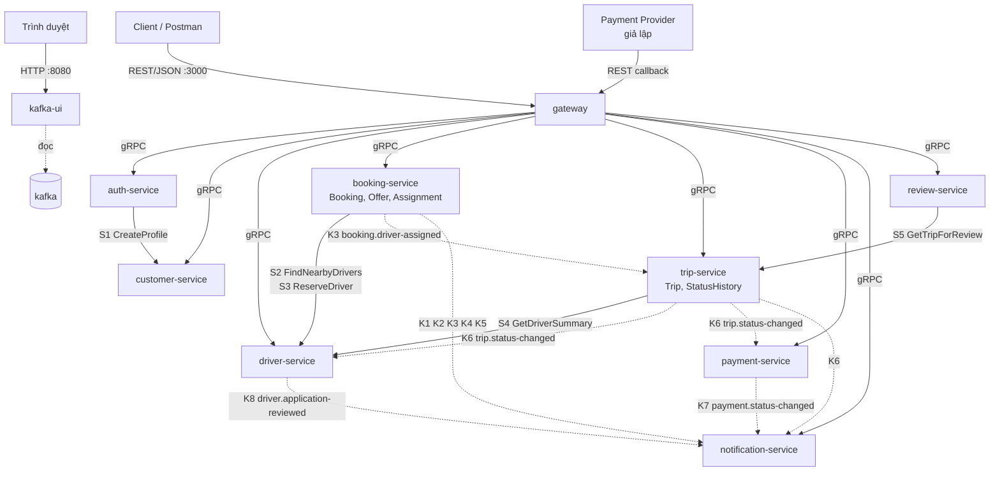
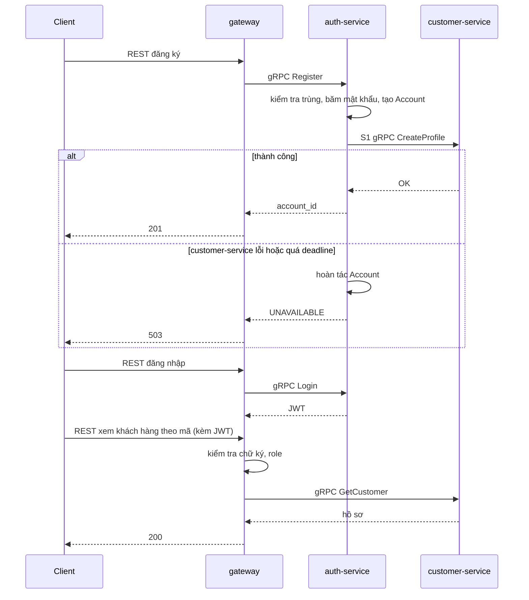
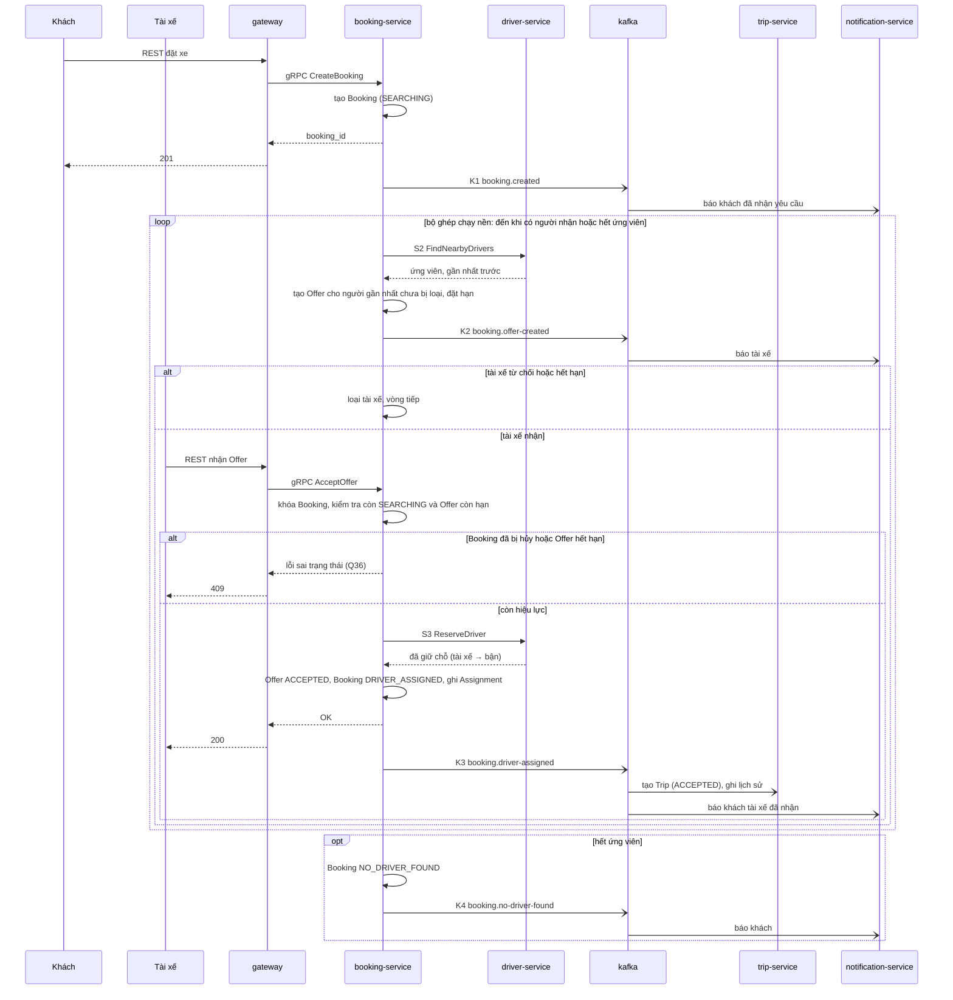
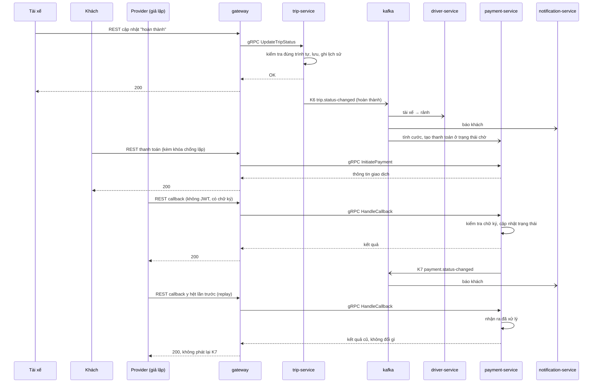
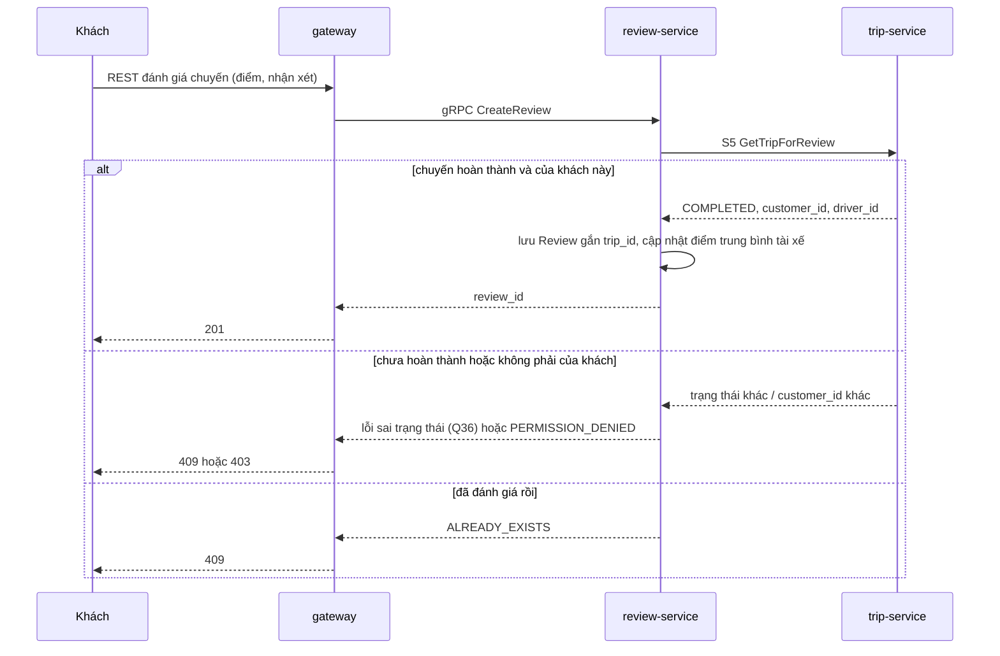

# 02 — Kiến trúc và đường giao tiếp

> Vòng 1 (chỉ BA), bản sửa 2026-10-02 theo **danh sách 8 service giảng viên chốt**. Đầu vào: `01-bounded-contexts.md` (bảng R1–R13), `CLAUDE.md`, `srs.md`; mốc so sánh: `docs/reference/thiet-ke-da-duyet.md`.
> File này trả lời: **service nào nói chuyện với service nào, bằng gì, vì yêu cầu nào** — và cặp nào **không** nói chuyện.
> Không thuộc file này: loại database và schema (file 03), đường dẫn REST chi tiết (file 04), field của `.proto` (spec).
>
> **Đã chốt:** 8 service (giảng viên); broker là Kafka, xem event qua Kafka UI (sinh viên); context chuyến đi tên Trip; `review-service` riêng.
> **Chưa chốt:** mọi chỗ ghi **[GĐ-n]** là *giả định tạm*; mục 11 liệt kê từng giả định, câu hỏi nó chờ, và những dòng phải sửa nếu câu trả lời khác đi.

## 1. Tóm tắt

| Loại đường | Số lượng | Ghi chú |
|---|---|---|
| Client → Gateway | REST/JSON | Cổng duy nhất cho nghiệp vụ (mục chấm 8) |
| Gateway → service | gRPC, tới cả 8 service | Mỗi service có ít nhất một API cho người dùng |
| Service → service đồng bộ | **5 lời gọi gRPC** (S1–S5) | Chỉ ở nơi bên gọi phải có kết quả mới làm tiếp được |
| Service → service bất đồng bộ | **8 topic Kafka** (K1–K8) | Chỉ cho sự kiện mà bên phát không chờ |
| Cặp service có nối | 10 / 28 | Mục 9 |
| Cặp service **không** nối | 18 / 28 | Mục 9 |

Mỗi service dùng kiểu giao tiếp nào (ngoài việc nhận gRPC từ Gateway):

| Service | Gọi gRPC sang service khác | Bị service khác gọi gRPC | Publish Kafka | Subscribe Kafka |
|---|---|---|---|---|
| `auth-service` | S1 → customer | — | — | — |
| `customer-service` | — | S1 | — | — |
| `driver-service` | — | S2, S3, S4 | K8 | K6 |
| `booking-service` | S2, S3 → driver | — | K1, K2, K3, K4, K5 | — |
| `trip-service` | S4 → driver | S5 | K6 | K3 |
| `payment-service` | — | — | K7 | K6 |
| `notification-service` | — | — | — | K1–K8 |
| `review-service` | S5 → trip | — | — | — |

Đây là câu trả lời cho nhận xét "không phải service nào cũng giao tiếp cả đồng bộ lẫn bất đồng bộ":

| Nhóm | Service | Vì sao |
|---|---|---|
| Chỉ gRPC, **không dùng Kafka** | `auth-service`, `customer-service`, `review-service` | Không có sự kiện nào của chúng mà context khác cần biết, và chúng không cần nghe sự kiện nào |
| Chỉ Kafka, **không có gRPC với service khác** | `payment-service`, `notification-service` | Không ai phải chờ chúng (NFR05 nêu đích danh hai service này) |
| Cả hai | `booking-service`, `trip-service`, `driver-service` | Mỗi đường có lý do riêng ở mục 4.3 và 6.2 |

## 2. Service và nhiệm vụ

### 2.1 Danh sách

| Thành phần | Nhiệm vụ | Truy vết | Mở cổng ra máy chủ? |
|---|---|---|---|
| `gateway` | Xem 2.2 | Mục chấm 3, 6, 8, 27, 28, 29 | **Có — 3000** |
| `auth-service` | Tài khoản, đăng nhập, cấp JWT, OTP, role | FR26, FR32, FR39 | Không |
| `customer-service` | Hồ sơ khách hàng | FR27 | Không |
| `driver-service` | Hồ sơ tài xế, xe, duyệt hồ sơ, Online/Offline, vị trí, tìm tài xế quanh tọa độ, giữ chỗ tài xế | FR02–FR04, FR13, FR28, FR29, FR38, FR39 | Không |
| `booking-service` | Booking, danh sách booking, ghép tài xế (Offer, đếm giờ, phân công), hủy khi đang tìm | FR01, FR05–FR11, FR35–FR37 | Không |
| `trip-service` | Trip, trình tự trạng thái, lịch sử trạng thái, hủy chuyến, theo dõi, giám sát | FR11, FR12, FR14, FR15, FR30, FR31, FR36 | Không |
| `payment-service` | Cước, giao dịch, callback, chống lặp | FR16–FR20 | Không |
| `notification-service` | Tạo và cho xem thông báo | FR21–FR24 | Không |
| `review-service` | Đánh giá chuyến, điểm trung bình tài xế | FR25 | Không |
| `kafka` | Kênh sự kiện | Mục chấm 7 | Không |
| `kafka-ui` | Giao diện web xem topic và event | Mục chấm 7 | **Có — 8080** |
| `kafka-init` | Tạo topic khi khởi động rồi thoát | Mục chấm 7 | Không |
| Database của từng service | File 03 | Database-per-service | Không |

**Chỉ hai thành phần mở cổng ra máy chủ:** Gateway tại `http://localhost:3000` và Kafka UI tại `http://localhost:8080`. Hai số cổng là đề xuất, đặt thành biến trong `.env.example`. Kafka UI là công cụ xem, không phải đường vào nghiệp vụ: mọi request nghiệp vụ vẫn chỉ đi qua Gateway (mục chấm 8).

### 2.2 Nhiệm vụ Gateway (mục chấm 3)

| # | Nhiệm vụ | Làm gì | Truy vết |
|---|---|---|---|
| 1 | Authentication | Kiểm tra chữ ký và hạn của JWT **tại chỗ**, không gọi `auth-service` mỗi request. Sai → 401 | NFR06, mục 27 |
| 2 | Authorization | So role trong token với role mà route cho phép. Sai → 403 | BRULE12, NFR07, FR32, mục 28 |
| 3 | Rate limiting | Đếm request theo IP (route công khai) hoặc theo tài khoản. Vượt → 429 | Mục 29 |
| 4 | Routing | Đổi REST/JSON → gRPC; đổi gRPC status → HTTP theo bảng trong `CLAUDE.md` | Mục 3, 4, 8 |
| 5 | Log | Ghi method, đường dẫn, mã trả về, thời gian, mã request. Không ghi mật khẩu, token, dữ liệu cá nhân | NFR10, NFR08 |
| 6 | Health | `/health`, `/ready`, `/health/services` (hỏi health của cả 8 service qua gRPC) | Mục 6 |
| 7 | Kiểm tra hình thức đầu vào | Thiếu trường, sai kiểu → 400 trước khi gọi service | Mục 25, 26 |

Gateway **không** làm:

| Không làm | Vì sao |
|---|---|
| Logic nghiệp vụ, kể cả gọi lần lượt hai service rồi ghép kết quả | `CLAUDE.md`. Điều phối đăng ký khách do `auth-service` làm (S1). Hủy sai giai đoạn (booking / trip) do service trả lỗi, Gateway không tự chuyển hướng |
| Truy cập database nghiệp vụ | `CLAUDE.md` |
| Kiểm tra "dữ liệu này có phải của bạn không" | Là quy tắc nghiệp vụ (C2, B14, T3, T7, V2 trong file 01). Gateway chỉ biết role; service kiểm tra quyền sở hữu |
| Kiểm tra chữ ký callback của Payment Provider | Khóa bí mật của Provider thuộc `payment-service` |

Gateway chuyển danh tính đã kiểm tra (`account_id`, `role`) cho service qua gRPC metadata. Service tin metadata này vì chỉ Gateway vào được mạng nội bộ của Compose (mục chấm 8). Lời gọi service → service chuyển tiếp nguyên metadata đó.

**[GĐ-7]** Một Gateway, không đặt Nginx phía trước; bộ đếm rate limit giữ trong bộ nhớ Gateway (thiết kế tham chiếu dùng Redis). **[GĐ-8]** JWT ký bằng khóa bất đối xứng: `auth-service` giữ khóa riêng, Gateway chỉ có khóa công khai.

## 3. Sơ đồ kiến trúc

Nét liền = gRPC (bên gọi chờ kết quả). Nét đứt = Kafka (bên phát không chờ). Mọi đường nét đứt đi qua `kafka`; sơ đồ vẽ thẳng từ bên phát đến bên nghe để thấy ai cần biết điều gì.

## 4. Bảng mọi đường giao tiếp

### 4.1 Từ ngoài vào

| Mã | Bên gửi | Bên nhận | Kiểu | Nội dung | Vì yêu cầu nào |
|---|---|---|---|---|---|
| C1 | Client (khách, tài xế, admin) | `gateway` :3000 | REST/JSON | Mọi thao tác của người dùng | `CLAUDE.md`; mục 8 |
| C2 | Payment Provider | `gateway` :3000 | REST/JSON, không JWT | Callback kết quả giao dịch. **[GĐ-5]** Provider là giả lập: Postman đóng vai Provider | FR18, UC14, mục 19, 30 |
| C3 | Trình duyệt của người chấm | `kafka-ui` :8080 | HTTP | Xem topic, message, consumer group | Mục 7 |

### 4.2 Gateway → service (gRPC)

Tên rpc là gợi ý ở mức nhóm; spec chốt từng rpc.

| Mã | Bên nhận | Nhóm thao tác | Vì yêu cầu nào | Mục chấm |
|---|---|---|---|---|
| G1 | `auth-service` | Đăng ký khách, đăng nhập, xin OTP, xác nhận OTP và tạo tài khoản tài xế | FR26, FR39 | 9, 10, 21, 25 |
| G2 | `customer-service` | Xem / sửa hồ sơ của mình; xem khách hàng theo mã | FR27 | 11 |
| G3 | `driver-service` | Nộp hồ sơ tài xế và xe; xem tài xế theo mã; tài xế quanh tọa độ; bật / tắt nhận chuyến; gửi vị trí; admin duyệt / từ chối | FR02–FR04, FR13, FR28, FR29, FR38, FR39 | 12, 13, 21, 22, 23 |
| G4 | `booking-service` | Tạo booking; danh sách booking; xem booking; hủy booking đang tìm; tài xế xem Offer đang chờ, nhận, từ chối **[GĐ-2]** | FR06–FR08, FR35–FR37 | 14, 15, 16, 18 |
| G5 | `trip-service` | Xem chuyến theo mã chuyến hoặc mã booking; cập nhật trạng thái; hủy chuyến; admin xem danh sách và can thiệp | FR12, FR14, FR30, FR31, FR36 | 17, 18 |
| G6 | `payment-service` | Xem cước; khởi tạo thanh toán điện tử; nhận callback; tài xế xác nhận thu tiền mặt; thanh toán lại; tra cứu giao dịch | FR16–FR20 | 19, 30 |
| G7 | `notification-service` | Xem thông báo của mình | FR21–FR24, UC16 | 16, 18, 22 |
| G8 | `review-service` | Tạo đánh giá cho một chuyến; xem đánh giá của chuyến; xem điểm trung bình của tài xế | FR25 | 20 |
| G9 | cả 8 service | Health check | Mục chấm 6 | 6 |

Quy tắc chung: mọi lời gọi có deadline (đề xuất 2 giây cho Gateway → service, bám NFR01); hết deadline hoặc service không chạy → 503.

Vì sao tài xế gửi vị trí là gRPC qua Gateway mà **không** phát lên Kafka: không context nào cần *dòng* vị trí. Booking hỏi khi cần ghép (S2), Trip hỏi khi khách mở màn hình theo dõi (S4).

### 4.3 Service → service đồng bộ (gRPC)

| Mã | Bên gọi → bên nhận | Lời gọi | Vì sao bên gọi phải chờ | Vì yêu cầu nào | Khi bên nhận không sẵn sàng (NFR05) | Deadline đề xuất |
|---|---|---|---|---|---|---|
| S1 | `auth-service` → `customer-service` | `CreateProfile(account_id, họ tên, …)` trong lúc đăng ký khách **[GĐ-1]** | Đăng ký chỉ coi là xong khi đã có hồ sơ (C1); mục chấm 11 phải chạy được ngay sau mục 9 | FR26, FR27; mục 9, 11 | Auth hoàn tác tài khoản vừa tạo, trả 503. Đăng nhập và mọi chức năng khác không bị ảnh hưởng | 1 giây |
| S2 | `booking-service` → `driver-service` | `FindNearbyDrivers(tọa độ, loại xe, bán kính, limit)` — gọi lại ở mỗi vòng ghép để có dữ liệu mới nhất | Không có danh sách ứng viên thì không gửi Offer được | FR02–FR05, BRULE01–03, NFR02; mục 15 | Bộ ghép thử lại vài lần có giãn cách; vẫn lỗi thì kết luận `NO_DRIVER_FOUND` (K4) để booking không treo. Booking đã tạo không mất; khách vẫn xem và hủy được | 1 giây |
| S3 | `booking-service` → `driver-service` | `ReserveDriver(driver_id, booking_id)` khi tài xế bấm nhận: nếu tài xế đang Online và không bận thì chuyển sang bận cho booking này | Phải trả lời tài xế ngay "nhận được" hay "không"; chỉ được xác nhận phân công khi tài xế **còn rảnh** (B11, D8) | BRULE01, FR07, AC06, NFR14; mục 16 | Booking trả 503 cho tài xế, Offer vẫn chờ đến hết hạn; tài xế bấm lại được vì `ReserveDriver` gọi lặp cùng `booking_id` cho kết quả như cũ | 1 giây |
| S4 | `trip-service` → `driver-service` | `GetDriverSummary(driver_id)`: tên, biển số, loại xe, vị trí hiện tại | Khách mở màn hình theo dõi chuyến, cần dữ liệu để trả lời ngay; vị trí là dữ liệu sống nên không sao chép sẵn được | FR13, FR14, FR15, UC10 | Trip vẫn trả thông tin chuyến và trạng thái, bỏ trống phần tài xế / vị trí kèm cờ "chưa cập nhật" (đúng luồng thay thế của UC10) | 1 giây |
| S5 | `review-service` → `trip-service` | `GetTripForReview(trip_id)`: trạng thái, `customer_id`, `driver_id` **[GĐ-12]** | Chưa biết chuyến đã hoàn thành và thuộc về khách này thì không được nhận đánh giá | BRULE11, FR25, AC14; mục 20 | Review trả 503; khách đánh giá lại sau. Chuyến, thanh toán không bị ảnh hưởng | 1 giây |

Ghi chú:

- S3 chỉ **giữ chỗ**. Việc trả tài xế về rảnh đi bằng Kafka (K6) vì khi đó không ai phải chờ. Trường hợp Booking đã giữ chỗ được nhưng lỗi trước khi ghi phân công: Q35.
- S4 không phục vụ mục chấm nào trực tiếp (FR14, FR15 ngoài phiếu). Giữ vì truy vết được về FR14 / UC10; **làm sau cùng**.
- Không có gRPC nào đi **vào** `booking-service`, `payment-service`, `notification-service`, `auth-service`, `review-service` từ service khác.

### 4.4 Service → service bất đồng bộ (Kafka)

Chi tiết ở mục 6.2. Tóm tắt hướng đi:

| Mã | Topic | Publish | Subscribe |
|---|---|---|---|
| K1 | `booking.created` | `booking-service` | `notification-service` |
| K2 | `booking.offer-created` | `booking-service` | `notification-service` |
| K3 | `booking.driver-assigned` | `booking-service` | `trip-service`, `notification-service` |
| K4 | `booking.no-driver-found` | `booking-service` | `notification-service` |
| K5 | `booking.canceled` | `booking-service` | `notification-service` |
| K6 | `trip.status-changed` | `trip-service` | `driver-service`, `payment-service`, `notification-service` |
| K7 | `payment.status-changed` | `payment-service` | `notification-service` **[GĐ-3]** |
| K8 | `driver.application-reviewed` | `driver-service` | `notification-service` |

## 5. Quyết định cho từng quan hệ R1–R13

| Quan hệ (file 01) | Quyết định | Đường | Lý do | Đánh đổi |
|---|---|---|---|---|
| R1 Auth → Customer: tài khoản khách mới | **gRPC** **[GĐ-1]** | S1 | Mục 11 phải chạy ngay sau mục 9. Dùng event thì hồ sơ có thể đến trễ và mục 11 trả 404 | Đăng ký khách phụ thuộc `customer-service` đang chạy. ADR-004 |
| R2 Auth → Driver: tài xế đã qua OTP | **Không nối** **[GĐ-4]** | — | Tài khoản `driver` chỉ được tạo sau khi OTP đúng (A6). Tài xế đăng nhập rồi nộp hồ sơ bằng token; token mang `account_id` và role `driver` là bằng chứng đã qua OTP | Đăng ký tài xế thành nhiều bước ở client. Có thể tồn tại tài khoản `driver` chưa nộp hồ sơ |
| R3 Booking → Driver: ứng viên quanh điểm đón | **gRPC** | S2 | Cần danh sách ngay và phải là dữ liệu **mới nhất** (BRULE01) | Ghép tài xế phụ thuộc Driver đang chạy; nhận booking thì không |
| R4 Booking → Driver: giữ chỗ khi nhận | **gRPC** | S3 | Tài xế đang chờ câu trả lời; phải có **một** nơi quyết định "tài xế này còn rảnh" — là Driver, nơi giữ trạng thái nhận chuyến (D8) | "Nhận chuyến" chạm hai service; có khe hở khi lỗi giữa chừng (Q35). ADR-007 |
| R5 Booking → Trip: bàn giao | **Kafka** **[GĐ-10]** | K3 | Booking đã xong việc khi ghi phân công; không cần kết quả của Trip để trả lời tài xế. Trip dừng thì tài xế vẫn nhận được chuyến, Trip tạo sau khi chạy lại (NFR05) | Trip xuất hiện trễ dưới một giây sau khi nhận: client lấy chuyến theo `booking_id`, có thể phải hỏi lại. ADR-007 |
| R6 Trip → Driver: tài xế rảnh lại | **Kafka** | K6 | Trip không cần chờ Driver ghi xong mới kết thúc chuyến | Tài xế vừa xong chuyến vẫn hiện là bận thêm một nhịp; hệ quả tệ nhất: lỡ một lần được mời |
| R7 Trip → Driver: thông tin tài xế, xe, vị trí | **gRPC** | S4 | Khách cần xem ngay; vị trí là dữ liệu sống | Màn hình theo dõi phụ thuộc Driver; đã có đường lùi |
| R8 Trip → Payment: chuyến hoàn thành | **Kafka** | K6 | NFR05 nêu đích danh: Payment lỗi không được chặn việc kết thúc chuyến. BRULE08: chỉ tính cước sau khi hoàn thành | Cước có sau khi hoàn thành một chút. Khách thanh toán trước khi event tới thì nhận 409 "chưa có cước" (M1) |
| R9 Payment → Trip: kết quả thanh toán | **Không nối** **[GĐ-3]** | — | Giả định "COMPLETED" ở mục 19 là trạng thái của **giao dịch**. Khách xem trạng thái thanh toán qua API của Payment | Màn hình chuyến không tự hiện "đã thanh toán" |
| R10 Review → Trip: chuyến hoàn thành chưa, của ai | **gRPC** **[GĐ-12]** | S5 | Review phải biết ngay để nhận hay từ chối đánh giá (BRULE11); hỏi thẳng nơi giữ sự thật, không giữ bản sao | Đánh giá phụ thuộc Trip đang chạy. ADR-007 |
| R11 Review → Driver: điểm trung bình | **Không nối** **[GĐ-11]** | — | Điểm tổng hợp thuộc Review (V5). Không yêu cầu nào buộc Driver biết điểm: ghép tài xế chỉ xét khoảng cách (BRULE03) | Hồ sơ tài xế (mục 12) không kèm điểm; client gọi API của Review |
| R12 → Notification | **Kafka** | K1–K8 | NFR05 nêu đích danh Notification; không context nào chờ nó | Thông báo có thể trễ; phải chống tạo trùng |
| R13 Trip → Booking: kết cục chuyến | **Không nối** **[GĐ-9b]** | — | Booking kết thúc ở `DRIVER_ASSIGNED`; không quy tắc nào của Booking phụ thuộc kết cục chuyến | Danh sách booking (mục 14) không hiện "hoàn thành / đã hủy chuyến"; client xem ở Trip |

## 6. Topic Kafka

### 6.1 Quy ước

| Điểm | Quy ước | Lý do |
|---|---|---|
| Tên topic | `<context>.<sự-kiện>`, chữ thường, gạch nối | Nhìn tên biết ai phát |
| Phong bì chung | `event_id` (UUID), `event_type`, `occurred_at`, `data` | `event_id` để nhận ra message lặp |
| Khóa message (key) | ID của đối tượng chính (bảng dưới) | Kafka giữ thứ tự theo key: các event của cùng một chuyến đến đúng thứ tự |
| Consumer group | Tên service | Mỗi service nhận mỗi event một lần, dù chạy nhiều bản |
| Nội dung | **Chỉ ID, trạng thái, số liệu.** Không họ tên, số điện thoại, địa chỉ chữ, lý do hủy, nhận xét | NFR08, NFR16: event xem được trên Kafka UI. Ngoại lệ: K3 có tọa độ điểm đón, điểm đến vì Trip cần (Q22) |
| Tạo topic | `kafka-init` tạo sẵn theo danh sách; broker tắt tự tạo topic | Mục chấm 7: topic "được đăng ký rõ ràng" |

Kafka giao message **ít nhất một lần**, nên mọi consumer phải chịu được message lặp.

Ghép tài xế chạy **bên trong** `booking-service` (một tiến trình nền đọc các Booking đang tìm và các Offer đến hạn trong database của chính nó), nên không cần topic nào để Booking "tự nói với mình".

### 6.2 Bảng topic

| Mã | Topic | Publish | Subscribe — làm gì | Lý do nghiệp vụ | Key | Field chính trong `data` | Xử lý message lặp |
|---|---|---|---|---|---|---|---|
| K1 | `booking.created` | `booking-service` | **Notification**: báo khách "đã nhận yêu cầu" | FR21, FR35 | `booking_id` | `booking_id`, `customer_id`, `vehicle_type` | Mục 6.4 |
| K2 | `booking.offer-created` | `booking-service` | **Notification**: báo tài xế có lời mời nhận chuyến | FR06, UC07, UC16; mục 15 ("gửi offer" nhìn thấy được) | `booking_id` | `offer_id`, `booking_id`, `driver_id`, `expires_at` | Mục 6.4 |
| K3 | `booking.driver-assigned` | `booking-service` | **Trip**: tạo Trip ở trạng thái đầu từ bản chụp. **Notification**: báo khách "tài xế đã nhận chuyến" | FR07, FR11, FR22, AC06; mục 16 | `booking_id` | `booking_id`, `customer_id`, `driver_id`, `vehicle_type`, `payment_method`, `pickup_lat`, `pickup_lng`, `dropoff_lat`, `dropoff_lng`, `assigned_at` | Trip: mỗi `booking_id` nhiều nhất một Trip (T1), đã có thì bỏ qua |
| K4 | `booking.no-driver-found` | `booking-service` | **Notification**: báo khách | FR10, BRULE07, AC09 | `booking_id` | `booking_id`, `customer_id`, `offers_tried` | Mục 6.4 |
| K5 | `booking.canceled` | `booking-service` | **Notification**: báo khách; báo tài xế đang giữ Offer chờ (nếu có) | FR36, AC16; mục 18 | `booking_id` | `booking_id`, `customer_id`, `canceled_by`, `pending_offer_driver_id` (có thể rỗng) | Mục 6.4 |
| K6 | `trip.status-changed` | `trip-service` | **Driver**: trạng thái hoàn thành / hủy → tài xế rảnh lại. **Payment**: chỉ trạng thái hoàn thành → tính cước, tạo thanh toán ở trạng thái chờ. **Notification**: báo khách và tài xế | FR12, FR16, FR23, FR36, BRULE01, BRULE08, AC16; mục 17, 18 | `trip_id` | `trip_id`, `booking_id`, `customer_id`, `driver_id`, `status`, `previous_status`; khi hoàn thành thêm `vehicle_type`, `payment_method`, `distance_km`, `duration_min`; khi hủy thêm `canceled_by` | Driver: chỉ trả về rảnh nếu `booking_id` khớp booking đang giữ (D9). Payment: mỗi `trip_id` một Fare (M1), đã có thì bỏ qua |
| K7 | `payment.status-changed` | `payment-service` | **Notification**: báo kết quả thanh toán (thành công / thất bại) | FR19, FR24, BRULE10, AC12, AC13 | `trip_id` | `payment_id`, `trip_id`, `customer_id`, `method`, `amount`, `status` | Mục 6.4 |
| K8 | `driver.application-reviewed` | `driver-service` | **Notification**: báo tài xế kết quả duyệt | FR39, AC20; mục 22 | `driver_id` | `driver_id`, `result` (duyệt / từ chối) | Mục 6.4 |

Ba điều cần giải thích được:

| Điều | Lý do |
|---|---|
| K6 là **một** topic cho mọi trạng thái, không tách `trip.completed`, `trip.canceled` | Các trạng thái của một chuyến phải đến **đúng thứ tự** (Notification báo "đã đến" trước "đã đón"); Kafka chỉ đảm bảo thứ tự trong cùng topic và cùng key. Đánh đổi: Payment và Driver nhận cả event không cần và phải lọc theo `status` |
| Trip **không** phát K6 cho trạng thái đầu (`ACCEPTED`) | Việc "tài xế đã nhận" đã được K3 báo; không context nào cần nghe lần hai. Dòng lịch sử đầu tiên vẫn được ghi trong `trip-service` |
| Hủy có ở hai topic | Chưa có tài xế → K5 (việc của Booking). Đã có tài xế → K6 với `status` hủy (việc của Trip; Driver cần để trả tài xế về rảnh) |

### 6.3 Phát event không được mất

Vấn đề: service ghi database xong rồi mới gửi Kafka. Nếu chết giữa hai bước, trạng thái đã đổi mà event không bao giờ được phát.

| Event mất | Hậu quả |
|---|---|
| K3 | Tài xế đã nhận, đã bị giữ ở trạng thái bận, nhưng **không có Trip nào được tạo** |
| K6 (hoàn thành) | Chuyến không bao giờ được tính cước; tài xế kẹt ở trạng thái bận |
| K4 | Khách không được báo (vi phạm BRULE07) |

**[GĐ-6]** Dùng mẫu **outbox**: ghi event vào một bảng trong cùng giao dịch với thay đổi nghiệp vụ; một tiến trình nền đọc bảng đó và gửi lên Kafka. Truy vết: NFR14, NFR15. Chi tiết và phương án rút gọn: ADR-005.

### 6.4 Chống trùng ở Notification

Mỗi thông báo gắn với (`event_id`, người nhận). Gặp lại cặp này thì không tạo thông báo mới. Người nhận là `account_id` lấy từ event; **[GĐ-5]** Notification chỉ lưu thông báo trong ứng dụng nên không cần hỏi số điện thoại hay email từ service nào.

## 7. Kiểm tra Kafka (mục chấm 7)

| Câu giảng viên hỏi | Trả lời bằng |
|---|---|
| Dùng Kafka thế nào? | Bảng 6.2: 8 topic, mỗi topic có bên phát, bên nghe, lý do |
| Đã đăng ký event chưa? | (1) Bảng 6.2 là sổ đăng ký. (2) Container `kafka-init` tạo đúng 8 topic đó khi khởi động; broker tắt tự tạo topic, nên service gửi nhầm tên topic sẽ lỗi ngay thay vì âm thầm tạo topic mới |
| Xem event ở đâu? | Kafka UI, giao diện HTTP tại **`http://localhost:8080`** |
| Service nào không dùng Kafka, vì sao? | `auth-service`, `customer-service`, `review-service` — mục 1 |

Các bước demo:

| Bước | Thao tác | Kết quả mong đợi |
|---|---|---|
| 1 | `docker compose ps` | Chỉ `gateway` (3000) và `kafka-ui` (8080) có cổng ra máy chủ |
| 2 | Mở `http://localhost:8080` → Topics | Thấy đủ 8 topic của bảng 6.2 |
| 3 | Postman: tạo booking (mục 15) | Topic `booking.created` có thêm một message (`event_id`, `booking_id`); ngay sau đó `booking.offer-created` có một message mang `driver_id` của tài xế gần nhất |
| 4 | Kafka UI → Consumers | Group `notification-service` đã đọc hai message đó (lag = 0) |
| 5 | Postman: tài xế nhận chuyến (mục 16) | Topic `booking.driver-assigned` có message mới; group `trip-service` đã đọc |
| 6 | Postman: cập nhật trạng thái chuyến (mục 17) | Topic `trip.status-changed` có message mới; khi hoàn thành, group `payment-service` và `driver-service` đã đọc |

Yêu cầu với Compose (dev-agent hiện thực): `kafka` và `kafka-init` không có `ports`; `kafka-ui` có `ports` 8080; `gateway` có `ports` 3000; không container nào khác có `ports`. Kafka UI không có đăng nhập, chỉ dùng cho môi trường học tập (Q22).

## 8. Sơ đồ trình tự

### 8.1 Đăng ký khách hàng rồi xem hồ sơ (mục 9, 11) — [GĐ-1]

### 8.2 Đặt xe → ghép tài xế → nhận chuyến → tạo Trip (mục 15, 16) — [GĐ-2], [GĐ-10]

### 8.3 Hoàn thành → tính cước → thanh toán điện tử (mục 17, 19, 30) — [GĐ-3], [GĐ-5]

### 8.4 Đánh giá chuyến (mục 20) — [GĐ-11], [GĐ-12]

### 8.5 Hủy (mục 18)

| Giai đoạn | Client gọi | Service xử lý | Thay đổi | Event | Ai được báo |
|---|---|---|---|---|---|
| Đang tìm tài xế | Hủy booking | `booking-service` | Booking → `CANCELED`; Offer đang chờ → vô hiệu; bộ ghép dừng (cùng một giao dịch, B12) | K5 | Khách; tài xế đang giữ Offer chờ |
| Đã có tài xế, trước khi đón khách (Q7) | Hủy chuyến | `trip-service` | Trip → `CANCELED`, ghi lịch sử kèm lý do | K6 (`status` hủy) | Khách, tài xế; Driver trả tài xế về rảnh |
| Gọi hủy booking khi đã phân công | Hủy booking | `booking-service` | Không đổi gì | — | Trả 409 kèm mã lỗi chỉ rõ phải hủy chuyến (Q29) |

## 9. Cặp service không nối

28 cặp giữa 8 service nghiệp vụ. **10 cặp có nối**: Auth–Customer (S1); Booking–Driver (S2, S3); Booking–Trip (K3); Trip–Driver (S4, K6); Trip–Payment (K6); Review–Trip (S5); và bốn cặp với Notification (Booking, Trip, Payment, Driver).

**18 cặp không nối:**

| Cặp | Vì sao không nối |
|---|---|
| Auth – Driver | **[GĐ-4]** Token đã mang `account_id` và role; Driver không cần hỏi Auth, Auth không cần biết kết quả duyệt |
| Auth – Booking, Trip, Payment, Review | Các service này chỉ cần `account_id` và role, Gateway đã chuyển sang |
| Auth – Notification | Không FR nào yêu cầu thông báo khi đăng ký hay đăng nhập. OTP không đi qua Notification **[GĐ-5]** |
| Customer – Driver | Hai loại hồ sơ độc lập; không quy tắc nào cần cả hai |
| Customer – Booking | Booking chỉ giữ `customer_id`; Gateway đã xác thực token có role `customer`, và đăng ký đảm bảo hồ sơ tồn tại (C1) nên không cần "kiểm tra khách hàng" |
| Customer – Trip | Trip chỉ giữ `customer_id`. UC22 (admin xem thông tin khách trong chuyến): client gọi thêm API khách hàng |
| Customer – Payment | Payment chỉ cần `customer_id`, đã có trong K6 |
| Customer – Review | Review chỉ cần `customer_id` từ token và từ Trip |
| Customer – Notification | **[GĐ-5]** Thông báo trong ứng dụng chỉ cần `account_id` |
| Driver – Payment | Cước tính theo mã loại xe có sẵn trong K6; Payment không cần hồ sơ tài xế |
| Driver – Review | **[GĐ-11]** Điểm trung bình thuộc Review; `driver_id` lấy từ Trip |
| Booking – Payment | Phương thức thanh toán đi theo bản chụp Booking → Trip → K6; Booking và tiền không cần nói chuyện trực tiếp |
| Booking – Review | Đánh giá gắn với chuyến (`trip_id`), không gắn với yêu cầu đặt xe |
| Payment – Review | BRULE11 chỉ yêu cầu chuyến đã hoàn thành, không yêu cầu đã thanh toán |
| Notification – Review | Không FR nào yêu cầu thông báo khi có đánh giá (FR21–FR24 không nhắc) |

Ngay trong cặp có nối cũng chỉ nối **một chiều, một kiểu** ở nơi không cần hơn:

| Chiều / kiểu không có | Vì sao |
|---|---|
| Customer → Auth | Customer không bao giờ cần hỏi Auth |
| Driver → Booking, Driver → Trip | Driver chỉ trả lời và nghe event; không gọi ai |
| Trip → Booking (cả gRPC lẫn Kafka) | **[GĐ-9b]** Booking không đổi sau khi bàn giao |
| Booking → Trip bằng gRPC | **[GĐ-10]** Bàn giao không cần chờ |
| Payment → Trip | **[GĐ-3]** |
| Trip → Review | Trip không cần biết chuyến đã được đánh giá hay chưa |
| Notification → bất kỳ service nào | Notification chỉ nghe |

## 10. Khác với thiết kế tham chiếu

Thiết kế tham chiếu (`docs/reference/thiet-ke-da-duyet.md`) đã được giảng viên duyệt cho một nhóm khác. Bảng này liệt kê từng điểm thiết kế này làm khác và lý do, để sinh viên trả lời được "sao không làm giống bản đã duyệt".

### 10.1 Bốn đường gRPC trong ảnh

| Trong ảnh | Quyết định | Ở thiết kế này | Vì sao |
|---|---|---|---|
| customer ↔ driver — "validate customer" | **Bỏ** | Không nối | Không FR/BRULE nào cần Driver hay Customer hỏi nhau. Nếu hiểu là "kiểm tra khách khi đặt xe" thì cũng không cần: Gateway đã xác thực JWT và role, đăng ký đảm bảo hồ sơ tồn tại (C1) |
| driver ↔ booking — "matching / availability" | **Giữ, xác định chiều: booking → driver**, thành hai lời gọi | S2 `FindNearbyDrivers` (matching); S3 `ReserveDriver` (availability) | Booking là bên cần kết quả ngay (FR02–FR05, BRULE01–03); Driver không bao giờ cần hỏi Booking |
| booking ↔ trip — "location / ETA lookup" | **Bỏ giữa booking và trip; chuyển thành trip → driver** | S4 `GetDriverSummary` | Vị trí và xe là dữ liệu của Driver, không phải của Booking hay Trip. Bên cần xem là Trip (UC10: theo dõi chuyến sau khi tài xế nhận). Giữa Booking và Trip chỉ còn bàn giao bằng event (K3) |
| trip ↔ payment — "validate completed trip" | **Bỏ giữa trip và payment; nhu cầu "kiểm tra chuyến đã hoàn thành" chuyển thành review → trip** | S5 `GetTripForReview` | Payment đã nhận chính sự kiện hoàn thành (K6) nên có sẵn bằng chứng (M1); gọi thêm gRPC là nối cả hai kiểu cho cùng một việc, và làm Payment phụ thuộc Trip trái NFR05. Review thì thật sự cần hỏi ngay (BRULE11) |
| (không có) | **Thêm** | S1 auth → customer `CreateProfile` | Mục chấm 11 phải chạy ngay sau mục 9 (ADR-004). Ảnh không vẽ cách hồ sơ khách được tạo |

### 10.2 Event

| Trong ảnh (RabbitMQ) | Quyết định | Ở thiết kế này (Kafka) | Vì sao |
|---|---|---|---|
| `booking.created` | Giữ | K1 `booking.created` | FR21 |
| `driver.offer.created` | Giữ, đổi tên | K2 `booking.offer-created` | Bên phát là Booking; tên topic theo quy ước `<context>.<sự-kiện>` |
| `booking.no_driver_found` | Giữ | K4 `booking.no-driver-found` | BRULE07 |
| `driver.accepted` (trip nghe) | Giữ, đổi tên | K3 `booking.driver-assigned` | Cùng vai trò bàn giao Booking → Trip; tên nói rõ bên phát và sự việc (FR11 "phân công") |
| (không có) | Thêm | K5 `booking.canceled` | FR36, mục 18: hủy khi đang tìm cũng phải báo các bên |
| `trip.status.changed`, `trip.canceled` | Gộp | K6 `trip.status-changed` | Giữ thứ tự các trạng thái của một chuyến trong một topic (mục 6.2) |
| `payment.completed`, `payment.failed` | Gộp | K7 `payment.status-changed` | Thất bại rồi thanh toán lại thành công phải đến đúng thứ tự; subscriber duy nhất là Notification |
| `review.created` | **Bỏ** | — | Không context nào cần nghe: điểm trung bình thuộc Review **[GĐ-11]**, không FR nào yêu cầu thông báo khi có đánh giá |
| review nghe trip / payment events | **Bỏ**, thay bằng gRPC | S5 | **[GĐ-12]** Review hỏi thẳng Trip khi cần, không giữ bản sao danh sách chuyến đã hoàn thành |
| payment nghe `trip.status.changed` (COMPLETED) | Giữ | K6 | BRULE08, NFR05 |
| (không có) | Thêm | K8 `driver.application-reviewed`; Driver nghe K6 | AC20: tài xế nhận kết quả duyệt. BRULE01: tài xế rảnh lại sau chuyến. Ảnh không ghi `driver-service` nối broker |

### 10.3 Điểm khác còn lại

| Điểm | Trong ảnh | Ở thiết kế này | Vì sao |
|---|---|---|---|
| Message broker | RabbitMQ | **Kafka** + Kafka UI cổng 8080 | Sinh viên chốt; giảng viên dạy Kafka (slide 13) và yêu cầu xem được event qua giao diện HTTP. Phiếu chấm mục 7 chấp nhận cả hai |
| Số service | 10 | 8: bỏ `report-service`, `audit-service` | Giảng viên chốt. FR30–FR34 đặt ở đâu: file 01 mục 7.3 |
| Redis ở Gateway | Cache token, session, rate limit | Không có **[GĐ-7]** | JWT kiểm tra tại chỗ nên không cần cache token hay session; một Gateway thì đếm rate limit trong bộ nhớ đủ cho mục 29. Thêm Redis khi chạy nhiều Gateway (Q17, Q18) |
| Hệ thống ngoài (Map, Payment, Notification Provider) | Vẽ như tích hợp thật | Giả lập **[GĐ-5]** | Phiếu chấm chỉ cần callback và chống replay (Q14) |
| auth, customer không nối broker | Không nối | Không nối | **Giống** — và thêm `review-service` cũng không nối |
| Vai trò và quyền | Bảng ROLE, PERMISSION, ROLE_PERMISSION | Ba role cố định; kiểm tra theo role tại Gateway | `CLAUDE.md` đã chốt ba vai trò; mục 28 chỉ cần role (Q30, chốt ở file 03) |
| `DRIVER_OFFER.price_offer` | Có | Không có giá trong Offer | BRULE08: chỉ tính cước sau khi chuyến hoàn thành (chốt ở file 03) |
| Điểm trung bình tài xế | Bảng DRIVER_RATING ở Rating & Review | Giống: DriverRating thuộc Review | Q28 |
| Khóa chính | INT | Chưa chốt, đề xuất UUID | Q31, file 03 |

## 11. Giả định tạm và phạm vi ảnh hưởng

Nếu câu trả lời khác giả định, sửa đúng các dòng ở cột cuối.

| Mã | Chờ | Giả định tạm | Phương án khác | Dòng phải sửa nếu đổi |
|---|---|---|---|---|
| GĐ-1 | Q3 | Auth gọi đồng bộ sang Customer khi đăng ký; lỗi thì hoàn tác | (a) Auth phát event, Customer tạo hồ sơ sau | S1 bỏ; thêm topic `account.registered`; mục 1: Auth và Customer bắt đầu dùng Kafka; sơ đồ 8.1; **mục chấm 11 có thể 404 nếu gọi ngay sau mục 9**; ADR-004 |
| GĐ-2 | Q5 | Tài xế gọi API của `booking-service` để xem Offer đang chờ, kèm thông báo K2 | Chỉ qua thông báo | G4 bỏ thao tác "xem Offer đang chờ"; K2 thành bắt buộc thay vì bổ trợ |
| GĐ-3 | Q6 | "COMPLETED" ở mục 19 là trạng thái của giao dịch; Trip không nghe Payment | Là trạng thái của chuyến | K7 thêm subscriber `trip-service`; R9 thành Kafka; mục 9 bỏ dòng "Payment → Trip"; sơ đồ 8.3; file 01 thêm một trạng thái Trip sau "hoàn thành" |
| GĐ-4 | Q4 | Tài xế chờ duyệt đăng nhập được; Driver chặn bật Online | Không đăng nhập được | Cặp Auth–Driver thành có nối: K8 thêm subscriber `auth-service`; G1, G3 phải đổi; R2 đổi quyết định |
| GĐ-5 | Q14 | Ba Provider đều giả lập; thông báo chỉ lưu trong ứng dụng; OTP không gửi SMS thật | Tích hợp thật | Thêm đường ra ngoài từ Payment, Notification; Notification cần thông tin liên lạc → thêm đường tới Customer / Driver; OTP qua SMS thêm đường Auth → Notification |
| GĐ-6 | Q20 | Outbox cho mọi service phát event | Gửi Kafka ngay sau khi ghi database | Mục 6.3; file 03 bớt bảng outbox; chấp nhận rủi ro trong bảng 6.3 |
| GĐ-7 | Q17, Q18 | Không Nginx; không Redis; rate limit đếm trong bộ nhớ Gateway | Có Nginx; hoặc đếm bằng Redis | Mục 2.1 thêm container; nếu có Nginx thì cổng 3000 chuyển từ Gateway sang Nginx |
| GĐ-8 | Q19 | JWT ký bất đối xứng | Khóa bí mật dùng chung | Mục 2.2 dòng 1; không đổi đường giao tiếp |
| GĐ-9 | Q21 | `customer_id` và `driver_id` chính là `account_id` | Mỗi hồ sơ có mã riêng | Booking, Trip, Payment, Review phải hỏi Customer / Driver để đổi mã → thêm lời gọi gRPC; ảnh hưởng S1, G2, G3 và mọi event |
| GĐ-9b | Q27 | Booking không nghe kết cục của Trip | Booking ghi trạng thái cuối | K6 thêm subscriber `booking-service`; mục 1: Booking bắt đầu subscribe; mục 9 bỏ dòng "Trip → Booking"; file 01 thêm trạng thái Booking |
| GĐ-10 | Q33 | Bàn giao Booking → Trip bằng event K3 | Booking gọi gRPC `CreateTrip` rồi mới trả lời tài xế | K3 mất subscriber Trip (chỉ còn Notification); thêm S6 booking → trip; nhận chuyến phụ thuộc Trip đang chạy; sơ đồ 8.2; ADR-007 |
| GĐ-11 | Q28 | Điểm trung bình tài xế thuộc Review, không phát event | Review phát `review.created`, Driver ghi điểm vào hồ sơ | Thêm topic K9; mục 1: Review bắt đầu dùng Kafka, Driver thêm một subscribe; mục 9 bỏ dòng Driver – Review |
| GĐ-12 | Q34 | Review hỏi Trip bằng gRPC | Review nghe K6 (hoàn thành) và giữ bảng "chuyến được phép đánh giá" như thiết kế tham chiếu | S5 bỏ; K6 thêm subscriber `review-service`; đánh giá ngay sau khi hoàn thành có thể bị từ chối nếu event chưa tới; ADR-007 |

## 12. Câu hỏi còn mở

Q1–Q16, Q27–Q32 ở file 01. Câu của file này:

| # | Câu hỏi | Lựa chọn | Đề xuất | Hỏi ai |
|---|---|---|---|---|
| Q17 | Có đặt Nginx trước Gateway không? Giảng viên có nói "Nginx load balancer về bản chất là gateway" | (a) Không; (b) Nginx → nhiều bản Gateway | (a) — một bản Gateway đủ cho 30 mục chấm | GV |
| Q18 | Bộ đếm rate limit (mục 29) giữ ở đâu? Thiết kế tham chiếu có Redis ở Gateway | (a) Trong bộ nhớ Gateway; (b) Redis | (a) nếu chỉ một Gateway; (b) bắt buộc nếu chọn Q17(b) | SV |
| Q19 | JWT ký bằng gì? | (a) Bất đối xứng: Gateway không tự tạo token được; (b) khóa chung: đơn giản hơn | (a). Cả hai cách: tài khoản bị khóa sau khi đã có token thì token vẫn dùng được đến khi hết hạn — cần hạn ngắn | SV |
| Q20 | Chống mất event bằng outbox hay gửi thẳng? | ADR-005 | Outbox | SV |
| Q21 | `customer_id`, `driver_id` có trùng `account_id` không? Thiết kế tham chiếu dùng mã riêng (`customer_id` và `user_id`) | (a) Trùng; (b) mã riêng | (a) — không phát sinh lời gọi đổi mã. Chốt ở file 03 | SV |
| Q22 | Kafka UI không có đăng nhập và K3 chứa tọa độ điểm đón, điểm đến. Chấp nhận cho môi trường học tập không? | (a) Chấp nhận, ghi rõ chỉ dùng khi demo; (b) bật đăng nhập cho Kafka UI | (a) | SV |
| Q23 | Quãng đường và thời lượng chuyến (để tính cước) do ai xác định? | (a) Trip tính từ tọa độ điểm đón, điểm đến và mốc thời gian; (b) tài xế gửi lên khi hoàn thành | (a) — không tin số do client gửi. Ảnh hưởng field của K6 | SV |
| Q24 | `driver-service` không trả lời khi Booking hỏi (S2): thử lại mấy lần rồi kết luận không tìm được? | 3 lần / chờ đến khi có lại | 3 lần rồi phát K4, để booking không treo | SV |
| Q25 | Deadline: 2 giây cho Gateway → service, 1 giây cho service → service — có phù hợp NFR01 (≤ 2 giây) không? | Là biến cấu hình | Giữ đề xuất | SV |
| Q26 | ~~Thêm bất biến "một tài xế chỉ một chuyến chưa kết thúc"?~~ | — | **Đã đưa vào file 01** thành D8, D9, B11 (giữ chỗ ở Driver qua S3) | — |
| Q33 | Bàn giao Booking → Trip bằng event hay gRPC? | (a) Event K3: Trip có sau khi nhận dưới một giây, client lấy chuyến theo `booking_id`; (b) gRPC `CreateTrip`: câu trả lời "nhận chuyến" kèm luôn `trip_id` nhưng Trip dừng thì không nhận được chuyến | (a) — giống thiết kế tham chiếu (`driver.accepted`). Nếu chọn khóa chính UUID (Q31), có thể để Booking sinh sẵn `trip_id` và đưa vào K3 để tài xế có mã ngay | GV |
| Q34 | Review kiểm tra BRULE11 bằng cách hỏi Trip (gRPC) hay nghe event như thiết kế tham chiếu? | (a) gRPC S5; (b) nghe K6 | (a) — đúng quy tắc "cần kết quả ngay thì gRPC", không giữ bản sao. Khác bản đã duyệt nên cần xác nhận | GV |
| Q36 | Lỗi "sai trạng thái" (nhận Offer đã hết hạn, hủy booking đã phân công, đánh giá chuyến chưa hoàn thành, thanh toán khi chưa có cước) trả mã gì? Bảng đổi mã trong `CLAUDE.md` chỉ có 5 gRPC status, **còn lại đều thành 503** — tức `FAILED_PRECONDITION` hiện sẽ ra 503, sai nghĩa | (a) Thêm `FAILED_PRECONDITION` → 409 vào bảng trong `CLAUDE.md`; (b) dùng `ALREADY_EXISTS` (409) cho mọi xung đột trạng thái; (c) dùng `INVALID_ARGUMENT` (400) | (a) — cần sinh viên sửa `CLAUDE.md`, BA không tự sửa. Các sơ đồ ở mục 8 đang ghi 409 theo đề xuất này | SV |
| Q35 | Booking đã giữ chỗ tài xế (S3) nhưng lỗi trước khi ghi phân công: tài xế kẹt ở trạng thái bận. Xử lý thế nào? | (a) Tài xế bấm nhận lại (S3 gọi lặp được) khi Offer còn hạn; khi Offer hết hạn mà chưa có phân công, Booking gọi `ReleaseDriver` bù trừ; (b) chỉ để `admin` gỡ tay | (a); chi tiết ở spec mục 16. Chọn (a) thì S3 gồm hai rpc `ReserveDriver` / `ReleaseDriver` | SV |
