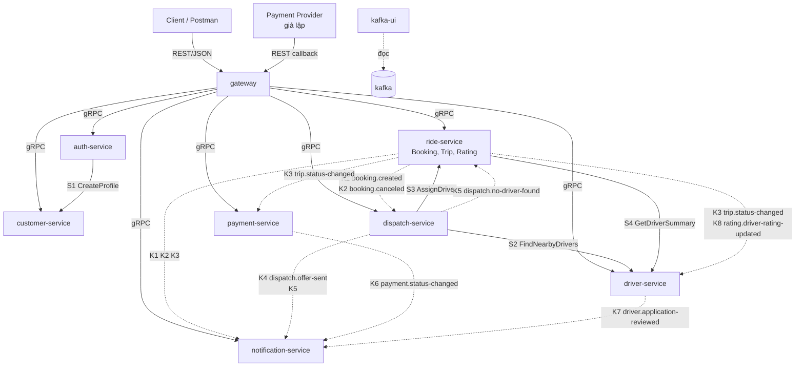
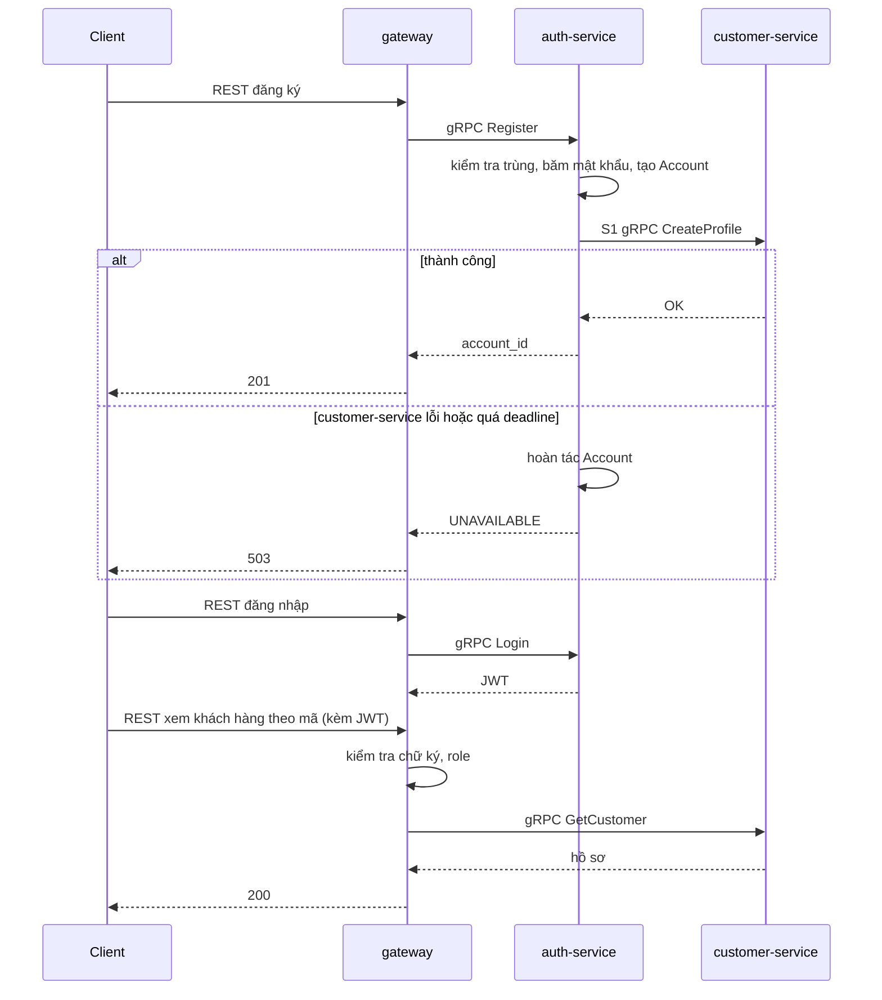
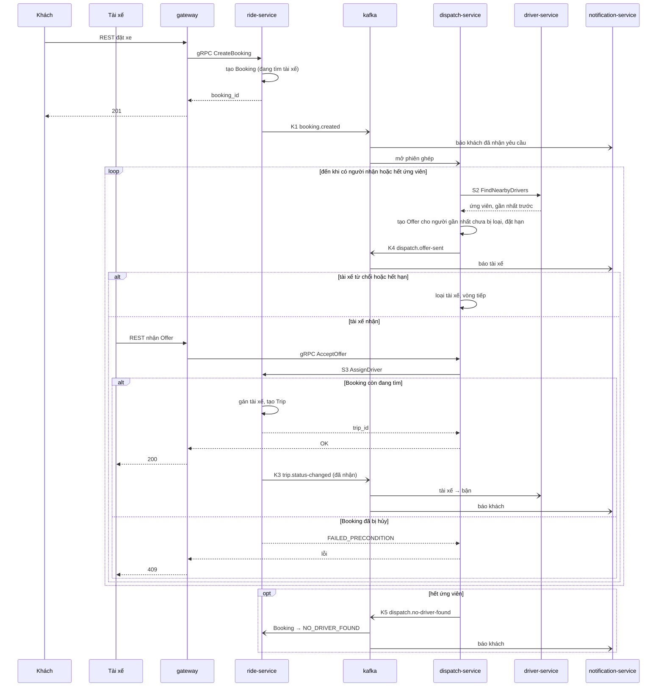

# 02 — Kiến trúc và đường giao tiếp

> Vòng 1 (chỉ BA). Đầu vào: `01-bounded-contexts.md` (bảng R1–R12), `CLAUDE.md`, `srs.md`.
> File này trả lời: **service nào nói chuyện với service nào, bằng gì, vì yêu cầu nào** — và cặp nào **không** nói chuyện.
> Không thuộc file này: loại database và schema (file 03), đường dẫn REST chi tiết (file 04), field của `.proto` (spec).
>
> **Trạng thái duyệt:** chưa câu hỏi mở nào của file 01 được trả lời, chưa ADR nào được xác nhận. Mọi chỗ ghi **[GĐ-n]** là *giả định tạm*; mục 10 liệt kê từng giả định, câu hỏi nó chờ, và những dòng phải sửa nếu câu trả lời khác đi.

## 1. Tóm tắt

| Loại đường | Số lượng | Ghi chú |
|---|---|---|
| Client → Gateway | REST/JSON | Cổng duy nhất mở ra ngoài (mục chấm 8) |
| Gateway → service | gRPC, tới cả 7 service | Mỗi service có ít nhất một API cho người dùng |
| Service → service đồng bộ | **4 lời gọi gRPC** (S1–S4) | Chỉ ở nơi bên gọi phải có kết quả mới làm tiếp được |
| Service → service bất đồng bộ | **8 topic Kafka** (K1–K8) | Chỉ cho sự kiện mà bên phát không chờ |
| Cặp service có nối | 9 / 21 | Mục 9 |
| Cặp service **không** nối | 12 / 21 | Mục 9 |

Mỗi service dùng kiểu giao tiếp nào (ngoài việc nhận gRPC từ Gateway):

| Service | Gọi gRPC sang service khác | Bị service khác gọi gRPC | Publish Kafka | Subscribe Kafka |
|---|---|---|---|---|
| `auth-service` | Có (S1) | — | — | — |
| `customer-service` | — | Có (S1) | — | — |
| `driver-service` | — | Có (S2, S4) | Có (K7) | Có (K3, K8) |
| `ride-service` | Có (S4) | Có (S3) | Có (K1, K2, K3, K8) | Có (K5) |
| `dispatch-service` | Có (S2, S3) | — | Có (K4, K5) | Có (K1, K2) |
| `payment-service` | — | — | Có (K6) | Có (K3) |
| `notification-service` | — | — | — | Có (K1–K7) |

`auth-service` và `customer-service` **không dùng Kafka**. `payment-service` và `notification-service` **không có gRPC với service khác**. Đây là điểm khác bản cũ, nơi mọi service đều nối cả hai kiểu.

## 2. Service và nhiệm vụ

### 2.1 Danh sách

| Thành phần | Nhiệm vụ | Truy vết | Mở cổng ra máy chủ? |
|---|---|---|---|
| `gateway` | Xem 2.2 | Mục chấm 3, 6, 8, 27, 28, 29 | **Có** |
| `auth-service` | Tài khoản, đăng nhập, cấp JWT, OTP, role | FR26, FR32, FR39 | Không |
| `customer-service` | Hồ sơ khách hàng | FR27 | Không |
| `driver-service` | Hồ sơ tài xế, xe, duyệt hồ sơ, Online/Offline, vị trí, tìm tài xế quanh tọa độ | FR02–FR04, FR13, FR28, FR29, FR38, FR39 | Không |
| `ride-service` | Booking, Trip, hủy, danh sách, giám sát; module Rating | FR01, FR11, FR12, FR14, FR25, FR30, FR31, FR35–FR37 | Không |
| `dispatch-service` | Phiên ghép tài xế, Offer, đếm giờ | FR05–FR10 | Không |
| `payment-service` | Cước, giao dịch, callback, chống lặp | FR16–FR20 | Không |
| `notification-service` | Tạo và cho xem thông báo | FR21–FR24 | Không |
| `kafka` | Kênh sự kiện | Mục chấm 7 | Không |
| `kafka-ui` | Xem topic và event | Mục chấm 7 | **Có** |
| `kafka-init` | Tạo topic khi khởi động rồi thoát | Mục chấm 7 | Không |
| Database của từng service | File 03 | Database-per-service | Không |

### 2.2 Nhiệm vụ Gateway (mục chấm 3)

| # | Nhiệm vụ | Làm gì | Truy vết |
|---|---|---|---|
| 1 | Authentication | Kiểm tra chữ ký và hạn của JWT **tại chỗ**, không gọi `auth-service` mỗi request. Sai → 401 | NFR06, mục 27 |
| 2 | Authorization | So role trong token với role mà route cho phép. Sai → 403 | BRULE12, NFR07, FR32, mục 28 |
| 3 | Rate limiting | Đếm request theo IP (route công khai) hoặc theo tài khoản. Vượt → 429 | Mục 29 |
| 4 | Routing | Đổi REST/JSON → gRPC; đổi gRPC status → HTTP theo bảng trong `CLAUDE.md` | Mục 3, 4, 8 |
| 5 | Log | Ghi method, đường dẫn, mã trả về, thời gian, mã request. Không ghi mật khẩu, token, dữ liệu cá nhân | NFR10, NFR08 |
| 6 | Health | `/health`, `/ready`, `/health/services` (hỏi health của từng service qua gRPC) | Mục 6 |
| 7 | Kiểm tra hình thức đầu vào | Thiếu trường, sai kiểu → 400 trước khi gọi service | Mục 25, 26 |

Gateway **không** làm:

| Không làm | Vì sao |
|---|---|
| Logic nghiệp vụ, kể cả gọi lần lượt hai service rồi ghép kết quả | `CLAUDE.md`. Điều phối đăng ký khách do `auth-service` làm (S1), không phải Gateway |
| Truy cập database nghiệp vụ | `CLAUDE.md` |
| Kiểm tra "dữ liệu này có phải của bạn không" | Đó là quy tắc nghiệp vụ (C2, R-5, R-7 trong file 01). Gateway chỉ biết role; service kiểm tra quyền sở hữu |
| Kiểm tra chữ ký callback của Payment Provider | Khóa bí mật của Provider thuộc `payment-service` |

Gateway chuyển danh tính đã kiểm tra (`account_id`, `role`) cho service qua gRPC metadata. Service tin metadata này vì chỉ Gateway vào được mạng nội bộ của Compose (mục chấm 8).

**[GĐ-7]** Một Gateway, không đặt Nginx phía trước; bộ đếm rate limit giữ trong bộ nhớ Gateway. **[GĐ-8]** JWT ký bằng khóa bất đối xứng: `auth-service` giữ khóa riêng, Gateway chỉ có khóa công khai.

## 3. Sơ đồ kiến trúc

Nét liền = gRPC (bên gọi chờ kết quả). Nét đứt = Kafka (bên phát không chờ). Đường Gateway → service gom thành một nhóm cho dễ đọc; chi tiết ở mục 4.2.

Mọi đường nét đứt đi qua `kafka`; sơ đồ vẽ thẳng từ bên phát đến bên nghe để thấy ai cần biết điều gì.

## 4. Bảng mọi đường giao tiếp

### 4.1 Từ ngoài vào Gateway

| Mã | Bên gửi | Bên nhận | Kiểu | Nội dung | Vì yêu cầu nào |
|---|---|---|---|---|---|
| C1 | Client (khách, tài xế, admin) | `gateway` | REST/JSON | Mọi thao tác của người dùng | `CLAUDE.md`; mục 8 |
| C2 | Payment Provider | `gateway` | REST/JSON, không JWT | Callback kết quả giao dịch. **[GĐ-5]** Provider là giả lập: Postman đóng vai Provider | FR18, UC14, mục 19, 30 |

### 4.2 Gateway → service (gRPC)

Tên rpc là gợi ý ở mức nhóm; spec chốt từng rpc.

| Mã | Bên nhận | Nhóm thao tác | Vì yêu cầu nào | Mục chấm |
|---|---|---|---|---|
| G1 | `auth-service` | Đăng ký khách, đăng nhập, xin OTP, xác nhận OTP và tạo tài khoản tài xế | FR26, FR39 | 9, 10, 21, 25 |
| G2 | `customer-service` | Xem / sửa hồ sơ của mình; xem khách hàng theo mã | FR27 | 11 |
| G3 | `driver-service` | Nộp hồ sơ tài xế và xe; xem tài xế theo mã; tài xế quanh tọa độ; bật / tắt nhận chuyến; gửi vị trí; admin duyệt / từ chối | FR02–FR04, FR13, FR28, FR29, FR38, FR39 | 12, 13, 21, 22, 23 |
| G4 | `ride-service` | Tạo booking; danh sách booking; xem chuyến; cập nhật trạng thái chuyến; hủy; đánh giá; admin xem và can thiệp chuyến | FR12, FR14, FR25, FR30, FR31, FR35–FR37 | 14, 15, 17, 18, 20 |
| G5 | `dispatch-service` | Tài xế xem Offer đang chờ; nhận; từ chối **[GĐ-2]** | FR06–FR08 | 15, 16 |
| G6 | `payment-service` | Xem cước; khởi tạo thanh toán điện tử; nhận callback; tài xế xác nhận thu tiền mặt; thanh toán lại; tra cứu giao dịch | FR16–FR20 | 19, 30 |
| G7 | `notification-service` | Xem thông báo của mình | FR21–FR24, UC16 | 16, 18, 22 |
| G8 | cả 7 service | Health check | Mục chấm 6 | 6 |

Quy tắc chung: mọi lời gọi có deadline (đề xuất 2 giây cho Gateway → service, bám NFR01); hết deadline hoặc service không chạy → 503.

Vì sao tài xế gửi vị trí là gRPC qua Gateway mà **không** phát lên Kafka: không context nào cần *dòng* vị trí. Dispatch hỏi khi cần ghép (S2), Ride hỏi khi khách mở màn hình theo dõi (S4).

### 4.3 Service → service đồng bộ (gRPC)

| Mã | Bên gọi → bên nhận | Lời gọi | Vì sao bên gọi phải chờ | Vì yêu cầu nào | Khi bên nhận không sẵn sàng (NFR05) | Deadline đề xuất |
|---|---|---|---|---|---|---|
| S1 | `auth-service` → `customer-service` | `CreateProfile(account_id, họ tên, …)` trong lúc đăng ký khách **[GĐ-1]** | Đăng ký chỉ coi là xong khi đã có hồ sơ (C1), và mục chấm 11 phải chạy được ngay sau mục 9 | FR26, FR27; mục 9, 11 | Auth hoàn tác tài khoản vừa tạo, trả 503; khách đăng ký lại sau. **Đăng nhập và mọi chức năng khác không bị ảnh hưởng** | 1 giây |
| S2 | `dispatch-service` → `driver-service` | `FindNearbyDrivers(tọa độ, loại xe, bán kính, limit)` | Không có danh sách ứng viên thì không gửi Offer được | FR02–FR05, BRULE01–03, NFR02; mục 15 | Dispatch thử lại vài lần có giãn cách; vẫn lỗi thì kết luận không tìm được tài xế (K5) để booking không bị treo. Booking đã tạo không mất; khách vẫn xem và hủy được | 1 giây |
| S3 | `dispatch-service` → `ride-service` | `AssignDriver(booking_id, driver_id)` khi tài xế bấm nhận **[GĐ-2]** | Phải trả lời tài xế ngay là "nhận được" hay "booking đã bị hủy"; Ride là nơi quyết định cuối (tranh chấp hủy — nhận) | FR07, FR11, AC06, NFR14; mục 16 | Dispatch trả 503 cho tài xế, Offer vẫn ở trạng thái chờ đến hết hạn; tài xế bấm lại được vì `AssignDriver` gọi lặp cho kết quả như cũ | 1 giây |
| S4 | `ride-service` → `driver-service` | `GetDriverSummary(driver_id)`: tên, biển số, loại xe, vị trí hiện tại | Khách mở màn hình theo dõi chuyến, cần dữ liệu để trả lời ngay | FR13, FR14, FR15, UC10 | Ride vẫn trả thông tin chuyến và trạng thái, bỏ trống phần tài xế / vị trí kèm cờ "chưa cập nhật" (đúng luồng thay thế của UC10) | 1 giây |

S4 không phục vụ mục chấm nào trực tiếp (FR14, FR15 ngoài phiếu). Giữ vì truy vết được về FR14 / UC10; ưu tiên làm sau cùng.

### 4.4 Service → service bất đồng bộ (Kafka)

Xem bảng topic ở mục 6. Tóm tắt hướng đi:

| Mã | Topic | Publish | Subscribe |
|---|---|---|---|
| K1 | `booking.created` | `ride-service` | `dispatch-service`, `notification-service` |
| K2 | `booking.canceled` | `ride-service` | `dispatch-service`, `notification-service` |
| K3 | `trip.status-changed` | `ride-service` | `driver-service`, `payment-service`, `notification-service` |
| K4 | `dispatch.offer-sent` | `dispatch-service` | `notification-service` |
| K5 | `dispatch.no-driver-found` | `dispatch-service` | `ride-service`, `notification-service` |
| K6 | `payment.status-changed` | `payment-service` | `notification-service` **[GĐ-3]** |
| K7 | `driver.application-reviewed` | `driver-service` | `notification-service` |
| K8 | `rating.driver-rating-updated` | `ride-service` (module Rating) | `driver-service` |

## 5. Quyết định cho từng quan hệ R1–R12

| Quan hệ (file 01) | Quyết định | Đường | Lý do | Đánh đổi |
|---|---|---|---|---|
| R1 Auth → Customer: tài khoản khách mới | **gRPC** **[GĐ-1]** | S1 | Mục 11 phải chạy ngay sau mục 9. Dùng event thì hồ sơ có thể đến trễ và mục 11 trả 404 | Đăng ký khách phụ thuộc `customer-service` đang chạy. Họ tên đi ngang qua Auth (Auth không lưu). ADR-004 |
| R2 Auth → Driver: số điện thoại tài xế đã xác thực | **Không nối** **[GĐ-4]** | — | Tài khoản `driver` chỉ được tạo sau khi OTP đúng (A6). Tài xế đăng nhập rồi nộp hồ sơ bằng token; token mang `account_id` và role `driver` chính là bằng chứng đã qua OTP | Đăng ký tài xế thành nhiều bước ở client (xin OTP → xác nhận → nộp hồ sơ). Có thể tồn tại tài khoản `driver` chưa nộp hồ sơ |
| R3 Ride → Dispatch: booking cần tài xế / bị hủy | **Kafka** | K1, K2 | FR35: Booking tạo xong ở trạng thái "đang tìm", khách không chờ ghép. Dispatch chậm hoặc dừng không chặn việc nhận booking (NFR05) | Event mất thì booking treo ở "đang tìm" — xem 6.3. Hủy tới Dispatch trễ một chút: có thể gửi thừa một Offer, nhưng S3 sẽ từ chối |
| R4 Dispatch → Driver: ứng viên quanh điểm đón | **gRPC** | S2 | Cần danh sách ngay và phải là dữ liệu **mới nhất** (BRULE01) | Dispatch phụ thuộc Driver đang chạy |
| R5a Dispatch → Ride: tài xế đã nhận | **gRPC** **[GĐ-2]** | S3 | Tài xế đang chờ câu trả lời; và phải có một nơi quyết định khi hủy và nhận xảy ra cùng lúc (NFR14) | Hai service core phụ thuộc đồng bộ ở đúng một điểm. ADR-003 đã nêu |
| R5b Dispatch → Ride: không tìm được tài xế | **Kafka** | K5 | Không ai chờ kết quả này; Notification cũng cần nghe (BRULE07) | Booking chuyển `NO_DRIVER_FOUND` trễ hơn kết luận của Dispatch một chút |
| R6 Ride → Driver: tài xế bận / rảnh | **Kafka** | K3 | Ride không cần chờ Driver ghi xong mới tiếp tục chuyến. Driver nghe: nhận chuyến → bận; hoàn thành hoặc hủy → rảnh | Trong vài trăm mili-giây tài xế vừa nhận chuyến vẫn hiện là rảnh. Hệ quả tệ nhất: một Offer thừa. Chặn gán trùng bằng bất biến mới ở Ride — xem 5.1 |
| R7 Ride → Driver: thông tin tài xế, xe, vị trí | **gRPC** | S4 | Khách cần xem ngay; vị trí là dữ liệu sống nên không sao chép sẵn được | Màn hình theo dõi phụ thuộc Driver; đã có đường lùi (thiếu phần tài xế) |
| R8 Ride → Payment: chuyến hoàn thành | **Kafka** | K3 | NFR05 nêu đích danh: Payment lỗi không được chặn việc kết thúc chuyến. BRULE08: chỉ tính cước sau khi hoàn thành | Cước có sau khi hoàn thành một chút, không tức thì. Event mất thì chuyến không được tính cước — xem 6.3 |
| R9 Payment → Ride: kết quả thanh toán | **Không nối** **[GĐ-3]** | — | Giả định "COMPLETED" ở mục 19 là trạng thái của **giao dịch**. Khách xem trạng thái thanh toán qua API của Payment | Màn hình chuyến không tự hiện "đã thanh toán"; client phải gọi thêm API của Payment |
| R10 Rating ↔ Ride: chuyến đã hoàn thành chưa | **Trong cùng service** | — | ADR-002: Rating chạy trong `ride-service`, đọc tại chỗ | Như ADR-002 |
| R11 Rating → Driver: điểm trung bình mới | **Kafka** | K8 | Khách không cần chờ Driver cập nhật xong (UC17 bước 5) | Điểm hiển thị ở hồ sơ tài xế trễ một chút |
| R12 → Notification | **Kafka** | K1–K7 | NFR05 nêu đích danh Notification; không context nào chờ nó | Thông báo có thể trễ; phải chống tạo trùng |

### 5.1 Điều file 02 cần mà file 01 chưa ghi

| Bổ sung | Nằm ở | Vì sao cần |
|---|---|---|
| **Một tài xế chỉ có nhiều nhất một Trip chưa kết thúc.** `AssignDriver` từ chối nếu tài xế đang có chuyến | Ride (đề xuất mã R-11 trong file 01, mục 5.4) | R6 đi bằng Kafka nên trạng thái "bận" ở Driver có độ trễ. Ride giữ dữ liệu Trip nên là nơi chặn chắc chắn. Truy vết: BRULE01, NFR14 |
| `AssignDriver` gọi lặp với cùng `booking_id` + `driver_id` trả kết quả như lần đầu | Ride | Để tài xế bấm lại được khi S3 lỗi giữa chừng |

File 01 **chưa được sửa**; hai dòng này chờ sinh viên đồng ý rồi mới thêm.

### 5.2 Nếu gộp Dispatch vào Ride (phương án lùi của ADR-003, chờ Q15)

| Đường | Thay đổi |
|---|---|
| S3 | **Biến mất** (thành lời gọi hàm trong cùng service, một giao dịch cục bộ) |
| S2 | Bên gọi đổi thành `ride-service` |
| K1, K2 | Mất subscriber Dispatch; chỉ còn Notification nghe |
| K5 | Mất subscriber Ride; chỉ còn Notification nghe; bên phát thành `ride-service` |
| K4 | Bên phát thành `ride-service` |
| G5 | Gộp vào G4 |

Còn 3 lời gọi gRPC giữa service, vẫn 8 topic, 6 service nghiệp vụ.

## 6. Topic Kafka

### 6.1 Quy ước

| Điểm | Quy ước | Lý do |
|---|---|---|
| Tên topic | `<context>.<sự-kiện>`, chữ thường, gạch nối | Nhìn tên biết ai phát |
| Phong bì chung | `event_id` (UUID), `event_type`, `occurred_at`, `data` | `event_id` để nhận ra message lặp |
| Khóa message (key) | ID của đối tượng chính (bảng dưới) | Kafka giữ thứ tự theo key: các event của cùng một chuyến đến đúng thứ tự |
| Consumer group | Tên service | Mỗi service nhận mỗi event một lần, dù chạy nhiều bản |
| Nội dung | **Chỉ ID, trạng thái, số liệu.** Không họ tên, số điện thoại, địa chỉ, lý do hủy, nhận xét | NFR08, NFR16: event xem được trên Kafka UI. Ngoại lệ: K1 có tọa độ điểm đón vì Dispatch cần (Q22) |
| Tạo topic | `kafka-init` tạo sẵn theo danh sách; tắt tự tạo topic | Mục chấm 7: topic "được đăng ký rõ ràng" |

Kafka giao message **ít nhất một lần**, nên mọi consumer phải chịu được message lặp.

### 6.2 Bảng topic

| Mã | Topic | Publish | Subscribe — làm gì | Lý do nghiệp vụ | Key | Field chính trong `data` | Xử lý message lặp |
|---|---|---|---|---|---|---|---|
| K1 | `booking.created` | `ride-service` | **Dispatch**: mở phiên ghép. **Notification**: báo khách "đã nhận yêu cầu" | FR35, FR06, FR21 | `booking_id` | `booking_id`, `customer_id`, `pickup_lat`, `pickup_lng`, `vehicle_type` | Dispatch: mỗi `booking_id` chỉ một phiên, đã có thì bỏ qua. Notification: xem 6.4 |
| K2 | `booking.canceled` | `ride-service` | **Dispatch**: đóng phiên, hủy Offer đang chờ. **Notification**: báo khách | FR36, AC16 | `booking_id` | `booking_id`, `customer_id`, `canceled_by` | Dispatch: phiên đã đóng thì bỏ qua. Nếu event hủy đến trước event tạo, ghi dấu "đã hủy" để không mở phiên |
| K3 | `trip.status-changed` | `ride-service` | **Driver**: trạng thái nhận chuyến → bận; hoàn thành / hủy → rảnh. **Payment**: chỉ xử lý trạng thái hoàn thành — tính cước, tạo giao dịch. **Notification**: báo khách và tài xế | FR11, FR12, FR16, FR22, FR23, FR36, BRULE01, BRULE08, AC16 | `trip_id` | `trip_id`, `booking_id`, `customer_id`, `driver_id`, `status`, `previous_status`; khi hoàn thành thêm `vehicle_type`, `payment_method`, `distance_km`, `duration_min`; khi hủy thêm `canceled_by` | Driver: ghi `trip_id` đang chạy; event "rảnh" chỉ có hiệu lực nếu khớp `trip_id`. Payment: mỗi `trip_id` chỉ một Fare (M1), đã có thì bỏ qua |
| K4 | `dispatch.offer-sent` | `dispatch-service` | **Notification**: báo tài xế có lời mời nhận chuyến | FR06, UC07, UC16; mục 15 ("gửi offer" nhìn thấy được) | `booking_id` | `offer_id`, `booking_id`, `driver_id`, `expires_at` | Xem 6.4 |
| K5 | `dispatch.no-driver-found` | `dispatch-service` | **Ride**: Booking → `NO_DRIVER_FOUND`. **Notification**: báo khách | FR10, BRULE07, AC09 | `booking_id` | `booking_id`, `customer_id`, `offers_tried` | Ride: chỉ đổi nếu Booking còn ở trạng thái đang tìm; nếu đã hủy hoặc đã có tài xế thì bỏ qua |
| K6 | `payment.status-changed` | `payment-service` | **Notification**: báo kết quả thanh toán (thành công / thất bại) | FR19, FR24, BRULE10, AC12, AC13 | `trip_id` | `payment_id`, `trip_id`, `customer_id`, `method`, `amount`, `status` | Xem 6.4 |
| K7 | `driver.application-reviewed` | `driver-service` | **Notification**: báo tài xế kết quả duyệt | FR39, AC20; mục 22 | `driver_id` | `driver_id`, `result` (duyệt / từ chối) | Xem 6.4 |
| K8 | `rating.driver-rating-updated` | `ride-service` (module Rating) | **Driver**: ghi điểm trung bình mới | FR25, UC17 bước 5 | `driver_id` | `driver_id`, `average_score`, `rating_count` | Event mang **giá trị tuyệt đối**, ghi đè lặp lại không sai; bỏ qua event có `rating_count` nhỏ hơn giá trị đang có |

Vì sao K3 là **một** topic cho mọi trạng thái của Trip thay vì tách `trip.completed` riêng: Driver cần cả "nhận chuyến" lẫn "hoàn thành / hủy" đến **đúng thứ tự**; Kafka chỉ đảm bảo thứ tự trong cùng một topic và cùng key. Đánh đổi: Payment nhận cả event không cần và phải lọc theo `status`.

Hủy phát ở hai topic tùy thời điểm: chưa có tài xế → K2 (chỉ Dispatch và Notification cần); đã có tài xế → K3 với `status` hủy (Driver cần để trả tài xế về rảnh). FR36 vẫn là một thao tác hủy ở phía khách.

### 6.3 Phát event không được mất

Vấn đề: service ghi database xong rồi mới gửi Kafka. Nếu chết giữa hai bước, trạng thái đã đổi mà event không bao giờ được phát.

| Event mất | Hậu quả |
|---|---|
| K1 | Booking treo mãi ở "đang tìm tài xế" |
| K3 (hoàn thành) | Chuyến không bao giờ được tính cước; tài xế kẹt ở trạng thái bận |
| K5 | Khách không được báo (vi phạm BRULE07) |

**[GĐ-6]** Dùng mẫu **outbox**: ghi event vào một bảng trong cùng giao dịch với thay đổi nghiệp vụ; một tiến trình nền đọc bảng đó và gửi lên Kafka. Truy vết: NFR14, NFR15. Chi tiết và phương án đơn giản hơn: ADR-005.

### 6.4 Chống trùng ở Notification

Mỗi thông báo gắn với (`event_id`, người nhận). Gặp lại cặp này thì không tạo thông báo mới. Người nhận là `account_id` lấy từ event; **[GĐ-5]** Notification chỉ lưu thông báo trong ứng dụng nên không cần hỏi số điện thoại hay email từ service nào.

## 7. Kiểm tra Kafka (mục chấm 7)

| Câu giảng viên hỏi | Trả lời bằng |
|---|---|
| Dùng Kafka thế nào? | Bảng 6.2: 8 topic, mỗi topic có bên phát, bên nghe, lý do |
| Đã đăng ký event chưa? | (1) Bảng 6.2 là sổ đăng ký. (2) Container `kafka-init` tạo đúng 8 topic đó khi khởi động; broker tắt tự tạo topic, nên service gửi nhầm tên topic sẽ lỗi ngay thay vì âm thầm tạo topic mới |
| Xem event ở đâu? | Kafka UI, cổng đề xuất **8080** trên máy chủ: `http://localhost:8080` |

Các bước demo:

| Bước | Thao tác | Kết quả mong đợi |
|---|---|---|
| 1 | `docker compose ps` | Chỉ `gateway` và `kafka-ui` có cổng ra máy chủ |
| 2 | Mở Kafka UI → Topics | Thấy đủ 8 topic của bảng 6.2 |
| 3 | Postman: tạo booking (mục 15) | Topic `booking.created` có thêm một message; mở ra thấy `event_id`, `booking_id` |
| 4 | Kafka UI → Consumers | Thấy group `dispatch-service` và `notification-service` đã đọc message đó (lag = 0) |
| 5 | Postman: tài xế nhận chuyến (mục 16) | Topic `trip.status-changed` có message mới |

Yêu cầu với Compose (dev-agent hiện thực): `kafka` và `kafka-init` không có `ports`; `kafka-ui` có `ports`; cổng Gateway đề xuất 3000. Kafka UI không có đăng nhập, chỉ dùng cho môi trường học tập (Q22).

## 8. Sơ đồ trình tự

### 8.1 Đăng ký khách hàng rồi xem hồ sơ (mục 9, 11) — [GĐ-1]

### 8.2 Đặt xe → ghép tài xế → nhận chuyến (mục 15, 16) — [GĐ-2]

### 8.3 Hoàn thành → tính cước → thanh toán điện tử (mục 17, 19, 30) — [GĐ-3], [GĐ-5]

## 9. Cặp service không nối

21 cặp giữa 7 service nghiệp vụ. **9 cặp có nối**: Auth–Customer (S1), Dispatch–Driver (S2), Dispatch–Ride (S3, K1, K2, K5), Ride–Driver (S4, K3, K8), Ride–Payment (K3), và bốn cặp với Notification (Ride, Dispatch, Payment, Driver).

**12 cặp không nối:**

| Cặp | Vì sao không nối |
|---|---|
| Auth – Driver | **[GĐ-4]** Token đã mang `account_id` và role; Driver không cần hỏi Auth, Auth không cần biết kết quả duyệt |
| Auth – Ride | Ride chỉ cần `account_id` và role, Gateway đã chuyển sang |
| Auth – Dispatch | Như trên |
| Auth – Payment | Như trên |
| Auth – Notification | Không FR nào yêu cầu thông báo khi đăng ký hay đăng nhập. OTP không đi qua Notification **[GĐ-5]** |
| Customer – Driver | Hai loại hồ sơ độc lập; không quy tắc nào cần cả hai |
| Customer – Ride | Ride chỉ giữ `customer_id`. Không mục chấm nào cần Ride trả kèm họ tên khách. UC22 (admin xem thông tin khách trong chuyến): client gọi thêm API khách hàng |
| Customer – Dispatch | Ghép tài xế không dùng thông tin cá nhân của khách |
| Customer – Payment | Payment chỉ cần `customer_id`, đã có trong K3 |
| Customer – Notification | **[GĐ-5]** Thông báo trong ứng dụng chỉ cần `account_id` |
| Driver – Payment | Cước tính theo mã loại xe có sẵn trong K3; Payment không cần hồ sơ tài xế |
| Dispatch – Payment | Ghép tài xế và tiền không liên quan nhau |

Ngoài ra, ngay trong cặp có nối cũng chỉ nối **một chiều, một kiểu** ở nơi không cần hơn:

| Chiều không có | Vì sao |
|---|---|
| Customer → Auth | Customer không bao giờ cần hỏi Auth |
| Driver → Dispatch, Driver → Ride | Driver chỉ trả lời và nghe event; không gọi ai |
| Payment → Ride | **[GĐ-3]** |
| Notification → bất kỳ service nào | Notification chỉ nghe |
| Payment và Notification không có gRPC với service nào | Không ai phải chờ chúng (NFR05) |
| Auth và Customer không dùng Kafka | Không có sự kiện nào của chúng mà context khác cần biết |

## 10. Giả định tạm và phạm vi ảnh hưởng

Nếu câu trả lời khác giả định, sửa đúng các dòng ở cột cuối.

| Mã | Chờ | Giả định tạm | Phương án khác | Dòng phải sửa nếu đổi |
|---|---|---|---|---|
| GĐ-1 | Q3 | Auth gọi đồng bộ sang Customer khi đăng ký; lỗi thì hoàn tác | (a) Auth phát event, Customer tạo hồ sơ sau | S1 bỏ; thêm topic `account.registered` (Auth publish, Customer subscribe); mục 1: Auth và Customer bắt đầu dùng Kafka; sơ đồ 8.1; **mục chấm 11 có thể 404 nếu gọi ngay sau mục 9**; ADR-004 |
| | | | (c) hồ sơ tạo lần đầu khi khách cập nhật | S1 bỏ; cặp Auth–Customer thành không nối; mục 11 trả 404 cho khách chưa cập nhật |
| GĐ-2 | Q5 | Tài xế gọi API để xem Offer đang chờ (và có thêm thông báo K4); Ride quyết định cuối khi hủy và nhận cùng lúc | Chỉ qua thông báo, không có API xem Offer | G5 bỏ thao tác "xem Offer đang chờ"; K4 thành bắt buộc thay vì bổ trợ |
| | | | Dispatch quyết định cuối | S3 đổi thành event; cần thêm đường Ride → Dispatch đồng bộ khi hủy; sơ đồ 8.2 |
| GĐ-3 | Q6 | "COMPLETED" ở mục 19 là trạng thái của giao dịch; Ride không nghe Payment | (b) là trạng thái của Booking / chuyến | K6 thêm subscriber `ride-service`; R9 thành Kafka; mục 9: bỏ dòng "Payment → Ride"; sơ đồ 8.3; file 01 cần thêm một trạng thái sau "hoàn thành" |
| GĐ-4 | Q4 | Tài xế chờ duyệt đăng nhập được; Driver chặn bật Online | (b) không đăng nhập được | Cặp Auth–Driver thành có nối: K7 thêm subscriber `auth-service` (hoặc Driver gọi Auth); bước nộp hồ sơ không dùng JWT thường được, G1 và G3 phải đổi; R2 đổi quyết định |
| GĐ-5 | Q14 | Ba Provider đều giả lập: Postman gọi callback thanh toán; OTP không gửi SMS thật (cách tài xế lấy mã khi demo do spec mục 21 quyết định); thông báo chỉ lưu trong ứng dụng | Tích hợp thật | Thêm đường ra ngoài từ Payment, Notification; nếu gửi SMS / email thật thì Notification cần thông tin liên lạc → thêm đường tới Customer / Driver; OTP qua SMS thêm đường Auth → Notification |
| GĐ-6 | Q20 (mới) | Outbox cho mọi service phát event | Gửi Kafka ngay sau khi ghi database | Mục 6.3; file 03 bớt bảng outbox; chấp nhận rủi ro trong bảng 6.3 |
| GĐ-7 | Q17, Q18 (mới) | Không Nginx; rate limit đếm trong bộ nhớ Gateway | Có Nginx; hoặc đếm bằng Redis | Mục 2.1 thêm container; Compose: cổng mở ra ngoài chuyển từ Gateway sang Nginx |
| GĐ-8 | Q19 (mới) | JWT ký bất đối xứng | Khóa bí mật dùng chung | Mục 2.2 dòng 1; không đổi đường giao tiếp |
| GĐ-9 | Q21 (mới) | `customer_id` và `driver_id` chính là `account_id` | Mỗi hồ sơ có mã riêng | Ride, Payment, Dispatch phải hỏi Customer / Driver để đổi mã → thêm lời gọi gRPC; ảnh hưởng S1, G2, G3 và mọi event |
| — | Q15 | Tách Dispatch | Gộp vào Ride | Mục 5.2 |

## 11. Câu hỏi còn mở

Q1–Q16 ở file 01 vẫn mở. Câu mới của file này:

| # | Câu hỏi | Lựa chọn | Đề xuất | Hỏi ai |
|---|---|---|---|---|
| Q17 | Có đặt Nginx trước Gateway không? Giảng viên có nói "Nginx load balancer về bản chất là gateway" | (a) Không; (b) Nginx → nhiều bản Gateway | (a) — một bản Gateway đủ cho 30 mục chấm | GV |
| Q18 | Bộ đếm rate limit (mục 29) giữ ở đâu? | (a) Trong bộ nhớ Gateway; (b) Redis | (a) nếu chỉ một Gateway; (b) bắt buộc nếu chọn Q17(b). `docs/study/00` ghi "Gateway + Redis" theo bản cũ | SV |
| Q19 | JWT ký bằng gì? | (a) Bất đối xứng: Gateway không tự tạo token được; (b) khóa chung: đơn giản hơn | (a). Lưu ý cả hai cách: tài khoản bị khóa sau khi đã có token thì token vẫn dùng được đến khi hết hạn — cần hạn ngắn | SV |
| Q20 | Chống mất event bằng outbox hay gửi thẳng? | Xem ADR-005 | Outbox | SV |
| Q21 | `customer_id`, `driver_id` có trùng `account_id` không? | (a) Trùng; (b) mã riêng | (a) — không phát sinh lời gọi đổi mã. Chốt ở file 03 | SV |
| Q22 | Kafka UI không có đăng nhập và K1 chứa tọa độ điểm đón. Chấp nhận cho môi trường học tập không? | (a) Chấp nhận, ghi rõ chỉ dùng khi demo; (b) bật đăng nhập cho Kafka UI | (a) | SV |
| Q23 | Quãng đường và thời gian chuyến (để tính cước) do ai xác định? | (a) Ride tính từ tọa độ điểm đón, điểm đến và mốc thời gian; (b) tài xế gửi lên khi hoàn thành | (a) — không tin số do client gửi. Ảnh hưởng field của K3 | SV |
| Q24 | `driver-service` không trả lời khi Dispatch hỏi (S2): thử lại mấy lần rồi kết luận không tìm được? | 3 lần / chờ đến khi có lại | 3 lần rồi phát K5, để booking không treo | SV |
| Q25 | Deadline: 2 giây cho Gateway → service, 1 giây cho service → service — có phù hợp NFR01 (≤ 2 giây) không? | Là biến cấu hình | Giữ đề xuất | SV |
| Q26 | Có thêm bất biến "một tài xế chỉ một Trip chưa kết thúc" vào file 01 không (mục 5.1)? | Thêm / không | Thêm | SV |
