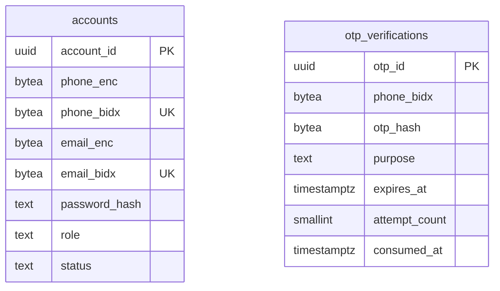
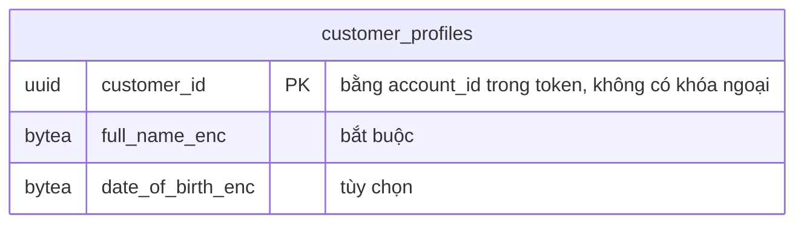
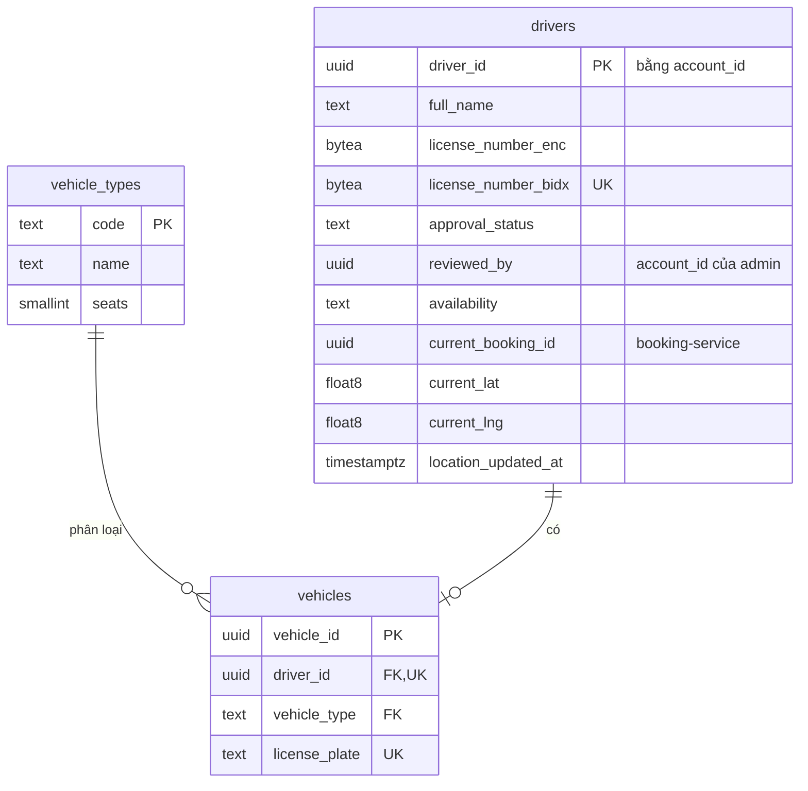
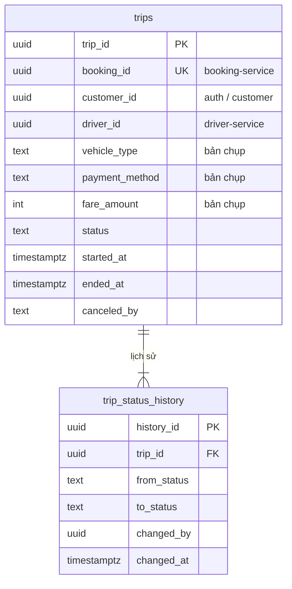
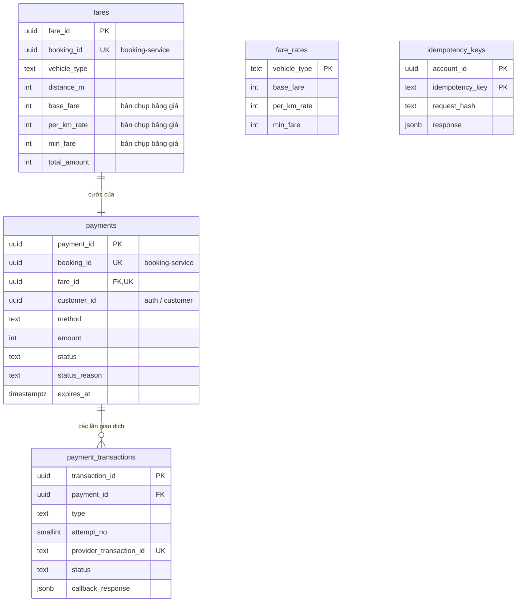
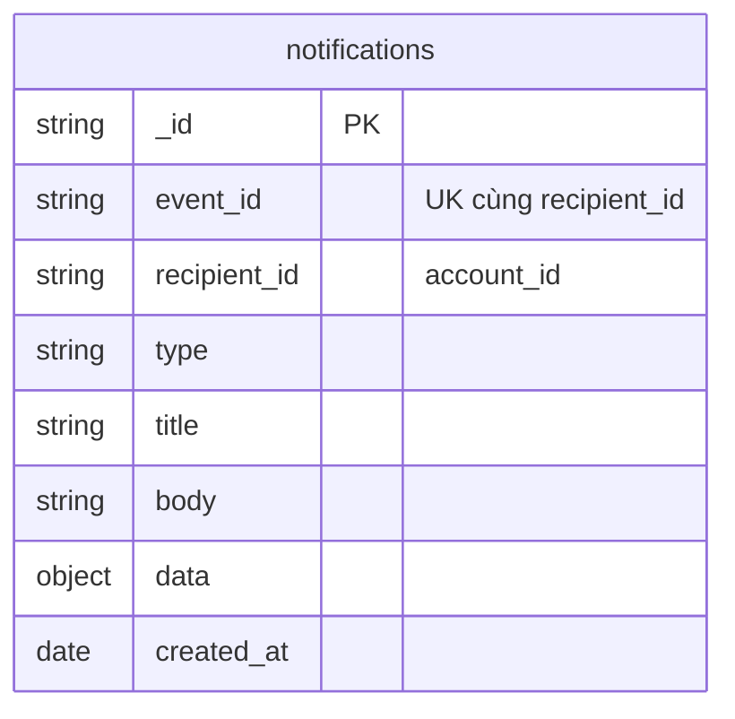
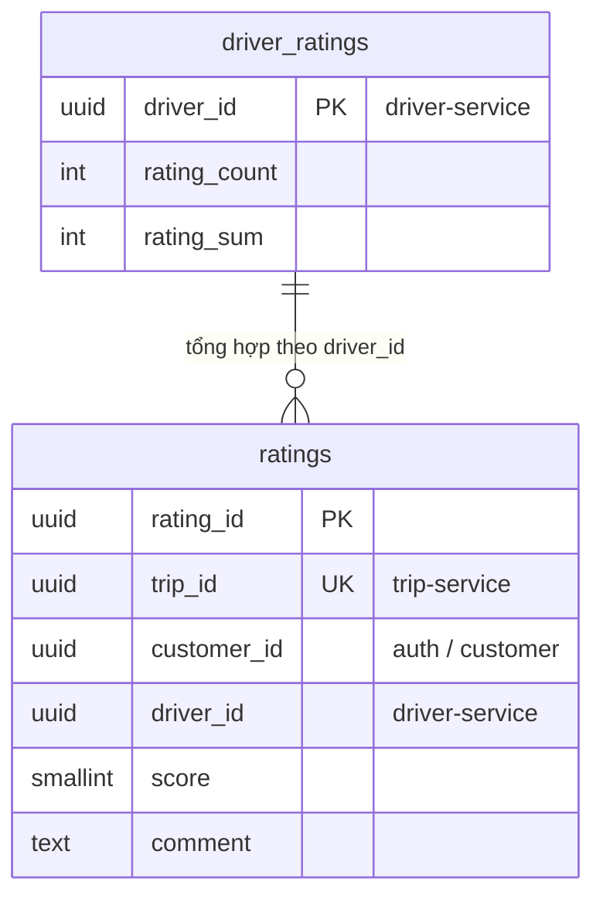

# 03 — Dữ liệu

> Vòng 1 (chỉ BA), viết 2026-10-02. Đầu vào: `CLAUDE.md`, `srs.md` (FR01–FR42, BRULE01–18, UC01–UC33, AC01–AC29), file 01 (aggregate, quy tắc A/C/D/B/T/M/N/V), file 02 (S2–S7, K1–K7), ADR-001 … ADR-014. Mốc so sánh: `docs/reference/thiet-ke-da-duyet.md` mục 3.
> Sửa 2026-10-03: hồ sơ khách tạo sau khi đăng nhập, bỏ `customer_profiles.phone_enc` (mục 4.1, ADR-013); seed thêm KH3 chưa có hồ sơ (mục 14); bỏ `notifications.status`; thêm biến `SIMULATION_MODE`, `PAYMENT_CALLBACK_SECRET` (mục 13) — ADR-014. Cùng ngày: Q58 đóng (hồ sơ không lưu số điện thoại); `simulate_result: "MANUAL"` (Q57) giữ giao dịch `PENDING` chờ callback — không đổi schema (mục 8.4).
> File này trả lời: **mỗi service lưu gì, ở đâu, kiểu gì, vì sao**. Đường dẫn REST và rpc: file 04.
> Ký hiệu: **[ĐC]** = đã chốt trong `CLAUDE.md` / `srs.md`. **[BA]** = BA tự chọn, chưa ai xác nhận (gom ở mục 16). Tên trạng thái viết HOA vẫn là đề xuất như ở file 01, trừ tên đã có trong SRS.

## 1. Tóm tắt

### 1.1 Database của từng service

| Service | Database | Container | Bảng nghiệp vụ | Bảng kỹ thuật | Lý do chọn loại này | Đánh đổi | So với tham chiếu |
|---|---|---|---|---|---|---|---|
| `auth-service` | PostgreSQL 16 | `auth-db` | 2: `accounts`, `otp_verifications` | `schema_migrations` | Định danh đăng nhập phải **duy nhất tuyệt đối** (A2): cần ràng buộc UNIQUE và giao dịch | — | Giữ loại; bớt 4 bảng (mục 12) |
| `customer-service` | PostgreSQL 16 | `customer-db` | 1: `customer_profiles` | `schema_migrations` | Một bảng có cấu trúc cố định, tra theo khóa chính; PK = `account_id` chặn tạo hồ sơ lần hai ngay trong database (C1, BRULE18) | Service nhỏ mà vẫn một database riêng | Giữ |
| `driver-service` | PostgreSQL 16 (**không PostGIS**) | `driver-db` | 3: `drivers`, `vehicles`, `vehicle_types` | `outbox`, `schema_migrations` | Giữ chỗ tài xế phải là một lệnh UPDATE có điều kiện, nguyên tử (D8); tìm trong 1 km bằng công thức Haversine trên cột `lat`/`lng` (ADR-011) | Không có index không gian; đủ cho quy mô demo | **Đổi**: bỏ PostGIS |
| `booking-service` | PostgreSQL 16 | `booking-db` | 3: `bookings`, `driver_offers`, `driver_assignments` | `outbox`, `schema_migrations` | Tranh chấp hủy — nhận giải quyết bằng khóa dòng (B12); "một Offer đang chờ", "một Offer được nhận" bảo vệ bằng index duy nhất có điều kiện (B8, B10) | — | Giữ |
| `trip-service` | PostgreSQL 16 | `trip-db` | 2: `trips`, `trip_status_history` | `outbox`, `schema_migrations` | Đổi trạng thái + ghi lịch sử + ghi outbox phải cùng một giao dịch (T2, T4, T8) | — | Giữ |
| `payment-service` | PostgreSQL 16 | `payment-db` | 4: `fare_rates`, `fares`, `payments`, `payment_transactions` | `idempotency_keys`, `outbox`, `schema_migrations` | Tiền cần ACID: "một lần thu thành công", "một lần hoàn" bảo vệ bằng ràng buộc của database (M6, M8, NFR14) | — | Giữ |
| `notification-service` | MongoDB 7 | `notification-db` | 1 collection: `notifications` | — (index tạo khi khởi động) | Mỗi loại thông báo mang phần `data` khác nhau; chỉ ghi thêm và đọc theo người nhận; không join, không giao dịch nhiều dòng. Index duy nhất (`event_id`, `recipient_id`) đủ để chống trùng (N4) | Thêm một công nghệ phải học và vận hành; không có công cụ migration | Giữ |
| `rating-service` | PostgreSQL 16 | `rating-db` | 2: `ratings`, `driver_ratings` | `schema_migrations` | "Mỗi chuyến một đánh giá" cần UNIQUE (V3); lưu đánh giá và cộng điểm phải cùng giao dịch (V5) | — | Giữ |
| `gateway` | Redis 7 | `redis` | Không có dữ liệu nghiệp vụ | 2 nhóm key (mục 12) | Bộ đếm có hạn tự xóa, tăng số nguyên tử (`CLAUDE.md`, ADR-010) | Gateway phụ thuộc Redis; Redis dừng thì cho qua | Thu hẹp: bỏ cache, session |

Tổng: **18 bảng nghiệp vụ + 1 collection**, 4 bảng `outbox`, 1 bảng `idempotency_keys`, 7 bảng `schema_migrations`.

### 1.2 Vì sao mỗi service một container database [BA]

| Lựa chọn | Ưu | Nhược |
|---|---|---|
| **Mỗi service một container** (`auth-db`, `customer-db`, …) | Cô lập thật: service này không thể kết nối nhầm database kia; dừng riêng từng database để demo NFR05; mục chấm 5 nhìn thấy rõ database-per-service | 7 container PostgreSQL + 1 MongoDB tốn RAM (ước lượng 40–60 MB mỗi container khi rảnh — chưa đo) |
| Một server PostgreSQL, 7 database, 7 user | Nhẹ máy | Một server dừng là cả 7 service dừng; ranh giới chỉ là quyền của user |

Chọn dòng đầu. Không container database nào có `ports` (mục chấm 8).

## 2. Quy ước kiểu dữ liệu (các câu dễ bị hỏi)

| Dữ liệu | Kiểu chọn | Vì sao kiểu này | Vì sao không chọn kiểu kia |
|---|---|---|---|
| Khóa chính | `uuid`, `DEFAULT gen_random_uuid()` [ĐC] | Mỗi service tự sinh ID, không cần nơi cấp số chung; ID không đoán được; đi qua event vẫn duy nhất. Service sinh ID **trước khi ghi** được: Booking sinh `booking_id` rồi mới gọi S4 | `INT` tự tăng: phải ghi xong mới có ID; đoán được ID người khác. `varchar(36)`: 36 byte thay vì 16, so sánh chậm hơn |
| Tiền VND | `integer`, đơn vị **đồng**, `CHECK (> 0)` | VND không có đơn vị lẻ; số nguyên cộng trừ chính xác tuyệt đối; tối đa ~2,1 tỷ đ là thừa cho một cuốc xe; thư viện `pg` trả về kiểu số của JavaScript | `float`/`double`: sai số nhị phân (0,1 + 0,2 ≠ 0,3). `NUMERIC(10,2)`: có 2 chữ số lẻ không bao giờ dùng, và `pg` trả về chuỗi. `bigint`: `pg` trả về chuỗi |
| Quãng đường | `integer`, đơn vị **mét** | Cùng lý do với tiền: công thức cước chỉ còn phép tính số nguyên (mục 6.3). API hiển thị thêm `distance_km` cho người đọc | `NUMERIC` km hoặc `float` km: nhân với đơn giá rồi làm tròn lên 1.000 đ có thể lệch đúng 1.000 đ vì sai số số thực |
| Tọa độ | `double precision` + `CHECK` khoảng (vĩ độ −90…90, kinh độ −180…180) | Tọa độ là **số đo**, không phải số đếm: sai số của số thực 64 bit nhỏ hơn 1 mm, vô nghĩa so với sai số GPS (vài mét). Hàm lượng giác của PostgreSQL và JavaScript làm việc trực tiếp với kiểu này | `DECIMAL(10,7)` (tham chiếu): chính xác thập phân nhưng không cần, phải ép kiểu trong mọi phép tính, `pg` trả về chuỗi. `geography` của PostGIS: xem ADR-011 |
| Thời điểm | `timestamptz`, lưu UTC; API trả ISO 8601 có `Z` | Một thời điểm tuyệt đối, không phụ thuộc múi giờ của container; so sánh hạn (`expires_at < now()`) luôn đúng | `timestamp` không múi giờ: cùng một giá trị bị hiểu khác nhau giữa các máy. `DATETIME` (tham chiếu) là kiểu của MySQL |
| Trạng thái, role, phương thức | `text` + `CHECK (… IN (…))` | Giá trị sai bị database từ chối; đọc được ngay trong `psql`; thêm giá trị bằng một migration đổi CHECK | `ENUM` của PostgreSQL: không xóa được giá trị, đổi tên phiền, thêm giá trị có giới hạn trong giao dịch. Bảng tra cứu riêng: thừa cho 3–6 giá trị cố định |
| Số điện thoại | Chuỗi, chuẩn hóa về `+84…`; lưu **mã hóa** (`bytea`) + **chỉ mục mù** (`bytea`, UNIQUE) | Là định danh, không phải số để tính: có số 0 đầu, dấu `+`. Mã hóa vì là dữ liệu cá nhân (mục chấm 24); chỉ mục mù để vẫn UNIQUE và đăng nhập được (mục 11.4) | Kiểu số: mất số 0 đầu. Lưu rõ: trái NFR08 |
| Mật khẩu | `password_hash text`: `scrypt$N$r$p$salt$hash` | Băm một chiều, có salt riêng từng mật khẩu, chậm có chủ ý. `scrypt` có sẵn trong Node (`node:crypto`), không cần gói biên dịch. Tham số nằm ngay trong chuỗi để sau này tăng độ khó mà không hỏng mật khẩu cũ | Mã hóa hai chiều: có khóa là giải được. SHA-256 trần: quá nhanh, dò được. `bcrypt`/`argon2`: cần gói ngoài phải biên dịch trong Docker |
| Văn bản người dùng nhập | `text` + `CHECK (char_length(…) <= n)` | PostgreSQL lưu `text` và `varchar` như nhau; giới hạn độ dài đặt ở CHECK để đổi được bằng migration | `varchar(255)`: con số 255 không có ý nghĩa nghiệp vụ |
| Dữ liệu đã mã hóa | `bytea` | Kết quả mã hóa là byte, không phải chữ | `text` base64: dài hơn 33 % |
| Loại xe | `text` mã: `MOTORBIKE`, `CAR_4`, `CAR_7` | Mã dùng chung giữa các context (file 01 mục 5); đọc được trong event và log | UUID / số: phải tra mới biết là loại gì |
| Nội dung event, response đã lưu | `jsonb` | Cấu trúc khác nhau theo từng loại; không truy vấn theo field bên trong | Tách cột: mỗi loại event một bảng |

Mọi bảng có `created_at timestamptz NOT NULL DEFAULT now()`; bảng có sửa thì thêm `updated_at`. Hai cột này không lặp lại trong các bảng dưới.

## 3. `auth-service` — `auth-db`

### 3.1 `accounts` (FR26, FR32; A1–A5; mục 9, 10, 24, 25)

| Field | Kiểu | Ràng buộc | Ghi chú / vì sao |
|---|---|---|---|
| `account_id` | `uuid` | PK | Chính là `customer_id` / `driver_id` ở các service khác (mục 4.1) |
| `phone_enc` | `bytea` | NOT NULL | Số điện thoại đã mã hóa AES-256-GCM |
| `phone_bidx` | `bytea` | NOT NULL, **UNIQUE** | Chỉ mục mù HMAC-SHA256; dùng để đăng nhập và chặn trùng (A2) |
| `email_enc` | `bytea` | NULL | Tùy chọn [BA] — UC02 cho đăng nhập bằng "số điện thoại/email" |
| `email_bidx` | `bytea` | NULL, **UNIQUE** | PostgreSQL cho nhiều dòng NULL trong cột UNIQUE |
| `password_hash` | `text` | NOT NULL | Mục 2 |
| `role` | `text` | NOT NULL, CHECK IN (`customer`, `driver`, `admin`) | Một cột, không có bảng ROLE / PERMISSION [ĐC] |
| `status` | `text` | NOT NULL DEFAULT `ACTIVE`, CHECK IN (`ACTIVE`, `LOCKED`) | A3: tài khoản khóa bị từ chối đăng nhập |

Index: hai UNIQUE ở trên là đủ (đăng nhập tra theo `phone_bidx` hoặc `email_bidx`).

### 3.2 `otp_verifications` (FR39; A6; mục 21)

| Field | Kiểu | Ràng buộc | Ghi chú / vì sao |
|---|---|---|---|
| `otp_id` | `uuid` | PK | |
| `phone_bidx` | `bytea` | NOT NULL | Không lưu số điện thoại rõ; khi xác nhận, client gửi lại số và Auth tính lại chỉ mục |
| `otp_hash` | `bytea` | NOT NULL | HMAC-SHA256 của mã OTP. Vì sao HMAC mà không SHA-256 trần: OTP chỉ có 10⁶ giá trị, băm trần thì thử hết trong chớp mắt |
| `purpose` | `text` | NOT NULL, CHECK IN (`DRIVER_REGISTRATION`) | Chỉ một mục đích có FR |
| `expires_at` | `timestamptz` | NOT NULL | Hạn dùng; đọc từ `OTP_TTL_SECONDS` |
| `attempt_count` | `smallint` | NOT NULL DEFAULT 0 | Chặn dò mã: quá `OTP_MAX_ATTEMPTS` thì OTP hết hiệu lực |
| `consumed_at` | `timestamptz` | NULL | Khác NULL = đã dùng; A6 "chỉ dùng một lần" |

Index: (`phone_bidx`, `purpose`, `created_at` DESC) — lấy OTP mới nhất của một số.

Tham chiếu có `otp.user_id`; ở đây **không có**: tài khoản tài xế chỉ được tạo **sau khi** OTP đúng (A6), nên lúc xin OTP chưa có tài khoản để trỏ tới.

Hai bảng không có khóa ngoại với nhau (xem lý do ở trên).

## 4. `customer-service` — `customer-db`

### 4.1 `customer_profiles` (FR27, BRULE18; C1–C6; mục 11, 24, 26)

Từ 2026-10-03 (ADR-013): một dòng **chỉ xuất hiện khi khách tự tạo hồ sơ** sau khi đăng nhập (A37), không còn tạo lúc đăng ký. Tài khoản `customer` chưa có dòng nào ở đây là trạng thái hợp lệ ("chưa có hồ sơ" → 404).

| Field | Kiểu | Ràng buộc | Ghi chú / vì sao |
|---|---|---|---|
| `customer_id` | `uuid` | PK, **không DEFAULT** | **Bằng `account_id`** trong token, lấy từ metadata `x-account-id` do Gateway chuyển (C4) [BA, Q21]. Không có cột `account_id` riêng. PK đảm bảo "mỗi tài khoản nhiều nhất một hồ sơ": tạo lần hai vi phạm PK → 409 (C1, BRULE18) |
| `full_name_enc` | `bytea` | NOT NULL | Họ tên, mã hóa. **Bắt buộc khi tạo** (C6). Giới hạn 100 ký tự kiểm tra ở ứng dụng trước khi mã hóa |
| `date_of_birth_enc` | `bytea` | NULL | Ngày sinh (`YYYY-MM-DD`), mã hóa. **Tùy chọn** (C6) |

Cột bắt buộc: `customer_id`, `full_name_enc` (cùng `created_at`, `updated_at`). Ngày sinh để NULL được vì UC03 không bắt buộc và không quy tắc nào dùng tới.

**Bỏ `phone_enc`** (bản trước giữ bản chụp số điện thoại nhận qua S1):

| Lựa chọn | Ưu | Nhược |
|---|---|---|
| (a) **Bỏ: số điện thoại chỉ nằm ở Auth** (chọn) | Một nguồn duy nhất cho số điện thoại; không có hai bản lệch nhau; hồ sơ ít dữ liệu cá nhân hơn (NFR16) | Màn hình hồ sơ không hiện số điện thoại; muốn hiện thì client lấy từ chỗ khác (Q58 — **đã chốt (a)** 2026-10-03) |
| (b) Client gửi số điện thoại khi tạo hồ sơ | Hồ sơ đủ thông tin liên lạc | Số đó chưa được xác thực và có thể khác số đăng nhập; trùng dữ liệu với Auth |
| (c) Customer hỏi Auth lấy số | Số chính xác | Thêm lại đúng đường Auth – Customer mà giảng viên vừa yêu cầu bỏ |

Không có index ngoài PK: mọi truy vấn đều theo `customer_id`. Hệ quả của việc mã hóa cả họ tên: **không tìm khách theo tên được** — không FR nào trong 30 mục chấm cần.

## 5. `driver-service` — `driver-db`

### 5.1 `vehicle_types` (FR03, BRULE02; danh mục gốc của loại xe)

| Field | Kiểu | Ràng buộc | Ghi chú |
|---|---|---|---|
| `code` | `text` | PK | `MOTORBIKE`, `CAR_4`, `CAR_7` [ĐC ba loại; mã là BA đặt] |
| `name` | `text` | NOT NULL | "Xe máy", "Ô tô 4 chỗ", "Ô tô 7 chỗ" |
| `seats` | `smallint` | NOT NULL, CHECK (> 0) | 1, 4, 7 |

Ba dòng này tạo bằng **migration** (dữ liệu danh mục), không phải seed.

### 5.2 `drivers` (FR28, FR38, FR39, FR13; D1–D6, D8, D9; mục 12, 13, 21, 22, 23, 24)

| Field | Kiểu | Ràng buộc | Ghi chú / vì sao |
|---|---|---|---|
| `driver_id` | `uuid` | PK, không DEFAULT | Bằng `account_id` (như Customer). Nộp hồ sơ lần hai với cùng tài khoản → trùng PK → 409 |
| `full_name` | `text` | NOT NULL, CHECK độ dài ≤ 100 | **Không mã hóa**: họ tên tài xế được hiển thị cho khách (FR14) |
| `license_number_enc` | `bytea` | NOT NULL | Số giấy phép lái xe, mã hóa (mục chấm 24) |
| `license_number_bidx` | `bytea` | NOT NULL, **UNIQUE** | Một giấy phép chỉ thuộc một tài xế [BA] |
| `approval_status` | `text` | NOT NULL DEFAULT `PENDING`, CHECK IN (`PENDING`, `APPROVED`, `REJECTED`) | D4, D5 |
| `reviewed_by` | `uuid` | NULL | `account_id` của admin đã duyệt / từ chối (FR34 — lưu vết) |
| `reviewed_at` | `timestamptz` | NULL | |
| `reject_reason` | `text` | NULL, CHECK độ dài ≤ 255 | |
| `availability` | `text` | NOT NULL DEFAULT `OFFLINE`, CHECK IN (`OFFLINE`, `ONLINE`, `BUSY`) | `ONLINE` = Available/Ready của BRULE01 |
| `current_booking_id` | `uuid` | NULL | Booking đang giữ tài xế (D8, D9). Tham chiếu chéo, không khóa ngoại |
| `current_lat`, `current_lng` | `double precision` | NULL, CHECK khoảng | Vị trí hiện tại (FR13). Chỉ lưu vị trí mới nhất, **không lưu lịch sử** [BA, đóng Q11 theo a] |
| `location_updated_at` | `timestamptz` | NULL | UC10: "dữ liệu có thể chưa được cập nhật" |

Ràng buộc mức bảng (bảo vệ quy tắc ngay trong database):

| CHECK | Quy tắc |
|---|---|
| `(availability = 'BUSY') = (current_booking_id IS NOT NULL)` | D8: bận thì phải biết bận vì booking nào |
| `availability = 'OFFLINE' OR approval_status = 'APPROVED'` | D6: chưa duyệt thì không Online được |
| `availability = 'OFFLINE' OR current_lat IS NOT NULL` | Online mà không có vị trí thì không tìm được |
| `(current_lat IS NULL) = (current_lng IS NULL)` | Tọa độ đủ cặp |

| Index | Phục vụ |
|---|---|
| `(current_lat, current_lng) WHERE availability = 'ONLINE' AND approval_status = 'APPROVED'` | Mục 13, S2: lọc khung chữ nhật quanh điểm đón chỉ trên tài xế đủ điều kiện |
| `(approval_status, created_at)` | Mục 22: admin xem hồ sơ chờ duyệt |

Giữ chỗ (S3) là **một lệnh**: `UPDATE drivers SET availability='BUSY', current_booking_id=$2 WHERE driver_id=$1 AND availability='ONLINE'`; không dòng nào đổi nghĩa là tài xế không còn rảnh. Gọi lặp với cùng `booking_id` trả kết quả như lần đầu.

### 5.3 `vehicles` (FR29, BRULE02; D2, D7)

| Field | Kiểu | Ràng buộc | Ghi chú / vì sao |
|---|---|---|---|
| `vehicle_id` | `uuid` | PK | |
| `driver_id` | `uuid` | NOT NULL, **UNIQUE**, FK → `drivers` | Cùng database nên **có** khóa ngoại. UNIQUE: mỗi tài xế một xe [BA]; sau này cho nhiều xe thì bỏ UNIQUE |
| `vehicle_type` | `text` | NOT NULL, FK → `vehicle_types(code)` | BRULE02 |
| `license_plate` | `text` | NOT NULL, **UNIQUE** | D7 (chốt). Chuẩn hóa chữ hoa, bỏ khoảng trắng trước khi lưu. Không mã hóa: biển số gắn công khai trên xe và hiển thị cho khách (FR14) |
| `brand`, `model`, `color` | `text` | NULL, CHECK độ dài ≤ 50 | |

### 5.4 Tìm tài xế trong bán kính 1 km (mục 13, S2) — ADR-011

Chọn **công thức Haversine trên hai cột `current_lat`, `current_lng`**, tính trong SQL; không dùng PostGIS.

| Bước | Làm gì | Vì sao |
|---|---|---|
| 1 | Lọc `availability = 'ONLINE'`, `approval_status = 'APPROVED'`, đúng `vehicle_type` (nếu có) | D1, D2 |
| 2 | Lọc khung chữ nhật: `lat BETWEEN lat0 ± r/111320`, `lng BETWEEN lng0 ± r/(111320·cos(lat0))` | Dùng được index thường; loại phần lớn tài xế ở xa trước khi tính lượng giác |
| 3 | Tính khoảng cách Haversine (mét), giữ dòng `≤ r` | D3, FR04 |
| 4 | `ORDER BY` khoảng cách, `driver_id`; `LIMIT` / `OFFSET` | FR05, BRULE03; phân trang ổn định |

Công thức: `d = 2R · asin( sqrt( sin²(Δφ/2) + cos φ1 · cos φ2 · sin²(Δλ/2) ) )`, `R = 6 371 000 m`. **Cùng công thức** này được `booking-service` dùng để ước tính quãng đường tính cước (mục 6.3), nên sinh viên chỉ phải giải thích một công thức.

| | Haversine trên `lat`/`lng` (chọn) | PostGIS (tham chiếu) |
|---|---|---|
| Dựng trong Docker | Image `postgres:16-alpine` như 6 service kia | Image riêng `postgis/postgis`, phải bật extension trong migration |
| Dữ liệu seed | Hai cột số, viết tay được | Phải dựng kiểu `geography` từ tọa độ |
| Giải thích khi vấn đáp | Một công thức hình học | Phải hiểu `geography`, SRID 4326, GiST, `ST_DWithin` |
| Khi có hàng chục nghìn tài xế | Khung chữ nhật + index thường; chậm dần | Index không gian, nhanh |
| Đổi sang phương án kia | Chỉ sửa một câu truy vấn trong `driver-service` | — |

## 6. `booking-service` — `booking-db`

### 6.1 `bookings` (FR01, FR35–FR37; B1, B2, B13–B16; mục 14, 15, 18, 19)

| Field | Kiểu | Ràng buộc | Ghi chú / vì sao |
|---|---|---|---|
| `booking_id` | `uuid` | PK | Sinh ở ứng dụng **trước** khi gọi S4 `CreatePayment` (B15) |
| `customer_id` | `uuid` | NOT NULL | Lấy từ token |
| `vehicle_type` | `text` | NOT NULL | **Không CHECK danh sách**: mã hợp lệ hay không do Payment trả lời ở S4 (không có giá thì từ chối). Thêm loại xe mới không phải sửa Booking (NFR12) |
| `pickup_lat`, `pickup_lng` | `double precision` | NOT NULL, CHECK khoảng | FR01 |
| `pickup_address` | `text` | NOT NULL, CHECK độ dài ≤ 255 | |
| `destination_lat`, `destination_lng` | `double precision` | NOT NULL, CHECK khoảng | |
| `destination_address` | `text` | NOT NULL, CHECK độ dài ≤ 255 | |
| `payment_method` | `text` | NOT NULL, CHECK IN (`CASH`, `ONLINE`) | `ONLINE` = "thanh toán điện tử" của SRS, "online" của phiếu chấm |
| `estimated_distance_m` | `integer` | NOT NULL, CHECK (> 0) | Booking tự tính: Haversine × 1,3, làm tròn đến mét [ĐC] |
| `fare_amount` | `integer` | NOT NULL, CHECK (> 0) | Bản chụp số tiền Payment trả về; không sửa (BRULE08) |
| `payment_id` | `uuid` | NOT NULL, UNIQUE | Trả cho khách để thanh toán |
| `status` | `text` | NOT NULL, CHECK IN (`PENDING_PAYMENT`, `SEARCHING`, `DRIVER_ASSIGNED`, `NO_DRIVER_FOUND`, `CANCELED`) | File 01 mục 6.4 |
| `cancel_reason` | `text` | NULL, CHECK độ dài ≤ 255 | Khách nhập (FR36); hệ thống hủy thì ghi mã `PAYMENT_EXPIRED` / `ATTEMPTS_EXHAUSTED` |
| `canceled_by` | `text` | NULL, CHECK IN (`customer`, `system`) | `system`: quá hạn hoặc hết lượt thanh toán (BRULE17) |
| `canceled_at` | `timestamptz` | NULL | |

CHECK mức bảng: `(status = 'CANCELED') = (canceled_at IS NOT NULL)`.

| Index | Phục vụ |
|---|---|
| `(customer_id, created_at DESC)` | Mục 14: danh sách booking của khách, mới nhất trước, phân trang |
| `(created_at) WHERE status = 'SEARCHING'` | Bộ ghép nạp lại các booking đang tìm sau khi service khởi động lại (NFR15) |

### 6.2 `driver_offers` (FR06–FR09; B3–B10; mục 15, 16)

| Field | Kiểu | Ràng buộc | Ghi chú |
|---|---|---|---|
| `offer_id` | `uuid` | PK | |
| `booking_id` | `uuid` | NOT NULL, FK → `bookings` | |
| `driver_id` | `uuid` | NOT NULL | |
| `distance_m` | `integer` | NOT NULL, CHECK (≥ 0) | Khoảng cách tài xế → điểm đón lúc mời (FR04, AC05) |
| `status` | `text` | NOT NULL, CHECK IN (`PENDING`, `ACCEPTED`, `REJECTED`, `EXPIRED`, `VOIDED`) | |
| `expires_at` | `timestamptz` | NOT NULL | `now() + OFFER_TIMEOUT_SECONDS` (BRULE04) |
| `responded_at` | `timestamptz` | NULL | |

| Index | Quy tắc được bảo vệ |
|---|---|
| UNIQUE `(booking_id, driver_id)` | Tài xế đã bị loại không được mời lại cho cùng booking (B6) |
| UNIQUE `(booking_id) WHERE status = 'PENDING'` | Mỗi booking một Offer đang chờ (B10) |
| UNIQUE `(driver_id) WHERE status = 'PENDING'` | Mỗi tài xế một Offer đang chờ (B10); cũng phục vụ "tài xế xem Offer đang chờ" |
| UNIQUE `(booking_id) WHERE status = 'ACCEPTED'` | Mỗi booking nhiều nhất một Offer được nhận (B8) |
| `(expires_at) WHERE status = 'PENDING'` | Tiến trình nền tìm Offer hết giờ (FR09) |

Không có `price_offer` (tham chiếu có): cước cố định cho cả booking (BRULE08).

### 6.3 `driver_assignments` (FR07, FR11; B8, B11, B17)

| Field | Kiểu | Ràng buộc | Ghi chú |
|---|---|---|---|
| `assignment_id` | `uuid` | PK | |
| `booking_id` | `uuid` | NOT NULL, **UNIQUE**, FK → `bookings` | Một booking một phân công |
| `offer_id` | `uuid` | NOT NULL, UNIQUE, FK → `driver_offers` | |
| `driver_id` | `uuid` | NOT NULL | |
| `trip_id` | `uuid` | NOT NULL, UNIQUE | Do Trip trả về ở S5 (B17) |
| `assigned_at` | `timestamptz` | NOT NULL | |

Ước tính quãng đường (FR16, phần của Booking) — chỉ dùng số nguyên từ sau bước làm tròn:

| Bước | Ở đâu | Phép tính |
|---|---|---|
| 1 | Booking | `d_thẳng` = Haversine(điểm đón, điểm đến), mét |
| 2 | Booking | `estimated_distance_m = round(d_thẳng × FARE_DISTANCE_FACTOR)`, hệ số 1,3 [ĐC]. Bằng 0 → 400 (điểm đón trùng điểm đến) |
| 3 | Payment | Tra `fare_rates` theo `vehicle_type` |
| 4 | Payment | `thô × 1000 = base_fare × 1000 + per_km_rate × distance_m` (toàn số nguyên) |
| 5 | Payment | Làm tròn **lên** bội số 1.000 đ; lấy `max` với `min_fare` |

Ví dụ kiểm tra (bảng giá minh họa trong `CLAUDE.md`):

| Loại xe | Đường thẳng | Ước tính | Tính | Cước |
|---|---|---|---|---|
| `CAR_4` | 2 500 m | 3 250 m | 20 000 + 12 000 × 3,25 = 59 000 | **59 000 đ** |
| `MOTORBIKE` | 500 m | 650 m | 10 000 + 5 000 × 0,65 = 13 250 → 14 000 → dưới tối thiểu | **15 000 đ** |
| `CAR_7` | 3 333 m | 4 333 m | 25 000 + 15 000 × 4,333 = 89 995 → làm tròn lên | **90 000 đ** |

## 7. `trip-service` — `trip-db`

### 7.1 `trips` (FR11, FR12, FR14, FR36, FR41; T1–T7; mục 16, 17, 18)

| Field | Kiểu | Ràng buộc | Ghi chú / vì sao |
|---|---|---|---|
| `trip_id` | `uuid` | PK | |
| `booking_id` | `uuid` | NOT NULL, **UNIQUE** | T1: mỗi booking nhiều nhất một Trip; `CreateTrip` gọi lặp trả Trip cũ |
| `customer_id`, `driver_id` | `uuid` | NOT NULL | Kiểm tra quyền sở hữu (T3, T5, T7) |
| `vehicle_type` | `text` | NOT NULL | Bản chụp |
| `pickup_lat`, `pickup_lng`, `destination_lat`, `destination_lng` | `double precision` | NOT NULL, CHECK khoảng | Bản chụp: tài xế biết đón và trả ở đâu |
| `pickup_address`, `destination_address` | `text` | NOT NULL | Bản chụp |
| `payment_method` | `text` | NOT NULL, CHECK IN (`CASH`, `ONLINE`) | Bản chụp: tài xế biết có phải thu tiền mặt không (FR17) |
| `fare_amount` | `integer` | NOT NULL, CHECK (> 0) | Bản chụp: số tiền phải thu |
| `status` | `text` | NOT NULL, CHECK IN (`ACCEPTED`, `ARRIVED`, `PICKED_UP`, `IN_PROGRESS`, `COMPLETED`, `CANCELED`) | File 01 mục 6.5 |
| `started_at` | `timestamptz` | NULL | Lúc đón khách = "chuyến bắt đầu" (BRULE16); `start_time` của SRS |
| `ended_at` | `timestamptz` | NULL | Lúc `COMPLETED` hoặc `CANCELED`; `end_time` của SRS |
| `cancel_reason` | `text` | NULL, CHECK độ dài ≤ 255 | T5 |
| `canceled_by` | `text` | NULL, CHECK IN (`customer`, `driver`) | FR36, FR41 |

Mốc thời gian của từng trạng thái còn lại nằm ở `trip_status_history`; không lặp thành cột (tham chiếu có `arrived_at`, `completed_at`, `cancelled_at` riêng).

| Index | Phục vụ |
|---|---|
| `(customer_id, created_at DESC)`, `(driver_id, created_at DESC)` | Khách / tài xế xem chuyến của mình (UC18) |
| `(status, created_at DESC)` | Admin lọc theo trạng thái (FR30) |

### 7.2 `trip_status_history` (FR34, NFR10; T4)

| Field | Kiểu | Ràng buộc | Ghi chú |
|---|---|---|---|
| `history_id` | `uuid` | PK | |
| `trip_id` | `uuid` | NOT NULL, FK → `trips` | |
| `from_status` | `text` | NULL | NULL ở dòng đầu (tạo chuyến) |
| `to_status` | `text` | NOT NULL | |
| `changed_by` | `uuid` | NOT NULL | `account_id` người thao tác |
| `changed_by_role` | `text` | NOT NULL, CHECK IN (`customer`, `driver`) | |
| `reason` | `text` | NULL | Lý do hủy |
| `changed_at` | `timestamptz` | NOT NULL | |

Index: `(trip_id, changed_at)`. Bảng chỉ ghi thêm, không sửa, không xóa.

## 8. `payment-service` — `payment-db`

### 8.1 `fare_rates` — bảng giá (FR16, BR12)

| Field | Kiểu | Ràng buộc | Ghi chú |
|---|---|---|---|
| `vehicle_type` | `text` | PK | Cùng mã với `vehicle_types.code` của Driver; không khóa ngoại |
| `base_fare` | `integer` | NOT NULL, CHECK (≥ 0) | Giá mở cửa |
| `per_km_rate` | `integer` | NOT NULL, CHECK (≥ 0) | Đơn giá mỗi km |
| `min_fare` | `integer` | NOT NULL, CHECK (≥ 0) | Cước tối thiểu |

Ba dòng tạo bằng migration: `MOTORBIKE` (10 000; 5 000; 15 000), `CAR_4` (20 000; 12 000; 30 000), `CAR_7` (25 000; 15 000; 40 000) [ĐC, số minh họa]. Đổi giá = sửa một dòng ở một nơi; cước đã tính không đổi vì `fares` giữ bản chụp.

### 8.2 `fares` — cước của một booking (FR16, BRULE08; M1)

| Field | Kiểu | Ràng buộc | Ghi chú / vì sao |
|---|---|---|---|
| `fare_id` | `uuid` | PK | |
| `booking_id` | `uuid` | NOT NULL, **UNIQUE** | Tính một lần cho mỗi booking |
| `vehicle_type` | `text` | NOT NULL | |
| `distance_m` | `integer` | NOT NULL, CHECK (> 0) | Booking gửi sang ở S4 |
| `base_fare`, `per_km_rate`, `min_fare` | `integer` | NOT NULL | **Bản chụp** bảng giá lúc tính: "lưu từng thành phần của cước" [ĐC] để giải thích được con số cuối dù bảng giá đã đổi |
| `total_amount` | `integer` | NOT NULL, CHECK (`total_amount >= min_fare AND total_amount % 1000 = 0`) | Database tự chặn cước sai quy tắc làm tròn và tối thiểu (AC26) |
| `calculated_at` | `timestamptz` | NOT NULL | |

### 8.3 `payments` (FR17–FR20, FR40; M1–M12; mục 18, 19, 30)

| Field | Kiểu | Ràng buộc | Ghi chú / vì sao |
|---|---|---|---|
| `payment_id` | `uuid` | PK | |
| `booking_id` | `uuid` | NOT NULL, **UNIQUE** | Gắn với booking, không gắn trip: lúc trả trước chưa có Trip (file 01 mục 3.2). UNIQUE: `CreatePayment` gọi lặp trả Payment cũ |
| `fare_id` | `uuid` | NOT NULL, UNIQUE, FK → `fares` | |
| `customer_id` | `uuid` | NOT NULL | Kiểm tra quyền sở hữu |
| `method` | `text` | NOT NULL, CHECK IN (`CASH`, `ONLINE`) | M7 |
| `amount` | `integer` | NOT NULL, CHECK (> 0) | Bằng `fares.total_amount` |
| `status` | `text` | NOT NULL, CHECK IN (`PENDING`, `COMPLETED`, `FAILED`, `REFUNDED`, `CANCELED`) | File 01 mục 6.6 |
| `status_reason` | `text` | NULL, CHECK IN (`PAYMENT_EXPIRED`, `ATTEMPTS_EXHAUSTED`, `BOOKING_CANCELED`, `NO_DRIVER_FOUND`, `TRIP_CANCELED`) | Vì sao `CANCELED` / `REFUNDED` |
| `expires_at` | `timestamptz` | NULL | Hạn thanh toán = `created_at + PAYMENT_TIMEOUT_SECONDS` (BRULE17). Chỉ `ONLINE` có |
| `paid_at`, `refunded_at` | `timestamptz` | NULL | Đối soát (FR20) |

CHECK mức bảng: `(method = 'ONLINE') = (expires_at IS NOT NULL)`.

Index: `(expires_at) WHERE method = 'ONLINE' AND status IN ('PENDING', 'FAILED')` — tiến trình nền tìm thanh toán quá hạn.

Không có cột `currency` (tham chiếu có): hệ thống chỉ dùng VND. Không có cột nào chứa số thẻ, số tài khoản (BRULE09).

### 8.4 `payment_transactions` — từng lần giao dịch với Provider (FR18–FR20, FR40; M2, M3, M5, M6, M8)

| Field | Kiểu | Ràng buộc | Ghi chú / vì sao |
|---|---|---|---|
| `transaction_id` | `uuid` | PK | |
| `payment_id` | `uuid` | NOT NULL, FK → `payments` | |
| `type` | `text` | NOT NULL, CHECK IN (`CHARGE`, `REFUND`) | Thu và hoàn đều là giao dịch với Provider |
| `attempt_no` | `smallint` | NULL, CHECK (≥ 1) | Lần thử thứ mấy (BRULE17). Trần số lần đọc từ `PAYMENT_MAX_ATTEMPTS`, không gắn cứng vào CHECK |
| `provider_transaction_id` | `text` | NOT NULL, **UNIQUE** | Mã giao dịch phía Provider — thứ duy nhất được lưu về phương thức thanh toán (BRULE09). UNIQUE là khóa chống xử lý lặp callback (mục chấm 30) |
| `amount` | `integer` | NOT NULL, CHECK (> 0) | |
| `status` | `text` | NOT NULL, CHECK IN (`PENDING`, `SUCCEEDED`, `FAILED`) | BRULE10: lần thất bại vẫn được lưu |
| `callback_response` | `jsonb` | NULL | **Response đã trả cho callback lần đầu**; callback gửi lại thì trả đúng nội dung này (mục chấm 30) |
| `processed_at` | `timestamptz` | NULL | Lúc nhận kết quả |

| Ràng buộc | Quy tắc |
|---|---|
| CHECK `(type = 'CHARGE') = (attempt_no IS NOT NULL)` | Chỉ lần thu mới đếm lượt |
| UNIQUE `(payment_id, attempt_no)` | Không có hai lần thử cùng số |
| UNIQUE `(payment_id) WHERE type = 'CHARGE' AND status = 'SUCCEEDED'` | M6: một booking nhiều nhất một lần thu thành công |
| UNIQUE `(payment_id) WHERE type = 'CHARGE' AND status = 'PENDING'` | Không mở lần thử mới khi lần trước chưa có kết quả |
| UNIQUE `(payment_id) WHERE type = 'REFUND'` | M8: mỗi Payment hoàn nhiều nhất một lần |

Giả lập cổng thanh toán (ADR-014) **không đổi bảng này**:

| Điểm | Ghi chú |
|---|---|
| Cột phục vụ chữ ký HMAC | Không có từ đầu (chữ ký chỉ được kiểm tra, không lưu). Bỏ HMAC không cần migration |
| `provider_transaction_id` | Adapter giả lập sinh (ví dụ `SIM-<uuid>`); Provider thật thì do Provider cấp. Vẫn UNIQUE |
| `callback_response` | **Vẫn cần**: callback nội bộ của adapter và callback từ ngoài (A32) đi qua cùng một hàm xử lý; lần đầu lưu response, lần sau trả lại nguyên văn (mục chấm 30) |
| `status = PENDING` | Mặc định chỉ tồn tại trong khoảnh khắc giữa lúc tạo lần thử và lúc adapter gọi callback. Với `simulate_result: "MANUAL"` (Q57, 2026-10-03) giao dịch **đứng `PENDING`** (Payment cũng `PENDING`, `callback_response` NULL) cho đến khi callback A32 tới → `SUCCEEDED` / `FAILED`. Giống hệt Provider thật (kết quả đến sau), nên **không cần cột hay migration mới** |
| Lần thử `MANUAL` chưa có callback | UNIQUE `(payment_id) WHERE type = 'CHARGE' AND status = 'PENDING'` chặn mở lần thử mới → A31 khóa mới trả 409 `PAYMENT_IN_PROGRESS`. Không ai gửi callback thì Payment hết hạn như thường (mục 8.5); giao dịch giữ `PENDING`, callback `SUCCESS` đến muộn thì ghi nhận rồi hoàn ngay (M11) |

### 8.5 Hạn thanh toán và số lần thử (BRULE17, AC25) [BA — cách hiện thực]

| Điểm | Thiết kế | Vì sao |
|---|---|---|
| Ai giữ hạn và đếm lượt | **Payment** (`expires_at`, `attempt_no`) | Đây là chính sách thanh toán (M4). Payment phải tự từ chối lần thử quá hạn, nên phải biết hạn; giữ ở một nơi |
| Quá hạn | Tiến trình nền của Payment chuyển Payment `PENDING` / `FAILED` → `CANCELED` (`PAYMENT_EXPIRED`), phát K6 | Không request nào đang chờ (L1) |
| Lần thử cuối thất bại | Giao dịch `FAILED` (vẫn lưu — BRULE10); Payment → `CANCELED` (`ATTEMPTS_EXHAUSTED`), phát K6 | |
| Booking biết bằng cách nào | Nghe K6 `status = CANCELED`: đang `PENDING_PAYMENT` → `CANCELED` (`canceled_by = system`), phát K4 để Notification báo khách | Booking là nơi duy nhất đổi trạng thái Booking |
| Callback "thành công" đến sau khi đã `CANCELED` | Ghi nhận rồi hoàn ngay (M11) | Tiền đã trừ thì phải trả lại |

### 8.6 `idempotency_keys` — khóa chống lặp của request thanh toán (mục chấm 30; M5)

| Field | Kiểu | Ràng buộc | Ghi chú |
|---|---|---|---|
| `account_id` | `uuid` | PK (cùng `idempotency_key`) | Khóa chỉ có nghĩa trong phạm vi một người dùng |
| `idempotency_key` | `text` | PK, CHECK độ dài ≤ 100 | Giá trị header `Idempotency-Key` |
| `request_hash` | `text` | NOT NULL | SHA-256 của (`payment_id` + body). Cùng khóa mà khác nội dung → 409 |
| `response` | `jsonb` | NULL | NULL = đang xử lý; có giá trị = response lần đầu, trả lại nguyên văn khi gặp lại khóa |

Ghi dòng này **trong cùng giao dịch** với việc tạo `payment_transactions`. Hai request trùng khóa đến cùng lúc: PK chặn request thứ hai.

Hai lớp chống lặp cho mục chấm 30:

| Lặp ở đâu | Chặn bằng | Kết quả |
|---|---|---|
| Khách bấm thanh toán hai lần (cùng `Idempotency-Key`) | `idempotency_keys` | Response cũ; không tạo giao dịch thứ hai |
| Provider gửi lại callback | `payment_transactions.provider_transaction_id` + `callback_response` | Response cũ; không đổi trạng thái; không phát lại K6 |

`fare_rates` không có khóa ngoại tới `fares`: `fares` giữ bản chụp giá, không trỏ về bảng giá.

## 9. `notification-service` — `notification-db` (MongoDB)

Collection `notifications` (FR21–FR24; N2–N5; mục 16, 18, 22):

| Field | Kiểu BSON | Bắt buộc | Ghi chú |
|---|---|---|---|
| `_id` | string (UUID) | Có | UUID dạng chuỗi cho thống nhất với các service khác, không dùng ObjectId |
| `event_id` | string (UUID) | Có | `event_id` trong phong bì event (file 02 mục 6.1) |
| `recipient_id` | string (UUID) | Có | `account_id` người nhận, lấy từ event |
| `type` | string | Có | Ví dụ `BOOKING_CREATED`, `OFFER_CREATED`, `TRIP_ACCEPTED`, `TRIP_CANCELED`, `PAYMENT_COMPLETED`, `PAYMENT_REFUNDED`, `NO_DRIVER_FOUND`, `APPLICATION_APPROVED`; danh sách chốt ở spec |
| `title`, `body` | string | Có | Nội dung do service tự soạn theo `type`; **không** chứa dữ liệu cá nhân vì event chỉ mang ID, trạng thái, số tiền |
| `data` | object | Có | Các ID liên quan: `booking_id`, `trip_id`, `payment_id`, `offer_id`… — khác nhau theo `type` (lý do chọn kiểu tài liệu) |
| `created_at` | date | Có | |

Bỏ field `status` (`SENT` / `FAILED`) của bản trước: kênh gửi giả lập **chỉ lưu vào database và ghi log** (ADR-014), không có kết quả gửi nào để ghi. Khi nối kênh thật thì thêm lại field này (MongoDB không cần migration).

| Index | Phục vụ |
|---|---|
| UNIQUE `(event_id, recipient_id)` | N4: một event nhận hai lần không tạo hai thông báo; một event vẫn tạo được thông báo cho hai người (khách và tài xế) |
| `(recipient_id, created_at: -1)` | N2: người dùng xem thông báo của mình, mới nhất trước, phân trang |

Không có `NOTIFICATION_DELIVERY` (tham chiếu có): kênh gửi là giả lập, chỉ lưu thông báo trong ứng dụng và ghi log.

## 10. `rating-service` — `rating-db`

### 10.1 `ratings` (FR25; V1–V4; mục 20, 26)

| Field | Kiểu | Ràng buộc | Ghi chú |
|---|---|---|---|
| `rating_id` | `uuid` | PK | |
| `trip_id` | `uuid` | NOT NULL, **UNIQUE** | "Liên kết với chuyến đi" (mục 20); UNIQUE = mỗi chuyến một đánh giá (V3) |
| `customer_id`, `driver_id` | `uuid` | NOT NULL | Lấy từ Trip qua S7, không tin dữ liệu client gửi |
| `score` | `smallint` | NOT NULL, CHECK (BETWEEN 1 AND 5) | V4: thang 1–5 [BA] |
| `comment` | `text` | NULL, CHECK độ dài ≤ 500 | |

Index: `(driver_id, created_at DESC)`.

### 10.2 `driver_ratings` — điểm tổng hợp (UC17 bước 5; V5)

| Field | Kiểu | Ràng buộc | Ghi chú / vì sao |
|---|---|---|---|
| `driver_id` | `uuid` | PK | |
| `rating_count` | `integer` | NOT NULL, CHECK (≥ 0) | |
| `rating_sum` | `integer` | NOT NULL, CHECK (≥ 0) | Lưu **tổng và số lượng**, không lưu điểm trung bình: cộng dồn bằng số nguyên không trôi sai số; trung bình = tổng / số lượng, tính lúc đọc |

Tham chiếu lưu `rating_score DECIMAL(3,2)`; ở đây thay bằng hai số nguyên.

## 11. Phần cắt ngang

### 11.1 Tham chiếu chéo service (không khóa ngoại)

| Cột | Ở service | Trỏ tới dữ liệu của | Nhận ID bằng cách nào |
|---|---|---|---|
| `customer_profiles.customer_id` | customer | auth (`account_id`) | Token (metadata từ Gateway) khi khách tạo hồ sơ |
| `drivers.driver_id`, `drivers.reviewed_by` | driver | auth | Token (metadata từ Gateway) |
| `drivers.current_booking_id` | driver | booking | S3 |
| `bookings.customer_id` | booking | auth / customer | Token |
| `bookings.payment_id` | booking | payment | Kết quả S4 |
| `driver_offers.driver_id`, `driver_assignments.driver_id` | booking | driver | Kết quả S2 |
| `driver_assignments.trip_id` | booking | trip | Kết quả S5 |
| `trips.booking_id`, `customer_id`, `driver_id` | trip | booking, auth, driver | S5 |
| `fares.booking_id`, `payments.booking_id`, `payments.customer_id` | payment | booking, auth | S4 |
| `ratings.trip_id`, `customer_id`, `driver_id` | rating | trip, auth, driver | S7 |
| `notifications.recipient_id` | notification | auth | Event K1–K7 |
| `fare_rates.vehicle_type`, `bookings.vehicle_type`, `trips.vehicle_type` | payment, booking, trip | driver (`vehicle_types.code`) | Mã dùng chung |

Hệ quả phải nói được khi vấn đáp:

| Hệ quả | Cách xử lý |
|---|---|
| Database không tự chặn ID "mồ côi" | ID luôn đến từ nguồn đã kiểm tra: token do Gateway xác thực, hoặc kết quả của một lời gọi gRPC |
| Không JOIN được giữa hai service | Sao bản chụp (mục 11.2), hoặc gọi gRPC lúc cần (S6), hoặc client gọi hai API |
| Không xóa dây chuyền | Hệ thống không có chức năng xóa tài khoản, booking, chuyến (không FR nào yêu cầu) |
| Hai nơi có thể lệch nhau khi lỗi giữa chừng | Lời gọi lặp lại được theo ID (S3, S4, S5) + outbox cho event (mục 11.3). Đăng ký và tạo hồ sơ không còn ghi hai database trong một thao tác nên không có khe hở này |

### 11.2 Bản chụp dữ liệu

| Dữ liệu | Chủ sở hữu | Sao sang | Lúc nào | Vì sao sao | Có lệch được không |
|---|---|---|---|---|---|
| Số tiền cước | payment (`fares.total_amount`) | `bookings.fare_amount` | S4 trả về | Khách xem booking thấy ngay giá mà không gọi Payment (FR35) | Không: cước không đổi (BRULE08) |
| Loại xe, tọa độ, địa chỉ, `payment_method`, `fare_amount` | booking | `trips` | S5 | Trip chạy hết chuyến mà không hỏi lại Booking (NFR05); tài xế thấy phải thu bao nhiêu (FR17) | Không: Booking không đổi sau bàn giao |
| Bảng giá | payment (`fare_rates`) | `fares.base_fare`, `per_km_rate`, `min_fare` | Lúc tính cước | Giải thích được con số cuối dù giá đã đổi | Cố ý khác bảng giá hiện hành |
| `customer_id`, `driver_id` của chuyến | trip | `ratings` | S7 | Tính điểm theo tài xế, kiểm tra chủ đánh giá | Không |

Bản chụp số điện thoại từ Auth sang hồ sơ khách **đã bỏ** 2026-10-03 (mục 4.1).

**Không** sao: tên / biển số / vị trí tài xế sang Trip (lấy sống qua S6); trạng thái Payment sang Booking hay Trip (client hỏi Payment); điểm trung bình sang Driver (GĐ-11).

### 11.3 Bảng phục vụ kỹ thuật

| Bảng | Ở service | Field | Vì sao cần | Truy vết |
|---|---|---|---|---|
| `outbox` | booking, trip, payment, driver | `event_id uuid` PK; `topic text`; `message_key text`; `payload jsonb`; `created_at`; `published_at timestamptz` NULL. Index `(created_at) WHERE published_at IS NULL` | Event được ghi **cùng giao dịch** với thay đổi nghiệp vụ, rồi mới gửi Kafka. `event_id` chính là `event_id` trong phong bì | NFR14, NFR15; ADR-005 (**còn là giả định GĐ-6, Q20**) |
| `idempotency_keys` | payment | Mục 8.6 | Mục chấm 30 | M5 |
| `schema_migrations` | 7 service dùng PostgreSQL | `version text` PK (tên file, ví dụ `001_init.sql`); `applied_at timestamptz` | Biết migration nào đã chạy; "không sửa migration đã chạy" (`CLAUDE.md`) | Quy ước code |

**Không có bảng "event đã xử lý"** ở consumer. Lý do: mỗi consumer chống lặp bằng chính trạng thái nghiệp vụ, rẻ hơn và không thể lệch với dữ liệu thật:

| Consumer | Event | Chống lặp bằng |
|---|---|---|
| booking | K6 | Chỉ đổi khi Booking đang `PENDING_PAYMENT`; còn lại bỏ qua |
| driver | K5 | Chỉ nhả khi `current_booking_id` khớp `booking_id` trong event (D9) |
| payment | K3, K4, K5 | Bước chuyển chỉ hợp lệ từ đúng trạng thái; UNIQUE "một lần hoàn" (mục 8.4) |
| notification | K1–K7 | UNIQUE (`event_id`, `recipient_id`) |

Outbox và ràng buộc 30 giây: tiến trình gửi outbox được **đánh thức ngay sau khi giao dịch commit**; quét định kỳ (`OUTBOX_POLL_INTERVAL_MS`, đề xuất 200 ms) chỉ là lưới an toàn. Chuỗi dài nhất (callback → K6 → Booking → Offer) phải xong trong khoảng một giây (`CLAUDE.md`).

### 11.4 Mã hóa dữ liệu nhạy cảm (mục chấm 24) — ADR-012

| Cách | Áp dụng cho | Thuật toán | Giải ngược được? |
|---|---|---|---|
| **Băm** | `accounts.password_hash` | scrypt, salt ngẫu nhiên từng mật khẩu | Không |
| **Băm có khóa** | `otp_verifications.otp_hash` | HMAC-SHA256, khóa `AUTH_OTP_HMAC_KEY` | Không |
| **Mã hóa** | `accounts.phone_enc`, `email_enc`; `customer_profiles.full_name_enc`, `date_of_birth_enc`; `drivers.license_number_enc` | AES-256-GCM, IV 12 byte ngẫu nhiên cho **từng giá trị** | Có, khi có khóa |
| **Chỉ mục mù** | `accounts.phone_bidx`, `email_bidx`; `otp_verifications.phone_bidx`; `drivers.license_number_bidx` | HMAC-SHA256(giá trị đã chuẩn hóa), khóa riêng | Không |

Định dạng một giá trị đã mã hóa (`bytea`): `phiên bản khóa (1 byte) ‖ IV (12 byte) ‖ dữ liệu mã hóa ‖ thẻ xác thực (16 byte)`. GCM vừa giữ bí mật vừa phát hiện dữ liệu bị sửa.

**Field mã hóa mà cần tra cứu hoặc UNIQUE** (số điện thoại, email, số giấy phép): vì IV ngẫu nhiên nên cùng một số điện thoại mã hóa hai lần ra hai kết quả khác nhau — không so sánh, không UNIQUE được trên cột mã hóa. Cách xử lý: lưu thêm một cột **chỉ mục mù**.

| Việc | Làm thế nào |
|---|---|
| Đăng ký | Chuẩn hóa số (`0912…` → `+84912…`) → tính HMAC → ghi `phone_bidx`; trùng thì UNIQUE báo lỗi → 409 |
| Đăng nhập | Chuẩn hóa → tính HMAC → `WHERE phone_bidx = $1` (dùng được index) |
| Hiển thị | Giải mã `phone_enc` |
| Vì sao HMAC mà không SHA-256 trần | Số điện thoại Việt Nam chỉ khoảng 10⁹ giá trị: băm trần thì ai có bản sao database cũng thử hết được. HMAC cần thêm khóa bí mật |
| Đánh đổi | Chỉ so sánh **bằng** được, không tìm gần đúng, không sắp xếp. Hai dòng cùng giá trị có cùng chỉ mục (lộ "trùng nhau" nhưng không lộ giá trị) |

Quản lý khóa:

| Điểm | Thiết kế |
|---|---|
| Khóa lấy ở đâu | Biến môi trường của **từng service**, Compose nạp từ `.env`. `.env` không commit (mục chấm 2); `.env.example` chỉ có tên biến và giá trị giả |
| Biến | `AUTH_DATA_KEY`, `AUTH_BLIND_INDEX_KEY`, `AUTH_OTP_HMAC_KEY`; `CUSTOMER_DATA_KEY`; `DRIVER_DATA_KEY`, `DRIVER_BLIND_INDEX_KEY` — mỗi biến 32 byte ngẫu nhiên, dạng base64 |
| Mỗi service một bộ khóa | Lộ khóa của một service không giải được dữ liệu service khác; khớp việc tách Auth và Customer (ADR-001) |
| Khóa mã hóa ≠ khóa chỉ mục | Mỗi khóa một mục đích |
| Khóa không nằm ở | Mã nguồn, image, database, log |
| Thiếu khóa hoặc sai độ dài | Service **không khởi động** và ghi lỗi rõ ràng |
| Xoay khóa | Byte phiên bản ở đầu mỗi giá trị: ghi mới bằng khóa mới, đọc theo phiên bản ghi trong dữ liệu. Chỉ mục mù muốn đổi khóa phải tính lại toàn bộ — đánh đổi đã biết |
| Giới hạn | Ai đọc được biến môi trường của container thì có khóa. Triển khai thật dùng dịch vụ giữ bí mật (KMS / Vault) — ngoài phạm vi |

Field **không** mã hóa và lý do:

| Field | Vì sao |
|---|---|
| Tọa độ tài xế, điểm đón, điểm đến | Phải tính khoảng cách trong SQL (mục chấm 13); bảo vệ bằng quyền truy cập ở API và mạng nội bộ (NFR08) |
| Họ tên tài xế, biển số | Hiển thị cho khách (FR14) |
| Dữ liệu giao dịch | Không lưu số thẻ / tài khoản (BRULE09); `provider_transaction_id` không phải bí mật |
| Địa chỉ đón / trả, lý do hủy, nhận xét | Không định danh trực tiếp một người; mã hóa thì mất khả năng hiển thị danh sách đơn giản. Có thể mở rộng sau |

Bằng chứng khi chấm: xem file 04, chuỗi request của mục 24.

## 12. Redis (chỉ Gateway dùng) — ADR-010

| Key | Kiểu | Giá trị | Thời gian sống | Dùng cho |
|---|---|---|---|---|
| `rl:ip:{ip}:{cửa sổ}` | string (số đếm) | `INCR` | `RATE_LIMIT_WINDOW_SECONDS` (đặt khi tạo key) | Rate limit route công khai theo IP (mục 29) |
| `rl:acc:{account_id}:{cửa sổ}` | string (số đếm) | `INCR` | Như trên | Rate limit route có token theo tài khoản |
| `revoked:{jti}` | string | `1` | Đúng bằng thời gian sống **còn lại** của token | Đăng xuất (FR42, UC33): token có `jti` này bị từ chối 401 |

`{cửa sổ}` = `floor(giờ hiện tại / RATE_LIMIT_WINDOW_SECONDS)`: cửa sổ cố định. Đánh đổi: ở ranh giới hai cửa sổ có thể lọt gấp đôi ngưỡng trong chốc lát; đổi lại chỉ cần một lệnh `INCR` mỗi request.

Redis dừng [ĐC]: Gateway cho request đi qua và ghi log cảnh báo; trong lúc đó không có rate limit và token đã đăng xuất dùng lại được.

Redis không lưu dữ liệu nghiệp vụ, không cache, không session (`CLAUDE.md`).

## 13. Biến môi trường là giới hạn trên [ĐC: đọc từ biến môi trường]

| Biến | Service | Mặc định đề xuất | Truy vết |
|---|---|---|---|
| `PAYMENT_TIMEOUT_SECONDS` | payment | 600 [ĐC 10 phút] | BRULE17 |
| `PAYMENT_MAX_ATTEMPTS` | payment | 3 [ĐC] | BRULE17 |
| `OFFER_TIMEOUT_SECONDS` | booking | 20 [BA, Q12] | BRULE04 |
| `SEARCH_RADIUS_M` | booking | 1000 [ĐC] | FR02 |
| `FARE_DISTANCE_FACTOR` | booking | 1.3 [ĐC] | FR16 |
| `OTP_TTL_SECONDS`, `OTP_MAX_ATTEMPTS` | auth | 300; 5 [BA] | A6 |
| `JWT_TTL_SECONDS` | auth | 3600 [BA] | NFR06 |
| `RATE_LIMIT_WINDOW_SECONDS`, `RATE_LIMIT_PUBLIC_MAX`, `RATE_LIMIT_ACCOUNT_MAX` | gateway | 60; 30; 120 [BA] | Mục 29 |
| `OUTBOX_POLL_INTERVAL_MS` | 4 service phát event | 200 [BA] | NFR14 |
| `SIMULATION_MODE` | auth, payment | `true` trong `.env.example` (demo); **`false` khi chạy thật** | ADR-014: auth trả OTP trong response; payment nhận `simulate_result` (`SUCCESS` / `FAILED` / `MANUAL`) |
| `PAYMENT_CALLBACK_SECRET` | payment | Chuỗi ngẫu nhiên ≥ 32 ký tự; `.env.example` chỉ có giá trị giả | ADR-014: khóa bí mật cố định trong header `X-Callback-Secret` của A32 |

## 14. Dữ liệu seed

Yêu cầu chung:

| Yêu cầu | Vì sao |
|---|---|
| Seed là **script của từng service**, dùng chính module mã hóa và băm của service đó | Số điện thoại, họ tên, số giấy phép phải được mã hóa bằng khóa trong `.env`; viết SQL tay thì không tạo được |
| ID cố định, dạng `00000000-0000-4000-8000-0000000000NN` | Bốn database phải khớp ID với nhau; Postman đặt sẵn biến |
| Chạy lại được (`ON CONFLICT DO NOTHING`), và có lệnh **đặt lại** về trạng thái đầu | Demo làm đổi trạng thái (tài xế bận, chuyến bị hủy); chấm lại phải về được điểm xuất phát |
| Mật khẩu của tài khoản seed đọc từ `SEED_PASSWORD` trong `.env` | Không ghi mật khẩu vào mã nguồn |

Điểm mẫu **P0** = (10.822159, 106.686824) — cổng trường IUH, Gò Vấp. Khoảng cách dưới đây là xấp xỉ; dev đặt tọa độ cụ thể.

**Tài khoản (auth) và hồ sơ:**

| Mã | Role | Trạng thái | Hồ sơ ở | Dùng cho mục |
|---|---|---|---|---|
| AD1 | admin | ACTIVE | — | 22, 28 |
| KH1 | customer | ACTIVE | customer — **có sẵn hồ sơ** | 11 (dự phòng khi không chạy chuỗi tạo hồ sơ), 14, 15–20, 24, 26 |
| KH2 | customer | ACTIVE | customer — có sẵn hồ sơ | 11 (xem hồ sơ người khác → 403), 28 |
| KH3 | customer | ACTIVE | **Chưa có hồ sơ** | 11 (dự phòng: xem → 404, tạo → 201) khi không chạy mục 9 trước |
| KH9 | customer | **LOCKED** | customer | 10 (đường lỗi tài khoản khóa) |
| TX1–TX8 | driver | ACTIVE | driver | Bảng dưới |

Hồ sơ seed là hồ sơ **khách đã tự tạo** (cùng định dạng dữ liệu với A37); seed của `customer-service` chỉ cần biết `account_id` cố định của KH1, KH2, KH9 — không gọi `auth-service`.

**Tài xế (driver) — mục 13 cần ≥ 5 tài xế ở các trạng thái khác nhau:**

| Mã | Loại xe | Duyệt | Nhận chuyến | Cách P0 | Có trong kết quả mục 13? | Vai trò khi demo |
|---|---|---|---|---|---|---|
| TX1 | `CAR_4` | APPROVED | ONLINE | ≈ 150 m | Có (thứ 1) | Nhận lời mời ở mục 15 → 16 → 17 |
| TX3 | `MOTORBIKE` | APPROVED | ONLINE | ≈ 250 m | Có (thứ 2) | Lọc theo loại xe |
| TX2 | `CAR_4` | APPROVED | ONLINE | ≈ 400 m | Có (thứ 3) | Người kế tiếp khi TX1 từ chối |
| TX4 | `CAR_7` | APPROVED | ONLINE | ≈ 700 m | Có (thứ 4) | Booking `ONLINE` của mục 19 dùng `CAR_7`, không tranh tài xế với mục 15 |
| TX5 | `CAR_4` | APPROVED | **OFFLINE** | ≈ 300 m | Không (BRULE01) | Mục 23: bật Online |
| TX6 | `CAR_4` | APPROVED | **BUSY** (giữ cho B5) | ≈ 200 m | Không (D1) | Tài xế của chuyến T5 (mục 18) |
| TX7 | `CAR_4` | **PENDING** | OFFLINE | ≈ 100 m | Không (D6) | Mục 22: hồ sơ chờ duyệt có sẵn |
| TX8 | `CAR_4` | APPROVED | ONLINE | ≈ 2,5 km | Không (ngoài 1 km) | Chứng minh lọc bán kính |

Kết quả mục 13 không lọc loại xe: 4 tài xế → `limit=2` cho 2 trang.

**Booking của KH1 (booking), kèm Trip, Payment, Rating — mục 14 cần ≥ 5 booking:**

| Mã | Phương thức | Booking | Trip | Payment | Rating | Dùng cho mục |
|---|---|---|---|---|---|---|
| B1 | CASH | `CANCELED` (khách hủy) | — | `CANCELED` | — | 14 |
| B2 | ONLINE | `NO_DRIVER_FOUND` | — | `REFUNDED` | — | 14 |
| B3 | CASH | `DRIVER_ASSIGNED` | T3 `COMPLETED` (TX1) | `COMPLETED` | 5 điểm | 14; 20 (xem đánh giá có sẵn, đánh giá lần hai → 409) |
| B4 | ONLINE | `DRIVER_ASSIGNED` | T4 `COMPLETED` (TX2) | `COMPLETED` | Chưa có | 14; 20 (dự phòng khi chưa chạy mục 17) |
| B5 | ONLINE | `DRIVER_ASSIGNED` | T5 `ACCEPTED` (TX6) | `COMPLETED` | — | 14; **18** (hủy chuyến → hoàn tiền) |
| B6 | ONLINE | `CANCELED` (`system`, `PAYMENT_EXPIRED`) | — | `CANCELED` | — | 14; minh họa BRULE17 |

Mỗi Trip seed có đủ dòng `trip_status_history`; mỗi Payment `ONLINE` đã thu có một `payment_transactions` `CHARGE` `SUCCEEDED`; B2 có thêm một `REFUND`. `driver_ratings` của TX1: `rating_count = 1`, `rating_sum = 5`. Không seed `notifications` và `outbox`.

## 15. Khác thiết kế tham chiếu

| Điểm | Tham chiếu | Ở đây | Vì sao |
|---|---|---|---|
| Khóa chính | `INT` | `uuid` | [ĐC] Mục 2 |
| Thời điểm | `DATETIME` | `timestamptz` | Mục 2 |
| Tiền | `DECIMAL(10,2)` + `currency` | `integer` đồng, không `currency` | VND không có đơn vị lẻ; chỉ một loại tiền |
| Tọa độ | `DECIMAL(10,7)` | `double precision` + CHECK | Mục 2 |
| Database của Driver | PostgreSQL + PostGIS | PostgreSQL thường + Haversine | ADR-011 |
| `ROLE`, `PERMISSION`, `ROLE_PERMISSION` | 3 bảng | Cột `accounts.role` | [ĐC] Ba role cố định |
| `REFRESH_TOKEN` | Có | **Không** | Không FR nào yêu cầu làm mới token; đăng xuất dùng danh sách thu hồi trong Redis (FR42) |
| `OTP_VERIFICATION.user_id` | FK tới user | Không có | Tài khoản tài xế tạo sau khi OTP đúng (A6) |
| Số điện thoại, email | `VARCHAR` rõ | Mã hóa + chỉ mục mù | Mục chấm 24 |
| `CUSTOMER_PROFILE.user_id`, `DRIVER.user_id` | Mã riêng + `user_id` | PK **bằng** `account_id` | Không phát sinh lời gọi đổi mã (GĐ-9) |
| `CUSTOMER_PROFILE.address` | Có | Không | SRS không có thuộc tính này |
| `DRIVER` + `DRIVER_PROFILE` + `DRIVER_LOCATION` + `DRIVER_APPLICATION` | 4 bảng | 1 bảng `drivers` | BRULE01–03 cần trạng thái duyệt, trạng thái nhận chuyến và vị trí trong **một** truy vấn; hồ sơ chỉ nộp một lần nên trạng thái duyệt là cột của `drivers` |
| `VEHICLE_TYPE.vehicle_type_id INT` | Số | Mã chữ `code` | Mã đi qua event và service khác vẫn đọc được |
| `DRIVER_OFFER.price_offer`, `vehicle_id` | Có | Không | Cước cố định cho cả booking (BRULE08); khách chỉ chọn loại xe |
| `BOOKING` | Không có phương thức thanh toán, cước | Có `payment_method`, `estimated_distance_m`, `fare_amount`, `payment_id` | Trả trước, cước cố định khi đặt (ADR-009) |
| `TRIP` | Không có tiền | Có bản chụp `payment_method`, `fare_amount` | Tài xế biết phải thu bao nhiêu (FR17) |
| `FARE.trip_id`, `PAYMENT.trip_id` | Gắn trip | Gắn `booking_id` | Lúc trả trước chưa có Trip |
| `FARE.pricing_rules JSON`, `surge_multiplier` | Có | Ba cột số nguyên; **không** `surge_multiplier` | [ĐC] Không giá giờ cao điểm; ba thành phần cố định thì cột rõ hơn JSON |
| Bảng giá | Không thấy | `fare_rates` | [ĐC] Payment giữ bảng giá |
| `PAYMENT_TRANSACTION` | Có | `payment_transactions` + `type`, `attempt_no`, `callback_response` | Hoàn tiền (FR40), giới hạn lượt (BRULE17), replay (mục 30) |
| Khóa chống lặp, outbox | Không thấy | `idempotency_keys`, `outbox` | Mục 30; NFR14 |
| `NOTIFICATION_DELIVERY` | Có | Không có (chỉ lưu và ghi log) | Kênh gửi giả lập (ADR-014) |
| Thời điểm tạo hồ sơ khách | — | Khách tự tạo sau khi đăng nhập; không có đường Auth → Customer | Góp ý giảng viên 2026-10-03 (ADR-013) |
| `DRIVER_RATING` + `REVIEW` | `rating_score DECIMAL(3,2)` | `driver_ratings` (tổng, số lượng) + `ratings` | Số nguyên cộng dồn không trôi sai số |
| Redis | Cache token, session, rate limit, cache chung | Rate limit + token đã thu hồi | [ĐC] |

## 16. Quyết định BA tự chọn và câu hỏi còn mở

### 16.1 Tự chọn, chưa ai xác nhận

| # | Quyết định | Nếu đổi thì sửa |
|---|---|---|
| D1 | `customer_id` = `driver_id` = `account_id` (Q21, GĐ-9) | Thêm cột `account_id` ở hai hồ sơ + lời gọi đổi mã ở 5 service |
| D2 | Mỗi service một container database | Compose; không đổi schema |
| D3 | Haversine thay PostGIS (ADR-011) | Image `driver-db`, một migration, một truy vấn |
| D4 | MongoDB cho Notification (giữ theo tham chiếu) | Đổi sang PostgreSQL: một bảng + UNIQUE tương đương |
| D5 | Quãng đường lưu và truyền bằng **mét** (số nguyên); `CLAUDE.md` viết "số km" | S4 đổi kiểu field; công thức phải làm tròn số thực |
| D6 | Mã loại xe `MOTORBIKE`, `CAR_4`, `CAR_7`; phương thức `CASH`, `ONLINE` | Tên hằng số |
| D7 | Email là định danh đăng nhập tùy chọn; số điện thoại bắt buộc | Bỏ hai cột `email_*` |
| D8 | Hồ sơ khách **không** giữ số điện thoại (sửa 2026-10-03, mục 4.1 — sinh viên đã chốt, Q58 đóng); mã hóa cả họ tên, ngày sinh | Thêm `phone_enc` do client gửi khi tạo hồ sơ |
| D9 | Mỗi tài xế một xe; số giấy phép duy nhất; hồ sơ nộp một lần | Bỏ UNIQUE tương ứng |
| D10 | Chỉ lưu vị trí hiện tại của tài xế (Q11) | Thêm bảng lịch sử vị trí |
| D11 | Payment giữ hạn 10 phút và đếm lượt; Booking biết qua K6 `CANCELED` (mục 8.5) | Chuyển `expires_at` sang Booking; K6, K4 đổi vai |
| D12 | Không có bảng "event đã xử lý" | Thêm bảng ở 3 consumer |
| D13 | Thang điểm 1–5; `scrypt`; AES-256-GCM; cửa sổ rate limit cố định | Cục bộ từng service |
| D14 | Outbox giữ theo ADR-005 (Q20 chưa trả lời) | Bỏ 4 bảng `outbox` |

### 16.2 Câu hỏi còn mở (đánh số tiếp Q45 của file 01, 02)

| # | Câu hỏi | Lựa chọn | Đề xuất | Hỏi ai |
|---|---|---|---|---|
| Q46 | Bảng Entity trong `srs.md` còn khác thiết kế: `password_hash` ở Customer / Driver / Operator; bảng Role; `DriverLocation` là lịch sử; `Fare.distance_km`; `VehicleType` ghi "Sedan, SUV". SRS đã có dòng dẫn sang file này. Có sửa bảng đó không? | (a) Giữ là mô hình khái niệm; (b) sửa cho khớp | (a) | SV |
| Q47 | Hồ sơ tài xế bị từ chối có được nộp lại không? SRS không nói | (a) Không, trong phạm vi này; (b) được, hồ sơ về `PENDING` | (a) | SV |
| Q48 | Địa chỉ đón / trả, lý do hủy, nhận xét có cần mã hóa không (NFR08 nhắc "dữ liệu vị trí")? | (a) Không; (b) mã hóa địa chỉ | (a) — mục 24 chứng minh trên dữ liệu định danh | SV / GV |
| Q49 | Dùng MongoDB cho Notification có đáng thêm một công nghệ không? | (a) Giữ; (b) PostgreSQL cho đồng nhất | (a) — có lý do theo nhu cầu, khớp tham chiếu | SV |

Chưa kiểm tra được trong vòng thiết kế (cần dev / test xác nhận): truy vấn Haversine dùng được index ở bước khung chữ nhật; mức RAM của 8 container database; chuỗi callback → K6 → Offer xong trong một giây với outbox.
