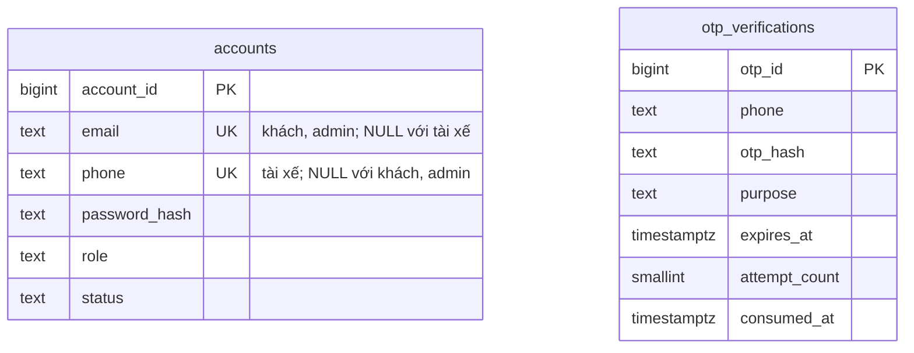
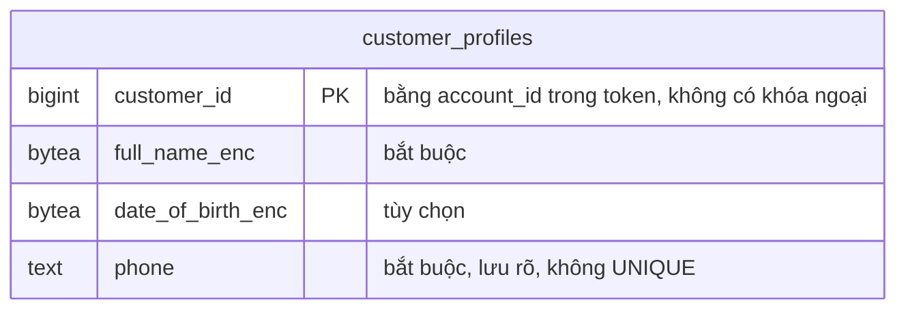
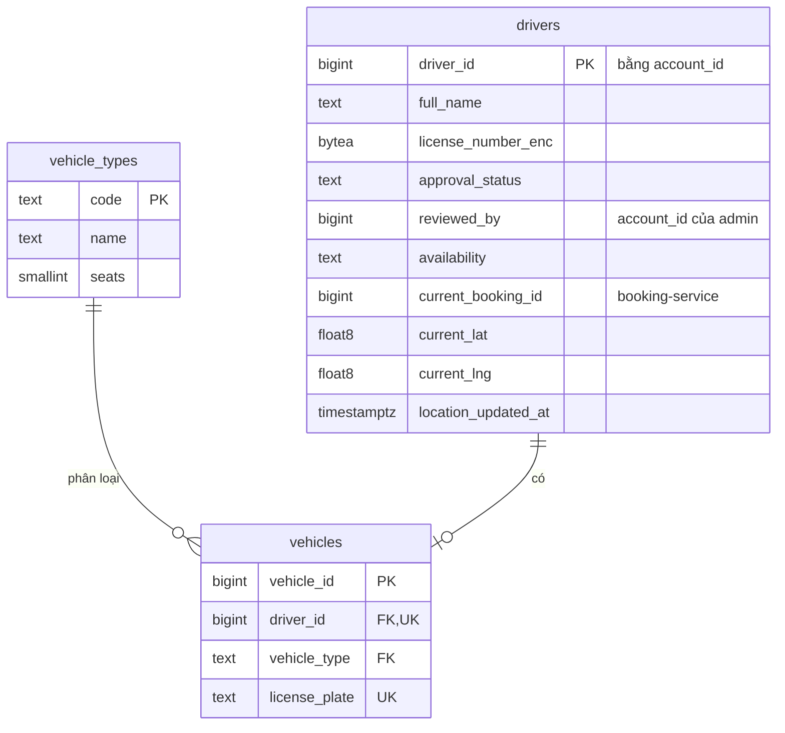
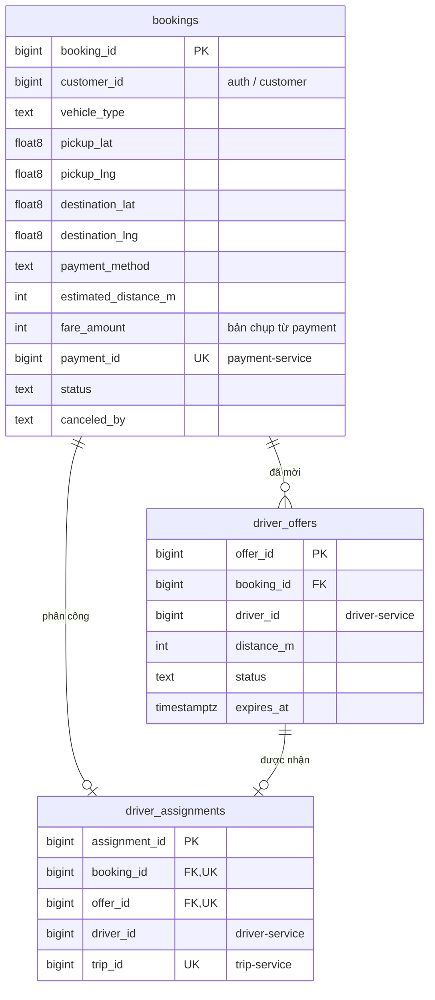
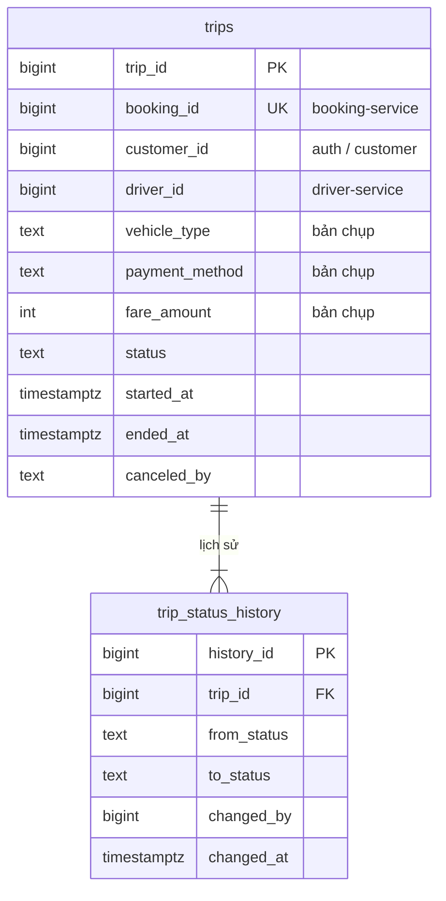
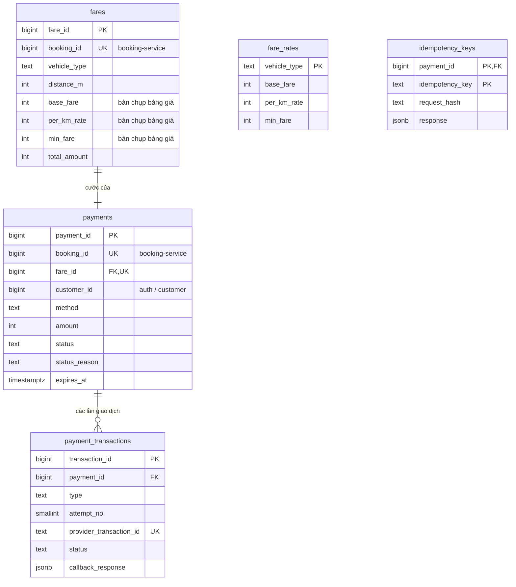
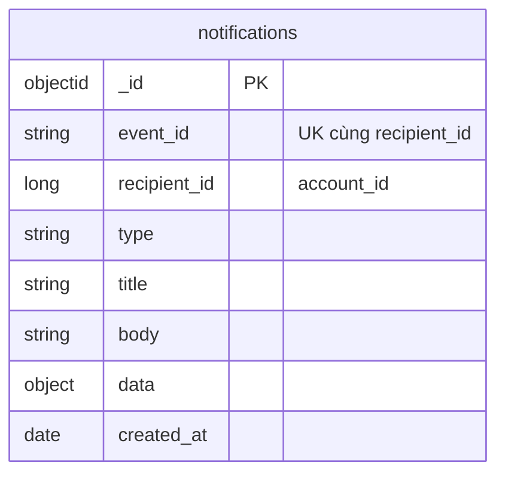
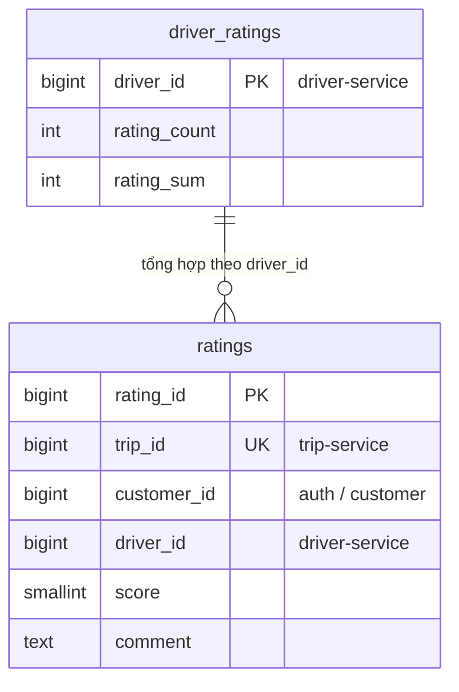

# 03 — Dữ liệu

> Vòng 1 (chỉ BA), viết 2026-10-02. Đầu vào: `CLAUDE.md`, `srs.md` (FR01–FR42, BRULE01–18, UC01–UC33, AC01–AC29), file 01 (aggregate, quy tắc A/C/D/B/T/M/N/V), file 02 (S2–S7, K1–K7), ADR-001 … ADR-017. Mốc so sánh: `docs/reference/thiet-ke-da-duyet.md` mục 3.
> Sửa 2026-10-03: hồ sơ khách tạo sau khi đăng nhập, bỏ `customer_profiles.phone_enc` (mục 4.1, ADR-013); seed thêm KH3 chưa có hồ sơ (mục 14); bỏ `notifications.status`; thêm biến `SIMULATION_MODE`, `PAYMENT_CALLBACK_SECRET` (mục 13) — ADR-014. Cùng ngày: Q58 đóng (hồ sơ không lưu số điện thoại); `simulate_result: "MANUAL"` (Q57) giữ giao dịch `PENDING` chờ callback — không đổi schema (mục 8.4).
> **Sửa 2026-10-03 lần 3 (luật thi: gõ tay mọi request, không mở tài liệu):** khóa chính và mọi cột tham chiếu đổi từ `uuid` sang **`bigint` identity** (mục 2, ADR-015); mã do API tạo bắt đầu từ **1000**, mã seed là số nhỏ theo quy luật (mục 14). **Bỏ chỉ mục mù**: số điện thoại, email lưu rõ, UNIQUE trực tiếp; chỉ mã hóa họ tên, ngày sinh khách và số giấy phép (mục 11.4, ADR-012 sửa). **Bỏ 4 bảng `outbox`** (mục 11.3, ADR-017). OTP băm bằng scrypt thay HMAC (bỏ một khóa). `idempotency_keys` đổi khóa chính thành (`payment_id`, `idempotency_key`) để khóa ngắn `k1` dùng lại được cho từng thanh toán (mục 8.6). Biến môi trường rút còn 14 (mục 13). Seed theo quy luật dễ nhớ (mục 14).
> Rà soát cùng ngày: tạo ADR-015 (khóa chính), ADR-016 (HS256), ADR-017 (không outbox); tổng bảng sửa thành 17; `trips` cho địa chỉ NULL như `bookings`; mã giao dịch hoàn `SIM-R-<payment_id>`; mục 1.2 / 1.3 đúng thứ tự.
> **Sửa 2026-10-05 (sinh viên chốt):** bỏ `accounts.email` bằng migration mới ở auth, thêm `customer_profiles.email` (tùy chọn, không UNIQUE, không mã hóa — mục 3.1, 4.1, ADR-019); seed email KH1, KH2 (mục 14); `drivers` cho nộp lại khi `REJECTED` (mục 5.2, FR43); ghi rõ chống lặp event không cần bảng riêng (mục 11.3); cổng gRPC riêng từng service (mục 13, ADR-020). **Ảnh `docs/architecture/bounded-context-db.png` cần vẽ lại** (hai bảng `accounts`, `customer_profiles`).
> **Sửa 2026-10-14 (theo yêu cầu giảng viên, sinh viên chốt) — ADR-021 thay ADR-019:** `accounts` thêm lại `email` (UNIQUE, NULL được, chữ thường), `phone` thành NULL được, CHECK "đúng một định danh theo role" (mục 3.1; migration mới `004` ở auth); `customer_profiles` bỏ `email`, thêm `phone` bắt buộc, không UNIQUE, lưu rõ (mục 4.1; migration mới `003` ở customer); seed: khách và admin có email, admin bỏ số `0999999999`, hồ sơ có số điện thoại (mục 14); mục 11.4 cập nhật danh sách lưu rõ. **Ảnh `bounded-context-db` đã sửa ở file `.html`** (sinh viên xuất lại PNG).
> File này trả lời: **mỗi service lưu gì, ở đâu, kiểu gì, vì sao**. Đường dẫn REST và rpc: file 04.
> Ký hiệu: **[ĐC]** = đã chốt trong `CLAUDE.md` / `srs.md`. **[BA]** = BA tự chọn, chưa ai xác nhận (gom ở mục 16). Tên trạng thái viết HOA vẫn là đề xuất như ở file 01, trừ tên đã có trong SRS.

## 1. Tóm tắt

### 1.1 Database của từng service

| Service | Database | Container | Bảng nghiệp vụ | Bảng kỹ thuật | Lý do chọn loại này | Đánh đổi | So với tham chiếu |
|---|---|---|---|---|---|---|---|
| `auth-service` | PostgreSQL 16 | `auth-db` | 2: `accounts`, `otp_verifications` | `schema_migrations` | Định danh đăng nhập (email của khách / admin, số điện thoại của tài xế) phải **duy nhất tuyệt đối** (A2) và đúng theo role (A9): cần UNIQUE, CHECK và giao dịch | — | Giữ loại; bớt 4 bảng (mục 15) |
| `customer-service` | PostgreSQL 16 | `customer-db` | 1: `customer_profiles` | `schema_migrations` | Một bảng có cấu trúc cố định, tra theo khóa chính; PK = `account_id` chặn tạo hồ sơ lần hai ngay trong database (C1, BRULE18) | Service nhỏ mà vẫn một database riêng | Giữ |
| `driver-service` | PostgreSQL 16 (**không PostGIS**) | `driver-db` | 3: `drivers`, `vehicles`, `vehicle_types` | `schema_migrations` | Giữ chỗ tài xế phải là một lệnh UPDATE có điều kiện, nguyên tử (D8); tìm trong 1 km bằng công thức Haversine trên cột `lat`/`lng` (ADR-011) | Không có index không gian; đủ cho quy mô demo | **Đổi**: bỏ PostGIS |
| `booking-service` | PostgreSQL 16 | `booking-db` | 3: `bookings`, `driver_offers`, `driver_assignments` | `schema_migrations` | Tranh chấp hủy — nhận giải quyết bằng khóa dòng (B12); "một Offer đang chờ", "một Offer được nhận" bảo vệ bằng index duy nhất có điều kiện (B8, B10) | — | Giữ |
| `trip-service` | PostgreSQL 16 | `trip-db` | 2: `trips`, `trip_status_history` | `schema_migrations` | Đổi trạng thái + ghi lịch sử phải cùng một giao dịch (T2, T4, T8) | — | Giữ |
| `payment-service` | PostgreSQL 16 | `payment-db` | 4: `fare_rates`, `fares`, `payments`, `payment_transactions` | `idempotency_keys`, `schema_migrations` | Tiền cần ACID: "một lần thu thành công", "một lần hoàn" bảo vệ bằng ràng buộc của database (M6, M8, NFR14) | — | Giữ |
| `notification-service` | MongoDB 7 | `notification-db` | 1 collection: `notifications` | — (index tạo khi khởi động) | Mỗi loại thông báo mang phần `data` khác nhau; chỉ ghi thêm và đọc theo người nhận; không join, không giao dịch nhiều dòng. Index duy nhất (`event_id`, `recipient_id`) đủ để chống trùng (N4) | Thêm một công nghệ phải học và vận hành; không có công cụ migration | Giữ |
| `rating-service` | PostgreSQL 16 | `rating-db` | 2: `ratings`, `driver_ratings` | `schema_migrations` | "Mỗi chuyến một đánh giá" cần UNIQUE (V3); lưu đánh giá và cộng điểm phải cùng giao dịch (V5) | — | Giữ |
| `gateway` | Redis 7 | `redis` | Không có dữ liệu nghiệp vụ | 2 nhóm key (mục 12) | Bộ đếm có hạn tự xóa, tăng số nguyên tử (`CLAUDE.md`, ADR-010) | Gateway phụ thuộc Redis; Redis dừng thì cho qua | Thu hẹp: bỏ cache, session |

Tổng: **17 bảng nghiệp vụ + 1 collection**, 1 bảng `idempotency_keys`, 7 bảng `schema_migrations`. Không có bảng `outbox` (ADR-017).

### 1.2 Vì sao mỗi service một container database [BA]

| Lựa chọn | Ưu | Nhược |
|---|---|---|
| **Mỗi service một container** (`auth-db`, `customer-db`, …) | Cô lập thật: service này không thể kết nối nhầm database kia; dừng riêng từng database để demo NFR05; mục chấm 5 nhìn thấy rõ database-per-service | 7 container PostgreSQL + 1 MongoDB tốn RAM (ước lượng 40–60 MB mỗi container khi rảnh — chưa đo) |
| Một server PostgreSQL, 7 database, 7 user | Nhẹ máy | Một server dừng là cả 7 service dừng; ranh giới chỉ là quyền của user |

Chọn dòng đầu. Không container database nào có `ports` (mục chấm 8).

### 1.3 Tên container, database, user (luật thi: lệnh terminal gõ tay) [ĐC quy luật, BA đặt cụ thể]

| Thứ | Quy luật | Ví dụ |
|---|---|---|
| Container database | `<context>-db`, đặt bằng `container_name` trong Compose để `docker exec` dùng thẳng tên ngắn | `auth-db`, `customer-db`, `driver-db`, `booking-db`, `trip-db`, `payment-db`, `rating-db`, `notification-db` |
| Container service | Tên service, cũng đặt `container_name` | `auth-service`, …, `gateway`, `kafka`, `kafka-ui`, `redis` |
| Database | Tên context, không hậu tố | `auth`, `customer`, `driver`, `booking`, `trip`, `payment`, `rating`; MongoDB: `notification` |
| User | **`cab`** ở mọi database; mật khẩu chung `DB_PASSWORD` | `docker exec customer-db psql -U cab -d customer -c "table customer_profiles"` (`table` = `select *`) |

Đánh đổi của mật khẩu chung: lộ một mật khẩu là vào được mọi database. Chấp nhận vì không database nào mở cổng ra máy chủ (mục chấm 8) và mỗi service vẫn chỉ được cấu hình địa chỉ database của mình.

## 2. Quy ước kiểu dữ liệu (các câu dễ bị hỏi)

| Dữ liệu | Kiểu chọn | Vì sao kiểu này | Vì sao không chọn kiểu kia |
|---|---|---|---|
| Khóa chính | `bigint GENERATED ALWAYS AS IDENTITY (START WITH 1000)` [ĐC 2026-10-03, ADR-015] | Luật thi bắt **gõ tay** mọi request: mã trong `/api/v1/customers/1` gõ trong một giây, UUID 36 ký tự thì không. Phiếu chấm ghi "xem … theo **mã số**". Mỗi bảng tự đánh số, không cần nơi cấp số chung. `START WITH 1000`: mã do API tạo luôn ≥ 1000, mã seed là số nhỏ (1–99) ghi bằng `OVERRIDING SYSTEM VALUE`, không bao giờ trùng | `uuid`: không gõ tay được. `serial`: cách cũ, cho phép ghi đè ID nhầm. `integer`: đủ cho demo nhưng `CLAUDE.md` đã chốt `bigint`. **Đánh đổi:** mã dễ đoán → **mọi API theo mã kiểm tra quyền sở hữu** (file 04 mục 4); service không tự sinh mã trước khi ghi được như UUID → Booking xin số từ dãy (`nextval`) trước khi gọi S4 (mục 6.1) |
| Số `bigint` khi ra khỏi database | `pg` trả `bigint` dạng **chuỗi** → service đăng ký bộ đọc kiểu số (`types.setTypeParser(20, Number)`); proto dùng `int64` và `proto-loader` đặt `longs: Number`; JSON trả **số** | Giá trị luôn < 2⁵³ nên đổi sang số của JavaScript không mất chính xác | Để chuỗi: client thấy `"1"` và `1` lẫn lộn |
| Tiền VND | `integer`, đơn vị **đồng**, `CHECK (> 0)` | VND không có đơn vị lẻ; số nguyên cộng trừ chính xác tuyệt đối; tối đa ~2,1 tỷ đ là thừa cho một cuốc xe; thư viện `pg` trả về kiểu số của JavaScript | `float`/`double`: sai số nhị phân (0,1 + 0,2 ≠ 0,3). `NUMERIC(10,2)`: có 2 chữ số lẻ không bao giờ dùng, và `pg` trả về chuỗi. `bigint`: thừa cho tiền (khóa chính dùng `bigint` vì đã chốt, kèm bộ đọc kiểu số ở dòng trên) |
| Quãng đường | `integer`, đơn vị **mét** | Cùng lý do với tiền: công thức cước chỉ còn phép tính số nguyên (mục 6.3). API hiển thị thêm `distance_km` cho người đọc | `NUMERIC` km hoặc `float` km: nhân với đơn giá rồi làm tròn lên 1.000 đ có thể lệch đúng 1.000 đ vì sai số số thực |
| Tọa độ | `double precision` + `CHECK` khoảng (vĩ độ −90…90, kinh độ −180…180) | Tọa độ là **số đo**, không phải số đếm: sai số của số thực 64 bit nhỏ hơn 1 mm, vô nghĩa so với sai số GPS (vài mét). Hàm lượng giác của PostgreSQL và JavaScript làm việc trực tiếp với kiểu này | `DECIMAL(10,7)` (tham chiếu): chính xác thập phân nhưng không cần, phải ép kiểu trong mọi phép tính, `pg` trả về chuỗi. `geography` của PostGIS: xem ADR-011 |
| Thời điểm | `timestamptz`, lưu UTC; API trả ISO 8601 có `Z` | Một thời điểm tuyệt đối, không phụ thuộc múi giờ của container; so sánh hạn (`expires_at < now()`) luôn đúng | `timestamp` không múi giờ: cùng một giá trị bị hiểu khác nhau giữa các máy. `DATETIME` (tham chiếu) là kiểu của MySQL |
| Trạng thái, role, phương thức | `text` + `CHECK (… IN (…))` | Giá trị sai bị database từ chối; đọc được ngay trong `psql`; thêm giá trị bằng một migration đổi CHECK | `ENUM` của PostgreSQL: không xóa được giá trị, đổi tên phiền, thêm giá trị có giới hạn trong giao dịch. Bảng tra cứu riêng: thừa cho 3–6 giá trị cố định |
| Số điện thoại | `text`, chuẩn hóa về dạng `0` + 9 chữ số (`+84912…`, `84912…` → `0912…`); **lưu rõ**. Ở `accounts` (tài xế): `UNIQUE`. Ở `customer_profiles` (liên hệ của khách): **không** UNIQUE (sửa 2026-10-14) | Là định danh / số liên hệ, không phải số để tính: có số 0 đầu. Lưu rõ để UNIQUE và đăng nhập tra thẳng bằng index, không cần chỉ mục mù (ADR-012) | Kiểu số: mất số 0 đầu. Mã hóa + chỉ mục mù: thêm một cột, một khóa, một khái niệm phải giải thích. **Đánh đổi:** số điện thoại đọc được trong `auth-db`, `customer-db` |
| Email (sửa 2026-10-14) | `text`, cắt khoảng trắng, **chữ thường**, CHECK `email = lower(email)` và `char_length(email) <= 254`; **lưu rõ**, `UNIQUE` ở `accounts` | Định danh đăng nhập của khách và admin (A2): chữ thường để `Kh1@Cab.vn` và `kh1@cab.vn` là một; UNIQUE tra thẳng khi đăng nhập. 254 = độ dài tối đa theo RFC 5321. Định dạng kiểm ở ứng dụng | `citext`: phải bật extension, thêm khái niệm. Mã hóa: không UNIQUE được nếu không có chỉ mục mù |
| Mật khẩu | `password_hash text`: `scrypt$<salt hex>$<hash hex>` | Băm một chiều, có salt riêng từng mật khẩu, chậm có chủ ý. `scrypt` có sẵn trong Node (`node:crypto`), không cần gói biên dịch. Tham số cố định trong code (N = 16384, r = 8, p = 1) cho chuỗi ngắn, dễ đọc khi demo mục 24 | Mã hóa hai chiều: có khóa là giải được. SHA-256 trần: quá nhanh, dò được. `bcrypt`/`argon2`: cần gói ngoài phải biên dịch trong Docker. Đánh đổi của tham số cố định: muốn tăng độ khó thì mật khẩu cũ phải băm lại khi người dùng đăng nhập |
| Văn bản người dùng nhập | `text` + `CHECK (char_length(…) <= n)` | PostgreSQL lưu `text` và `varchar` như nhau; giới hạn độ dài đặt ở CHECK để đổi được bằng migration | `varchar(255)`: con số 255 không có ý nghĩa nghiệp vụ |
| Dữ liệu đã mã hóa | `bytea` | Kết quả mã hóa là byte, không phải chữ | `text` base64: dài hơn 33 % |
| Loại xe | `text` mã: `MOTORBIKE`, `CAR_4`, `CAR_7` | Mã dùng chung giữa các context (file 01 mục 5); đọc được trong event và log | Số: phải tra mới biết là loại gì |
| Nội dung event, response đã lưu | `jsonb` | Cấu trúc khác nhau theo từng loại; không truy vấn theo field bên trong | Tách cột: mỗi loại event một bảng |

Mọi bảng có `created_at timestamptz NOT NULL DEFAULT now()`; bảng có sửa thì thêm `updated_at`. Hai cột này không lặp lại trong các bảng dưới.

## 3. `auth-service` — `auth-db`

### 3.1 `accounts` (FR26, FR32; A1–A5, A9; BRULE19; mục 9, 10, 24, 25)

| Field | Kiểu | Ràng buộc | Ghi chú / vì sao |
|---|---|---|---|
| `account_id` | `bigint` identity | PK | Chính là `customer_id` / `driver_id` ở các service khác (mục 4.1) |
| `email` | `text` | **NULL được**, `CONSTRAINT accounts_email_key UNIQUE`, CHECK `email = lower(email) AND char_length(email) <= 254` | **Thêm lại 2026-10-14** (ADR-021). Định danh đăng nhập của `customer`, `admin`. Lưu rõ, chữ thường. PostgreSQL cho nhiều dòng NULL trong cột UNIQUE (tài xế không có email) |
| `phone` | `text` | **NULL được** (bỏ NOT NULL 2026-10-14), **UNIQUE** (`accounts_phone_key`), CHECK `phone ~ '^0[0-9]{9}$'` | Định danh đăng nhập của `driver` (đã xác thực OTP). Lưu rõ, đã chuẩn hóa. Không mã hóa (ADR-012). Khách, admin **không** có số ở đây |
| `password_hash` | `text` | NOT NULL, CHECK `LIKE 'scrypt$%'` | Mục 2 |
| `role` | `text` | NOT NULL, CHECK IN (`customer`, `driver`, `admin`) | Một cột, không có bảng ROLE / PERMISSION [ĐC] |
| `status` | `text` | NOT NULL DEFAULT `ACTIVE`, CHECK IN (`ACTIVE`, `LOCKED`) | A3: tài khoản khóa bị từ chối đăng nhập |

CHECK mức bảng `accounts_identity_by_role` (A9, BRULE19) [BA — chặt hơn mức tối thiểu "khách / admin phải có email, tài xế phải có số"]:

```sql
CHECK (
  (role = 'driver' AND phone IS NOT NULL AND email IS NULL)
  OR (role IN ('customer', 'admin') AND email IS NOT NULL AND phone IS NULL)
)
```

| Lựa chọn | Ưu | Nhược |
|---|---|---|
| **Chặt: đúng một định danh theo role** (chọn) | Tra `WHERE phone = $1` chỉ có thể ra tài xế, `WHERE email = $1` chỉ ra khách / admin → đăng nhập không cần kiểm role thêm; khách không có số ở tài khoản đúng yêu cầu | Tài xế không thêm email được; muốn thì phải đổi CHECK |
| Tối thiểu: chỉ bắt buộc có định danh của role mình | Linh hoạt | Một tài khoản có thể có cả hai → đăng nhập được hai cách, phá luật "tài xế dùng số, còn lại dùng email" |

Index: hai UNIQUE `email`, `phone` là index cho đăng nhập (tra theo một trong hai). Không thêm index khác.

Migration (không sửa `001`–`003`): **`004_email-dang-nhap.sql`** trong **một giao dịch**: `ADD COLUMN email text` + `accounts_email_key UNIQUE` + CHECK chữ thường / độ dài; `ALTER COLUMN phone DROP NOT NULL`; `ADD CONSTRAINT accounts_identity_by_role CHECK (…)`. Database còn dữ liệu theo ADR-019 (khách có số, không có email) vi phạm CHECK → migration lỗi, rollback, service thoát 1 → đặt lại bằng `docker compose down -v` (dữ liệu demo; không tự đoán email cho dòng cũ — ADR-021 "Đánh đổi").

### 3.2 `otp_verifications` (FR39; A6; mục 21)

| Field | Kiểu | Ràng buộc | Ghi chú / vì sao |
|---|---|---|---|
| `otp_id` | `bigint` identity | PK | |
| `phone` | `text` | NOT NULL | Số đã chuẩn hóa như `accounts.phone` |
| `otp_hash` | `text` | NOT NULL | Băm **scrypt có salt**, cùng hàm với mật khẩu (sửa 2026-10-03, bỏ khóa `AUTH_OTP_HMAC_KEY`). Vì sao không SHA-256 trần: OTP chỉ có 10⁶ giá trị, băm nhanh thì thử hết trong chớp mắt; scrypt khoảng 50 ms/lần → thử hết mất cỡ 14 giờ, lâu hơn nhiều hạn 5 phút của OTP |
| `purpose` | `text` | NOT NULL, CHECK IN (`DRIVER_REGISTRATION`) | Chỉ một mục đích có FR |
| `expires_at` | `timestamptz` | NOT NULL | Hạn dùng; đọc từ `OTP_TTL_SECONDS` |
| `attempt_count` | `smallint` | NOT NULL DEFAULT 0 | Chặn dò mã: sai quá 5 lần thì OTP hết hiệu lực |
| `consumed_at` | `timestamptz` | NULL | Khác NULL = đã dùng; A6 "chỉ dùng một lần" |

Index: (`phone`, `purpose`, `created_at` DESC) — lấy OTP mới nhất của một số. `OTP_MAX_ATTEMPTS` là hằng số 5 trong code (không còn là biến môi trường).

Tham chiếu có `otp.user_id`; ở đây **không có**: tài khoản tài xế chỉ được tạo **sau khi** OTP đúng (A6), nên lúc xin OTP chưa có tài khoản để trỏ tới.



Hai bảng không có khóa ngoại với nhau (xem lý do ở trên).

## 4. `customer-service` — `customer-db`

### 4.1 `customer_profiles` (FR27, BRULE18; C1–C6; mục 11, 24, 26)

Từ 2026-10-03 (ADR-013): một dòng **chỉ xuất hiện khi khách tự tạo hồ sơ** sau khi đăng nhập (A37), không còn tạo lúc đăng ký. Tài khoản `customer` chưa có dòng nào ở đây là trạng thái hợp lệ ("chưa có hồ sơ" → 404).

| Field | Kiểu | Ràng buộc | Ghi chú / vì sao |
|---|---|---|---|
| `customer_id` | `bigint` | PK, **không identity, không DEFAULT** | **Bằng `account_id`** trong token, lấy từ metadata `x-account-id` do Gateway chuyển (C4) [BA, Q21]. Không có cột `account_id` riêng. PK đảm bảo "mỗi tài khoản nhiều nhất một hồ sơ": tạo lần hai vi phạm PK → 409 (C1, BRULE18) |
| `full_name_enc` | `bytea` | NOT NULL | Họ tên, mã hóa. **Bắt buộc khi tạo** (C6). Giới hạn 100 ký tự kiểm tra ở ứng dụng trước khi mã hóa |
| `date_of_birth_enc` | `bytea` | NULL | Ngày sinh (`YYYY-MM-DD`), mã hóa. **Tùy chọn** (C6) |
| `phone` | `text` | **NOT NULL**, CHECK `phone ~ '^0[0-9]{9}$'` (`customer_profiles_phone_format`), **không UNIQUE** | **Thêm 2026-10-14** (ADR-021). Số điện thoại **liên hệ**, bắt buộc khi tạo hồ sơ (C6), chuẩn hóa như số của tài xế. **Lưu rõ, không mã hóa** (quyết định "không mã hóa số điện thoại, email" — mục 11.4). Không UNIQUE vì không dùng để đăng nhập; hai khách cùng gia đình dùng chung số vẫn hợp lệ. Sửa được ở A10, không xóa được |
| ~~`email`~~ | — | **Bỏ 2026-10-14** (thêm 2026-10-05 theo ADR-019) | Email của khách chuyển về `accounts` làm định danh đăng nhập (mục 3.1). Mỗi dữ liệu một nơi |

Cột bắt buộc: `customer_id`, `full_name_enc`, `phone` (cùng `created_at`, `updated_at`). Ngày sinh để NULL được vì UC03 không bắt buộc.

Migration (không sửa `001`, `002`): **`003_sdt-trong-ho-so.sql`** trong một giao dịch: `DROP COLUMN IF EXISTS email`; `ADD COLUMN phone text NOT NULL CONSTRAINT customer_profiles_phone_format CHECK (phone ~ '^0[0-9]{9}$')`. Bảng còn hồ sơ cũ (không có số) → `ADD COLUMN … NOT NULL` lỗi, rollback, service thoát 1 → `docker compose down -v` (như auth `004`). Database dựng mới chạy migration khi bảng còn rỗng (seed chạy sau), nên không lỗi.

Số điện thoại của khách nằm ở đâu (đổi 2026-10-14, Q58 đổi kết luận):

| Lựa chọn | Ưu | Nhược |
|---|---|---|
| (a) Chỉ ở Auth (chốt 2026-10-03 → 2026-10-05) | Một nguồn | Giảng viên yêu cầu khách đăng nhập bằng email, khách **không** có số ở tài khoản |
| (b) **Client gửi khi tạo hồ sơ, lưu ở hồ sơ** (chọn 2026-10-14) | Hồ sơ đủ thông tin liên lạc; số chỉ lưu một nơi (tài khoản khách không có số) | Số chưa được xác thực (không OTP) — chỉ là thông tin liên hệ |
| (c) Customer hỏi Auth lấy số | — | Auth không còn số của khách; thêm lại đường Auth – Customer đã bỏ (ADR-013) |

Không có index ngoài PK: mọi truy vấn đều theo `customer_id`. Hệ quả của việc mã hóa cả họ tên: **không tìm khách theo tên được** — không FR nào trong 30 mục chấm cần.



## 5. `driver-service` — `driver-db`

### 5.1 `vehicle_types` (FR03, BRULE02; danh mục gốc của loại xe)

| Field | Kiểu | Ràng buộc | Ghi chú |
|---|---|---|---|
| `code` | `text` | PK | `MOTORBIKE`, `CAR_4`, `CAR_7` [ĐC ba loại; mã là BA đặt] |
| `name` | `text` | NOT NULL | "Xe máy", "Ô tô 4 chỗ", "Ô tô 7 chỗ" |
| `seats` | `smallint` | NOT NULL, CHECK (> 0) | 1, 4, 7 |

Ba dòng này tạo bằng **migration** (dữ liệu danh mục), không phải seed.

### 5.2 `drivers` (FR28, FR38, FR39, FR13; D1–D6, D8, D9; mục 12, 13, 21, 22, 23, 24)

| Field | Kiểu | Ràng buộc | Ghi chú / vì sao |
|---|---|---|---|
| `driver_id` | `bigint` | PK, không identity, không DEFAULT | Bằng `account_id` (như Customer). Nộp hồ sơ lần hai khi hồ sơ đang `PENDING` / `APPROVED` → 409. Đang `REJECTED` → **nộp lại** = `UPDATE` cùng dòng (FR43, D10, sửa 2026-10-05): ghi đè `full_name`, `license_number_enc`, xe; `approval_status = 'PENDING'`; `reject_reason`, `reviewed_by`, `reviewed_at` = NULL. Không cần cột mới |
| `full_name` | `text` | NOT NULL, CHECK độ dài ≤ 100 | **Không mã hóa**: họ tên tài xế được hiển thị cho khách (FR14) |
| `license_number_enc` | `bytea` | NOT NULL | Số giấy phép lái xe, mã hóa (mục chấm 24). **Không UNIQUE** (bỏ chỉ mục mù 2026-10-03): hai hồ sơ trùng số giấy phép do admin phát hiện lúc duyệt (FR39) |
| `approval_status` | `text` | NOT NULL DEFAULT `PENDING`, CHECK IN (`PENDING`, `APPROVED`, `REJECTED`) | D4, D5 |
| `reviewed_by` | `bigint` | NULL | `account_id` của admin đã duyệt / từ chối (FR34 — lưu vết) |
| `reviewed_at` | `timestamptz` | NULL | |
| `reject_reason` | `text` | NULL, CHECK độ dài ≤ 255 | |
| `availability` | `text` | NOT NULL DEFAULT `OFFLINE`, CHECK IN (`OFFLINE`, `ONLINE`, `BUSY`) | `ONLINE` = Available/Ready của BRULE01 |
| `current_booking_id` | `bigint` | NULL | Booking đang giữ tài xế (D8, D9). Tham chiếu chéo, không khóa ngoại |
| `current_lat`, `current_lng` | `double precision` | NULL, CHECK khoảng | Vị trí hiện tại (FR13). Chỉ lưu vị trí mới nhất, **không lưu lịch sử** [BA, đóng Q11 theo a] |
| `location_updated_at` | `timestamptz` | NULL | UC10: "dữ liệu có thể chưa được cập nhật" |

Ràng buộc mức bảng (bảo vệ quy tắc ngay trong database):

| CHECK | Quy tắc |
|---|---|
| `(availability = 'BUSY') = (current_booking_id IS NOT NULL)` | D8: bận thì phải biết bận vì booking nào |
| `availability = 'OFFLINE' OR approval_status = 'APPROVED'` | D6: chưa duyệt thì không Online được |
| `availability = 'OFFLINE' OR current_lat IS NOT NULL` | Online mà không có vị trí thì không tìm được |
| `(current_lat IS NULL) = (current_lng IS NULL)` | Tọa độ đủ cặp |

| Index | Phục vụ |
|---|---|
| `(current_lat, current_lng) WHERE availability = 'ONLINE' AND approval_status = 'APPROVED'` | Mục 13, S2: lọc khung chữ nhật quanh điểm đón chỉ trên tài xế đủ điều kiện |
| `(approval_status, created_at)` | Mục 22: admin xem hồ sơ chờ duyệt |

Giữ chỗ (S3) là **một lệnh**: `UPDATE drivers SET availability='BUSY', current_booking_id=$2 WHERE driver_id=$1 AND availability='ONLINE'`; không dòng nào đổi nghĩa là tài xế không còn rảnh. Gọi lặp với cùng `booking_id` trả kết quả như lần đầu.

### 5.3 `vehicles` (FR29, BRULE02; D2, D7)

| Field | Kiểu | Ràng buộc | Ghi chú / vì sao |
|---|---|---|---|
| `vehicle_id` | `bigint` identity | PK | |
| `driver_id` | `bigint` | NOT NULL, **UNIQUE**, FK → `drivers` | Cùng database nên **có** khóa ngoại. UNIQUE: mỗi tài xế một xe [BA]; sau này cho nhiều xe thì bỏ UNIQUE |
| `vehicle_type` | `text` | NOT NULL, FK → `vehicle_types(code)` | BRULE02 |
| `license_plate` | `text` | NOT NULL, **UNIQUE** | D7 (chốt). Chuẩn hóa chữ hoa, bỏ khoảng trắng trước khi lưu. Không mã hóa: biển số gắn công khai trên xe và hiển thị cho khách (FR14) |
| `brand`, `model`, `color` | `text` | NULL, CHECK độ dài ≤ 50 | |

### 5.4 Tìm tài xế trong bán kính 1 km (mục 13, S2) — ADR-011

Chọn **công thức Haversine trên hai cột `current_lat`, `current_lng`**, tính trong SQL; không dùng PostGIS.

| Bước | Làm gì | Vì sao |
|---|---|---|
| 1 | Lọc `availability = 'ONLINE'`, `approval_status = 'APPROVED'`, đúng `vehicle_type` (nếu có) | D1, D2 |
| 2 | Lọc khung chữ nhật: `lat BETWEEN lat0 ± r/M`, `lng BETWEEN lng0 ± r/(M·cos(lat0))`, với `M = π·6 371 000/180 ≈ 111 195` m/độ | Dùng được index thường; loại phần lớn tài xế ở xa trước khi tính lượng giác. `M` dùng cùng `R = 6 371 km` với Haversine; nếu dùng 111 320 thì khung hẹp hơn vòng tròn khoảng 1 m và loại nhầm tài xế ở 999–1 000 m theo hướng bắc/nam |
| 3 | Tính khoảng cách Haversine (mét), giữ dòng `≤ r` | D3, FR04 |
| 4 | `ORDER BY` khoảng cách, `driver_id`; `LIMIT` / `OFFSET` | FR05, BRULE03; phân trang ổn định |

Công thức: `d = 2R · asin( sqrt( sin²(Δφ/2) + cos φ1 · cos φ2 · sin²(Δλ/2) ) )`, `R = 6 371 000 m`. **Cùng công thức** này được `booking-service` dùng để ước tính quãng đường tính cước (mục 6.3), nên sinh viên chỉ phải giải thích một công thức.

| | Haversine trên `lat`/`lng` (chọn) | PostGIS (tham chiếu) |
|---|---|---|
| Dựng trong Docker | Image `postgres:16-alpine` như 6 service kia | Image riêng `postgis/postgis`, phải bật extension trong migration |
| Dữ liệu seed | Hai cột số, viết tay được | Phải dựng kiểu `geography` từ tọa độ |
| Giải thích khi vấn đáp | Một công thức hình học | Phải hiểu `geography`, SRID 4326, GiST, `ST_DWithin` |
| Khi có hàng chục nghìn tài xế | Khung chữ nhật + index thường; chậm dần | Index không gian, nhanh |
| Đổi sang phương án kia | Chỉ sửa một câu truy vấn trong `driver-service` | — |



## 6. `booking-service` — `booking-db`

### 6.1 `bookings` (FR01, FR35–FR37; B1, B2, B13–B16; mục 14, 15, 18, 19)

| Field | Kiểu | Ràng buộc | Ghi chú / vì sao |
|---|---|---|---|
| `booking_id` | `bigint` identity | PK | Cần có **trước** khi gọi S4 `CreatePayment` (B15): lấy số bằng `SELECT nextval(pg_get_serial_sequence('bookings','booking_id'))`, gọi S4, rồi `INSERT … OVERRIDING SYSTEM VALUE` với số đó. Vì sao không ghi trước rồi gọi S4: `payment_id`, `fare_amount` là NOT NULL. S4 lỗi thì số đó bị bỏ qua (dãy số có lỗ — vô hại) |
| `customer_id` | `bigint` | NOT NULL | Lấy từ token |
| `vehicle_type` | `text` | NOT NULL | **Không CHECK danh sách**: mã hợp lệ hay không do Payment trả lời ở S4 (không có giá thì từ chối). Thêm loại xe mới không phải sửa Booking (NFR12) |
| `pickup_lat`, `pickup_lng` | `double precision` | NOT NULL, CHECK khoảng | FR01 |
| `pickup_address` | `text` | **NULL** (đổi 2026-10-03), CHECK độ dài ≤ 255 | Tùy chọn để body đặt xe ngắn (luật thi); tọa độ đủ để tìm tài xế và tính cước |
| `destination_lat`, `destination_lng` | `double precision` | NOT NULL, CHECK khoảng | |
| `destination_address` | `text` | **NULL**, CHECK độ dài ≤ 255 | Như trên |
| `vehicle_type` mặc định | — | — | API không gửi `vehicle` → `CAR_4` (file 04 A19). Đặt ở tầng ứng dụng, không DEFAULT trong database |
| `payment_method` | `text` | NOT NULL, CHECK IN (`CASH`, `ONLINE`) | `ONLINE` = "thanh toán điện tử" của SRS, "online" của phiếu chấm. API không gửi `pay` → `CASH` |
| `estimated_distance_m` | `integer` | NOT NULL, CHECK (> 0) | Booking tự tính: Haversine × 1,3, làm tròn đến mét [ĐC] |
| `fare_amount` | `integer` | NOT NULL, CHECK (> 0) | Bản chụp số tiền Payment trả về; không sửa (BRULE08) |
| `payment_id` | `bigint` | NOT NULL, UNIQUE | Trả cho khách để thanh toán |
| `status` | `text` | NOT NULL, CHECK IN (`PENDING_PAYMENT`, `SEARCHING`, `DRIVER_ASSIGNED`, `NO_DRIVER_FOUND`, `CANCELED`) | File 01 mục 6.4 |
| `cancel_reason` | `text` | NULL, CHECK độ dài ≤ 255 | Khách nhập (FR36); hệ thống hủy thì ghi mã `PAYMENT_EXPIRED` / `ATTEMPTS_EXHAUSTED` |
| `canceled_by` | `text` | NULL, CHECK IN (`customer`, `system`) | `system`: quá hạn hoặc hết lượt thanh toán (BRULE17) |
| `canceled_at` | `timestamptz` | NULL | |

CHECK mức bảng: `(status = 'CANCELED') = (canceled_at IS NOT NULL)`.

| Index | Phục vụ |
|---|---|
| `(customer_id, created_at DESC)` | Mục 14: danh sách booking của khách, mới nhất trước, phân trang |
| `(created_at) WHERE status = 'SEARCHING'` | Bộ ghép nạp lại các booking đang tìm sau khi service khởi động lại (NFR15) |

### 6.2 `driver_offers` (FR06–FR09; B3–B10; mục 15, 16)

| Field | Kiểu | Ràng buộc | Ghi chú |
|---|---|---|---|
| `offer_id` | `bigint` identity | PK | |
| `booking_id` | `bigint` | NOT NULL, FK → `bookings` | |
| `driver_id` | `bigint` | NOT NULL | |
| `distance_m` | `integer` | NOT NULL, CHECK (≥ 0) | Khoảng cách tài xế → điểm đón lúc mời (FR04, AC05) |
| `status` | `text` | NOT NULL, CHECK IN (`PENDING`, `ACCEPTED`, `REJECTED`, `EXPIRED`, `VOIDED`) | |
| `expires_at` | `timestamptz` | NOT NULL | `now() + OFFER_TIMEOUT_SECONDS` (BRULE04). `.env.example` đặt **300** giây để kịp gõ tay từ mục 15 sang mục 16 (mục 13) |
| `responded_at` | `timestamptz` | NULL | |

| Index | Quy tắc được bảo vệ |
|---|---|
| UNIQUE `(booking_id, driver_id)` | Tài xế đã bị loại không được mời lại cho cùng booking (B6) |
| UNIQUE `(booking_id) WHERE status = 'PENDING'` | Mỗi booking một Offer đang chờ (B10) |
| UNIQUE `(driver_id) WHERE status = 'PENDING'` | Mỗi tài xế một Offer đang chờ (B10); cũng phục vụ "tài xế xem Offer đang chờ" |
| UNIQUE `(booking_id) WHERE status = 'ACCEPTED'` | Mỗi booking nhiều nhất một Offer được nhận (B8) |
| `(expires_at) WHERE status = 'PENDING'` | Tiến trình nền tìm Offer hết giờ (FR09) |

Không có `price_offer` (tham chiếu có): cước cố định cho cả booking (BRULE08).

### 6.3 `driver_assignments` (FR07, FR11; B8, B11, B17)

| Field | Kiểu | Ràng buộc | Ghi chú |
|---|---|---|---|
| `assignment_id` | `bigint` identity | PK | |
| `booking_id` | `bigint` | NOT NULL, **UNIQUE**, FK → `bookings` | Một booking một phân công |
| `offer_id` | `bigint` | NOT NULL, UNIQUE, FK → `driver_offers` | |
| `driver_id` | `bigint` | NOT NULL | |
| `trip_id` | `bigint` | NOT NULL, UNIQUE | Do Trip trả về ở S5 (B17) |
| `assigned_at` | `timestamptz` | NOT NULL | |

Ước tính quãng đường (FR16, phần của Booking) — chỉ dùng số nguyên từ sau bước làm tròn:

| Bước | Ở đâu | Phép tính |
|---|---|---|
| 1 | Booking | `d_thẳng` = Haversine(điểm đón, điểm đến), mét |
| 2 | Booking | `estimated_distance_m = round(d_thẳng × 1,3)`, hệ số 1,3 là hằng số trong code [ĐC] (không còn biến `FARE_DISTANCE_FACTOR`). Bằng 0 → 400 (điểm đón trùng điểm đến) |
| 3 | Payment | Tra `fare_rates` theo `vehicle_type` |
| 4 | Payment | `thô × 1000 = base_fare × 1000 + per_km_rate × distance_m` (toàn số nguyên) |
| 5 | Payment | Làm tròn **lên** bội số 1.000 đ; lấy `max` với `min_fare` |

Ví dụ kiểm tra (bảng giá minh họa trong `CLAUDE.md`):

| Loại xe | Đường thẳng | Ước tính | Tính | Cước |
|---|---|---|---|---|
| `CAR_4` | 2 500 m | 3 250 m | 20 000 + 12 000 × 3,25 = 59 000 | **59 000 đ** |
| `MOTORBIKE` | 500 m | 650 m | 10 000 + 5 000 × 0,65 = 13 250 → 14 000 → dưới tối thiểu | **15 000 đ** |
| `CAR_7` | 3 333 m | 4 333 m | 25 000 + 15 000 × 4,333 = 89 995 → làm tròn lên | **90 000 đ** |

Tuyến mẫu dùng khi thi (mục 14): **P0 (10.82, 106.68) → D0 (10.83, 106.69)**. Đường thẳng ≈ 1 559 m → ước tính ≈ **2 026 m**:

| Loại xe | Tính | Cước |
|---|---|---|
| `CAR_4` (mặc định) | 20 000 + 12 000 × 2,026 = 44 312 → làm tròn lên | **45 000 đ** |
| `MOTORBIKE` | 10 000 + 5 000 × 2,026 = 20 130 → làm tròn lên | **21 000 đ** |
| `CAR_7` | 25 000 + 15 000 × 2,026 = 55 390 → làm tròn lên | **56 000 đ** |

Số mét chính xác do test-agent xác nhận khi chạy (sai lệch vài mét không đổi kết quả làm tròn: ba số trên đều cách mốc 1 000 đ đủ xa).



## 7. `trip-service` — `trip-db`

### 7.1 `trips` (FR11, FR12, FR14, FR36, FR41; T1–T7; mục 16, 17, 18)

| Field | Kiểu | Ràng buộc | Ghi chú / vì sao |
|---|---|---|---|
| `trip_id` | `bigint` identity | PK | |
| `booking_id` | `bigint` | NOT NULL, **UNIQUE** | T1: mỗi booking nhiều nhất một Trip; `CreateTrip` gọi lặp trả Trip cũ |
| `customer_id`, `driver_id` | `bigint` | NOT NULL | Kiểm tra quyền sở hữu (T3, T5, T7) |
| `vehicle_type` | `text` | NOT NULL | Bản chụp |
| `pickup_lat`, `pickup_lng`, `destination_lat`, `destination_lng` | `double precision` | NOT NULL, CHECK khoảng | Bản chụp: tài xế biết đón và trả ở đâu |
| `pickup_address`, `destination_address` | `text` | NULL | Bản chụp; NULL khi booking không gửi địa chỉ (cùng quy tắc với `bookings`, mục 6.1) |
| `payment_method` | `text` | NOT NULL, CHECK IN (`CASH`, `ONLINE`) | Bản chụp: tài xế biết có phải thu tiền mặt không (FR17) |
| `fare_amount` | `integer` | NOT NULL, CHECK (> 0) | Bản chụp: số tiền phải thu |
| `status` | `text` | NOT NULL, CHECK IN (`ACCEPTED`, `ARRIVED`, `PICKED_UP`, `IN_PROGRESS`, `COMPLETED`, `CANCELED`) | File 01 mục 6.5 |
| `started_at` | `timestamptz` | NULL | Lúc đón khách = "chuyến bắt đầu" (BRULE16); `start_time` của SRS |
| `ended_at` | `timestamptz` | NULL | Lúc `COMPLETED` hoặc `CANCELED`; `end_time` của SRS |
| `cancel_reason` | `text` | NULL, CHECK độ dài ≤ 255 | T5 |
| `canceled_by` | `text` | NULL, CHECK IN (`customer`, `driver`) | FR36, FR41 |

Mốc thời gian của từng trạng thái còn lại nằm ở `trip_status_history`; không lặp thành cột (tham chiếu có `arrived_at`, `completed_at`, `cancelled_at` riêng).

| Index | Phục vụ |
|---|---|
| `(customer_id, created_at DESC)`, `(driver_id, created_at DESC)` | Khách / tài xế xem chuyến của mình (UC18) |
| `(status, created_at DESC)` | Admin lọc theo trạng thái (FR30) |

### 7.2 `trip_status_history` (FR34, NFR10; T4)

| Field | Kiểu | Ràng buộc | Ghi chú |
|---|---|---|---|
| `history_id` | `bigint` identity | PK | |
| `trip_id` | `bigint` | NOT NULL, FK → `trips` | |
| `from_status` | `text` | NULL | NULL ở dòng đầu (tạo chuyến) |
| `to_status` | `text` | NOT NULL | |
| `changed_by` | `bigint` | NOT NULL | `account_id` người thao tác |
| `changed_by_role` | `text` | NOT NULL, CHECK IN (`customer`, `driver`) | |
| `reason` | `text` | NULL | Lý do hủy |
| `changed_at` | `timestamptz` | NOT NULL | |

Index: `(trip_id, changed_at)`. Bảng chỉ ghi thêm, không sửa, không xóa.



## 8. `payment-service` — `payment-db`

### 8.1 `fare_rates` — bảng giá (FR16, BR12)

| Field | Kiểu | Ràng buộc | Ghi chú |
|---|---|---|---|
| `vehicle_type` | `text` | PK | Cùng mã với `vehicle_types.code` của Driver; không khóa ngoại |
| `base_fare` | `integer` | NOT NULL, CHECK (≥ 0) | Giá mở cửa |
| `per_km_rate` | `integer` | NOT NULL, CHECK (≥ 0) | Đơn giá mỗi km |
| `min_fare` | `integer` | NOT NULL, CHECK (≥ 0) | Cước tối thiểu |

Ba dòng tạo bằng migration: `MOTORBIKE` (10 000; 5 000; 15 000), `CAR_4` (20 000; 12 000; 30 000), `CAR_7` (25 000; 15 000; 40 000) [ĐC, số minh họa]. Đổi giá = sửa một dòng ở một nơi; cước đã tính không đổi vì `fares` giữ bản chụp.

### 8.2 `fares` — cước của một booking (FR16, BRULE08; M1)

| Field | Kiểu | Ràng buộc | Ghi chú / vì sao |
|---|---|---|---|
| `fare_id` | `bigint` identity | PK | |
| `booking_id` | `bigint` | NOT NULL, **UNIQUE** | Tính một lần cho mỗi booking |
| `vehicle_type` | `text` | NOT NULL | |
| `distance_m` | `integer` | NOT NULL, CHECK (> 0) | Booking gửi sang ở S4 |
| `base_fare`, `per_km_rate`, `min_fare` | `integer` | NOT NULL | **Bản chụp** bảng giá lúc tính: "lưu từng thành phần của cước" [ĐC] để giải thích được con số cuối dù bảng giá đã đổi |
| `total_amount` | `integer` | NOT NULL, CHECK (`total_amount >= min_fare AND total_amount % 1000 = 0`) | Database tự chặn cước sai quy tắc làm tròn và tối thiểu (AC26) |
| `calculated_at` | `timestamptz` | NOT NULL | |

### 8.3 `payments` (FR17–FR20, FR40; M1–M12; mục 18, 19, 30)

| Field | Kiểu | Ràng buộc | Ghi chú / vì sao |
|---|---|---|---|
| `payment_id` | `bigint` identity | PK | |
| `booking_id` | `bigint` | NOT NULL, **UNIQUE** | Gắn với booking, không gắn trip: lúc trả trước chưa có Trip (file 01 mục 3.2). UNIQUE: `CreatePayment` gọi lặp trả Payment cũ |
| `fare_id` | `bigint` | NOT NULL, UNIQUE, FK → `fares` | |
| `customer_id` | `bigint` | NOT NULL | Kiểm tra quyền sở hữu |
| `method` | `text` | NOT NULL, CHECK IN (`CASH`, `ONLINE`) | M7 |
| `amount` | `integer` | NOT NULL, CHECK (> 0) | Bằng `fares.total_amount` |
| `status` | `text` | NOT NULL, CHECK IN (`PENDING`, `COMPLETED`, `FAILED`, `REFUNDED`, `CANCELED`) | File 01 mục 6.6 |
| `status_reason` | `text` | NULL, CHECK IN (`PAYMENT_EXPIRED`, `ATTEMPTS_EXHAUSTED`, `BOOKING_CANCELED`, `NO_DRIVER_FOUND`, `TRIP_CANCELED`) | Vì sao `CANCELED` / `REFUNDED` |
| `expires_at` | `timestamptz` | NULL | Hạn thanh toán = `created_at + PAYMENT_TIMEOUT_SECONDS` (BRULE17). Chỉ `ONLINE` có |
| `paid_at`, `refunded_at` | `timestamptz` | NULL | Đối soát (FR20) |

CHECK mức bảng: `(method = 'ONLINE') = (expires_at IS NOT NULL)`.

Index: `(expires_at) WHERE method = 'ONLINE' AND status IN ('PENDING', 'FAILED')` — tiến trình nền tìm thanh toán quá hạn.

Không có cột `currency` (tham chiếu có): hệ thống chỉ dùng VND. Không có cột nào chứa số thẻ, số tài khoản (BRULE09).

### 8.4 `payment_transactions` — từng lần giao dịch với Provider (FR18–FR20, FR40; M2, M3, M5, M6, M8)

| Field | Kiểu | Ràng buộc | Ghi chú / vì sao |
|---|---|---|---|
| `transaction_id` | `bigint` identity | PK | |
| `payment_id` | `bigint` | NOT NULL, FK → `payments` | |
| `type` | `text` | NOT NULL, CHECK IN (`CHARGE`, `REFUND`) | Thu và hoàn đều là giao dịch với Provider |
| `attempt_no` | `smallint` | NULL, CHECK (≥ 1) | Lần thử thứ mấy (BRULE17). Trần 3 lần là hằng số trong code (mục 13), không gắn cứng vào CHECK |
| `provider_transaction_id` | `text` | NOT NULL, **UNIQUE** | Mã giao dịch phía Provider — thứ duy nhất được lưu về phương thức thanh toán (BRULE09). UNIQUE là khóa chống xử lý lặp callback (mục chấm 30) |
| `amount` | `integer` | NOT NULL, CHECK (> 0) | |
| `status` | `text` | NOT NULL, CHECK IN (`PENDING`, `SUCCEEDED`, `FAILED`) | BRULE10: lần thất bại vẫn được lưu |
| `callback_response` | `jsonb` | NULL | **Response đã trả cho callback lần đầu**; callback gửi lại thì trả đúng nội dung này (mục chấm 30) |
| `processed_at` | `timestamptz` | NULL | Lúc nhận kết quả |

| Ràng buộc | Quy tắc |
|---|---|
| CHECK `(type = 'CHARGE') = (attempt_no IS NOT NULL)` | Chỉ lần thu mới đếm lượt |
| UNIQUE `(payment_id, attempt_no)` | Không có hai lần thử cùng số |
| UNIQUE `(payment_id) WHERE type = 'CHARGE' AND status = 'SUCCEEDED'` | M6: một booking nhiều nhất một lần thu thành công |
| UNIQUE `(payment_id) WHERE type = 'CHARGE' AND status = 'PENDING'` | Không mở lần thử mới khi lần trước chưa có kết quả |
| UNIQUE `(payment_id) WHERE type = 'REFUND'` | M8: mỗi Payment hoàn nhiều nhất một lần |

Giả lập cổng thanh toán (ADR-014) **không đổi bảng này**:

| Điểm | Ghi chú |
|---|---|
| Cột phục vụ chữ ký HMAC | Không có từ đầu (chữ ký chỉ được kiểm tra, không lưu). Bỏ HMAC không cần migration |
| `provider_transaction_id` | Adapter giả lập sinh theo quy luật **`SIM-<payment_id>-<attempt_no>`** (ví dụ `SIM-7-1`): ngắn, gõ được, đoán trước được khi học thuộc; duy nhất vì (`payment_id`, `attempt_no`) đã UNIQUE. Giao dịch hoàn (không có `attempt_no`): **`SIM-R-<payment_id>`** (ví dụ `SIM-R-2`); duy nhất vì mỗi Payment hoàn nhiều nhất một lần. API gọi field này là `txn_id`. Provider thật thì do Provider cấp. Vẫn UNIQUE |
| `callback_response` | **Vẫn cần**: callback nội bộ của adapter và callback từ ngoài (A32) đi qua cùng một hàm xử lý; lần đầu lưu response, lần sau trả lại nguyên văn (mục chấm 30) |
| `status = PENDING` | Mặc định chỉ tồn tại trong khoảnh khắc giữa lúc tạo lần thử và lúc adapter gọi callback. Với `simulate_result: "MANUAL"` (Q57, 2026-10-03) giao dịch **đứng `PENDING`** (Payment cũng `PENDING`, `callback_response` NULL) cho đến khi callback A32 tới → `SUCCEEDED` / `FAILED`. Giống hệt Provider thật (kết quả đến sau), nên **không cần cột hay migration mới** |
| Lần thử `MANUAL` chưa có callback | UNIQUE `(payment_id) WHERE type = 'CHARGE' AND status = 'PENDING'` chặn mở lần thử mới → A31 khóa mới trả 409 `PAYMENT_IN_PROGRESS`. Không ai gửi callback thì Payment hết hạn như thường (mục 8.5); giao dịch giữ `PENDING`, callback `SUCCESS` đến muộn thì ghi nhận rồi hoàn ngay (M11) |

### 8.5 Hạn thanh toán và số lần thử (BRULE17, AC25) [BA — cách hiện thực]

| Điểm | Thiết kế | Vì sao |
|---|---|---|
| Ai giữ hạn và đếm lượt | **Payment** (`expires_at`, `attempt_no`) | Đây là chính sách thanh toán (M4). Payment phải tự từ chối lần thử quá hạn, nên phải biết hạn; giữ ở một nơi |
| Quá hạn | Tiến trình nền của Payment chuyển Payment `PENDING` / `FAILED` → `CANCELED` (`PAYMENT_EXPIRED`), phát K6 | Không request nào đang chờ (L1) |
| Lần thử cuối thất bại | Giao dịch `FAILED` (vẫn lưu — BRULE10); Payment → `CANCELED` (`ATTEMPTS_EXHAUSTED`), phát K6 | |
| Booking biết bằng cách nào | Nghe K6 `status = CANCELED`: đang `PENDING_PAYMENT` → `CANCELED` (`canceled_by = system`), phát K4 để Notification báo khách | Booking là nơi duy nhất đổi trạng thái Booking |
| Callback "thành công" đến sau khi đã `CANCELED` | Ghi nhận rồi hoàn ngay (M11) | Tiền đã trừ thì phải trả lại |

### 8.6 `idempotency_keys` — khóa chống lặp của request thanh toán (mục chấm 30; M5)

| Field | Kiểu | Ràng buộc | Ghi chú |
|---|---|---|---|
| `payment_id` | `bigint` | PK (cùng `idempotency_key`), FK → `payments` | **Đổi 2026-10-03** (trước là `account_id`): khóa có nghĩa trong phạm vi **một thanh toán**. Nhờ vậy khóa ngắn `k1` gõ tay dùng lại được cho mỗi thanh toán khác nhau (luật thi). Payment thuộc đúng một khách nên vẫn không lẫn giữa người dùng |
| `idempotency_key` | `text` | PK, CHECK độ dài 1–100 | Giá trị header `Idempotency-Key`, ví dụ `k1` |
| `request_hash` | `text` | NOT NULL | SHA-256 của body **đã chuẩn hóa** (đọc JSON rồi viết lại, khóa theo thứ tự chữ cái; body rỗng = `{}`) — như 04 mục 1.4. Gõ lại body khác khoảng trắng hoặc khác thứ tự khóa vẫn là cùng nội dung. Cùng khóa mà khác nội dung → 409 `IDEMPOTENCY_KEY_REUSED` |
| `response` | `jsonb` | NULL | NULL = đang xử lý; có giá trị = response lần đầu, trả lại nguyên văn khi gặp lại khóa |

Ghi dòng này **trong cùng giao dịch** với việc tạo `payment_transactions`. Hai request trùng khóa đến cùng lúc: PK chặn request thứ hai. Đánh đổi của phạm vi theo thanh toán: cùng khóa `k1` cho hai thanh toán là hai lần thử độc lập — đúng ý nghĩa, vì client không thể "lặp" một request sang thanh toán khác.

Hai lớp chống lặp cho mục chấm 30:

| Lặp ở đâu | Chặn bằng | Kết quả |
|---|---|---|
| Khách bấm thanh toán hai lần (cùng `Idempotency-Key`) | `idempotency_keys` | Response cũ; không tạo giao dịch thứ hai |
| Provider gửi lại callback | `payment_transactions.provider_transaction_id` + `callback_response` | Response cũ; không đổi trạng thái; không phát lại K6 |



`fare_rates` không có khóa ngoại tới `fares`: `fares` giữ bản chụp giá, không trỏ về bảng giá.

## 9. `notification-service` — `notification-db` (MongoDB)

Collection `notifications` (FR21–FR24; N2–N5; mục 16, 18, 22):

| Field | Kiểu BSON | Bắt buộc | Ghi chú |
|---|---|---|---|
| `_id` | ObjectId | Có | MongoDB tự sinh (đổi 2026-10-03, trước là chuỗi UUID). Không ai cần gõ mã thông báo: không có API theo mã thông báo |
| `event_id` | string (UUID) | Có | `event_id` trong phong bì event (file 02 mục 6.1). Giữ UUID vì do bên phát sinh lúc gửi, không có bảng cấp số, và không ai phải gõ (ADR-015) |
| `recipient_id` | long (số nguyên 64 bit) | Có | `account_id` người nhận, lấy từ event |
| `type` | string | Có | Một trong 15 loại ở bảng dưới (chốt ở spec 17-18 mục 2.7) |
| `title`, `body` | string | Có | Nội dung do service tự soạn theo `type`; **không** chứa dữ liệu cá nhân vì event chỉ mang ID, trạng thái, số tiền |
| `data` | object | Có | Các ID liên quan: `booking_id`, `trip_id`, `payment_id`, `offer_id`… — khác nhau theo `type` (lý do chọn kiểu tài liệu) |
| `created_at` | date | Có | **= `occurred_at` của event** (lúc sự việc xảy ra), không phải lúc Notification ghi; `occurred_at` sai dạng thì dùng giờ hiện tại. Vì sao: Notification dừng rồi đọc bù event thì thông báo vẫn xếp đúng thứ tự sự việc (spec 17-18 CD6) |

Danh sách `type` (spec 17-18 mục 2.7; mỗi event tạo 0–2 thông báo):

| Topic | `type` | Người nhận |
|---|---|---|
| `booking.created` (K1) | `BOOKING_CREATED` | Khách |
| `booking.offer-created` (K2) | `OFFER_CREATED` | Tài xế được mời |
| `booking.no-driver-found` (K3) | `NO_DRIVER_FOUND` | Khách |
| `booking.canceled` (K4) | `BOOKING_CANCELED`; `OFFER_VOIDED` (nếu có tài xế đang giữ lời mời chờ) | Khách; tài xế đó |
| `trip.status-changed` (K5) `ACCEPTED`, `ARRIVED`, `COMPLETED` | `TRIP_ACCEPTED`, `TRIP_ARRIVED`, `TRIP_COMPLETED` | Khách |
| K5 `CANCELED` | `TRIP_CANCELED` | **Cả khách và tài xế** (CD-Q3) |
| K5 `PICKED_UP`, `IN_PROGRESS` | — (không tạo; BR10 không liệt kê) | — |
| `payment.status-changed` (K6) `COMPLETED`, `FAILED`, `CANCELED`, `REFUNDED` | `PAYMENT_COMPLETED`, `PAYMENT_FAILED`, `PAYMENT_CANCELED`, `PAYMENT_REFUNDED` | Khách |
| `driver.application-reviewed` (K7) | `APPLICATION_APPROVED`, `APPLICATION_REJECTED` | Tài xế |

Quá hạn / hết lượt thanh toán sinh hai thông báo `PAYMENT_CANCELED` (K6) và `BOOKING_CANCELED` (K4): giữ cả hai vì là hai đối tượng khác nhau (CD-Q5).

Bỏ field `status` (`SENT` / `FAILED`) của bản trước: kênh gửi giả lập **chỉ lưu vào database và ghi log** (ADR-014), không có kết quả gửi nào để ghi. Khi nối kênh thật thì thêm lại field này (MongoDB không cần migration).

| Index | Phục vụ |
|---|---|
| UNIQUE `(event_id, recipient_id)` | N4: một event nhận hai lần không tạo hai thông báo; một event vẫn tạo được thông báo cho hai người (khách và tài xế) |
| `(recipient_id, created_at: -1)` | N2: người dùng xem thông báo của mình, mới nhất trước, phân trang |

Không có `NOTIFICATION_DELIVERY` (tham chiếu có): kênh gửi là giả lập, chỉ lưu thông báo trong ứng dụng và ghi log.



## 10. `rating-service` — `rating-db`

### 10.1 `ratings` (FR25; V1–V4; mục 20, 26)

| Field | Kiểu | Ràng buộc | Ghi chú |
|---|---|---|---|
| `rating_id` | `bigint` identity | PK | |
| `trip_id` | `bigint` | NOT NULL, **UNIQUE** | "Liên kết với chuyến đi" (mục 20); UNIQUE = mỗi chuyến một đánh giá (V3) |
| `customer_id`, `driver_id` | `bigint` | NOT NULL | Lấy từ Trip qua S7, không tin dữ liệu client gửi |
| `score` | `smallint` | NOT NULL, CHECK (BETWEEN 1 AND 5) | V4: thang số nguyên 1–5 (đã chốt 2026-10-05, DG-Q1) |
| `comment` | `text` | NULL, CHECK độ dài ≤ 500 | |

Index: `(driver_id, created_at DESC)`.

### 10.2 `driver_ratings` — điểm tổng hợp (UC17 bước 5; V5)

| Field | Kiểu | Ràng buộc | Ghi chú / vì sao |
|---|---|---|---|
| `driver_id` | `bigint` | PK (không identity: bằng `driver_id` của Driver) | |
| `rating_count` | `integer` | NOT NULL, CHECK (≥ 0) | |
| `rating_sum` | `integer` | NOT NULL, CHECK (≥ 0) | Lưu **tổng và số lượng**, không lưu điểm trung bình: cộng dồn bằng số nguyên không trôi sai số; trung bình = tổng / số lượng, tính lúc đọc |

Tham chiếu lưu `rating_score DECIMAL(3,2)`; ở đây thay bằng hai số nguyên.



## 11. Phần cắt ngang

### 11.1 Tham chiếu chéo service (không khóa ngoại)

| Cột | Ở service | Trỏ tới dữ liệu của | Nhận ID bằng cách nào |
|---|---|---|---|
| `customer_profiles.customer_id` | customer | auth (`account_id`) | Token (metadata từ Gateway) khi khách tạo hồ sơ |
| `drivers.driver_id`, `drivers.reviewed_by` | driver | auth | Token (metadata từ Gateway) |
| `drivers.current_booking_id` | driver | booking | S3 |
| `bookings.customer_id` | booking | auth / customer | Token |
| `bookings.payment_id` | booking | payment | Kết quả S4 |
| `driver_offers.driver_id`, `driver_assignments.driver_id` | booking | driver | Kết quả S2 |
| `driver_assignments.trip_id` | booking | trip | Kết quả S5 |
| `trips.booking_id`, `customer_id`, `driver_id` | trip | booking, auth, driver | S5 |
| `fares.booking_id`, `payments.booking_id`, `payments.customer_id` | payment | booking, auth | S4 |
| `ratings.trip_id`, `customer_id`, `driver_id` | rating | trip, auth, driver | S7 |
| `notifications.recipient_id` | notification | auth | Event K1–K7 |
| `fare_rates.vehicle_type`, `bookings.vehicle_type`, `trips.vehicle_type` | payment, booking, trip | driver (`vehicle_types.code`) | Mã dùng chung |

Hệ quả phải nói được khi vấn đáp:

| Hệ quả | Cách xử lý |
|---|---|
| Database không tự chặn ID "mồ côi" | ID luôn đến từ nguồn đã kiểm tra: token do Gateway xác thực, hoặc kết quả của một lời gọi gRPC |
| Không JOIN được giữa hai service | Sao bản chụp (mục 11.2), hoặc gọi gRPC lúc cần (S6), hoặc client gọi hai API |
| Không xóa dây chuyền | Hệ thống không có chức năng xóa tài khoản, booking, chuyến (không FR nào yêu cầu) |
| Hai nơi có thể lệch nhau khi lỗi giữa chừng | Lời gọi lặp lại được theo ID (S3, S4, S5). Event gửi ngay sau commit, **có thể mất** nếu service dừng đúng lúc đó (ADR-017, rủi ro đã chấp nhận). Đăng ký và tạo hồ sơ không ghi hai database trong một thao tác nên không có khe hở này |

### 11.2 Bản chụp dữ liệu

| Dữ liệu | Chủ sở hữu | Sao sang | Lúc nào | Vì sao sao | Có lệch được không |
|---|---|---|---|---|---|
| Số tiền cước | payment (`fares.total_amount`) | `bookings.fare_amount` | S4 trả về | Khách xem booking thấy ngay giá mà không gọi Payment (FR35) | Không: cước không đổi (BRULE08) |
| Loại xe, tọa độ, địa chỉ, `payment_method`, `fare_amount` | booking | `trips` | S5 | Trip chạy hết chuyến mà không hỏi lại Booking (NFR05); tài xế thấy phải thu bao nhiêu (FR17) | Không: Booking không đổi sau bàn giao |
| Bảng giá | payment (`fare_rates`) | `fares.base_fare`, `per_km_rate`, `min_fare` | Lúc tính cước | Giải thích được con số cuối dù giá đã đổi | Cố ý khác bảng giá hiện hành |
| `customer_id`, `driver_id` của chuyến | trip | `ratings` | S7 | Tính điểm theo tài xế, kiểm tra chủ đánh giá | Không |

Bản chụp số điện thoại từ Auth sang hồ sơ khách **đã bỏ** 2026-10-03 (mục 4.1).

**Không** sao: tên / biển số / vị trí tài xế sang Trip (lấy sống qua S6); trạng thái Payment sang Booking hay Trip (client hỏi Payment); điểm trung bình sang Driver (GĐ-11).

### 11.3 Bảng phục vụ kỹ thuật

| Bảng | Ở service | Field | Vì sao cần | Truy vết |
|---|---|---|---|---|
| ~~`outbox`~~ | — | **Đã bỏ 2026-10-03** (ADR-017 thay ADR-005): service commit rồi gửi Kafka ngay | Ít bảng, không tiến trình nền | NFR14 đáp ứng một phần (file 02 mục 6.3) |
| `idempotency_keys` | payment | Mục 8.6 | Mục chấm 30 | M5 |
| `schema_migrations` | 7 service dùng PostgreSQL | `version text` PK (tên file, ví dụ `001_init.sql`); `applied_at timestamptz` | Biết migration nào đã chạy; "không sửa migration đã chạy" (`CLAUDE.md`) | Quy ước code |

**Không có bảng "event đã xử lý"** ở consumer (giữ nguyên, sinh viên xác nhận 2026-10-05). Payment, Driver, Booking **không lưu `event_id`**; chỉ Notification dùng `event_id` vì thông báo là bản ghi thêm mới, không có trạng thái để so. Lý do: chống lặp bằng chính trạng thái nghiệp vụ rẻ hơn và không thể lệch với dữ liệu thật. Đánh đổi: mỗi handler phải viết bước chuyển có điều kiện cẩn thận; không có nơi tra "event này đã xử lý chưa" (file 02 mục 6.4):

| Consumer | Event | Chống lặp bằng |
|---|---|---|
| booking | K6 | Chỉ đổi khi Booking đang `PENDING_PAYMENT`; còn lại bỏ qua |
| driver | K5 | Chỉ nhả khi `current_booking_id` khớp `booking_id` trong event (D9) |
| payment | K3, K4, K5 | Bước chuyển chỉ hợp lệ từ đúng trạng thái; UNIQUE "một lần hoàn" (mục 8.4) |
| notification | K1–K7 | UNIQUE (`event_id`, `recipient_id`) |

Ràng buộc 30 giây: event được gửi ngay trong request vừa commit, nên chuỗi dài nhất (callback → K6 → Booking → Offer) xong trong khoảng một giây (`CLAUDE.md`). Chống lặp ở consumer vẫn cần vì producer Kafka thử lại có thể gửi một event hai lần.

### 11.4 Mã hóa dữ liệu nhạy cảm (mục chấm 24) — ADR-012

| Cách | Áp dụng cho | Thuật toán | Giải ngược được? |
|---|---|---|---|
| **Băm** | `accounts.password_hash`, `otp_verifications.otp_hash` | scrypt, salt ngẫu nhiên từng giá trị | Không |
| **Mã hóa** | `customer_profiles.full_name_enc`, `date_of_birth_enc`; `drivers.license_number_enc` | AES-256-GCM, IV 12 byte ngẫu nhiên cho **từng giá trị** | Có, khi có khóa |
| **Lưu rõ** (sửa 2026-10-03; 2026-10-14 theo ADR-021) | `accounts.email`, `accounts.phone`, `otp_verifications.phone`, `customer_profiles.phone` | — | — |

Phạm vi hẹp có chủ ý (ADR-012 sửa): **chỉ mã hóa trường cá nhân không dùng để tìm kiếm**. Số điện thoại là định danh đăng nhập và phải UNIQUE; mã hóa có IV ngẫu nhiên thì không tra và không UNIQUE được, phải thêm chỉ mục mù — thêm một khái niệm, một khóa, một cột. Bỏ đi để mọi thứ còn lại tự giải thích được khi thi.

Định dạng một giá trị đã mã hóa (`bytea`): `IV (12 byte) ‖ dữ liệu mã hóa ‖ thẻ xác thực (16 byte)`. GCM vừa giữ bí mật vừa phát hiện dữ liệu bị sửa. Bỏ byte phiên bản khóa của bản trước (xoay khóa để "có thể làm sau").

Quản lý khóa:

| Điểm | Thiết kế |
|---|---|
| Khóa lấy ở đâu | Biến môi trường của **từng service**, Compose nạp từ `.env`. `.env` không commit (mục chấm 2) |
| Biến | `CUSTOMER_DATA_KEY` (chỉ `customer-service`), `DRIVER_DATA_KEY` (chỉ `driver-service`) — mỗi biến 32 byte, dạng base64 (44 ký tự). Khóa ký JWT là việc khác: `JWT_SECRET` (ADR-016) |
| Mỗi service một khóa | Lộ khóa của một service không giải được dữ liệu service khác |
| Khóa không nằm ở | Mã nguồn, image, database, log |
| `.env.example` | Có **khóa mẫu dùng được** để chạy demo bằng một lệnh sao chép (`CLAUDE.md` Ràng buộc khi thi). Khóa mẫu ghi rõ "chỉ cho máy demo"; chạy thật phải thay khóa mới trong `.env` — **đánh đổi phải nói khi thi**: khóa mẫu nằm trên Git nên dữ liệu demo không thật sự bí mật |
| Thiếu khóa hoặc sai độ dài | Service **không khởi động** và ghi lỗi nêu tên biến |
| Giới hạn | Ai đọc được biến môi trường của container thì có khóa. Triển khai thật dùng dịch vụ giữ bí mật (KMS / Vault) — ngoài phạm vi |

Field **không** mã hóa và lý do:

| Field | Vì sao |
|---|---|
| Email, số điện thoại tài xế (auth) | Định danh đăng nhập, cần UNIQUE và tra cứu; bảo vệ bằng mạng nội bộ (database không mở cổng) và quyền ở API (không API nào trả email / số điện thoại của người khác) |
| Số điện thoại hồ sơ khách (từ 2026-10-14) | Theo quyết định đã chốt "không mã hóa số điện thoại, email" (`CLAUDE.md`). Thông tin liên hệ; giữ phạm vi mục 24 hẹp (chỉ họ tên, ngày sinh, số giấy phép). Bảo vệ bằng quyền ở API (chỉ chủ hồ sơ và admin xem — C2) và mạng nội bộ. Đánh đổi: số đọc được trong `customer-db` (ADR-021) |
| Tọa độ tài xế, điểm đón, điểm đến | Phải tính khoảng cách trong SQL (mục chấm 13); bảo vệ bằng quyền truy cập ở API và mạng nội bộ (NFR08) |
| Họ tên tài xế, biển số | Hiển thị cho khách (FR14) |
| Dữ liệu giao dịch | Không lưu số thẻ / tài khoản (BRULE09); `provider_transaction_id` không phải bí mật |
| Địa chỉ đón / trả, lý do hủy, nhận xét | Không định danh trực tiếp một người; mã hóa thì mất khả năng hiển thị danh sách đơn giản. Có thể mở rộng sau |

Bằng chứng khi chấm: xem file 04, chuỗi request của mục 24.

## 12. Redis (chỉ Gateway dùng) — ADR-010

| Key | Kiểu | Giá trị | Thời gian sống | Dùng cho |
|---|---|---|---|---|
| `rl:ip:{ip}` | string (số đếm) | `INCR` | `RATE_LIMIT_WINDOW_SECONDS`, đặt **một lần khi request đầu tiên tạo key** | Rate limit route công khai theo IP (mục 29; NFR17) |
| `rl:acc:{account_id}` | string (số đếm) | `INCR` | Như trên | Rate limit route có token theo tài khoản (NFR17) |
| `revoked:{jti}` | string | `1` | Đúng bằng thời gian sống **còn lại** của token | Đăng xuất (FR42, UC33): token có `jti` này bị từ chối 401 |

**Cửa sổ cố định bắt đầu từ request đầu tiên** (sửa 2026-10-05, GH-Q1 / GH-M2 của spec 20-29; trước đây key có thêm `{cửa sổ}` = `floor(giờ / window)` chia theo đồng hồ). Mỗi request chạy một `MULTI`: `SET key 0 EX <window> NX` → `INCR key` → `TTL key`. Request đầu tạo key kèm hạn; các request sau chỉ tăng số, **không** kéo dài hạn, nên spam không làm cửa sổ dài thêm; `TTL` chính là `Retry-After` / `RateLimit-Reset`. Hết hạn thì key tự mất, request kế tiếp mở cửa sổ mới.

| Lựa chọn | Ưu | Nhược |
|---|---|---|
| (a) **Bắt đầu từ request đầu** (chọn) | Bấm Send 6 lần liên tục thì lần 6 **luôn** 429 — demo 30 giây không phụ thuộc may rủi; vẫn một vòng gọi Redis | Ba lệnh trong `MULTI` thay vì một `INCR` |
| (b) Chia theo đồng hồ | Một lệnh `INCR` | 6 lần bấm có thể rơi vào hai cửa sổ → lần 6 vẫn 200 (~30 % khả năng khi demo); ở ranh giới lọt gấp đôi ngưỡng |

Giá trị demo trong `.env.example`: cửa sổ 10 giây, 5 request công khai, 30 request có token (mục 13) — đủ thấp để bấm Send liên tục là thấy 429, đủ cao để gõ tay bình thường không bao giờ chạm (mỗi request gõ tay mất ≥ 5 giây). Bộ test tự động của các mục khác chạy với `RATE_LIMIT_PUBLIC_MAX=1000`, `RATE_LIMIT_ACCOUNT_MAX=1000`; chỉ bộ test mục 29 dùng giá trị mẫu (GH-Q3).

Redis dừng [ĐC]: Gateway cho request đi qua và ghi log cảnh báo; trong lúc đó không có rate limit và token đã đăng xuất dùng lại được.

Redis không lưu dữ liệu nghiệp vụ, không cache, không session (`CLAUDE.md`).

## 13. Biến môi trường (rút gọn 2026-10-03 — 14 biến)

Nguyên tắc: chỉ giữ biến là **bí mật** hoặc **giới hạn thời gian / ngưỡng cần chỉnh khi demo** [ĐC]. Con số nghiệp vụ đã chốt (3 lần thử, bán kính 1 km, hệ số 1,3, 5 lần nhập OTP) và deadline gRPC là **hằng số trong code** (ghi ở mục "Hằng số" dưới). `.env.example` có sẵn giá trị dùng được: `cp .env.example .env` là chạy (`CLAUDE.md` Ràng buộc khi thi).

| # | Biến | Service dùng | Giá trị trong `.env.example` | Truy vết |
|---|---|---|---|---|
| 1 | `DB_PASSWORD` | 7 PostgreSQL + MongoDB và service tương ứng (user `cab`) | `cab123` | Mục 1.3 |
| 2 | `JWT_SECRET` | auth (ký), gateway (kiểm tra) | `demo-jwt-secret-chi-dung-cho-may-demo-32b` (≥ 32 ký tự) | ADR-016; mục chấm 27 |
| 3 | `JWT_TTL_SECONDS` | auth | `3600` | NFR06 |
| 4 | `CUSTOMER_DATA_KEY` | customer | 32 byte base64 cố định, ghi chú "chỉ cho máy demo" | ADR-012; mục chấm 24 |
| 5 | `DRIVER_DATA_KEY` | driver | 32 byte base64 cố định, khác biến 4 | ADR-012 |
| 6 | `PAYMENT_CALLBACK_SECRET` | payment | `cab-secret` | ADR-014; header `X-Callback-Secret` của A32 |
| 7 | `SIMULATION_MODE` | auth, payment, **mọi service có seed** | `true`; **`false` khi chạy thật** | ADR-014: OTP trong response, `simulate_result`, **chạy seed khi khởi động** |
| 8 | `SEED_PASSWORD` | auth | `12345678` | Mục 14 |
| 9 | `PAYMENT_TIMEOUT_SECONDS` | payment | `600` [ĐC 10 phút] | BRULE17 |
| 10 | `OFFER_TIMEOUT_SECONDS` | booking | **`300`** (demo: đủ để gõ tay từ mục 15 sang mục 16); giá trị nghiệp vụ đề xuất 20 (Q12) | BRULE04 |
| 11 | `OTP_TTL_SECONDS` | auth | `300` | A6 |
| 12 | `RATE_LIMIT_WINDOW_SECONDS` | gateway | `10` | Mục 29 |
| 13 | `RATE_LIMIT_PUBLIC_MAX` | gateway | `5` | Mục 29 |
| 14 | `RATE_LIMIT_ACCOUNT_MAX` | gateway | `30` | Mục 29 |

Đã bỏ: `GATEWAY_PORT`, `KAFKA_UI_PORT`, `KAFKA_CLUSTER_ID`, `REDIS_PASSWORD`, `LOG_LEVEL` (đặt thẳng trong `compose.yaml` / code); 7 biến `*_DB_PASSWORD` (gộp thành `DB_PASSWORD`); `JWT_PRIVATE_KEY_B64`, `JWT_PUBLIC_KEY_B64`, `JWT_ISSUER` (ADR-016); `AUTH_DATA_KEY`, `AUTH_BLIND_INDEX_KEY`, `DRIVER_BLIND_INDEX_KEY` (ADR-012); `AUTH_OTP_HMAC_KEY` (OTP băm scrypt); `OUTBOX_POLL_INTERVAL_MS` (ADR-017); biến bật seed riêng (gộp vào `SIMULATION_MODE`); các hằng số dưới.

Hằng số trong code (không phải biến môi trường):

| Hằng số | Giá trị | Nguồn |
|---|---|---|
| Số lần thử thanh toán | 3 | BRULE17 [ĐC] |
| Bán kính tìm tài xế | 1 000 m | FR02, BRULE01–03 [ĐC] |
| Hệ số quãng đường | 1,3 | FR16 [ĐC] |
| Số lần nhập sai OTP | 5 | A6 [BA] |
| Deadline Gateway → service / service → service / health | 3 000 / 1 000 / 1 000 ms | Q25 [BA] |
| Cổng gRPC của từng service (sửa 2026-10-05) | auth 50051, customer 50052, driver 50053, booking 50054, trip 50055, payment 50056, notification 50057, rating 50058; biến `*_GRPC_ADDR` ở bên gọi mang đúng cổng | ADR-020; file 02 mục 2.3 |
| Thử lại gửi Kafka | tối đa 3 lần, tổng ≤ 1 giây | ADR-017 [BA] |

Đánh đổi: đổi một hằng số phải build lại image; chấp nhận vì đó là quy tắc nghiệp vụ đã chốt, không phải thứ chỉnh khi demo.

## 14. Dữ liệu seed

Yêu cầu chung:

| Yêu cầu | Vì sao |
|---|---|
| Seed là **code của từng service** (`src/seed.js`), dùng chính module băm / mã hóa của service đó | Họ tên, số giấy phép phải mã hóa bằng khóa trong `.env`; mật khẩu phải băm scrypt; SQL tay không làm được |
| Chạy khi khởi động nếu `SIMULATION_MODE=true`; mọi lệnh ghi `ON CONFLICT DO NOTHING` | Người chấm không tạo tay; khởi động lại không nhân đôi, không ghi đè trạng thái đã đổi khi demo |
| **ID seed là số nhỏ theo quy luật**, ghi bằng `OVERRIDING SYSTEM VALUE`; ID tạo qua API bắt đầu từ 1000 (mục 2) | Gõ tay và học thuộc được (luật thi); nhiều database khớp ID với nhau mà không cần tra |
| **Cùng một mật khẩu** `SEED_PASSWORD` (`.env.example`: `12345678`) | Một thứ phải nhớ |
| Đặt lại về trạng thái đầu: `docker compose down -v` rồi `docker compose up -d --build` (xóa volume → migration và seed chạy lại) | Hai lệnh ngắn, nhớ được; không cần script hay lệnh reset riêng |

**Điểm mẫu P0 = (10.82, 106.68)** — số tròn gần cổng trường IUH, Gò Vấp. **Điểm đến mẫu D0 = (10.83, 106.69)**: cộng 0.01 vào cả hai số. Mọi booking seed đi P0 → D0 (cước ở mục 6.3).

**Tài khoản (auth) và hồ sơ khách (customer):**

Sửa 2026-10-14 (ADR-021): khách và admin đăng nhập bằng **email**; tài xế bằng **số điện thoại**; số điện thoại của khách nằm ở **hồ sơ**. Mã tài khoản giữ nguyên.

| Mã | `account_id` | Định danh đăng nhập (`accounts`) | Role | Trạng thái | Hồ sơ khách (`customer_profiles`) | Dùng cho mục |
|---|---|---|---|---|---|---|
| KH1 | **1** | email `kh1@cab.vn` | customer | ACTIVE | Nguyễn Văn An, 2000-01-01, số `0900000001` | 10, 11, 14–20, 24–27, 28, 29, 30 |
| KH2 | **2** | email `kh2@cab.vn` | customer | ACTIVE | Trần Thị Bình, 2000-02-02, số `0900000002` | 11 (xem hồ sơ người khác → 403), 14 (403) |
| KH3 | **3** | email `kh3@cab.vn` | customer | ACTIVE | **Chưa có** | 11 (phụ: xem → 404, tạo → 201) |
| KH9 | **9** | email `kh9@cab.vn` | customer | **LOCKED** | Lê Văn Chín, không ngày sinh, số `0900000009` | 10 (tài khoản khóa → 403) |
| TX1–TX8 | **11–18** | số `0910000001` … `0910000008` | driver | ACTIVE | — | Bảng dưới |
| AD1 | **99** | email `admin@cab.vn` (**không** còn số `0999999999`) | admin | ACTIVE | — | 10, 12, 22, 28 |

Quy luật: **tài xế dùng số điện thoại, mọi người khác dùng email**. Khách `khn@cab.vn` ↔ mã `n`, số hồ sơ `090000000n`; tài xế `091000000n` ↔ mã `10 + n`; admin `admin@cab.vn` ↔ mã `99`. Cùng mật khẩu `12345678`. Seed của `customer-service` chỉ cần các mã 1, 2, 9 — không gọi `auth-service`.

**Tài xế (driver) — mục 13 cần ≥ 5 tài xế ở các trạng thái khác nhau:**

Quy luật vị trí: **TXn đứng ở (10.82n, 106.68)** — viết thêm chữ số n vào sau 10.82, tức 10.821 … 10.826 — với n = 1…6, tức cách P0 khoảng n × 111 m về phía bắc; TX8 ở (10.84, 106.68), cách ≈ 2,2 km; TX7 chưa có vị trí.

| Mã | `driver_id` | Loại xe | Duyệt | Nhận chuyến | Vị trí | Cách P0 | Trong kết quả mục 13? | Vai trò khi demo |
|---|---|---|---|---|---|---|---|---|
| TX1 | 11 | `CAR_4` | APPROVED | ONLINE | (10.821, 106.68) | ≈ 111 m | Có (thứ 1) | Nhận lời mời mục 15 → 16 → 17 |
| TX2 | 12 | `MOTORBIKE` | APPROVED | ONLINE | (10.822, 106.68) | ≈ 222 m | Có (thứ 2) | Lọc theo loại xe |
| TX3 | 13 | `CAR_4` | APPROVED | ONLINE | (10.823, 106.68) | ≈ 334 m | Có (thứ 3) | Người kế tiếp khi TX1 từ chối; tài xế của T4 |
| TX4 | 14 | `CAR_7` | APPROVED | ONLINE | (10.824, 106.68) | ≈ 445 m | Có (thứ 4) | Nhận lời mời của B7 sau mục 19 (không tranh TX1) |
| TX5 | 15 | `CAR_4` | APPROVED | **OFFLINE** | (10.825, 106.68) | ≈ 556 m | Không (BRULE01) | Dự phòng mục 23 |
| TX6 | 16 | `CAR_4` | APPROVED | **BUSY** (giữ cho B5) | (10.826, 106.68) | ≈ 667 m | Không (D1) | Tài xế của T5 (mục 18) |
| TX7 | 17 | `CAR_4` | **PENDING** | OFFLINE | — | — | Không (D6) | Mục 22: hồ sơ chờ duyệt có sẵn, bị từ chối |
| TX8 | 18 | `CAR_4` | APPROVED | ONLINE | (10.84, 106.68) | ≈ 2,2 km | Không (ngoài 1 km) | Chứng minh lọc bán kính |

Kết quả mục 13 tại P0, không lọc loại xe: 4 tài xế theo đúng thứ tự TX1, TX2, TX3, TX4 → `limit=2` cho 2 trang. Họ tên tài xế seed: "Tài Xế n"; biển số `59A-0000n`; số giấy phép `GPLX-0000n`.

**Booking của KH1, kèm Trip, Payment, Rating — mục 14 cần ≥ 5 booking.** Quy luật: **mã booking = mã payment = mã fare = mã trip** (nếu có) = số thứ tự 1…7.

| Mã | Loại xe | Phương thức | Booking | Trip (cùng mã) | Payment (cùng mã) | Giao dịch | Rating | Dùng cho mục |
|---|---|---|---|---|---|---|---|---|
| B1 | CAR_4 | CASH | `CANCELED` (khách hủy) | — | `CANCELED` | — | — | 14 |
| B2 | CAR_4 | ONLINE | `NO_DRIVER_FOUND` | — | `REFUNDED` | `SIM-2-1` thu thành công + `SIM-R-2` hoàn | — | 14 |
| B3 | CAR_4 | CASH | `DRIVER_ASSIGNED` | T3 `COMPLETED` (TX1) | `COMPLETED` | — | **5 điểm** | 14; 20 (đã có đánh giá) |
| B4 | CAR_4 | ONLINE | `DRIVER_ASSIGNED` | T4 `COMPLETED` (TX3) | `COMPLETED` | `SIM-4-1` | **Chưa có** | 14; **20** |
| B5 | CAR_4 | ONLINE | `DRIVER_ASSIGNED` | T5 `ACCEPTED` (TX6) | `COMPLETED` | `SIM-5-1` | — | 14; **18** (hủy chuyến → hoàn tiền) |
| B6 | CAR_4 | ONLINE | `CANCELED` (`system`, `PAYMENT_EXPIRED`) | — | `CANCELED` | — | — | 14; minh họa BRULE17 |
| B7 | **CAR_7** | ONLINE | **`PENDING_PAYMENT`** | — | **`PENDING`**, cước 56 000 đ, `expires_at` = lúc seed + **1 ngày** | Chưa có | — | **19, 30** |

B7 có hạn thanh toán 1 ngày (khác 10 phút của BRULE17) để chấm lúc nào trong ngày cũng được; đây là **dữ liệu mẫu**, không phải quy tắc — booking tạo qua API vẫn hạn `PAYMENT_TIMEOUT_SECONDS`. B7 dùng `CAR_7` để sau khi thanh toán, lời mời đi tới TX4 chứ không giữ TX1.

Mỗi Trip seed có đủ dòng `trip_status_history`; Offer và phân công của B3, B4, B5 có mã bằng mã booking. `driver_ratings` của TX1: `rating_count = 1`, `rating_sum = 5`. Không seed `notifications`.

## 15. Khác thiết kế tham chiếu

| Điểm | Tham chiếu | Ở đây | Vì sao |
|---|---|---|---|
| Khóa chính | `INT` | `bigint` identity, bắt đầu 1000; seed số nhỏ | [ĐC] Mục 2 — **gần giống** tham chiếu từ 2026-10-03 (ADR-015) |
| Thời điểm | `DATETIME` | `timestamptz` | Mục 2 |
| Tiền | `DECIMAL(10,2)` + `currency` | `integer` đồng, không `currency` | VND không có đơn vị lẻ; chỉ một loại tiền |
| Tọa độ | `DECIMAL(10,7)` | `double precision` + CHECK | Mục 2 |
| Database của Driver | PostgreSQL + PostGIS | PostgreSQL thường + Haversine | ADR-011 |
| `ROLE`, `PERMISSION`, `ROLE_PERMISSION` | 3 bảng | Cột `accounts.role` | [ĐC] Ba role cố định |
| `REFRESH_TOKEN` | Có | **Không** | Không FR nào yêu cầu làm mới token; đăng xuất dùng danh sách thu hồi trong Redis (FR42) |
| `OTP_VERIFICATION.user_id` | FK tới user | Không có | Tài khoản tài xế tạo sau khi OTP đúng (A6) |
| Số điện thoại | `VARCHAR` rõ | `text` rõ: `accounts.phone` UNIQUE (tài xế), `customer_profiles.phone` không UNIQUE (liên hệ của khách) | ADR-012 sửa: mã hóa phạm vi hẹp; ADR-021 |
| Email | `USER.email` (định danh tài khoản) | `accounts.email` rõ, UNIQUE, NULL với tài xế — **giống** tham chiếu (2026-10-14) | ADR-021 (theo yêu cầu giảng viên): khách, admin đăng nhập bằng email; tài xế bằng số điện thoại |
| Họ tên, ngày sinh khách; số giấy phép | `VARCHAR` / `DATE` rõ | `bytea` mã hóa AES-256-GCM | Mục chấm 24 |
| `CUSTOMER_PROFILE.user_id`, `DRIVER.user_id` | Mã riêng + `user_id` | PK **bằng** `account_id` | Không phát sinh lời gọi đổi mã (GĐ-9) |
| `CUSTOMER_PROFILE.address` | Có | Không | SRS không có thuộc tính này |
| `DRIVER` + `DRIVER_PROFILE` + `DRIVER_LOCATION` + `DRIVER_APPLICATION` | 4 bảng | 1 bảng `drivers` | BRULE01–03 cần trạng thái duyệt, trạng thái nhận chuyến và vị trí trong **một** truy vấn; nộp lại (FR43) ghi đè cùng dòng, không giữ lịch sử các lần nộp, nên trạng thái duyệt là cột của `drivers` |
| `VEHICLE_TYPE.vehicle_type_id INT` | Số | Mã chữ `code` | Mã đi qua event và service khác vẫn đọc được |
| `DRIVER_OFFER.price_offer`, `vehicle_id` | Có | Không | Cước cố định cho cả booking (BRULE08); khách chỉ chọn loại xe |
| `BOOKING` | Không có phương thức thanh toán, cước | Có `payment_method`, `estimated_distance_m`, `fare_amount`, `payment_id` | Trả trước, cước cố định khi đặt (ADR-009) |
| `TRIP` | Không có tiền | Có bản chụp `payment_method`, `fare_amount` | Tài xế biết phải thu bao nhiêu (FR17) |
| `FARE.trip_id`, `PAYMENT.trip_id` | Gắn trip | Gắn `booking_id` | Lúc trả trước chưa có Trip |
| `FARE.pricing_rules JSON`, `surge_multiplier` | Có | Ba cột số nguyên; **không** `surge_multiplier` | [ĐC] Không giá giờ cao điểm; ba thành phần cố định thì cột rõ hơn JSON |
| Bảng giá | Không thấy | `fare_rates` | [ĐC] Payment giữ bảng giá |
| `PAYMENT_TRANSACTION` | Có | `payment_transactions` + `type`, `attempt_no`, `callback_response` | Hoàn tiền (FR40), giới hạn lượt (BRULE17), replay (mục 30) |
| Khóa chống lặp | Không thấy | `idempotency_keys` (không có `outbox` — ADR-017) | Mục 30 |
| `NOTIFICATION_DELIVERY` | Có | Không có (chỉ lưu và ghi log) | Kênh gửi giả lập (ADR-014) |
| Thời điểm tạo hồ sơ khách | — | Khách tự tạo sau khi đăng nhập; không có đường Auth → Customer | Góp ý giảng viên 2026-10-03 (ADR-013) |
| `DRIVER_RATING` + `REVIEW` | `rating_score DECIMAL(3,2)` | `driver_ratings` (tổng, số lượng) + `ratings` | Số nguyên cộng dồn không trôi sai số |
| Redis | Cache token, session, rate limit, cache chung | Rate limit + token đã thu hồi | [ĐC] |

## 16. Quyết định BA tự chọn và câu hỏi còn mở

### 16.1 Tự chọn, chưa ai xác nhận

| # | Quyết định | Nếu đổi thì sửa |
|---|---|---|
| D1 | `customer_id` = `driver_id` = `account_id` (Q21, GĐ-9) | Thêm cột `account_id` ở hai hồ sơ + lời gọi đổi mã ở 5 service |
| D2 | Mỗi service một container database | Compose; không đổi schema |
| D3 | Haversine thay PostGIS (ADR-011) | Image `driver-db`, một migration, một truy vấn |
| D4 | MongoDB cho Notification (giữ theo tham chiếu) | Đổi sang PostgreSQL: một bảng + UNIQUE tương đương |
| D5 | Quãng đường lưu và truyền bằng **mét** (số nguyên); `CLAUDE.md` viết "số km" | S4 đổi kiểu field; công thức phải làm tròn số thực |
| D6 | Mã loại xe `MOTORBIKE`, `CAR_4`, `CAR_7`; phương thức `CASH`, `ONLINE` | Tên hằng số |
| D7 | **Đổi 2026-10-14 (ADR-021, theo yêu cầu giảng viên):** `accounts.email` UNIQUE là định danh của khách / admin; `accounts.phone` UNIQUE là định danh của tài xế; CHECK đúng một định danh theo role [BA: mức chặt] | Nới CHECK nếu muốn một tài khoản có cả hai định danh |
| D8 | **Đổi 2026-10-14:** hồ sơ khách **có** số điện thoại liên hệ (bắt buộc, không UNIQUE, lưu rõ), không có email; mã hóa cả họ tên, ngày sinh | Bỏ cột `phone` bằng migration mới |
| D9 | Mỗi tài xế một xe; hồ sơ nộp lại được khi bị từ chối (FR43, ghi đè cùng dòng — đổi 2026-10-05). Số giấy phép **không** còn UNIQUE (mã hóa, không chỉ mục mù — 2026-10-03) | Muốn UNIQUE thì phải thêm lại chỉ mục mù hoặc bỏ mã hóa số giấy phép |
| D10 | Chỉ lưu vị trí hiện tại của tài xế (Q11) | Thêm bảng lịch sử vị trí |
| D11 | Payment giữ hạn 10 phút và đếm lượt; Booking biết qua K6 `CANCELED` (mục 8.5) | Chuyển `expires_at` sang Booking; K6, K4 đổi vai |
| D12 | Không có bảng "event đã xử lý"; Payment, Driver, Booking chống lặp bằng trạng thái, Notification bằng UNIQUE (`event_id`, `recipient_id`) — **sinh viên xác nhận 2026-10-05** | Thêm bảng ở 3 consumer |
| D13 | Thang điểm 1–5; `scrypt`; AES-256-GCM; cửa sổ rate limit cố định | Cục bộ từng service |
| ~~D14~~ | Đã đóng 2026-10-03: **không** outbox (ADR-017) | Thêm lại 4 bảng `outbox` và tiến trình gửi nếu cần bảo đảm không mất event (ADR-005) |
| D15 | Mã seed theo quy luật (khách `n`, tài xế `10 + n`, admin 99; booking = payment = trip = 1…7); mã qua API từ 1000 (`START WITH 1000`, ADR-015) | Mục 14; kịch bản thi |
| D16 | `idempotency_keys` theo (`payment_id`, khóa) thay vì (`account_id`, khóa) | Mục 8.6 |
| D17 | B7: booking `ONLINE` chờ thanh toán có sẵn, hạn 1 ngày, để mục 19 chỉ cần 2 request | Mục 14; file 04 mục 5 |
| D18 | `trips.pickup_address`, `destination_address` cho phép NULL theo `bookings` (body đặt xe ngắn) | Mục 7.1 |

### 16.2 Câu hỏi còn mở (đánh số tiếp Q45 của file 01, 02)

| # | Câu hỏi | Lựa chọn | Đề xuất | Hỏi ai |
|---|---|---|---|---|
| Q46 | Bảng Entity trong `srs.md` còn khác thiết kế: `password_hash` ở Customer / Driver / Operator; bảng Role; `DriverLocation` là lịch sử; `Fare.distance_km`; `VehicleType` ghi "Sedan, SUV". SRS đã có dòng dẫn sang file này. Có sửa bảng đó không? | (a) Giữ là mô hình khái niệm; (b) sửa cho khớp | (a) | SV |
| ~~Q47~~ | Hồ sơ tài xế bị từ chối có được nộp lại không? | **Đóng 2026-10-05 theo (b)** — đổi quyết định "không" của 2026-10-04: nộp lại bằng A11, hồ sơ về `PENDING` (FR43) | — | — |
| Q48 | Địa chỉ đón / trả, lý do hủy, nhận xét có cần mã hóa không (NFR08 nhắc "dữ liệu vị trí")? | (a) Không; (b) mã hóa địa chỉ | (a) — mục 24 chứng minh trên dữ liệu định danh | SV / GV |
| Q49 | Dùng MongoDB cho Notification có đáng thêm một công nghệ không? | (a) Giữ; (b) PostgreSQL cho đồng nhất | (a) — có lý do theo nhu cầu, khớp tham chiếu | SV |

Chưa kiểm tra được trong vòng thiết kế (cần dev / test xác nhận): truy vấn Haversine dùng được index ở bước khung chữ nhật; mức RAM của 8 container database; chuỗi callback → K6 → Offer xong trong một giây; số mét và cước của tuyến mẫu P0 → D0 (mục 6.3).
