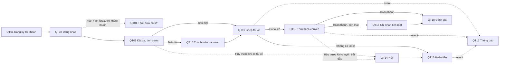

# 05 — Quy trình nghiệp vụ theo mô hình 5 thành phần

> Nguồn: `srs.md` (FR, BRULE, UC), `docs/design/01`–`04`, `CLAUDE.md`. Cập nhật 2026-10-03.
> Mã API (A01–A39) theo `04-api.md` (tên trường ngắn — đồng bộ 2026-10-03: QT01–QT09). **Đồng bộ 04 lần 4 (ADR-018):** cột Software dùng đường dẫn `/api/v1/…`, đổi trạng thái bằng `PATCH` + `status`; mã API và rpc không đổi; mã gRPC giữa service (S2–S7; S1 đã bỏ) và topic Kafka (K1–K7) theo `02-kien-truc-giao-tiep.md`.
> Sửa 2026-10-03 theo góp ý giảng viên: QT01 chỉ tạo tài khoản, QT04 thêm bước tạo hồ sơ (ADR-013); QT05, QT10, QT16, QT17 theo cách giả lập hệ thống ngoài mới (ADR-014); ma trận 4.1, 4.2. Cùng ngày: QT09 ghi rõ đặt xe không cần hồ sơ (Q56); QT10 thêm `simulate_result: "MANUAL"` (Q57). Sửa lần 3 theo luật thi: D1 (số điện thoại, email lưu rõ — ADR-012), D14 (HS256 — ADR-016), QT02, QT08, QT12, QT21 (seed theo quy luật, lệnh gõ tay, 14 biến môi trường).
> **Sửa 2026-10-14 (theo yêu cầu giảng viên, ADR-021 thay ADR-019):** QT01, QT02 — khách, admin đăng ký / đăng nhập bằng email, tài xế bằng số điện thoại, nhóm route `/api/v1/auth/…`; QT04 — hồ sơ có số điện thoại bắt buộc, không còn email; QT05 — `auth/otp`, `auth/driver-register`; QT08 — xem tài xế theo mã chỉ admin và chính tài xế; QT12 — danh sách booking theo mã khách; SW4, D1, D3.

## 0. Mô hình 5 thành phần

Mỗi quy trình được mô tả bằng năm thành phần của một hệ thống thông tin:

| Thành phần | Trả lời câu hỏi | Trong CAB |
|---|---|---|
| **Procedures** (Quy trình) | Làm những bước nào, theo quy tắc nào? | Các bước của use case, quy tắc BRULE |
| **People** (Con người) | Ai tham gia, vai trò gì? | Khách hàng, tài xế, admin, quản trị hệ thống |
| **Hardware** (Phần cứng) | Chạy trên thiết bị nào, thiết bị đó lưu gì? | Điện thoại, máy tính, máy chủ, ổ đĩa database, RAM Redis, ổ đĩa Kafka |
| **Software** (Phần mềm) | Phần mềm nào thao tác gì? | Ứng dụng client, API Gateway, 8 service, PostgreSQL, MongoDB, Redis, Kafka |
| **Data** (Dữ liệu) | Đọc, tạo, sửa dữ liệu gì? | Bảng, collection, key Redis, event Kafka, token |

Phần 2 liệt kê một lần bốn thành phần People, Hardware, Software, Data kèm mã (P, H, SW, D). Phần 3 mô tả từng quy trình và dẫn lại các mã đó, để không lặp.

---

## 1. Danh mục quy trình

| Mã | Quy trình | Nhóm | Use case | Yêu cầu | Mục chấm |
|---|---|---|---|---|---|
| **QT01** | Đăng ký tài khoản khách hàng (chỉ tài khoản) | Tài khoản | UC01 | FR26 | 9 |
| **QT02** | Đăng nhập | Tài khoản | UC02 | FR26 | 10, 25 |
| **QT03** | Đăng xuất | Tài khoản | UC33 | FR42 | 27 (bổ trợ) |
| **QT04** | Tạo, xem và cập nhật hồ sơ khách hàng | Tài khoản | UC03, UC19 | FR27, BRULE18 | 11, 24, 26 |
| **QT05** | Đăng ký tài xế (OTP, nộp hồ sơ) | Tài xế | UC29 | FR39, FR28, FR29 | 21 |
| **QT06** | Duyệt hồ sơ tài xế | Tài xế | UC30, UC20 | FR39, BRULE12 | 22, 28 |
| **QT07** | Bật / tắt nhận chuyến và gửi vị trí | Tài xế | UC28, UC12 | FR38, FR13, BRULE01 | 23 |
| **QT08** | Xem tài xế (theo mã, quanh một tọa độ) | Tài xế | UC06, UC20, UC21 | FR02–FR04, FR28, FR29 | 12, 13 |
| **QT09** | Đặt xe và tính cước cố định | Đặt xe | UC04, UC05, UC13 | FR01, FR16, FR35, BRULE08 | 15 |
| **QT10** | Thanh toán điện tử trả trước | Đặt xe | UC14, UC15 | FR18–FR20, BRULE09, BRULE13, BRULE17 | 19, 30 |
| **QT11** | Ghép tài xế (mời, nhận, từ chối, hết giờ) | Đặt xe | UC06–UC09 | FR02–FR11, BRULE01–07 | 15, 16 |
| **QT12** | Xem danh sách và chi tiết booking | Đặt xe | UC18 | FR37 | 14 |
| **QT13** | Thực hiện và theo dõi chuyến đi | Chuyến đi | UC10, UC11 | FR11–FR15 | 17 |
| **QT14** | Hủy booking / hủy chuyến | Chuyến đi | UC27, UC32 | FR36, FR41, BRULE16 | 18 |
| **QT15** | Ghi nhận thanh toán tiền mặt | Thanh toán | UC14 | FR17 | 17 (bổ trợ) |
| **QT16** | Hoàn tiền | Thanh toán | UC31 | FR40, BRULE14, BRULE15 | 18 |
| **QT17** | Gửi và xem thông báo | Sau chuyến | UC16 | FR21–FR24 | 16, 18, 22 |
| **QT18** | Đánh giá chuyến đi | Sau chuyến | UC17 | FR25, BRULE11 | 20 |
| **QT19** | Giám sát chuyến đi (admin) | Vận hành | UC22 | FR30, BRULE12 | Ngoài phiếu |
| **QT20** | Kiểm soát truy cập tại Gateway (cắt ngang mọi quy trình) | Vận hành | — | NFR06, NFR07 | 3, 8, 27, 28, 29 |
| **QT21** | Vận hành và kiểm tra hệ thống | Vận hành | — | NFR04, NFR15 | 1, 2, 5, 6, 7 |

**Chuỗi quy trình chính của một chuyến đi:**

---

## 2. Danh mục thành phần dùng chung

### 2.1 People — con người

| Mã | Vai trò | Role trong hệ thống | Tham gia quy trình |
|---|---|---|---|
| **P1** | Khách hàng | `customer` | QT01–QT04, QT09, QT10, QT12–QT14, QT17, QT18 |
| **P2** | Tài xế | `driver` | QT02, QT03, QT05, QT07, QT08, QT11, QT13, QT14, QT17 |
| **P3** | Admin (SRS gọi là Operator, nhân viên vận hành) | `admin` | QT02, QT04, QT06, QT08, QT19 |
| **P4** | Quản trị hệ thống (IT / DevOps) | Không đăng nhập ứng dụng; thao tác trên máy chủ | QT21 |
| **P5** | Nhà cung cấp thanh toán | Tổ chức bên ngoài; trong project được **giả lập** bằng module trong `payment-service`; khi demo callback thì Postman đóng vai | QT10, QT16 |

### 2.2 Hardware — thiết bị và nơi lưu trữ

Khi demo, mọi máy chủ (H4–H8) là container Docker chạy trên **một laptop 16 GB**. Khi triển khai thật, mỗi thành phần có thể nằm trên máy chủ riêng.

| Mã | Thiết bị | Lưu gì | Mất thiết bị thì sao |
|---|---|---|---|
| **H1** | Điện thoại khách hàng (khi chấm: máy chạy Postman) | Token JWT đang đăng nhập; tọa độ GPS điểm đón (tạm, gửi lên khi đặt xe) | Đăng nhập lại; không mất dữ liệu hệ thống |
| **H2** | Điện thoại tài xế, có GPS | Token JWT; vị trí hiện tại (tạm, gửi lên định kỳ) | Như trên |
| **H3** | Máy tính admin | Token JWT của admin; trình duyệt mở Kafka UI | Như trên |
| **H4** | Máy chủ ứng dụng (Gateway và 8 service) | **Không lưu dữ liệu nghiệp vụ** (service không trạng thái); chỉ có log tiến trình | Chạy lại container là xong |
| **H5** | Ổ đĩa máy chủ database (Docker volume), 7 PostgreSQL + 1 MongoDB | Toàn bộ dữ liệu nghiệp vụ, mỗi service một database (bảng ở 2.4) | Mất dữ liệu; cần sao lưu |
| **H6** | RAM máy chủ Redis | Bộ đếm rate limit; danh sách token đã đăng xuất. Dữ liệu **tạm**, tự hết hạn | Mất bộ đếm và danh sách thu hồi; Gateway vẫn chạy (`CLAUDE.md`) |
| **H7** | Ổ đĩa Kafka broker | Nhật ký event của 7 topic; vị trí đọc (offset) của từng consumer group | Mất event chưa xử lý |
| **H8** | Mạng | Mạng nội bộ Docker cho service gọi nhau; chỉ cổng 3000 (Gateway) và 8080 (Kafka UI) mở ra ngoài | — |

### 2.3 Software — phần mềm

| Mã | Phần mềm | Chạy trên | Thao tác gì |
|---|---|---|---|
| **SW1** | Ứng dụng client (khách, tài xế, admin). Khi chấm: **Postman** | H1, H2, H3 | Gửi request REST/JSON kèm token đến Gateway |
| **SW2** | **API Gateway** (Node.js) | H4 | Kiểm tra JWT, kiểm tra role, rate limit, đăng xuất, đổi REST → gRPC, health check |
| **SW3** | `auth-service` | H4 | Tài khoản, mật khẩu băm, đăng nhập, cấp JWT, OTP |
| **SW4** | `customer-service` | H4 | Hồ sơ khách hàng do khách tạo sau khi đăng nhập (mã hóa họ tên, ngày sinh; số điện thoại liên hệ bắt buộc, lưu rõ — ADR-021). Không gọi và không bị service nào gọi |
| **SW5** | `driver-service` | H4 | Hồ sơ tài xế, xe, duyệt hồ sơ, Online/Offline, vị trí, tìm tài xế trong 1 km, giữ chỗ tài xế |
| **SW6** | `booking-service` | H4 | Booking, tính quãng đường ước tính, ghép tài xế, lời mời, phân công |
| **SW7** | `trip-service` | H4 | Chuyến đi, trình tự trạng thái, hủy chuyến, lịch sử trạng thái |
| **SW8** | `payment-service` | H4 | Bảng giá, tính cước, thanh toán trả trước, callback, tiền mặt, hoàn tiền, chống gửi lặp |
| **SW9** | `notification-service` | H4 | Nghe event, tạo và cho xem thông báo |
| **SW10** | `rating-service` | H4 | Đánh giá chuyến, điểm trung bình tài xế |
| **SW11** | PostgreSQL 16 (7 database), MongoDB 7 (1 database) | H5 | Lưu và truy vấn dữ liệu nghiệp vụ |
| **SW12** | Redis 7 | H6 | Bộ đếm, danh sách token thu hồi |
| **SW13** | Kafka, `kafka-init` (tạo 7 topic), **Kafka UI** (`http://localhost:8080`) | H7 | Chuyển event giữa service; xem topic, event, consumer |
| **SW14** | Adapter giả lập (module trong service, ADR-014): cổng thanh toán (trong payment, gọi ngay xử lý callback, mặc định thành công; `MANUAL` thì không gọi, chờ callback từ Postman); bản đồ (công thức khoảng cách, trong booking); kênh thông báo / SMS (chỉ lưu database và ghi log); kênh OTP (ghi log, trả mã trong response khi `SIMULATION_MODE=true`) | H4 | Thay cho hệ thống bên ngoài khi demo |
| **SW15** | Docker Compose | Máy chủ | Dựng toàn bộ container; liệt kê container (mục chấm 5) |

### 2.4 Data — dữ liệu

| Mã | Dữ liệu | Thuộc service | Lưu ở | Dữ liệu chính |
|---|---|---|---|---|
| **D1** | `accounts` | auth | H5 (auth-db) | Mã tài khoản (số nguyên), **email** (khách, admin) hoặc **số điện thoại** (tài xế) — đúng một định danh theo role, lưu rõ, không trùng (ADR-012, ADR-021), mật khẩu băm scrypt, role, trạng thái |
| **D2** | `otp_verifications` | auth | H5 (auth-db) | OTP băm, hạn, số lần thử |
| **D3** | `customer_profiles` | customer | H5 (customer-db) | Họ tên (bắt buộc), ngày sinh (tùy chọn) — mã hóa; số điện thoại liên hệ (bắt buộc, lưu rõ, không UNIQUE — 2026-10-14). Có thể chưa có dòng cho một tài khoản |
| **D4** | `drivers`, `vehicles`, `vehicle_types` | driver | H5 (driver-db) | Hồ sơ, số giấy phép (mã hóa), trạng thái duyệt, Online/Offline, vị trí hiện tại; xe, biển số, loại xe |
| **D5** | `bookings` | booking | H5 (booking-db) | Điểm đón, điểm đến, loại xe, phương thức, quãng đường ước tính, số tiền cước, trạng thái, lý do hủy |
| **D6** | `driver_offers`, `driver_assignments` | booking | H5 (booking-db) | Lời mời cho từng tài xế, hạn trả lời, kết quả; phân công cuối cùng kèm mã chuyến |
| **D7** | `trips`, `trip_status_history` | trip | H5 (trip-db) | Bản chụp booking, trạng thái chuyến, lý do hủy; lịch sử đổi trạng thái |
| **D8** | `fare_rates`, `fares` | payment | H5 (payment-db) | Bảng giá theo loại xe; cước của từng booking và các thành phần |
| **D9** | `payments`, `payment_transactions`, `idempotency_keys` | payment | H5 (payment-db) | Thanh toán theo booking, hạn, trạng thái; từng lần thu / hoàn; khóa chống gửi lặp |
| **D10** | `notifications` (collection) | notification | H5 (notification-db, MongoDB) | Người nhận, loại, tiêu đề, nội dung, các mã liên quan |
| **D11** | `ratings`, `driver_ratings` | rating | H5 (rating-db) | Số sao, nhận xét theo chuyến; tổng điểm và số lượt của tài xế |
| **D12** | Key Redis `rl:*`, `revoked:{jti}` | Gateway | H6 | Bộ đếm rate limit; token đã đăng xuất |
| **D13** | Event Kafka K1–K7 | Service phát | H7 | `event_id`, loại event, mã đối tượng, trạng thái mới |
| **D14** | Token JWT | auth cấp | H1, H2, H3 | `sub` (mã tài khoản), `role`, `jti`, `exp`, chữ ký HS256 bằng `JWT_SECRET` (ADR-016) |

**Bảy event Kafka (D13):**

| Mã | Topic | Phát | Nghe |
|---|---|---|---|
| K1 | `booking.created` | booking | notification |
| K2 | `booking.offer-created` | booking | notification |
| K3 | `booking.no-driver-found` | booking | payment, notification |
| K4 | `booking.canceled` | booking | payment, notification |
| K5 | `trip.status-changed` | trip | driver, payment, notification |
| K6 | `payment.status-changed` | payment | booking, notification |
| K7 | `driver.application-reviewed` | driver | notification |

---

## 3. Chi tiết từng quy trình

Mọi request của người dùng đều đi qua **QT20** (Gateway kiểm tra token, role, rate limit) trước khi tới service; phần dưới không nhắc lại bước này.

### QT01 — Đăng ký tài khoản khách hàng

| Thành phần | Nội dung |
|---|---|
| **Procedures** | 1. Khách nhập **email**, mật khẩu (ADR-021).   2. Hệ thống kiểm tra dữ liệu; email đã có → từ chối (409).   3. Auth băm mật khẩu, tạo tài khoản role `customer`. Đăng ký công khai **không** tạo được role khác.   4. Trả về tài khoản (không có mật khẩu). **Chưa có hồ sơ**: khách tạo hồ sơ sau khi đăng nhập (QT04). Auth không gọi service nào (ADR-013). |
| **People** | P1 Khách hàng |
| **Hardware** | H1 gửi request · H4 xử lý · H5 lưu tài khoản (auth-db) |
| **Software** | SW1 → SW2 `POST /api/v1/auth/register` (A04) → SW3 `RegisterCustomer` → SW11 |
| **Data** | Tạo D1 `accounts` |

### QT02 — Đăng nhập

| Thành phần | Nội dung |
|---|---|
| **Procedures** | 1. Khách, admin nhập **email** và mật khẩu; tài xế nhập **số điện thoại** và mật khẩu (BRULE19). Gửi cả hai hoặc không gửi định danh nào → 400.   2. Auth tìm tài khoản theo định danh lưu rõ, có ràng buộc không trùng; so mật khẩu với bản băm.   3. Sai thông tin → 401; tài khoản bị khóa → từ chối (Exception UC02).   4. Đúng → cấp JWT chứa mã tài khoản, role, mã token, hạn.   5. Chuỗi SQL injection như `' OR 1=1 --` ở ô email bị từ chối vì sai định dạng (400); ở ô mật khẩu không đăng nhập được vì truy vấn dùng tham số (401) (mục 25). |
| **People** | P1, P2, P3 |
| **Hardware** | H1/H2/H3 nhận và **lưu token** · H4 · H5 đọc auth-db |
| **Software** | SW1 → SW2 `POST /api/v1/auth/login` (A05, body `email` + `password`, hoặc `phone` + `password` với tài xế) → SW3 `Login` → SW11 |
| **Data** | Đọc D1 · Tạo D14 (token, không lưu ở server) |

### QT03 — Đăng xuất

| Thành phần | Nội dung |
|---|---|
| **Procedures** | 1. Người dùng gửi yêu cầu đăng xuất kèm token.   2. Gateway ghi mã token (`jti`) vào danh sách thu hồi, tự hết hạn cùng lúc với token.   3. Từ đó mọi request dùng token này bị 401. Không gọi sang service nào. |
| **People** | P1, P2, P3 |
| **Hardware** | H1/H2/H3 xóa token · H6 lưu `revoked:{jti}` |
| **Software** | SW1 → SW2 `POST /api/v1/auth/logout` (A06) → SW12 |
| **Data** | Tạo D12 `revoked:{jti}` · D14 hết hiệu lực |

### QT04 — Tạo, xem và cập nhật hồ sơ khách hàng

| Thành phần | Nội dung |
|---|---|
| **Procedures** | Tiền điều kiện: khách đã đăng nhập (QT02).   1. Khách mở màn hình hồ sơ. Chưa có hồ sơ → 404 (chưa có).   2. **Tạo hồ sơ**: khách nhập họ tên và số điện thoại liên hệ (bắt buộc), ngày sinh (tùy chọn). Customer lấy `customer_id` = mã tài khoản trong token, không nhận mã từ client; mã hóa rồi lưu. Đã có hồ sơ → 409 (BRULE18).   3. **Xem**: khách xem hồ sơ của mình (theo mã hoặc `/me`); admin xem được mọi hồ sơ (mục 11). Khách xem hồ sơ người khác → 403. Customer giải mã họ tên, ngày sinh rồi trả về.   4. **Sửa**: chỉ hồ sơ của mình; chưa có → 404; văn bản chứa `<` hoặc `>` bị từ chối 400 (chống XSS, mục 26). Customer mã hóa lại trước khi lưu.   Customer không gọi Auth: token đã đủ để biết ai đang thao tác (ADR-013). |
| **People** | P1 (chủ hồ sơ: tạo, xem, sửa), P3 (chỉ xem) |
| **Hardware** | H1/H3 · H4 · H5 customer-db (dữ liệu nằm trên đĩa ở dạng **mã hóa**, mục 24) |
| **Software** | SW2 `POST /api/v1/customers` (A37, body `name`, `phone`, `dob`), `GET /api/v1/customers/me` (A38), `GET /api/v1/customers/{id}` (A09), `PATCH /api/v1/customers/me` (A10) → SW4 `CreateCustomer`, `GetCustomer`, `UpdateCustomer` |
| **Data** | Tạo, đọc, sửa D3. Khóa mã hóa lấy từ biến môi trường của customer-service |

### QT05 — Đăng ký tài xế

| Thành phần | Nội dung |
|---|---|
| **Procedures** | 1. Tài xế nhập số điện thoại, xin OTP.   2. Auth tạo OTP, lưu bản băm kèm hạn; kênh gửi giả lập **ghi log** mã OTP, và khi `SIMULATION_MODE=true` thì **trả luôn mã trong response** để Postman dùng tiếp (ADR-014).   3. Tài xế nhập OTP và thông tin tài khoản; OTP đúng và còn hạn → Auth tạo tài khoản role `driver` và **trả luôn token** (không cần đăng nhập riêng).   4. Tài xế dùng token đó nộp hồ sơ cá nhân và xe.   5. Hồ sơ ở trạng thái **chờ duyệt** (`PENDING`).   6. Bị admin từ chối → tài xế xem lý do ở hồ sơ của mình rồi **nộp lại bằng cùng thao tác nộp hồ sơ** → hồ sơ về `PENDING` (FR43, thêm 2026-10-05). |
| **People** | P2 Tài xế |
| **Hardware** | H2 · H4 · H5 auth-db (tài khoản, OTP), driver-db (hồ sơ, xe) |
| **Software** | SW2 A07 `POST /api/v1/auth/otp`, A08 `POST /api/v1/auth/driver-register`, A11 `POST /api/v1/drivers` → SW3 `RequestDriverOtp`, `RegisterDriver` → SW5 `SubmitApplication` · SW14 kênh OTP giả lập (log) |
| **Data** | Tạo D2, D1 (role `driver`), D4 (`drivers` với `approval_status = PENDING`, `vehicles`) |

### QT06 — Duyệt hồ sơ tài xế

| Thành phần | Nội dung |
|---|---|
| **Procedures** | 1. Admin mở danh sách hồ sơ chờ duyệt.   2. Admin xem chi tiết, chọn duyệt hoặc từ chối (kèm lý do).   3. Driver cập nhật trạng thái hồ sơ, ghi người duyệt và thời điểm.   4. Driver phát event K7; Notification báo kết quả cho tài xế.   5. Người không phải admin gọi API duyệt → 403 (mục 28, BRULE12). |
| **People** | P3 Admin; P2 nhận kết quả |
| **Hardware** | H3 · H4 · H5 driver-db · H7 lưu event K7 |
| **Software** | SW2 A13 `GET /api/v1/drivers?approval_status=PENDING`, A15 / A16 `PATCH /api/v1/drivers/{id}` (`approval_status` = `APPROVED` / `REJECTED`) → SW5 `ListDrivers`, `ApproveDriver`, `RejectDriver` → SW13 K7 → SW9 |
| **Data** | Sửa D4 (`approval_status`, `reviewed_by`, `reviewed_at`, `reject_reason`) · Tạo D13 (K7), D10 |

### QT07 — Bật / tắt nhận chuyến và gửi vị trí

| Thành phần | Nội dung |
|---|---|
| **Procedures** | 1. Tài xế đã được duyệt chuyển Online hoặc Offline; chưa duyệt thì không Online được.   2. Khi Online, điện thoại tài xế gửi vị trí hiện tại định kỳ.   3. Chỉ tài xế Online mới được đưa vào ghép chuyến (BRULE01). |
| **People** | P2 |
| **Hardware** | H2 (GPS) · H4 · H5 driver-db (chỉ lưu **vị trí hiện tại**, không lưu lịch sử) |
| **Software** | SW2 `PATCH /api/v1/drivers/me`: A17 `{"status":"ONLINE"}`, A39 `{"status":"OFFLINE"}`, A18 `{"lat","lng"}` → SW5 `SetAvailability`, `UpdateLocation` |
| **Data** | Sửa D4 (`availability`, `current_lat`, `current_lng`, `location_updated_at`) |

### QT08 — Xem tài xế

| Thành phần | Nội dung |
|---|---|
| **Procedures** | 1. Xem tài xế theo mã (mục 12, sửa 2026-10-14): **admin** xem đủ mọi hồ sơ; **tài xế** chỉ xem hồ sơ của mình (mã khác → 403); khách không xem được (403) — khách thấy tài xế của chuyến mình qua QT13.   2. Tìm tài xế quanh một tọa độ (mục 13): lọc tài xế Online, đúng loại xe, trong bán kính 1 km; sắp theo khoảng cách; có `limit` và phân trang.   3. Khoảng cách tính bằng công thức trên hai cột tọa độ, không dùng PostGIS (ADR-011). |
| **People** | P1, P3 (tìm quanh tọa độ); P2, P3 (xem theo mã) |
| **Hardware** | H1/H3 · H4 · H5 driver-db |
| **Software** | SW2 A14 `GET /api/v1/drivers/{id}`, A12 `GET /api/v1/drivers?lat&lng&vehicle&page&limit` (bán kính 1 km là hằng số, không có tham số) → SW5 `GetDriver`, `FindNearbyDrivers` |
| **Data** | Đọc D4. Seed TX1–TX8 (mã 11–18) ở các trạng thái khác nhau; tại điểm mẫu P0 (10.82, 106.68) tìm thấy TX1–TX4 (file 03 mục 14) |

### QT09 — Đặt xe và tính cước cố định

| Thành phần | Nội dung |
|---|---|
| **Procedures** | 1. Khách chọn điểm đón, điểm đến, loại xe, phương thức thanh toán. Điều kiện chỉ là đã đăng nhập bằng tài khoản `customer` (email ở Auth) và đủ bốn dữ liệu này; **không cần đã tạo hồ sơ** (QT04), Booking không gọi Customer (Q56, 2026-10-03).   2. Booking tính quãng đường ước tính = khoảng cách đường thẳng × 1,3 (đơn vị mét).   3. Booking gọi Payment (S4, gRPC đồng bộ): Payment áp bảng giá, tính **cước cố định** = giá mở cửa + đơn giá/km × quãng đường, làm tròn lên 1.000 đ, không thấp hơn cước tối thiểu (BRULE08); tạo thanh toán ở trạng thái chờ.   4. Booking lưu yêu cầu kèm số tiền: **tiền mặt** → trạng thái đang tìm tài xế, chuyển sang QT11; **điện tử** → trạng thái chờ thanh toán, chuyển sang QT10.   5. Booking phát K1; Notification báo khách "đã nhận yêu cầu". |
| **People** | P1 |
| **Hardware** | H1 (GPS điểm đón) · H4 · H5 booking-db, payment-db · H7 |
| **Software** | SW2 `POST /api/v1/bookings` (A19, body `from`, `to`, `vehicle`, `pay`) → SW6 `CreateBooking` → SW8 `CreatePayment` (S4) → SW13 K1 → SW9 |
| **Data** | Tạo D5 `bookings`, D8 `fares`, D9 `payments` (hạn 10 phút với điện tử) · Đọc D8 `fare_rates` · Tạo D13 (K1) |

### QT10 — Thanh toán điện tử trả trước

| Thành phần | Nội dung |
|---|---|
| **Procedures** | 1. Khách thực hiện thanh toán, gửi kèm khóa chống lặp (`Idempotency-Key`).   2. Payment ghi khóa, tạo lần thử; gửi yêu cầu thu tiền đến cổng thanh toán giả lập (module trong `payment-service`).   3. Cổng giả lập **gọi ngay phần xử lý callback**, mặc định thành công. Khi `SIMULATION_MODE=true` khách có thể gửi `simulate_result`: `FAILED` để demo thất bại; `MANUAL` để cổng giả lập **không** gọi callback — lần thử và thanh toán đứng ở `PENDING`, chờ callback từ ngoài ở bước 6 (mục 19; Q57, ADR-014).   4. Thành công → Payment chuyển **COMPLETED** (mục 19), phát K6; Booking nghe K6, chuyển sang tìm tài xế (QT11). Mặc định response của bước 1 đã có kết quả; với `MANUAL` thì kết quả có sau bước 6.   5. Thất bại → `FAILED`, khách thử lại; tối đa 3 lần trong 10 phút (BRULE17). Quá hạn hoặc hết lượt → thanh toán bị hủy, Booking bị hủy. Đang có lần thử `PENDING` thì không mở lần thử mới (409).   6. Callback từ ngoài (Postman đóng vai Provider) vào endpoint callback, xác thực bằng **khóa bí mật cố định trong header** (không HMAC); sai khóa → 401. Giao dịch đang `PENDING` (sau `MANUAL`) → xử lý như bước 4 / 5, Payment `PENDING → COMPLETED`. Giao dịch đã có kết quả → trả kết quả cũ.   7. Gửi lại đúng request cũ (cùng khóa chống lặp) hoặc callback cũ → trả lại kết quả cũ, **không thu tiền lần hai** (mục 30).   8. Hệ thống không lưu số thẻ hay tài khoản ngân hàng (BRULE09). |
| **People** | P1 Khách hàng; P5 Nhà cung cấp thanh toán (giả lập; Postman đóng vai khi gửi callback từ ngoài) |
| **Hardware** | H1 · H4 · H5 payment-db, booking-db · H7 |
| **Software** | SW2 A31 `POST /api/v1/payments/{id}/transactions`, A32 `POST /api/v1/payment-callbacks` (header `X-Callback-Secret`), A30 `GET /api/v1/payments/{id}` → SW8 `PayPayment`, `HandleProviderCallback` (cùng một hàm xử lý callback) · SW14 cổng thanh toán giả lập · SW13 K6 → SW6, SW9 |
| **Data** | Tạo D9 `idempotency_keys`, `payment_transactions` (loại thu) · Sửa D9 `payments` (`COMPLETED` / `FAILED` / `CANCELED`), D5 (trạng thái booking) · Tạo D13 (K6) |

### QT11 — Ghép tài xế

| Thành phần | Nội dung |
|---|---|
| **Procedures** | 1. Booking gọi Driver lấy danh sách tài xế Online, đúng loại xe, trong 1 km, gần nhất trước (S2; BRULE01–03).   2. Booking tạo lời mời cho tài xế gần nhất, có hạn trả lời; phát K2, Notification báo tài xế.   3. Tài xế xem lời mời và:   &nbsp;&nbsp;• **Từ chối** → không hoàn tiền, hỏi tài xế kế tiếp (BRULE05, BRULE15).   &nbsp;&nbsp;• **Không trả lời** đến hết hạn → hỏi tài xế kế tiếp (BRULE04, BRULE06).   &nbsp;&nbsp;• **Nhận** → Booking giữ chỗ tài xế (S3), gọi Trip tạo chuyến (S5, gRPC đồng bộ: tài xế cần ngay mã chuyến), lưu phân công, Booking chuyển "đã có tài xế". Trip phát K5 (`ACCEPTED`), Notification báo khách.   4. Hết danh sách mà chưa ai nhận → Booking "không tìm được tài xế", phát K3; Payment hoàn tiền nếu đã thu (QT16); Notification báo khách (BRULE07). |
| **People** | P2 Tài xế (nhận lời mời); P1 nhận kết quả |
| **Hardware** | H2 · H4 · H5 booking-db, driver-db, trip-db · H7 |
| **Software** | SW6 → SW5 `FindNearbyDrivers` (S2), `ReserveDriver`, `ReleaseDriver` (S3) → SW7 `CreateTrip` (S5) · SW2 A23 `GET /api/v1/offers`, A24 / A25 `PATCH /api/v1/offers/{id}` (`status` = `ACCEPTED` / `REJECTED`) · SW13 K2, K3, K5 |
| **Data** | Đọc D4 · Tạo D6 `driver_offers`, `driver_assignments`, D7 `trips` · Sửa D5, D4 (`availability`, `current_booking_id`) · Tạo D13 (K2, K3, K5) |

### QT12 — Xem danh sách và chi tiết booking

| Thành phần | Nội dung |
|---|---|
| **Procedures** | 1. Xem danh sách booking **theo mã khách** (mục 14, sửa 2026-10-14): khách chỉ mã của mình (mã khác → 403), admin mọi mã; lọc theo trạng thái, mới nhất trước, có `limit` và phân trang.   2. Khách xem chi tiết một booking của mình; admin xem được mọi booking. |
| **People** | P1, P3 |
| **Hardware** | H1/H3 · H4 · H5 booking-db |
| **Software** | SW2 A20 `GET /api/v1/customers/{id}/bookings?status&page&limit`, A21 `GET /api/v1/bookings/{id}` → SW6 `ListBookings`, `GetBooking` |
| **Data** | Đọc D5. Seed B1–B7 của KH1 (mã 1–7, file 03 mục 14) |

### QT13 — Thực hiện và theo dõi chuyến đi

| Thành phần | Nội dung |
|---|---|
| **Procedures** | 1. Tài xế cập nhật trạng thái **đúng thứ tự**: đã nhận → đã đến điểm đón → đã đón khách → đang đi → hoàn thành. Sai thứ tự → 409 (mục 17).   2. Mỗi lần đổi trạng thái: Trip ghi lịch sử, phát K5; Notification báo khách.   3. Khách xem chuyến: Trip trả thông tin chuyến kèm tên, biển số tài xế đã **chụp lúc nhận chuyến** (S3 → S5), không gọi Driver (sửa 2026-10-21, S6 bỏ; vị trí sống ngoài phiếu).   4. Khi hoàn thành: Driver nghe K5, trả tài xế về trạng thái rảnh; Payment nghe K5, ghi nhận tiền mặt nếu có (QT15). |
| **People** | P2 (cập nhật); P1 (theo dõi) |
| **Hardware** | H2, H1 · H4 · H5 trip-db, driver-db · H7 |
| **Software** | SW2 A28 `PATCH /api/v1/trips/{id}` (`status` = `ARRIVED` … `COMPLETED`), A27 `GET /api/v1/trips/{id}` → SW7 `UpdateTripStatus`, `GetTrip` (đọc `trips.driver_name`, `driver_plate`) · SW13 K5 → SW5, SW8, SW9 |
| **Data** | Sửa D7 `trips` · Tạo D7 `trip_status_history`, D13 (K5) · Sửa D4 khi hoàn thành |

### QT14 — Hủy booking / hủy chuyến

| Thành phần | Nội dung |
|---|---|
| **Procedures** | Chỉ hủy được **trước khi chuyến bắt đầu** (BRULE16).   1. **Khách hủy khi chưa có tài xế** (đang chờ thanh toán hoặc đang tìm): Booking chuyển hủy, ghi lý do, phát K4.   2. **Khách hủy khi đã có tài xế**, hoặc **tài xế hủy chuyến đã nhận** (FR41): Trip chuyển `CANCELED` khi chuyến ở trạng thái đã nhận hoặc đã đến; sau khi đón khách → 409. Trip phát K5. Hệ thống **không tự tìm tài xế khác**.   3. Payment nghe K4 hoặc K5: đã thu thì hoàn tiền (QT16), chưa thu thì hủy thanh toán. Driver nghe K5, trả tài xế về rảnh. Notification báo các bên (mục 18). |
| **People** | P1; P2 (chỉ hủy chuyến đã nhận) |
| **Hardware** | H1, H2 · H4 · H5 booking-db, trip-db, payment-db · H7 |
| **Software** | SW2 A22 `PATCH /api/v1/bookings/{id}`, A29 `PATCH /api/v1/trips/{id}` (cả hai `{"status":"CANCELED","reason":…}`) → SW6 `CancelBooking`, SW7 `CancelTrip` · SW13 K4, K5 → SW5, SW8, SW9 |
| **Data** | Sửa D5 hoặc D7 (trạng thái, `cancel_reason`, `canceled_by`) · Tạo D13 (K4 / K5) |

### QT15 — Ghi nhận thanh toán tiền mặt

| Thành phần | Nội dung |
|---|---|
| **Procedures** | 1. Chuyến hoàn thành; khách trả tiền mặt cho tài xế đúng số tiền cước cố định (Trip giữ số tiền để tài xế biết phải thu bao nhiêu).   2. Payment nghe K5 `COMPLETED` và tự ghi nhận thanh toán tiền mặt `COMPLETED`; tài xế không cần bấm xác nhận. |
| **People** | P1 trả, P2 thu |
| **Hardware** | H5 payment-db · H7 |
| **Software** | SW7 phát K5 → SW13 → SW8 |
| **Data** | Sửa D9 `payments` (`method = CASH`, `status = COMPLETED`, `paid_at`) |

### QT16 — Hoàn tiền

| Thành phần | Nội dung |
|---|---|
| **Procedures** | 1. Payment nhận một trong các event: không tìm được tài xế (K3), khách hủy booking (K4), chuyến bị hủy bởi khách hoặc tài xế (K5 `CANCELED`).   2. Thanh toán điện tử đã `COMPLETED` → gửi yêu cầu hoàn đến cổng thanh toán giả lập; cổng giả lập gọi ngay phần xử lý kết quả, **luôn thành công** (ADR-014); hoàn **đủ** tiền, chuyển `REFUNDED` (BRULE14). Mỗi thanh toán chỉ hoàn một lần (ràng buộc database).   3. Chưa thu (đang chờ, thất bại) → chuyển `CANCELED`, không có gì để hoàn.   4. **Không hoàn** khi chuyến đã hoàn thành, và khi tài xế chỉ từ chối lời mời, vì trường hợp này không phát event nào (BRULE15).   5. Payment phát K6; Notification báo khách. |
| **People** | P1 nhận tiền; P5 (giả lập) |
| **Hardware** | H4 · H5 payment-db · H7 |
| **Software** | SW13 K3, K4, K5 → SW8 → SW14 cổng thanh toán giả lập · SW8 phát K6 → SW9 |
| **Data** | Tạo D9 `payment_transactions` (loại hoàn) · Sửa D9 `payments` (`REFUNDED`, `refunded_at`) · Tạo D13 (K6) |

### QT17 — Gửi và xem thông báo

| Thành phần | Nội dung |
|---|---|
| **Procedures** | 1. Notification nghe cả 7 topic.   2. Với mỗi event: xác định người nhận, tạo thông báo. Kênh gửi (thông báo, SMS) là giả lập: **chỉ lưu vào database và ghi một dòng log** (loại, người nhận, mã event; không dữ liệu cá nhân) — ADR-014. Event bị giao lặp không tạo thông báo trùng (ràng buộc duy nhất theo mã event và người nhận).   3. Người dùng xem thông báo của mình, mới nhất trước, có phân trang.   4. Notification lỗi không làm hỏng đặt xe hay chuyến đi, vì bên phát không chờ (NFR05). |
| **People** | P1, P2, P3 (người nhận) |
| **Hardware** | H7 · H4 · H5 notification-db (MongoDB) · H1/H2/H3 hiển thị |
| **Software** | SW13 → SW9 → SW14 kênh gửi giả lập (log) · SW2 A33 `GET /api/v1/notifications` → SW9 `ListNotifications` |
| **Data** | Đọc D13 · Tạo D10 `notifications` |

### QT18 — Đánh giá chuyến đi

| Thành phần | Nội dung |
|---|---|
| **Procedures** | 1. Khách chọn chuyến đã hoàn thành, chọn số sao (1–5), nhập nhận xét.   2. Rating hỏi Trip (S7, gRPC đồng bộ): chuyến đã hoàn thành và đúng là của khách này? Không đúng → từ chối (BRULE11).   3. Rating lưu đánh giá gắn với chuyến; mỗi chuyến chỉ một đánh giá (mục 20).   4. Rating cộng vào tổng điểm của tài xế trong cùng giao dịch.   5. Người dùng xem đánh giá của chuyến và điểm trung bình của tài xế. |
| **People** | P1 (đánh giá); P2, P3 (xem) |
| **Hardware** | H1 · H4 · H5 rating-db, trip-db |
| **Software** | SW2 A34 `POST /api/v1/ratings`, A35 `GET /api/v1/ratings?trip_id`, A36 `GET /api/v1/ratings?driver_id` → SW10 `CreateRating` → SW7 `GetTripForRating` (S7) |
| **Data** | Đọc D7 · Tạo D11 `ratings` · Sửa D11 `driver_ratings` |

### QT19 — Giám sát chuyến đi (admin)

| Thành phần | Nội dung |
|---|---|
| **Procedures** | 1. Admin xem danh sách chuyến, lọc theo trạng thái.   2. Admin mở một chuyến để xem khách, tài xế, trạng thái.   3. Người không phải admin chỉ thấy chuyến của mình.   Xử lý sự cố (FR31) chưa được thiết kế chi tiết; ngoài phiếu chấm. |
| **People** | P3 |
| **Hardware** | H3 · H4 · H5 trip-db |
| **Software** | SW2 A26 `GET /api/v1/trips?status&page&limit`, A27 → SW7 `ListTrips`, `GetTrip` |
| **Data** | Đọc D7 |

### QT20 — Kiểm soát truy cập tại Gateway (cắt ngang)

| Thành phần | Nội dung |
|---|---|
| **Procedures** | Áp dụng cho mọi request của QT01–QT19:   1. **Rate limit:** đếm request theo IP hoặc theo tài khoản trong một cửa sổ thời gian; vượt ngưỡng → 429 (mục 29).   2. **Xác thực:** kiểm tra chữ ký và hạn của JWT; token bị sửa hoặc đã đăng xuất → 401 (mục 27).   3. **Phân quyền:** đối chiếu role với ma trận quyền của API; sai role → 403 (mục 28).   4. **Định tuyến:** đổi REST sang gRPC, gửi kèm mã tài khoản và role xuống service; đổi gRPC status về HTTP status.   5. Service phía sau kiểm tra **quyền sở hữu** (ví dụ khách chỉ xem booking của mình).   6. Gọi thẳng vào cổng của service từ ngoài → không kết nối được (mục 8). |
| **People** | P1, P2, P3 (gián tiếp) |
| **Hardware** | H4 · H6 (bộ đếm, danh sách thu hồi) · H8 (chỉ mở cổng 3000) |
| **Software** | SW2 · SW12 |
| **Data** | Đọc D14 (token) · Đọc, tạo D12 (`rl:*`, `revoked:*`) |

### QT21 — Vận hành và kiểm tra hệ thống

| Thành phần | Nội dung |
|---|---|
| **Procedures** | 1. Gõ tay hai lệnh: `cp .env.example .env` rồi `docker compose up -d --build`; liệt kê container bằng `docker compose ps` (mục 5). Đặt lại dữ liệu: `docker compose down -v` rồi dựng lại.   2. `kafka-init` tạo sẵn 7 topic khi khởi động.   3. Khi `SIMULATION_MODE=true`, mỗi service tự seed theo quy luật dễ nhớ, cùng mật khẩu `SEED_PASSWORD`: khách `khn@cab.vn` (mã n, số hồ sơ `090000000n`), tài xế `091000000n` (mã 10 + n) đứng quanh điểm mẫu P0 (10.82, 106.68), admin `admin@cab.vn` (mã 99), booking B1–B7 (file 03 mục 14; sửa 2026-10-14).   4. Kiểm tra sức khỏe: `/health` → `healthy` (Gateway còn sống), `/ready` → `ready` / `not_ready` (Gateway sẵn sàng), `/health/services` → mỗi service `healthy` / `unhealthy` (mục 6; chữ chốt theo giảng viên 2026-10-14).   5. Mở Kafka UI xem topic, event và consumer (mục 7).   6. Kiểm tra `.gitignore` và `.env`: không đưa file chứa mật khẩu, khóa lên GitHub (mục 2). |
| **People** | P4 Quản trị hệ thống (khi chấm: sinh viên) |
| **Hardware** | Máy chủ (laptop 16 GB) · H4–H8 |
| **Software** | SW15 Docker Compose · SW2 A01 `/health`, A02 `/ready`, A03 `/health/services` · SW13 Kafka UI · Git |
| **Data** | 14 biến môi trường (`.env`: `DB_PASSWORD`, `JWT_SECRET`, `CUSTOMER_DATA_KEY`, `DRIVER_DATA_KEY`, `PAYMENT_CALLBACK_SECRET`, `SIMULATION_MODE`, `SEED_PASSWORD`, các hạn và ngưỡng — file 03 mục 13) · Dữ liệu seed vào D1–D9, D11 (không seed thông báo) |

---

## 4. Ma trận tổng hợp

### 4.1 Quy trình × service

C = tạo dữ liệu · R = đọc · U = sửa · E = chỉ phát hoặc nhận event · G = được gọi gRPC

| Quy trình | auth | customer | driver | booking | trip | payment | notification | rating | Gateway / Redis |
|---|---|---|---|---|---|---|---|---|---|
| QT01 Đăng ký khách | C | | | | | | | | ✓ |
| QT02 Đăng nhập | R | | | | | | | | ✓ |
| QT03 Đăng xuất | | | | | | | | | ✓ (C) |
| QT04 Hồ sơ khách | | C R U | | | | | | | ✓ |
| QT05 Đăng ký tài xế | C | | C | | | | | | ✓ |
| QT06 Duyệt tài xế | | | U | | | | C (E) | | ✓ |
| QT07 Online, vị trí | | | U | | | | | | ✓ |
| QT08 Xem tài xế | | | R | | | | | | ✓ |
| QT09 Đặt xe | | | | C | | C (G) | C (E) | | ✓ |
| QT10 Thanh toán trước | | | | U (E) | | C U | C (E) | | ✓ |
| QT11 Ghép tài xế | | | R U (G) | C U | C (G) | E | C (E) | | ✓ |
| QT12 Xem booking | | | | R | | | | | ✓ |
| QT13 Thực hiện chuyến | | | R (G), U (E) | | U C | E | C (E) | | ✓ |
| QT14 Hủy | | | U (E) | U | U | U (E) | C (E) | | ✓ |
| QT15 Tiền mặt | | | | | E | U (E) | | | |
| QT16 Hoàn tiền | | | | E | E | C U | C (E) | | |
| QT17 Thông báo | | | | | | | C R | | ✓ |
| QT18 Đánh giá | | | | | R (G) | | | C U | ✓ |
| QT19 Giám sát | | | | | R | | | | ✓ |

### 4.2 Quy trình × nơi lưu trữ (Hardware)

| Quy trình | Thiết bị người dùng | Đĩa database (H5) | RAM Redis (H6) | Đĩa Kafka (H7) |
|---|---|---|---|---|
| QT01 | Gửi dữ liệu đăng ký | auth-db | | |
| QT02 | **Lưu token** | auth-db | | |
| QT03 | Xóa token | | `revoked:{jti}` | |
| QT04 | | customer-db (mã hóa) | | |
| QT05 | | auth-db, driver-db | | |
| QT06 | | driver-db | | K7 |
| QT07 | GPS tài xế | driver-db | | |
| QT08 | | driver-db | | |
| QT09 | GPS điểm đón | booking-db, payment-db | | K1 |
| QT10 | | payment-db, booking-db | | K6 |
| QT11 | | booking-db, driver-db, trip-db | | K2, K3, K5 |
| QT12 | | booking-db | | |
| QT13 | GPS tài xế | trip-db, driver-db | | K5 |
| QT14 | | booking-db / trip-db, payment-db | | K4 / K5 |
| QT15 | | payment-db | | K5 |
| QT16 | | payment-db | | K6 |
| QT17 | Hiển thị thông báo | notification-db | | Đọc cả 7 topic |
| QT18 | | rating-db | | |
| QT19 | | trip-db | | |
| QT20 | Gửi token | | `rl:*`, `revoked:*` | |

---

## 5. Cách dùng khi vấn đáp

- **"Hệ thống có những quy trình nào?"** → bảng ở phần 1 và sơ đồ chuỗi quy trình chính.
- **"Ai làm gì?"** → cột People của từng quy trình, hoặc bảng 2.1.
- **"Dữ liệu này nằm ở đâu?"** → bảng 2.2 (thiết bị lưu gì) và ma trận 4.2.
- **"Vì sao bước này gọi đồng bộ, bước kia dùng event?"** → dòng Procedures của QT09 (S4), QT11 (S5), QT13 (K5), QT14; lý do đầy đủ ở `02-kien-truc-giao-tiep.md` và ADR-008.
- **"Vì sao đăng ký không tạo luôn hồ sơ?"** → QT01 và QT04 là hai quy trình riêng của người dùng; lý do và câu trả lời mẫu ở ADR-013.
- **"Thiết bị nào hỏng thì mất gì?"** → cột cuối bảng 2.2: máy chủ ứng dụng không lưu dữ liệu nghiệp vụ nên dựng lại được; database và Kafka là nơi cần sao lưu.
