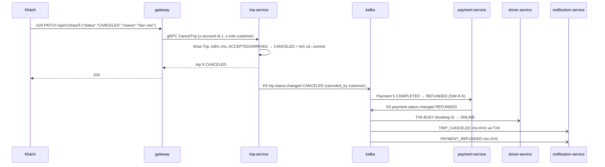

# Spec 17-18 — Chuyến đi, hủy chuyến / hủy booking, hoàn tiền, thông báo

> Vòng 2, viết 2026-10-05. Mục chấm **17, 18**, vế "thông báo" của **16**; bổ trợ **7** (consumer group `driver-service`, `payment-service`, `notification-service` trên Kafka UI), **19** (thông báo kết quả thanh toán), **22** (tài xế nhận thông báo duyệt — AC20), **28** (sai role → 403). FR10, FR12, FR17, FR21–FR24, FR36, FR40, FR41.
> Đầu vào: `CLAUDE.md` (Quyết định nghiệp vụ "Hoàn tiền", "Hủy và từ chối"; Quyết định kỹ thuật "Trả tài xế về rảnh sau chuyến", "Kết quả thanh toán, hoàn tiền", "Phát event Kafka", "Hệ thống ngoài", "Lỗi sai trạng thái"; Ràng buộc khi thi); `srs.md` (BR03, BR04.1, BR04.2, BR07, BR10; FR10, FR12, FR17, FR21–FR24, FR36, FR40, FR41; BRULE01, BRULE14–16; UC10, UC11, UC16, UC27, UC31, UC32; AC09–AC11, AC16, AC20, AC22–AC24; RTM08, RTM09, RTM12, RTM18, RTM23, RTM24); `docs/design/01` mục 6.4–6.7 (B12, B13, D9, T2–T8, M8–M12, N1–N5); `docs/design/02` K3–K7, mục 4.6, 6.2, 6.4, 7; `docs/design/03` mục 6, 7, 8, 9, 11.3, 14; `docs/design/04` A22, A27–A29, A33, mục 1, 1.10, 3, 4, 5.2; `docs/design/06` mục 16, 17, 18; ADR-014, ADR-017.
> Phụ thuộc: **spec 00**, **09-10**, **12-13-21-23**, **14-15-16-19-30** (đã code ở `116e16e`: bảng `trips`, `trip_status_history` đủ cột; rpc `CreateTrip`; K5 `ACCEPTED`; K1–K4, K6; `ReleaseDriver`; seed B1–B7, T3–T5).
> Ngoài phạm vi: A26 `ListTrips` (Q32 — làm sau 30 mục); S6 `GetDriverSummary` (FR14, mục 8.1); admin hủy chuyến (FR31, Q45); A34–A36 (spec 20).
> Ký hiệu: **[ĐC]** đã chốt; **[BA]** BA chọn (gom ở mục 9). Mã AC: **AC-CD** (chuyến, hủy), **AC-HT** (hoàn tiền, tài xế rảnh), **AC-TB** (thông báo).

## 1. Truy vết

| Mục chấm | BG | BR | FR | BRULE / quy tắc | UC | AC / RTM | NFR |
|---|---|---|---|---|---|---|---|
| 16 (vế thông báo) | BG03 | BR10 | FR06, FR21, FR22 | T8; N1, N2, N4 | UC16 | AC06 (phần báo) / RTM05 | NFR05, NFR14 |
| 17 Cập nhật trạng thái đúng trình tự | BG03 | BR03, BR07 | FR12, FR23 | T2, T3, T4, T8 | UC11, UC10 | AC10 / RTM09 | NFR10 |
| 17 (hệ quả) Tiền mặt, tài xế rảnh | BG04, BG01 | BR04.1, BR06 | FR17 | BRULE01, BRULE15; D9; M9, M10 | UC14 | AC11, AC23 / RTM12, RTM23 | NFR05 |
| 18 Khách hủy chuyến → CANCELED, các bên được báo | BG03, BG04 | BR01, BR04.2, BR10 | FR23, FR36, FR40 | BRULE14, BRULE16; T5, T6, T8; M8; N5 | UC27, UC31 | AC16, AC22 / RTM18, RTM23 | NFR05 |
| 18 Tài xế hủy chuyến đã nhận | BG03 | BR07 | FR40, FR41 | BRULE14, BRULE16; T5, T6; D9 | UC32, UC31 | AC24, AC22 / RTM24, RTM23 | NFR05 |
| 18 (phụ) Khách hủy booking chưa có tài xế | BG03, BG04 | BR01 | FR36, FR40 | BRULE14; B12, B13; M8, M11 | UC27, UC31 | AC16, AC22 / RTM18, RTM23 | NFR05, NFR14 |
| (bổ trợ 15) Không tìm được tài xế → hoàn tiền | BG04 | BR02, BR04.2 | FR10, FR40 | BRULE07, BRULE14; N3 | UC06, UC31 | AC09, AC22 / RTM08, RTM23 | NFR05 |
| (bổ trợ 19, 22) Báo thanh toán, báo kết quả duyệt | BG04, BG02 | BR10 | FR24, FR39 | M3, M12 | UC16, UC30 | AC12, AC13, AC20 / RTM13, RTM14, RTM21 | NFR05 |

## 2. Luồng nghiệp vụ

### 2.1 UC11 — Tài xế cập nhật trạng thái chuyến (A28, mục 17)

| | Nội dung |
|---|---|
| Tác nhân | Tài xế của chuyến (role `driver`) |
| Tiền điều kiện | Chuyến tồn tại, `driver_id` = tài xế trong token (T3) |
| Luồng chính | 1. Gửi `PATCH /api/v1/trips/{id}` `{"status":"<kế tiếp>"}`. 2. `trip-service` khóa dòng Trip (`FOR UPDATE`). 3. Trạng thái yêu cầu phải **đúng bước kế tiếp**: `ACCEPTED → ARRIVED → PICKED_UP → IN_PROGRESS → COMPLETED` (T2). 4. Cập nhật Trip (`PICKED_UP` ghi `started_at` — "chuyến bắt đầu", BRULE16; `COMPLETED` ghi `ended_at`) + một dòng `trip_status_history` (T4) — cùng giao dịch. 5. Commit → phát **K5** (`status`, `previous_status`) → 200 kèm `history` |
| Ngoại lệ | Nhảy cóc, lùi, gửi lại trạng thái đang có, chuyến đã `COMPLETED` / `CANCELED` → 409 `INVALID_STATUS_TRANSITION`. Không có chuyến → 404. Tài xế khác → 403 `NOT_OWNER`. Khách / admin → 403 `FORBIDDEN` (Gateway). Gửi K5 lỗi sau commit → vẫn 200, log `EVENT_PUBLISH_FAILED` (ADR-017) |
| Hậu điều kiện | `COMPLETED`: Driver trả tài xế về `ONLINE` (mục 2.6); Payment tiền mặt → `COMPLETED` (FR17), điện tử giữ nguyên — không hoàn (BRULE15); Notification báo khách (mục 2.7) |

### 2.2 UC27 — Khách hủy chuyến (A29, mục 18)

| | Nội dung |
|---|---|
| Tác nhân | Khách của chuyến (role `customer`) |
| Tiền điều kiện | Chuyến đang `ACCEPTED` hoặc `ARRIVED` — chưa đón khách (BRULE16, T5) |
| Luồng chính | 1. `PATCH /api/v1/trips/{id}` `{"status":"CANCELED","reason":"…"}`. 2. Khóa Trip; kiểm chủ (`customer_id`); kiểm trạng thái. 3. Trip `CANCELED`, `canceled_by = customer`, `cancel_reason`, `ended_at` + dòng lịch sử có `reason`. 4. Commit → **K5** `CANCELED` kèm `canceled_by` (không kèm lý do — 02 mục 6.1) → 200 |
| Ngoại lệ | Thiếu / rỗng `reason` → 400 `REASON_REQUIRED`. Từ `PICKED_UP` trở đi, hoặc đã `COMPLETED` / `CANCELED` → 409 `TRIP_NOT_CANCELABLE`. Không phải khách của chuyến → 403 `NOT_OWNER` |
| Hậu điều kiện | Payment: đã thu điện tử → `REFUNDED` (hoàn đủ — BRULE14); tiền mặt → `CANCELED`. Tài xế về `ONLINE`. Notification báo **cả khách và tài xế** (N5). Hệ thống **không** tìm tài xế khác (T6). Booking giữ `DRIVER_ASSIGNED` (R13 — không có đường Trip → Booking; A21 vẫn có `trip_id` để xem chuyến) |

### 2.3 UC32 — Tài xế hủy chuyến đã nhận (A29, FR41)

Như 2.2, khác: tác nhân là **tài xế của chuyến**, kiểm `driver_id`, `canceled_by = driver`. Khách được hoàn đủ (BRULE14), được báo (AC24), **phải đặt lại** — không tự ghép tài xế khác (T6, `CLAUDE.md`).

### 2.4 UC27 — Khách hủy booking chưa có tài xế (A22, mục 18 phụ)

| | Nội dung |
|---|---|
| Tác nhân | Khách của booking |
| Tiền điều kiện | Booking `PENDING_PAYMENT` hoặc `SEARCHING` (B13) |
| Luồng chính | 1. `PATCH /api/v1/bookings/{id}` `{"status":"CANCELED","reason":"…"}`. 2. Giao dịch: khóa Booking (`FOR UPDATE`) **rồi** Offer (quy ước khóa của spec 14 mục 5.6). 3. Booking `CANCELED`, `canceled_by = customer`, `cancel_reason`, `canceled_at`. 4. Offer `PENDING` (nếu có) → `VOIDED`, `responded_at`. 5. Commit → gọi `ReleaseDriver(driver_id, booking_id)` cho tài xế của Offer vừa `VOIDED`, phòng khi lần nhận dở dang còn giữ (lỗi chỉ log — như DX5) → phát **K4** → 200 |
| Ngoại lệ | Đã `DRIVER_ASSIGNED` → 409 `BOOKING_ALREADY_ASSIGNED` (phải hủy chuyến bằng A29). `CANCELED` / `NO_DRIVER_FOUND` → 409 `BOOKING_NOT_CANCELABLE`. Không phải chủ → 403 `NOT_OWNER`. Tài xế bấm nhận cùng lúc: hai bên khóa cùng một dòng Booking, bên đến sau thấy trạng thái mới → 409 (B12) |
| Hậu điều kiện | Payment: chưa thu → `CANCELED`; đã thu → `REFUNDED`; callback thành công đến **sau** khi đã `CANCELED` → ghi nhận rồi hoàn ngay (M11 — đã có ở spec 14). Bộ ghép dừng (thấy Booking không còn `SEARCHING`). Notification báo khách, báo tài xế có Offer bị hủy |

### 2.5 UC31, FR17 — Payment nghe K3, K4, K5 (hoàn tiền, tiền mặt)

| Event | Điều kiện | Payment đang | Làm gì | Phát |
|---|---|---|---|---|
| K3 `booking.no-driver-found` | — | `PENDING` / `FAILED` | → `CANCELED`, `status_reason = NO_DRIVER_FOUND` | — |
| | | `COMPLETED` (điện tử) | **Hoàn** → `REFUNDED`, `status_reason = NO_DRIVER_FOUND` | K6 `REFUNDED` |
| K4 `booking.canceled` | `canceled_by = customer` | `PENDING` / `FAILED` | → `CANCELED`, `BOOKING_CANCELED` | — |
| | | `COMPLETED` | **Hoàn** → `REFUNDED`, `BOOKING_CANCELED` | K6 `REFUNDED` |
| | `canceled_by = system` | (đã `CANCELED` vì quá hạn / hết lượt) | Bỏ qua (02 K4) | — |
| K5 `trip.status-changed` | `status = CANCELED` | `PENDING` (tiền mặt) | → `CANCELED`, `TRIP_CANCELED` | — |
| | | `COMPLETED` (điện tử) | **Hoàn** → `REFUNDED`, `TRIP_CANCELED` | K6 `REFUNDED` |
| | `status = COMPLETED` | `PENDING`, `method = CASH` | → `COMPLETED`, `paid_at` (FR17) | K6 `COMPLETED` |
| | | `COMPLETED`, `method = ONLINE` | Không đổi — **không hoàn** (BRULE15) | — |
| | `status` khác | — | Bỏ qua | — |
| Mọi event | Không có Payment cho `booking_id`; Payment đã `CANCELED` / `REFUNDED` | — | Bỏ qua, log `warn` khi không có Payment (chống lặp bằng trạng thái — 03 mục 11.3) | — |

"Hoàn" = adapter giả lập hoàn tiền (luôn thành công — ADR-014): `INSERT payment_transactions` `REFUND` `SIM-R-<payment_id>` `SUCCEEDED` + Payment `REFUNDED`, `refunded_at` — **cùng một hàm** với nhánh M11 của spec 14 (`refundNow(tx, payment, reason)`), chỉ khác `status_reason`. K6 không mang `CANCELED` ở bảng này vì Booking / Trip đã là bên báo tin (02 mục 6.2). Tài xế **từ chối** lời mời không có event nào → Payment không biết → không thể hoàn nhầm (BRULE15).

### 2.6 D9 — Driver nghe K5 (tài xế rảnh lại)

| `data.status` | Làm gì |
|---|---|
| `COMPLETED`, `CANCELED` | `UPDATE drivers SET availability = 'ONLINE', current_booking_id = NULL, updated_at = now() WHERE driver_id = $1 AND current_booking_id = $2` — **cùng câu lệnh với `ReleaseDriver`** (spec 14 mục 5.4). Không dòng nào đổi (event lặp, booking không khớp) → không làm gì (D9) |
| Khác | Bỏ qua |

Vì sao Kafka chứ không gRPC từ Trip [ĐC]: chuyến kết thúc ngoài đời thì phải được ghi nhận dù Driver đang dừng; Payment và Notification cũng cần sự kiện này. Đánh đổi: tài xế rảnh lại trễ ≈ 1 giây.

### 2.7 UC16 — Notification nghe K1–K7, người dùng xem thông báo (A33)

Notification **không quyết định nghiệp vụ**: mỗi event → 0–2 thông báo theo bảng sau, lưu vào MongoDB, ghi log một dòng (giả lập kênh gửi — ADR-014).

| Topic | Điều kiện | `type` | Người nhận | `title` | `body` (chỉ mã, trạng thái, số tiền) | `data` | Nguồn |
|---|---|---|---|---|---|---|---|
| K1 | — | `BOOKING_CREATED` | `customer_id` | Đã nhận yêu cầu đặt xe | `Booking {booking_id} đã được tiếp nhận` | `booking_id`, `status` | FR21 |
| K2 | — | `OFFER_CREATED` | `driver_id` | Có lời mời nhận chuyến | `Lời mời {offer_id} cho booking {booking_id}` | `offer_id`, `booking_id` | FR06 |
| K3 | — | `NO_DRIVER_FOUND` | `customer_id` | Không tìm được tài xế | `Booking {booking_id} không có tài xế phù hợp. Nếu đã thanh toán, bạn được hoàn đủ` | `booking_id` | FR10, N3 |
| K4 | — | `BOOKING_CANCELED` | `customer_id` | Booking đã hủy | `Booking {booking_id} đã hủy` | `booking_id`, `status` | FR36 |
| K4 | `pending_offer_driver_id` khác `null` | `OFFER_VOIDED` | `pending_offer_driver_id` | Lời mời không còn hiệu lực | `Booking {booking_id} đã bị khách hủy` | `booking_id` | 02 K4 |
| K5 | `ACCEPTED` | `TRIP_ACCEPTED` | `customer_id` | Tài xế đã nhận chuyến | `Tài xế {driver_id} đã nhận chuyến {trip_id}` | `trip_id`, `booking_id`, `driver_id`, `status` | FR22 — **mục 16** |
| K5 | `ARRIVED` | `TRIP_ARRIVED` | `customer_id` | Tài xế đã đến điểm đón | `Chuyến {trip_id}` | như trên | FR23, BR10 |
| K5 | `COMPLETED` | `TRIP_COMPLETED` | `customer_id` | Chuyến đi hoàn thành | `Chuyến {trip_id} đã hoàn thành` | như trên | FR23, BR10 |
| K5 | `CANCELED` | `TRIP_CANCELED` | `customer_id` **và** `driver_id` | Chuyến đi đã hủy | `Chuyến {trip_id} đã bị {khách hàng / tài xế} hủy` | như trên | FR36, FR41, N5 — **mục 18** |
| K5 | `PICKED_UP`, `IN_PROGRESS` | — | — | — | Không tạo (BR10 không liệt kê) | — | [BA CD8] |
| K6 | `COMPLETED` | `PAYMENT_COMPLETED` | `customer_id` | Thanh toán thành công | `Thanh toán {payment_id}: {amount} đ` | `payment_id`, `booking_id`, `amount`, `status` | FR17, FR24 |
| K6 | `FAILED` | `PAYMENT_FAILED` | `customer_id` | Thanh toán thất bại | `Thanh toán {payment_id} thất bại, bạn có thể thử lại` | như trên | FR19, M3 |
| K6 | `CANCELED` | `PAYMENT_CANCELED` | `customer_id` | Thanh toán đã hủy | `Thanh toán {payment_id} quá hạn / hết lượt thử` (theo `reason`) | như trên | BRULE17 |
| K6 | `REFUNDED` | `PAYMENT_REFUNDED` | `customer_id` | Đã hoàn tiền | `Đã hoàn {amount} đ cho thanh toán {payment_id}` | như trên | FR40 — **mục 18** |
| K7 | `result = APPROVED` / `REJECTED` | `APPLICATION_APPROVED` / `APPLICATION_REJECTED` | `driver_id` | Hồ sơ tài xế đã được duyệt / bị từ chối | `Hồ sơ tài xế {driver_id}` | `driver_id`, `status` | FR39, AC20 |

| Điểm | Quy định |
|---|---|
| Chống trùng (N4) | Mỗi thông báo: `updateOne({ event_id, recipient_id }, { $setOnInsert: … }, { upsert: true })` trên index UNIQUE (`event_id`, `recipient_id`). Event lặp → không tạo thêm |
| `created_at` | = `occurred_at` của event (lúc sự việc xảy ra), sai dạng thì `now()` [BA CD6] |
| Event sai dạng / thiếu ID / `type` không có trong bảng | Log `warn`, bỏ qua (giao lại cũng vẫn sai) |
| MongoDB lỗi | Ném lỗi để Kafka giao lại (không mất thông báo — N1) |
| Log "gửi" | `notification_created` kèm `type`, `recipient_id`, `event_id`; **không** ghi `title`, `body` |
| A33 | Người trong token chỉ xem thông báo có `recipient_id` = `x-account-id` (N2), mới nhất trước |

### 2.8 UC10 — Xem chuyến (A27, bổ trợ 16–18)

Chỉ đọc. Khách / tài xế của chuyến, hoặc admin (T7). Trả chuyến và lịch sử; **không** có thông tin sống của tài xế (S6 để sau — CD10).

## 3. Service tham gia

| Thành phần | Vai trò | Dữ liệu |
|---|---|---|
| `trip-service` | **Sở hữu** Trip: xem, tiến trạng thái, hủy; phát K5 mọi lần đổi | `trip-db` → `trips`, `trip_status_history` (không đổi schema) |
| `booking-service` | **Sở hữu** Booking: hủy khi chưa có tài xế, `VOIDED` Offer, phát K4; gọi `ReleaseDriver` (S3) | `booking-db` (không đổi schema) |
| `payment-service` | **Sở hữu** tiền: nghe K3, K4, K5 → hủy bỏ / hoàn / ghi nhận tiền mặt; phát K6 | `payment-db` (không đổi schema) |
| `driver-service` | **Sở hữu** trạng thái nhận chuyến: nghe K5 → `ONLINE` | `driver-db` (không đổi schema) |
| `notification-service` | **Sở hữu** thông báo: nghe K1–K7, lưu, A33 | `notification-db` → `notifications` (thêm 2 index) |
| `gateway` | Token, role đường dẫn + biến thể (A28 / A29), hình thức body, routing 4 route mới | — |
| `kafka` | K1–K7 có sẵn (spec 00); thêm 3 consumer group | — |

`auth-service`, `customer-service`, `rating-service` không đổi.

## 4. API REST tại Gateway

Xác thực theo spec 09-10 mục 4.1; quy tắc chung theo spec 12-13-21-23 mục 4.1 và spec 14 mục 4.1 (field lạ → `INVALID_INPUT`; enum không phân biệt hoa thường; mã `^[1-9][0-9]{0,15}$` → sai `INVALID_ID`; `page` ≥ 1, `limit` 1–50 → sai `INVALID_PAGINATION`; văn bản có `<` / `>` → `TEXT_CONTAINS_HTML`). Thêm:

| Field `reason` (A22, A29) | Quy định — Gateway **và** service |
|---|---|
| Thiếu, `null`, chuỗi rỗng sau khi cắt khoảng trắng | 400 `REASON_REQUIRED` |
| Không phải chuỗi | 400 `INVALID_INPUT` |
| Có `<` / `>` | 400 `TEXT_CONTAINS_HTML` |
| Dài hơn 255 ký tự (sau khi cắt) | 400 `INVALID_INPUT` |

### 4.1 `PATCH /api/v1/trips/{id}` — A28 tiến trạng thái (mục 17), A29 hủy (mục 18)

Role của đường dẫn: `customer`, `driver` (admin → 403 **trước** khi đọc body). Thứ tự ở Gateway (04 mục 1.10; spec 09-10 bước 6–8):

| # | Bước | Lỗi |
|---|---|---|
| 1 | Token, role đường dẫn | 401 / 403 `FORBIDDEN` |
| 2 | Mã trong đường dẫn | 400 `INVALID_ID` |
| 3 | Body là JSON object | 400 `INVALID_JSON` |
| 4 | Chọn biến thể theo `status` (đổi chữ hoa): `ARRIVED`, `PICKED_UP`, `IN_PROGRESS`, `COMPLETED` → **A28**; `CANCELED` → **A29**; thiếu / khác (`ACCEPTED`, `BUSY`, số…) | 400 `INVALID_INPUT` |
| 5 | Field theo biến thể: A28 chỉ `status` (có `reason` → 400 `INVALID_INPUT`); A29 `status` + `reason` (bảng `reason` ở trên) | 400 |
| 6 | Role biến thể: A28 chỉ `driver`; A29 `customer`, `driver` | 403 `FORBIDDEN` |

| Biến thể → rpc | Request | Response 200 |
|---|---|---|
| A28 → `UpdateTripStatus` | `{"status":"ARRIVED"}` | `{ "trip_id": 1000, "status": "ARRIVED", "history": [ { "status": "ACCEPTED", "at": "…Z" }, { "status": "ARRIVED", "at": "…Z" } ] }` |
| A29 → `CancelTrip` | `{"status":"CANCELED","reason":"ban viec"}` | `{ "trip_id": 5, "status": "CANCELED", "canceled_by": "customer", "reason": "ban viec" }` |

| Đường lỗi | HTTP | Mã | Ai trả |
|---|---|---|---|
| 401 các loại | 401 | `TOKEN_MISSING` / `TOKEN_INVALID` / `TOKEN_EXPIRED` / `TOKEN_REVOKED` | Gateway |
| Admin; khách gửi A28 | 403 | `FORBIDDEN` | Gateway |
| Mã sai định dạng; body không phải JSON | 400 | `INVALID_ID` / `INVALID_JSON` | Gateway |
| `status` thiếu / lạ; field lạ; `reason` sai kiểu / quá dài | 400 | `INVALID_INPUT` | Gateway + service |
| A29 thiếu / rỗng `reason` | 400 | `REASON_REQUIRED` | Gateway + service |
| `reason` có `<` / `>` | 400 | `TEXT_CONTAINS_HTML` | Gateway + service |
| Không có chuyến | 404 | `TRIP_NOT_FOUND` | Service |
| Không phải tài xế (A28) / khách hoặc tài xế (A29) của chuyến | 403 | `NOT_OWNER` | Service |
| A28 sai trình tự (nhảy cóc, lùi, lặp, đã kết thúc) | 409 | `INVALID_STATUS_TRANSITION` | Service |
| A29 từ `PICKED_UP` trở đi, đã `COMPLETED` / `CANCELED` | 409 | `TRIP_NOT_CANCELABLE` | Service |
| `trip-service` dừng | 503 | `SERVICE_UNAVAILABLE` | Gateway |

"Trùng" không áp dụng (đổi trạng thái; gửi lại là sai trạng thái → 409).

### 4.2 A27 `GET /api/v1/trips/{id}` — xem chuyến

| | |
|---|---|
| Token / role | Có / `customer` (chủ), `driver` (chủ), `admin` |
| rpc | `GetTrip` |
| Response 200 | `{ "trip_id": 1000, "booking_id": 1000, "status": "IN_PROGRESS", "vehicle": "CAR_4", "pay": "CASH", "fare": 45000, "customer_id": 1, "driver_id": 11, "from": [10.82, 106.68], "to": [10.83, 106.69], "started_at": "…Z", "created_at": "…Z", "history": [ { "status": "ACCEPTED", "at": "…Z" }, … ] }`. Có `from_address`, `to_address`, `ended_at`, `canceled_by`, `cancel_reason` khi có giá trị |

| Đường lỗi | HTTP | Mã |
|---|---|---|
| 401 các loại | 401 | như 4.1 |
| Mã sai định dạng | 400 | `INVALID_ID` |
| Không có | 404 | `TRIP_NOT_FOUND` |
| Không phải khách / tài xế của chuyến | 403 | `NOT_OWNER` |
| Service dừng | 503 | `SERVICE_UNAVAILABLE` |

Không có 403 `FORBIDDEN` theo role (cả ba role vào được). `GET /api/v1/trips` (A26) **chưa đăng ký** → 404 `ROUTE_NOT_FOUND` đến khi làm.

### 4.3 A22 `PATCH /api/v1/bookings/{id}` — khách hủy booking

| | |
|---|---|
| Token / role | Có / `customer` (chủ). Driver, admin → 403 trước body |
| rpc | `CancelBooking` |
| Request | `{"status":"CANCELED","reason":"doi y"}` — `status` khác `CANCELED` → 400 `INVALID_INPUT`; `reason` theo bảng đầu mục 4 |
| Response 200 | `{ "booking_id": 1001, "status": "CANCELED", "canceled_by": "customer" }` |

| Đường lỗi | HTTP | Mã | Ai trả |
|---|---|---|---|
| 401 các loại | 401 | như 4.1 | Gateway |
| Role `driver`, `admin` | 403 | `FORBIDDEN` | Gateway |
| Mã sai; body không phải JSON | 400 | `INVALID_ID` / `INVALID_JSON` | Gateway |
| `status` thiếu / khác `CANCELED`; field lạ | 400 | `INVALID_INPUT` | Gateway |
| `reason` | 400 | `REASON_REQUIRED` / `TEXT_CONTAINS_HTML` / `INVALID_INPUT` | Gateway + service |
| Không có booking | 404 | `BOOKING_NOT_FOUND` | Service |
| Không phải chủ | 403 | `NOT_OWNER` | Service |
| Đã có tài xế | 409 | `BOOKING_ALREADY_ASSIGNED` | Service |
| Đã hủy / không tìm được tài xế | 409 | `BOOKING_NOT_CANCELABLE` | Service |
| `booking-service` dừng | 503 | `SERVICE_UNAVAILABLE` | Gateway |

Không cần `payment-service` chạy: hoàn / hủy bỏ đi bằng K4 (NFR05).

### 4.4 A33 `GET /api/v1/notifications?page&limit` — thông báo của tôi (mục 16, 18)

| | |
|---|---|
| Token / role | Có / cả ba |
| rpc | `notification-service` — `ListNotifications` (lọc `recipient_id = x-account-id`) |
| Query cho phép | `page`, `limit` (mặc định 1, 10) |
| Thứ tự | `created_at` giảm dần, rồi `_id` giảm dần |
| Response 200 | `{ "data": [ { "type": "TRIP_ACCEPTED", "title": "Tài xế đã nhận chuyến", "body": "Tài xế 11 đã nhận chuyến 1000", "data": { "trip_id": 1000, "booking_id": 1000, "driver_id": 11, "status": "ACCEPTED" }, "created_at": "…Z" } ], "pagination": { "page": 1, "limit": 10, "total": 2, "total_pages": 1 } }` |
| Không trả | `_id`, `event_id`, `recipient_id` (không API nào cần) |

| Đường lỗi | HTTP | Mã |
|---|---|---|
| 401 các loại | 401 | như 4.1 |
| Query lạ | 400 | `INVALID_INPUT` |
| `page` / `limit` sai | 400 | `INVALID_PAGINATION` |
| `notification-service` dừng | 503 | `SERVICE_UNAVAILABLE` |

Không có thông báo → 200 `data: []`, `total: 0`. "Sai quyền", "không tìm thấy", "trùng" không áp dụng (danh sách "của tôi" lọc theo token — 04 mục 4).

## 5. Hợp đồng gRPC

Quy ước như spec 14 mục 5 (`longs: Number`, `defaults: false`; tên field proto = tên JSON; service tự kiểm lại; lỗi theo spec 00 mục 4.1, `details` = mã lỗi; thiếu `x-account-id` / `x-role` → `UNAUTHENTICATED` `IDENTITY_MISSING`; sai role → `PERMISSION_DENIED` `FORBIDDEN`).

### 5.1 `proto/trip.proto` — thêm 3 rpc vào `TripService`

| Message | Field |
|---|---|
| `TripIdRequest` | `int64 trip_id = 1;` |
| `HistoryItem` | `string status = 1; string at = 2;` |
| `Trip` | `int64 trip_id = 1; int64 booking_id = 2; string status = 3; string vehicle = 4; string pay = 5; int32 fare = 6; int64 customer_id = 7; int64 driver_id = 8; repeated double from = 9; repeated double to = 10; optional string from_address = 11; optional string to_address = 12; optional string started_at = 13; optional string ended_at = 14; optional string canceled_by = 15; optional string cancel_reason = 16; string created_at = 17; repeated HistoryItem history = 18;` |
| `UpdateTripStatusRequest` → `UpdateTripStatusResponse` | `int64 trip_id = 1; string status = 2;` → `int64 trip_id = 1; string status = 2; repeated HistoryItem history = 3;` |
| `CancelTripRequest` → `CancelTripResponse` | `int64 trip_id = 1; string reason = 2;` → `int64 trip_id = 1; string status = 2; string canceled_by = 3; string reason = 4;` |

| rpc | Ai gọi | Role | Lỗi (status → `details`) |
|---|---|---|---|
| `GetTrip` | GW (A27) | `customer`, `driver`, `admin` | `IDENTITY_MISSING`; `FORBIDDEN`; `INVALID_ARGUMENT` → `INVALID_ID`; `NOT_FOUND` → `TRIP_NOT_FOUND`; `PERMISSION_DENIED` → `NOT_OWNER`; `INTERNAL` |
| `UpdateTripStatus` | GW (A28) | `driver` | Như trên, thêm `INVALID_ARGUMENT` → `INVALID_INPUT` (`status` ngoài 4 giá trị); `FAILED_PRECONDITION` → `INVALID_STATUS_TRANSITION` |
| `CancelTrip` | GW (A29) | `customer`, `driver` | Như `GetTrip`, thêm `INVALID_ARGUMENT` → `REASON_REQUIRED` / `TEXT_CONTAINS_HTML` / `INVALID_INPUT`; `FAILED_PRECONDITION` → `TRIP_NOT_CANCELABLE` |

Thứ tự trong service: danh tính → dữ liệu vào (400) → `SELECT … FOR UPDATE` (404) → chủ (403) → trạng thái (409).

### 5.2 `proto/booking.proto` — thêm `CancelBooking`

| rpc | Vào | Ra | Role | Lỗi |
|---|---|---|---|---|
| `CancelBooking` | `int64 booking_id = 1; string reason = 2;` | `CancelBookingResponse { int64 booking_id = 1; string status = 2; string canceled_by = 3; }` | `customer` | `IDENTITY_MISSING`; `FORBIDDEN`; `INVALID_ARGUMENT` → `INVALID_ID` / `REASON_REQUIRED` / `TEXT_CONTAINS_HTML` / `INVALID_INPUT`; `NOT_FOUND` → `BOOKING_NOT_FOUND`; `PERMISSION_DENIED` → `NOT_OWNER`; `FAILED_PRECONDITION` → `BOOKING_ALREADY_ASSIGNED` / `BOOKING_NOT_CANCELABLE`; `INTERNAL` |

### 5.3 `proto/notification.proto` (mới) — `package cab.notification.v1; service NotificationService`

| Message | Field |
|---|---|
| `ListNotificationsRequest` | `int32 page = 1; int32 limit = 2;` |
| `NotificationData` | `optional int64 booking_id = 1; optional int64 trip_id = 2; optional int64 payment_id = 3; optional int64 offer_id = 4; optional int64 driver_id = 5; optional int32 amount = 6; optional string status = 7;` |
| `Notification` | `string type = 1; string title = 2; string body = 3; NotificationData data = 4; string created_at = 5;` |
| `Pagination` | Như `booking.proto` |
| `ListNotificationsResponse` | `repeated Notification data = 1; Pagination pagination = 2;` |

| rpc | Ai gọi | Role | Lỗi |
|---|---|---|---|
| `ListNotifications` | GW (A33) | cả ba | `IDENTITY_MISSING`; `FORBIDDEN`; `INVALID_ARGUMENT` → `INVALID_PAGINATION`; `INTERNAL` |

### 5.4 Cài đặt

| Service | Việc | Cách làm | Truy vết |
|---|---|---|---|
| trip | `UpdateTripStatus` | Bảng kế tiếp hằng số `NEXT = { ACCEPTED: ARRIVED, ARRIVED: PICKED_UP, PICKED_UP: IN_PROGRESS, IN_PROGRESS: COMPLETED }`. Một giao dịch: khóa → `NEXT[hiện tại] === yêu cầu` hay không → `UPDATE trips SET status, started_at = CASE PICKED_UP …, ended_at = CASE COMPLETED …, updated_at` → `INSERT trip_status_history (from, to, changed_by = x-account-id, 'driver', changed_at = now())` → đọc lịch sử theo `changed_at, history_id` → commit → K5 | T2–T4, T8 |
| trip | `CancelTrip` | Khóa → chủ theo role (`customer_id` / `driver_id`) → trạng thái ∈ {`ACCEPTED`, `ARRIVED`} → `UPDATE … status = 'CANCELED', canceled_by = role, cancel_reason, ended_at` → lịch sử có `reason` → commit → K5 có thêm `canceled_by` | T5, T6, BRULE16 |
| trip | K5 | Tổng quát hóa `publishStatusChanged(trip, previous, canceledBy?)` đã có: `data = { trip_id, booking_id, customer_id, driver_id, status, previous_status }` (+ `canceled_by` khi `CANCELED`); key `trip_id`. **Không** lý do, tọa độ | 02 K5 |
| trip | Log | `trip_status_changed` (`trip_id`, `from`, `to`), `trip_canceled` (`trip_id`, `canceled_by`). Không ghi `reason` | NFR08, NFR10 |
| booking | `CancelBooking` | Mục 2.4. `UPDATE driver_offers SET status = 'VOIDED', responded_at = now() WHERE booking_id = $1 AND status = 'PENDING' RETURNING driver_id`. K4: `{ booking_id, customer_id, canceled_by: 'customer', previous_status, pending_offer_driver_id }` — **không** có key `reason` (lý do là văn bản người dùng). Log `booking_canceled` (`booking_id`, `canceled_by`) | B12, B13; 02 K4 |
| booking | Bộ ghép, tiến trình hết hạn | Không đổi: đã dừng khi Booking không còn `SEARCHING`; Offer `VOIDED` không còn `PENDING` nên tiến trình hết hạn không chạm | spec 14 mục 5.6 |
| payment | Consumer | Một consumer, group `payment-service`, subscribe `booking.no-driver-found`, `booking.canceled`, `trip.status-changed`, `fromBeginning: true`. Mỗi event: một giao dịch `SELECT … FROM payments WHERE booking_id = $1 FOR UPDATE` → bảng mục 2.5 → commit → K6 nếu có. Message không phải JSON / thiếu `booking_id` → log, bỏ qua. Lỗi database → ném để Kafka giao lại | M8–M10, NFR14 |
| payment | Hoàn | Tách hàm `refundNow(tx, payment, reason)` dùng chung với nhánh M11 của `applyProviderResult`: `INSERT` `REFUND` `SIM-R-<id>` `SUCCEEDED` (UNIQUE `(payment_id) WHERE type = 'REFUND'` chặn hoàn lần hai — M8) → `updatePayment(REFUNDED, reason, refunded)`. Nhánh M11 giữ `status_reason` cũ | FR40, M8 |
| payment | Log | `payment_refunded` (`payment_id`, `reason`), `payment_canceled` (`payment_id`, `reason`), `cash_recorded` (`payment_id`) | NFR10 |
| driver | Consumer | Group `driver-service`, topic `trip.status-changed`, `fromBeginning: true`; mục 2.6; dùng lại hàm của `ReleaseDriver`. Log `driver_released` (`driver_id`, `booking_id`, `trip_status`) | D9, BRULE01 |
| notification | Consumer | Group `notification-service`, 7 topic K1–K7, `fromBeginning: true`; bảng mục 2.7 viết thành **một hàm thuần** `toNotifications(envelope) → [doc]` (test không cần MongoDB) | N1–N5 |
| notification | `ListNotifications` | `find({ recipient_id }).sort({ created_at: -1, _id: -1 }).skip().limit()` + `countDocuments` | N2 |
| cả ba consumer | Kafka dừng lúc khởi động | Thử nối lại mỗi 5 giây, **không chặn** gRPC (như `booking-service/src/consumer.js`) | NFR05 |

## 6. Giao tiếp giữa các service

| Đường | Kiểu | Lý do nghiệp vụ |
|---|---|---|
| Gateway → `trip-service` `GetTrip`, `UpdateTripStatus`, `CancelTrip` (G5) | gRPC | Tài xế / khách chờ kết quả ngay (trạng thái mới, lịch sử) |
| Gateway → `booking-service` `CancelBooking` (G4) | gRPC | Khách chờ biết đã hủy được chưa |
| Gateway → `notification-service` `ListNotifications` (G7) | gRPC | Người dùng chờ danh sách |
| `booking` → `driver` **S3** `ReleaseDriver` (khi hủy booking có Offer chờ) | gRPC | Nhả chỗ phòng khi lần nhận dở dang còn giữ; lặp an toàn (D9, DX5). Lỗi chỉ log, không chặn hủy |
| `trip` → Kafka **K5** (`ARRIVED` … `COMPLETED`, `CANCELED`) → driver, payment, notification | Kafka | **L2**: kết thúc / hủy chuyến không được lỗi theo Driver, Payment, Notification (NFR05). **L3**: ba bên cần [ĐC] |
| `booking` → Kafka **K4** (khách hủy) → payment, notification | Kafka | **L2**: hủy phải thành công dù Payment dừng (NFR05). **L3** |
| `booking` → Kafka **K3** (đã phát ở spec 14) → payment, notification | Kafka | **L1**: tiến trình nền kết luận; **L2**, **L3**. Spec này thêm **phần nghe** |
| `payment` → Kafka **K6** `REFUNDED`, `COMPLETED` (tiền mặt) → notification (booking bỏ qua vì không còn `PENDING_PAYMENT`) | Kafka | **L1**: kết quả đến sau một event khác; **L3** (FR24) |
| `driver` → Kafka **K7** (đã phát ở spec 12) → notification | Kafka | **L2** (AC20). Spec này thêm phần nghe |
| `trip` → `payment`, `trip` → `driver` bằng gRPC | **Không có** | Trip không được chờ hay lỗi theo hai bên này (R6, R8) |
| `trip` → `booking` | **Không có** | Booking kết thúc ở `DRIVER_ASSIGNED` (R13, GĐ-9b) |
| `payment` → `trip` | **Không có** | Không quy tắc nào của Trip phụ thuộc tiền (R9) |
| Bất kỳ ai → `notification` bằng gRPC | **Không có** | Không ai được chờ Notification (NFR05) |

Event (phong bì như spec 14 mục 6; key = ID đối tượng chính):

| Mã | Topic / key | `data` mới ở spec này |
|---|---|---|
| K4 | `booking.canceled` / `booking_id` | Khách hủy: `booking_id`, `customer_id`, `canceled_by` (`customer`), `previous_status` (`PENDING_PAYMENT` / `SEARCHING`), `pending_offer_driver_id` (số hoặc `null`) |
| K5 | `trip.status-changed` / `trip_id` | `trip_id`, `booking_id`, `customer_id`, `driver_id`, `status` (`ARRIVED` / `PICKED_UP` / `IN_PROGRESS` / `COMPLETED` / `CANCELED`), `previous_status`; `canceled_by` (`customer` / `driver`) khi `CANCELED` |
| K6 | `payment.status-changed` / `booking_id` | Không đổi dạng; thêm trường hợp `REFUNDED` (`previous_status` `COMPLETED`) và `COMPLETED` với `method` `CASH` |

Consumer group mới (thấy ở Kafka UI → Consumers, mục 7): `driver-service` (K5), `payment-service` (K3, K4, K5), `notification-service` (K1–K7).

## 7. Dữ liệu

| Database | Thay đổi | Ghi chú |
|---|---|---|
| `trip-db` | **Không** migration mới | Cột `started_at`, `ended_at`, `cancel_reason`, `canceled_by`, `trip_status_history.reason` đã có (DX18) |
| `booking-db` | Không | `VOIDED`, `canceled_by = 'customer'`, `cancel_reason` đã có |
| `payment-db` | Không | `status_reason` đã có `BOOKING_CANCELED`, `NO_DRIVER_FOUND`, `TRIP_CANCELED`; UNIQUE một lần hoàn (M8) đã có |
| `driver-db` | Không | CHECK D8 (`BUSY` ⇔ có `current_booking_id`) giữ đúng sau khi nhả |
| `notification-db` | Thêm 2 index vào `INDEXES` của `services/notification-service/src/migrate.js` (tạo khi khởi động, gọi lại an toàn) | Bảng dưới |

Collection `notifications` (03 mục 9): `event_id` (string UUID), `recipient_id` (long — dùng `Long` của driver `mongodb`), `type`, `title`, `body` (string), `data` (object chỉ chứa các key của `NotificationData`), `created_at` (date).

| Index | Tên | Phục vụ |
|---|---|---|
| `{ event_id: 1, recipient_id: 1 }` **unique** | `notifications_event_recipient_uq` | N4: event lặp không tạo thêm; một event vẫn cho hai người (TRIP_CANCELED) |
| `{ recipient_id: 1, created_at: -1 }` | `notifications_recipient_created_idx` | A33: của tôi, mới nhất trước, phân trang |

### 7.1 Seed cần cho 17, 18 (03 mục 14 — đã có, **không thêm**)

| Seed | Dùng ở |
|---|---|
| TX1 (11) `CAR_4` `ONLINE` tại (10.821, 106.68) | 15 → 16 → **17** (chuyến 1000) |
| **B5 / T5** `ACCEPTED`, KH1, TX6, `ONLINE`, Payment 5 `COMPLETED` 45 000 đ (`SIM-5-1`) | **18**: khách hủy → hoàn tiền, TX6 rảnh |
| TX6 (16) `BUSY`, `current_booking_id = 5` | 18: K5 `CANCELED` khớp booking 5 → `ONLINE` (D9) |
| B4 / T4, B3 / T3 `COMPLETED` | Đường lỗi: tiến / hủy chuyến đã xong → 409 |
| B1 (`CANCELED`), B2 (`NO_DRIVER_FOUND`), B3 (`DRIVER_ASSIGNED`) | Đường lỗi A22 |
| `notifications` | **Không seed**: thông báo chỉ sinh từ event thật — mục 16, 18 thấy thông báo vừa tạo |

## 8. Tiêu chí chấp nhận

Tiền điều kiện: spec 00, 09-10, 12-13-21-23, 14-15-16-19-30 đạt; `docker compose down -v` rồi `up -d --build`; `SIMULATION_MODE=true`. Token: `[KH1]`, `[KH2]`, `[TX1]`, `[TX3]`, `[TX6]`, `[AD1]`. "≈ 1 s" = kiểm sau tối đa 2 giây. Chuyến 1000 = chuyến tạo ở AC-DX-19 (payment của booking 1000 là `payment_id` trong response A19).

| AC | Mục | Given | When | Then |
|---|---|---|---|---|
| AC-TB-01 | 16 | Sau AC-DX-19 | A33 `[KH1]`; A33 `[TX1]` | 200 `data[0]` `TRIP_ACCEPTED`, `data` `{trip_id 1000, booking_id 1000, driver_id 11, status ACCEPTED}`, `data[1]` `BOOKING_CREATED` booking 1000; TX1: `OFFER_CREATED` `offer_id` 1000 (AC06 phần báo, FR21, FR22) |
| AC-CD-01 | 17 | Sau AC-TB-01 | A28 `PATCH /api/v1/trips/1000` `{"status":"COMPLETED"}` `[TX1]` | 409 `INVALID_STATUS_TRANSITION`; A27 vẫn `ACCEPTED`; `trip.status-changed` không có message mới |
| AC-CD-02 | 17 | Sau AC-CD-01 | `{"status":"ARRIVED"}` | 200 `ARRIVED`, `history` 2 mục `ACCEPTED`, `ARRIVED`; K5 `ARRIVED`, `previous_status` `ACCEPTED`; ≈ 1 s A33 `[KH1]` có `TRIP_ARRIVED` |
| AC-CD-03 | 17 | Sau AC-CD-02 | `"PICKED_UP"`; `"IN_PROGRESS"`; A27 | 200 ×2; A27 có `started_at`, `history` 4 mục; A33 `[KH1]` **không** có thông báo mới (CD8) |
| AC-CD-04 | 17, AC11 | Sau AC-CD-03 | `"COMPLETED"`; ≈ 1 s sau A14 `drivers/11` `[AD1]`; A30 payment booking 1000 `[KH1]`; A33 `[KH1]` | 200 `COMPLETED`, `history` **5** mục đúng thứ tự; TX1 `ONLINE`; Payment `CASH` **`COMPLETED`**, có `paid_at`, không giao dịch; K6 `COMPLETED` `method` `CASH`; A33: `PAYMENT_COMPLETED`, `TRIP_COMPLETED` (mới nhất trước) |
| AC-CD-05 | 17 (409) | Sau AC-CD-04 | A28 `COMPLETED` lại; `ARRIVED`; A29 `{"status":"CANCELED","reason":"x"}` `[TX1]` | 409 `INVALID_STATUS_TRANSITION` ×2; 409 `TRIP_NOT_CANCELABLE` |
| AC-CD-06 | 17 (400/401/403/404) | Chuyến 1000 | `trips/1000` `[TX3]` `ARRIVED`; `trips/999`; `trips/abc`; `{"status":"ACCEPTED"}`; `{"status":"BUSY"}`; body rỗng; `{"status":"ARRIVED","reason":"x"}`; `[KH1]` `{"status":"ARRIVED"}`; `[AD1]` không body; không token | 403 `NOT_OWNER`; 404 `TRIP_NOT_FOUND`; 400 `INVALID_ID`; 400 `INVALID_INPUT` ×4; 403 `FORBIDDEN` ×2; 401 `TOKEN_MISSING` |
| AC-CD-07 | 17 (A27) | Chuyến 1000 | A27 `[KH1]`, `[TX1]`, `[AD1]`, `[KH2]`, `[TX3]`, `trips/999` | 200 ×3 (`pay` `CASH`, `fare` 45000, `history`); 403 `NOT_OWNER` ×2; 404 `TRIP_NOT_FOUND` |
| AC-CD-08 | 17 (503) | `docker compose stop trip-service` | A28 bất kỳ | 503 `SERVICE_UNAVAILABLE`. `start` lại |
| AC-CD-09 | **18** | Seed T5 | A29 `PATCH /api/v1/trips/5` `[KH1]` `{"status":"CANCELED","reason":"ban viec"}` | 200 `{trip_id 5, CANCELED, canceled_by customer, reason "ban viec"}`; `trip_status_history` thêm dòng `ACCEPTED → CANCELED`, `reason`, role `customer`; K5 `CANCELED`, `canceled_by` `customer`, **không** có lý do |
| AC-HT-01 | **18** (AC22) | ≈ 1 s sau AC-CD-09 | A30 `payments/5` `[KH1]`; A14 `drivers/16` `[AD1]` | Payment `REFUNDED`, `status_reason` `TRIP_CANCELED`, `refunded_at`; `transactions`: `SIM-5-1` `CHARGE`, `SIM-R-5` `REFUND` `SUCCEEDED` 45000; K6 `REFUNDED`; TX6 `ONLINE` |
| AC-TB-02 | **18** (AC16, N5) | Sau AC-HT-01 | A33 `[KH1]`; đăng nhập `0910000006` → A33 `[TX6]` | KH1: `data[0]` `PAYMENT_REFUNDED` (`payment_id` 5, `amount` 45000), `data[1]` `TRIP_CANCELED` (`trip_id` 5); TX6: `TRIP_CANCELED` trip 5 |
| AC-CD-10 | 18 (400/403/409) | Sau AC-CD-09 | A29 `trips/5` lại; `{"status":"CANCELED"}`; `"reason":"  "`; `"reason":"<b>x</b>"`; `reason` 256 ký tự; `"reason":5`; `trips/4` `[KH1]`; `trips/5` `[KH2]`; `[AD1]` | 409 `TRIP_NOT_CANCELABLE` (Payment 5 vẫn một `REFUND`); 400 `REASON_REQUIRED` ×2; 400 `TEXT_CONTAINS_HTML`; 400 `INVALID_INPUT` ×2; 409 `TRIP_NOT_CANCELABLE`; 403 `NOT_OWNER`; 403 `FORBIDDEN` |
| AC-CD-11 | 18 (BRULE16) | Booking CASH mới KH1, TX1 nhận, chuyến C tiến tới `PICKED_UP` | A29 C `[KH1]`; A29 C `[TX1]` | 409 `TRIP_NOT_CANCELABLE` cả hai; chuyến vẫn `PICKED_UP` |
| AC-CD-12 | 18 (FR41, AC24) | Booking `ONLINE` mới KH1, A31 body rỗng → `COMPLETED`, TX1 nhận → chuyến D `ACCEPTED` | A29 D `[TX1]` `{"status":"CANCELED","reason":"xe hong"}`; ≈ 1 s sau A30, A14 `drivers/11`, A33 `[KH1]`, A21 booking, A23 `[TX1]`/`[TX3]` | 200 `canceled_by` `driver`; Payment `REFUNDED` (`TRIP_CANCELED`); TX1 `ONLINE`; KH1 có `TRIP_CANCELED`, `PAYMENT_REFUNDED`; booking vẫn `DRIVER_ASSIGNED` (R13); **không** Offer mới cho booking đó (T6) |
| AC-CD-13 | 18 (tiền mặt) | Booking CASH mới, TX1 nhận, chuyến E `ARRIVED` | A29 E `[KH1]`; ≈ 1 s A30 | 200; Payment `CANCELED` (`TRIP_CANCELED`), **không** có giao dịch hoàn, **không** K6 mới |
| AC-CD-14 | 18 phụ | Booking `ONLINE` mới KH1 (`PENDING_PAYMENT`, payment P) | A22 `PATCH /api/v1/bookings/{id}` `{"status":"CANCELED","reason":"doi y"}`; ≈ 1 s A21, A30 P, A31 P `k1`, A33 `[KH1]` | 200 `{booking_id, CANCELED, customer}`; K4 `canceled_by` customer, `previous_status` `PENDING_PAYMENT`, `pending_offer_driver_id` `null`, không key `reason`; A21 `cancel_reason` "doi y"; P `CANCELED` (`BOOKING_CANCELED`), không K6; 409 `PAYMENT_CANCELED`; `BOOKING_CANCELED` |
| AC-CD-15 | 18 phụ (VOIDED) | Booking CASH mới KH1, Offer `PENDING` cho TX1 | A22; A23 `[TX1]`; A23 `?status=VOIDED` `[TX1]`; A24 Offer đó; A14 `drivers/11`; A30; A33 `[TX1]` | 200; `data: []`; Offer `VOIDED`; 409 `INVALID_STATUS_TRANSITION`; TX1 `ONLINE`; Payment `CANCELED`; `OFFER_VOIDED`. K4 `pending_offer_driver_id` 11 |
| AC-CD-16 | 18 phụ (đã trả) | Booking `ONLINE` mới, A31 body rỗng → `COMPLETED`, booking `SEARCHING` (Offer chờ) | A22; ≈ 1 s A30 | 200; `REFUNDED` (`BOOKING_CANCELED`), `SIM-R-<id>`; K6 `REFUNDED`; A33 `[KH1]` `PAYMENT_REFUNDED` |
| AC-CD-17 | 18 phụ (M11) | Booking `ONLINE` mới (payment Q), A31 `k1` `MANUAL` → `PENDING` | A22; ≈ 1 s A30; A32 `{"txn_id":"SIM-Q-1"}`; A21 | 200; Q `CANCELED`; 200 `txn_status` `SUCCEEDED`, `status` **`REFUNDED`**; booking vẫn `CANCELED` (K6 `REFUNDED` bị Booking bỏ qua) |
| AC-CD-18 | 18 phụ (lỗi) | Seed | A22 `bookings/3`; `bookings/1`; `bookings/2`; `bookings/7` thiếu `reason`; `{"status":"SEARCHING","reason":"x"}`; `bookings/7` `[KH2]`; `bookings/999`; `bookings/abc`; `[TX1]`; `[AD1]`; không token | 409 `BOOKING_ALREADY_ASSIGNED`; 409 `BOOKING_NOT_CANCELABLE` ×2; 400 `REASON_REQUIRED`; 400 `INVALID_INPUT`; 403 `NOT_OWNER`; 404 `BOOKING_NOT_FOUND`; 400 `INVALID_ID`; 403 `FORBIDDEN` ×2; 401 |
| AC-CD-19 | 18 (NFR05) | `docker compose stop payment-service` | A22 trên booking `ONLINE` mới đã trả; A29 trên chuyến `ONLINE` mới; `start payment-service`; ≈ 3 s A30 cả hai | 200, 200 (hủy không lỗi theo Payment); sau khi Payment chạy lại cả hai `REFUNDED` |
| AC-HT-02 | 15 (AC09, AC22) | — | A19 `{"from":[10.90,106.68],"to":[10.91,106.69],"pay":"online"}` `[KH1]` → A31 body rỗng; ≈ 1 s A21, A30, A33 `[KH1]` | `NO_DRIVER_FOUND`; Payment `REFUNDED` (`NO_DRIVER_FOUND`); KH1 có `NO_DRIVER_FOUND`, `PAYMENT_REFUNDED`. Với `pay` mặc định `CASH`: Payment `CANCELED` (`NO_DRIVER_FOUND`) |
| AC-HT-03 | BRULE15 (AC23) | Chuyến `ONLINE` đã trả, tiến tới `COMPLETED`; một booking có Offer bị TX1 từ chối (AC-DX-13) | A30 hai thanh toán | Cả hai giữ nguyên (`COMPLETED` / `PENDING`), **không** giao dịch `REFUND`, không K6 `REFUNDED` |
| AC-HT-04 | NFR14 (event lặp) | Sau AC-HT-01 | Kafka UI → topic `trip.status-changed` → **Produce** lại y hệt message `CANCELED` của trip 5 (cùng `event_id`) | Payment 5 vẫn **một** `REFUND`; TX6 không đổi; A33 `[KH1]`, `[TX6]` **không** thêm thông báo |
| AC-HT-05 | D9 | TX1 đang `BUSY` cho booking X | Produce K5 `COMPLETED` với `driver_id` 11, `booking_id` ≠ X | TX1 vẫn `BUSY` với X |
| AC-HT-06 | NFR05 | `docker compose stop driver-service` | Chuyến `ACCEPTED` mới → A28 đến `COMPLETED`; `start driver-service`; ≈ 3 s A14 | 200 mọi bước; tài xế `ONLINE` sau khi Driver chạy lại |
| AC-TB-03 | 19, 22 (AC13, AC20) | — | A31 `FAILED` trên payment mới; A15 duyệt tài xế mục 21 → tài xế đó A33; A16 từ chối TX7 → đăng nhập `0910000007` A33 | `PAYMENT_FAILED`; `APPLICATION_APPROVED`; `APPLICATION_REJECTED` |
| AC-TB-04 | 16, 18 (phân trang, N2) | Sau các AC trên | A33 `[KH1]` `?limit=1`; `?limit=1&page=2`; `?limit=abc`; `?page=0`; `?foo=1`; `[AD1]`; `[KH2]`; không token | 200 một mục, `total` > 1; mục kế tiếp; 400 `INVALID_PAGINATION` ×2; 400 `INVALID_INPUT`; 200 `data: []`, `total` 0; chỉ thông báo có `booking_id` của KH2; 401 |
| AC-TB-05 | NFR05, N1 | `docker compose stop notification-service` | A19 → A24; A33 `[KH1]`; `start`; ≈ 3 s A33 | 201, 200 (đặt / nhận không lỗi); 503 `SERVICE_UNAVAILABLE`; sau khi chạy lại có `BOOKING_CREATED`, `TRIP_ACCEPTED` |
| AC-TB-06 | N4 | Sau AC-TB-05 | `docker compose restart notification-service`; A33 `[KH1]` | `total` không đổi |
| AC-TB-07 | 7 | Sau các AC trên | Kafka UI → Consumers | Có group `driver-service`, `payment-service`, `notification-service` (cùng `booking-service`), lag 0; topic K5 có message `ARRIVED` … `CANCELED`; không message nào chứa lý do hủy, tọa độ, họ tên |
| AC-TB-08 | NFR08, NFR10 | Sau các AC trên | `docker compose logs notification-service trip-service` | Có `notification_created`, `trip_status_changed`, `trip_canceled`; không có `title`, `body`, `reason` |

Tổng: **33 tiêu chí** (19 AC-CD, 6 AC-HT, 8 AC-TB).

### 8.1 Chuỗi gõ tay khi thi

Ước lượng theo 04 mục 5 / 06 mục 5: sửa tab 3–5 s, gõ body PATCH ≈ 15 s, nói song song, thêm 5–10 s sau khi thấy kết quả. **Ổn** ≤ 25 s; **Sát** 26–32 s; **Vượt** > 32 s.

| Mục | # | Request | Kết quả | Thời gian |
|---|---|---|---|---|
| **16** | 1 | Tab chuyến: `PATCH`, URL `offers/1000`, body `{"status":"ACCEPTED"}` (spec 14) | 200 `ACCEPTED`, `DRIVER_ASSIGNED`, `trip_id` 1000 | ~10 s |
| | 2 | Tab GET (đang `[KH1]`, URL `bookings?limit=2&page=2` của mục 14): sửa URL thành `notifications` | 200 `data[0]` `TRIP_ACCEPTED`, `data[1]` `BOOKING_CREATED` | ~5 s + nói ~10 s → **~26 s, Sát** |
| **17** | 1 | Tab chuyến: URL `trips/1000`, body `{"status":"COMPLETED"}` | **409 `INVALID_STATUS_TRANSITION`** | ~6 s |
| | 2–5 | Sửa một từ: `ARRIVED` → `PICKED_UP` → `IN_PROGRESS` → `COMPLETED` | 200 ×4; lần cuối `history` 5 mục | 4 × ~4 s + nói ~8 s → **~30 s, Sát** (như 06) |
| | (6) | (tùy chọn) Tab GET → Send | `PAYMENT_COMPLETED`, `TRIP_COMPLETED` (tiền mặt đã ghi nhận) | +5 s |
| **18** | 1 | **Tab GET** (đang `[KH1]`): method `PATCH`, URL `trips/5`, Body raw `{"status":"CANCELED","reason":"ban viec"}` | 200 `CANCELED`, `canceled_by` customer | ~15 s |
| | 2 | Cùng tab: method `GET`, URL `notifications` (body để nguyên — Gateway bỏ qua) | `PAYMENT_REFUNDED` (payment 5, 45000), `TRIP_CANCELED` (trip 5) | ~5 s + nói ~8 s → **~28 s, Sát** |
| | (3) | (tùy chọn) Tab đăng nhập TX1 sửa `0910000006` → copy token → tab GET `[TX6]` Send | `TRIP_CANCELED` trip 5 | +15 s |
| | (4) | (tùy chọn, hủy booking) Tab đặt xe thêm `"pay":"ONLINE"` → copy `booking_id` → tab GET `PATCH bookings/<id>` `{"status":"CANCELED","reason":"doi y"}` | 201 `PENDING_PAYMENT`; 200 `CANCELED` | +25 s |

Vì sao mục 18 dùng **tab GET** thay vì tab chuyến (06 mục 18): tab chuyến đang mang token TX1, đổi sang KH1 phải sang tab đăng nhập, Send, copy, dán (+8–10 s → ~36 s, Vượt). Tab GET đã mang token KH1 nên chỉ đổi method / URL / body (CD-Q2).

Câu nói gợi ý: **16** — "Trip phát `trip.status-changed`; Notification nghe Kafka nên đặt xe, nhận chuyến không bao giờ lỗi vì Notification". **17** — "Một đường dẫn, đổi `status`; sai bước là `FAILED_PRECONDITION` → 409; xong chuyến thì Driver và Payment tự nghe Kafka". **18** — "Chỉ hủy trước khi đón khách; Trip không gọi Payment mà phát event, Payment dừng thì hủy vẫn thành công, hoàn tiền khi Payment chạy lại".

Ràng buộc thứ tự (06 mục 3): 16 → 17 liền nhau (chuyến 1000); 18 chỉ làm **một lần** trên T5 (chạy lại phải `down -v`); 23 sau 17 (TX1 đã `ONLINE` nhờ K5).

Kết quả mong đợi theo phiếu chấm: **16** — nhận chuyến có `trip_id`, khách thấy thông báo `TRIP_ACCEPTED`; **17** — đúng trình tự thì 200 và lịch sử đủ 5 trạng thái, sai trình tự 409; **18** — chuyến `CANCELED` có lý do, khách thấy `TRIP_CANCELED` và `PAYMENT_REFUNDED`, tài xế thấy `TRIP_CANCELED` (các bên được báo).

### 8.2 Có thể làm sau (vượt phiếu chấm)

| Việc | Vì sao để sau |
|---|---|
| A26 `GET /api/v1/trips` (FR30, admin giám sát) | Q32: ngoài phiếu |
| S6 `GetDriverSummary` → khối `driver` trong A27 (FR14, UC10) | Ngoài phiếu; A27 đã có `driver_id` |
| Admin hủy / xử lý sự cố chuyến (FR31, UC23) | Q45 chưa thiết kế |
| A29 và A28 đồng thời trên cùng chuyến → một thắng, một 409 | `FOR UPDATE` bảo đảm; khó demo tay |
| A22 và A24 đồng thời (B12) | Khóa dòng Booking đã có từ spec 14 |
| Kafka dừng đúng lúc sau commit → mất K5 / K4 (không hoàn tiền, tài xế kẹt `BUSY`) | Rủi ro đã chấp nhận (ADR-017); xử lý tay theo log `EVENT_PUBLISH_FAILED` |
| Đánh dấu đã đọc thông báo; kênh gửi thật (SMS, push) | Không FR nào yêu cầu; ADR-014 |
| Unit test `toNotifications` cho 15 loại thông báo ở mục 2.7; bảng `NEXT` của Trip | Test-agent làm ở unit test |

## 9. Quyết định BA và câu hỏi còn mở

### 9.1 BA tự chọn

| # | Quyết định | Lý do | Nếu đổi thì sửa |
|---|---|---|---|
| CD1 | A28 gửi lại đúng trạng thái đang có → 409, không phải 200 | Một quy tắc "chỉ bước kế tiếp"; không cần chống lặp riêng | Mục 2.1, 5.4 |
| CD2 | Một mã `TRIP_NOT_CANCELABLE` cho mọi trạng thái không hủy được (gồm `COMPLETED`, `CANCELED`) | Ít mã phải nhớ; 04 chỉ có mã này | Mục 4.1 |
| CD3 | Hủy booking: Offer `PENDING` → `VOIDED` + `ReleaseDriver` phòng khi (lỗi chỉ log) | Dọn trường hợp nhận dở dang như DX5; lặp an toàn | Mục 2.4 |
| CD4 | Payment: một bảng xử lý chung cho K3 / K4 / K5; chưa thu → `CANCELED` **không** K6; đã thu → `REFUNDED` + K6 | Đúng 01 mục 6.6 và 02 K6 (chỉ phát `CANCELED` khi quá hạn / hết lượt) | Mục 2.5 |
| CD5 | `refundNow` dùng chung với nhánh M11 | Một chỗ hoàn tiền, một quy tắc M8 | Mục 5.4 |
| CD6 | `created_at` của thông báo = `occurred_at` của event | Thứ tự theo lúc sự việc xảy ra, kể cả khi Notification dừng rồi đọc bù | Mục 2.7 |
| CD7 | Chống trùng bằng `updateOne` + `$setOnInsert` + `upsert` | Một lệnh, không phải bắt lỗi trùng khóa | Mục 2.7 |
| CD8 | Không thông báo `PICKED_UP`, `IN_PROGRESS` | BR10 chỉ liệt kê đến điểm đón, hoàn thành | Mục 2.7 |
| CD9 | `TRIP_CANCELED` gửi cho **cả** khách và tài xế (kể cả người hủy) | Đơn giản, mục 18 khách thấy ngay; N5 vẫn đúng | Mục 2.7 |
| CD10 | A27 không có khối `driver` (chưa làm S6) | S6 phục vụ FR14 ngoài phiếu, 02 ghi "làm sau cùng" | Mục 2.8, 4.2 |
| CD11 | Ba consumer group mới đều `fromBeginning: true` | Không mất event phát trước khi group được tạo (Compose khởi động lệch nhau); consumer lặp an toàn | Mục 5.4 |
| CD12 | K5 `COMPLETED` tiền mặt → K6 `COMPLETED` (`method` `CASH`) | FR17 "ghi nhận", FR24 báo khách; Booking bỏ qua vì không còn `PENDING_PAYMENT` | Mục 2.5 |
| CD13 | Thông báo `OFFER_VOIDED` cho tài xế đang có Offer chờ khi khách hủy booking | 02 K4 "báo tài xế đang giữ Offer chờ" | Mục 2.7 |
| CD14 | A33 không trả `_id`, `event_id`, `recipient_id` | Không API nào theo mã thông báo; bớt dữ liệu | Mục 4.4 |
| CD15 | `reason` > 255 → `INVALID_INPUT` (không mã mới) | Cùng cách với địa chỉ ở spec 14 | Mục 4 |

### 9.2 Chỗ thiết kế chưa khớp hoặc thiếu (ghi lại, không tự sửa design)

| # | Chỗ | Ghi chú | Spec theo |
|---|---|---|---|
| CD-M1 | 06 mục 18 và 04 mục 5.2 dùng **tab chuyến** + token KH1 cho A29 | Phải đổi token → ~36 s, Vượt. Spec dùng **tab GET** (~28 s). **Đã sửa 04, 06 (2026-10-05, CD-Q2)** | Tab GET |
| CD-M2 | 04 A27 có khối `driver` (qua S6) | Spec để sau (CD10) | Không có `driver` |
| CD-M3 | 03 mục 9 "danh sách `type` chốt ở spec" | Chốt 15 loại ở mục 2.7 (thêm `OFFER_VOIDED`, `TRIP_ARRIVED`, `TRIP_COMPLETED`, `PAYMENT_FAILED`, `PAYMENT_CANCELED`, `APPLICATION_REJECTED`, `BOOKING_CANCELED`) | Mục 2.7 |
| CD-M4 | 01 N5 "bên **còn lại** được báo" | Spec báo cả hai (CD9) | Mục 2.7 |
| CD-M5 | 03 mục 9 không nói `created_at` lấy từ đâu | CD6 | Mục 2.7 |
| CD-M6 | `srs.md` RTM không có dòng cho FR21–FR24 (BR10, UC16) | **Đã thêm RTM29 (2026-10-05):** BG03 / BR10 / FR21–FR24 / — / UC16 / AC16, AC20 (CD-Q6) | — |
| CD-M7 | 02 mục 7 bước 8 ghi A29 `trips/5` không kèm cách đổi token | Như CD-M1; **đã sửa 02 (2026-10-05)** | — |

### 9.3 Câu hỏi còn mở

Sinh viên chốt **2026-10-05** theo đề xuất của BA. Hành vi của spec không đổi (các đề xuất đã được viết sẵn ở mục 2–8); chỉ còn CD-Q7 cần hỏi lại giảng viên.

| # | Câu hỏi | Lựa chọn | Đã chốt | Hỏi ai |
|---|---|---|---|---|
| CD-Q1 | Mục 16: xem thông báo (A33) là request **chính** hay tùy chọn? | (a) Chính — phiếu ghi Notification cho mục 16 (~26 s, Sát); (b) tùy chọn như 06 (~18 s) | **Đã chốt (a)** (sinh viên 2026-10-05); đã sửa 06 mục 16 | — |
| CD-Q2 | Mục 18 gõ A29 ở tab nào? | (a) Tab GET đang mang token KH1 (~28 s); (b) tab chuyến như 06, đổi token (~36 s) | **Đã chốt (a)** (sinh viên 2026-10-05); đã sửa 04 mục 5.2, 06 mục 18, 02 mục 7 | — |
| CD-Q3 | `TRIP_CANCELED` gửi cho ai? | (a) Cả hai bên; (b) chỉ bên không hủy (đúng chữ N5) | **Đã chốt (a)** (sinh viên 2026-10-05) — mục 18 khách thấy ngay, không cần đăng nhập TX6 | — |
| CD-Q4 | Booking sau khi chuyến bị hủy vẫn `DRIVER_ASSIGNED` (R13) — chấp nhận? | (a) Giữ; (b) thêm Booking nghe K5 | **Đã chốt (a)** (sinh viên 2026-10-05) — không thêm đường giao tiếp không có FR. Câu trả lời vấn đáp: *"Booking là yêu cầu đặt xe; nhiệm vụ của nó kết thúc khi đã bàn giao cho một chuyến (`DRIVER_ASSIGNED`). Từ đó trạng thái thật của chuyến — kể cả `CANCELED` — nằm ở Trip, xem bằng `GET /api/v1/trips/{id}`. Cho Booking nghe thêm `trip.status-changed` chỉ để chép lại trạng thái là thêm một đường giao tiếp không có FR nào cần."* | — |
| CD-Q5 | Hết hạn / hết lượt thanh toán sinh **hai** thông báo (`PAYMENT_CANCELED` từ K6, `BOOKING_CANCELED` từ K4) | (a) Giữ cả hai (hai đối tượng khác nhau); (b) bỏ thông báo khi K4 `canceled_by = system` | **Đã chốt (a)** (sinh viên 2026-10-05) | — |
| CD-Q6 | Thêm RTM29 cho FR21–FR24 vào `srs.md`? | (a) Thêm; (b) để nguyên | **Đã chốt (a)** (sinh viên 2026-10-05); đã thêm RTM29 vào `srs.md` | — |
| CD-Q7 | Admin có được hủy chuyến (FR31) không? | (a) Không, 403 như 04 mục 3; (b) thiết kế thêm | **Đã chốt (a)** (sinh viên 2026-10-05) trong phạm vi 30 mục (Q45): admin gọi A29 → 403. **Vẫn hỏi lại giảng viên** khi có dịp | GV |
